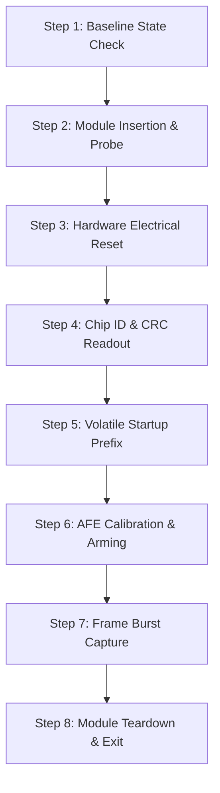

# FTE3600 Hardware Validation Plan (Post-Stage D18)

**Target Platform:** Dynabook Satellite Pro C40-J (`PYS46G-06J02D`)  
**Fingerprint Silicon:** FocalTech FT9362 / FW9369 (`spi-FTE3600:00`)  
**Host Controller:** Intel LPSS SPI2 controller (`pxa2xx-spi.2` / `idma64`, PCI `0000:00:1e.3`)  
**Kernel:** Linux `7.2.8-9-omarchy` (x86_64 SMP PREEMPT_DYNAMIC)  
**Status:** **NOT AUTHORIZED / PENDING HUMAN OPERATOR SIGN-OFF**

---

## 1. Safety Gate Prerequisite

> [!CAUTION]
> **MANDATORY HOLD:**
> This document specifies the exact protocol to be executed **only** after an explicit, separate authorization is granted by the human operator. Under Stage D18, this plan is documented for readiness but **strictly barred from execution**.

---

## 2. Step-by-Step Hardware Validation Protocol



### Step 1: Pre-Validation Baseline Invariant Verification
1. Ensure the driver module is not loaded:
   ```bash
   lsmod | grep fte3600
   # Expected: Empty
   ```
2. Verify SPI bus 1 statistics:
   ```bash
   grep -E "transfers|bytes|errors" /sys/bus/spi/devices/spi1/statistics/*
   # Verify clean counters
   ```

### Step 2: Driver Insertion and ACPI Match Verification
1. Insert the compiled module:
   ```bash
   sudo insmod kernel/fte3600.ko
   ```
2. Check `dmesg` output:
   - Verify ACPI match on `FTE3600:00`.
   - Verify GPIO Pad 14 acquisition.
   - Verify PCI controller identity match (`0x8086:0xa0ab`).
   - Verify `/dev/fte3600` creation with major/minor numbers.

### Step 3: Electrical Cold Reset Verification
1. Issue electrical reset via userspace client:
   ```bash
   ./tools/fte3600-tool reset
   ```
2. Verify `dmesg` logs:
   - GPIO Pad 14 driven low for 20 ms.
   - Settle delays of 10 ms pre- and post-pulse.
   - State advances to `RESET_SEQUENCE_ISSUED`.

### Step 4: Silicon Identification & CRC Validation
1. Issue identification-only initialization:
   ```bash
   ./tools/fte3600-tool init
   ```
2. Verify SPI wire transactions:
   - Clock enable register `0xC6 = 0x01` written and verified.
   - Chip ID read from `0x1A8B`: Expected `0x9362`.
   - CRC-16 read: Expected `0x1C53` (CRC over `0x93, 0x62`).
   - State advances to `IDENTIFIED`.

### Step 5: Volatile Startup Prefix & Fab Interrogation
1. Issue full volatile startup:
   ```bash
   ./tools/fte3600-tool init-full
   ```
2. Verify startup execution:
   - Status `0x80` idle check (`0x50`).
   - Foundry code read: SMIC Fab AA (`0x4C`) or Non-SMIC (`0x00`).
   - Line period configuration: 150 µs for SMIC, 200 µs for Non-SMIC.
   - State advances to `INITIALIZED_UNCALIBRATED`.

### Step 6: AFE Baseline Calibration & Touch Arming
1. Issue automated calibration:
   ```bash
   ./tools/fte3600-tool calibrate
   ```
2. Verify calibration convergence:
   - Acquisition of exclusive 5000 ms session lease.
   - Collection of up to 10 FDT sample frames.
   - Stability condition: drift $\le 5$ counts across 3 consecutive measurements.
   - Threshold calculation: $\max(0, \min - 30)$ clamped to $[300, 700]$.
   - 22-byte threshold bank written to `0x80E0` (or `0x80B0`).
   - Operational arming register sequencing (`0x1881`, `0x1A83`, `0x1A84 = 0x002F`).
   - State advances to `READY`.

### Step 7: Frame Readout & Image Verification
1. Issue full frame image capture:
   ```bash
   ./tools/fte3600-tool capture frame.pgm
   ```
2. Verify capture execution:
   - Status `0x80` check (`0x50` $\rightarrow$ `0x54`).
   - FIFO enable (`0x1800 |= 0x0001`).
   - 10,246-byte single-burst readout via IDMA64.
   - Header stripping (6 bytes) and 10,240-byte payload extraction ($64 \times 80$ 16-bit words).
   - Interrupt acknowledgment in `0x1A84 = 0x0020`.
   - Inspect `frame.pgm` using `feh` or `convert frame.pgm frame.png` to confirm valid fingerprint ridge/valley contrast.

### Step 8: Clean Teardown and Unload Verification
1. Remove module:
   ```bash
   sudo rmmod fte3600
   ```
2. Verify clean exit in `dmesg`:
   - Zero leaked references.
   - Zero quarantined transactions.
   - Clean GPIO release and domain table deregistration.

---

## 3. Fault-Handling and Rollback Contingencies

1. **Transaction Timeout:**
   - If SPI transaction times out at 250 ms, the driver will automatically fail closed, latch the controller into quarantine, and return `-ETIMEDOUT`.
   - The module will pin itself to host memory to prevent DMA use-after-free.
   - **Remedy:** Cold power cycle the laptop (Shut down, wait 10 seconds, boot up).
2. **CRC Mismatch:**
   - State machine fails closed to `UNKNOWN` (`-EBADMSG`).
   - **Remedy:** Re-run Step 3 (`./tools/fte3600-tool reset`) to re-sync SPI framing.
