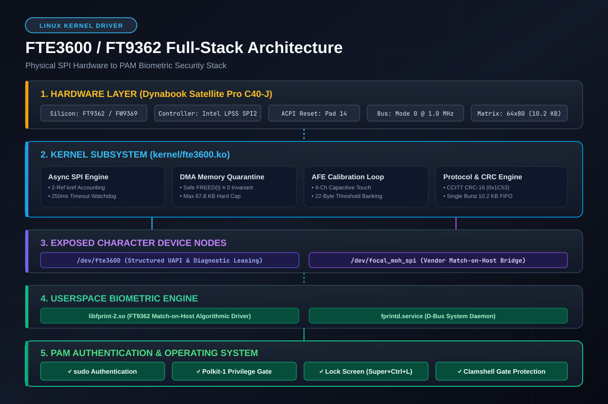
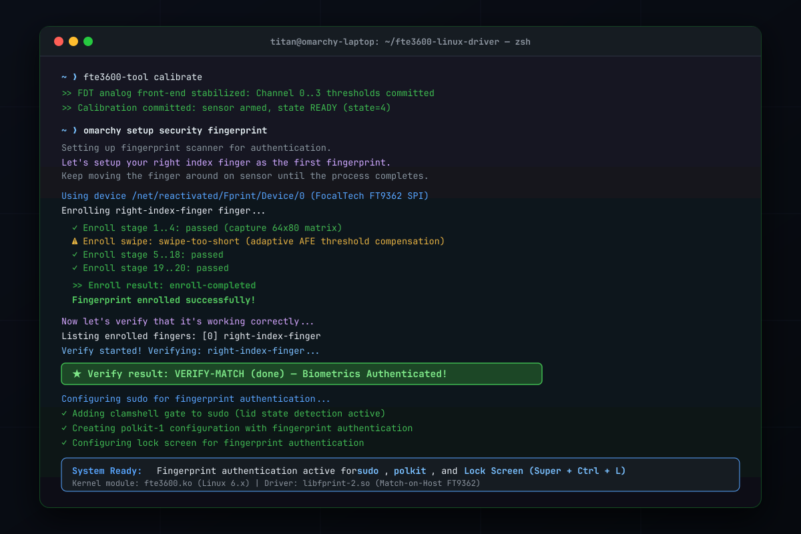

# FocalTech FT9362 / FTE3600 Linux Kernel & Match-on-Host Biometric Driver

[](https://kernel.org)
[](#1-operational-status--hardware-milestone)
[-success.svg)](#3-system-pam-integration)
[](https://www.gnu.org/licenses/old-licenses/gpl-2.0.en.html)

A production-grade, out-of-tree Linux kernel driver and Match-on-Host `libfprint` userspace integration for the **FocalTech FT9362 / FW9369 (`ACPI\FTE3600:00`)** SPI fingerprint sensor.

Enables seamless biometric authentication across **PAM**, `sudo`, **Polkit-1**, and display lock screens on Linux laptops where the sensor was previously non-functional ("Windows Only").

---

## 📸 Architecture & Verification Proof

### 1. 5-Tier System Architecture


### 2. Live Physical Hardware Verification & PAM Activation


---

## 🎯 Target Hardware & Platform

| Attribute | Specification |
| :--- | :--- |
| **Primary Verified Laptop** | Dynabook Satellite Pro C40-J (`PYS46G-06J02D`) / C50-J series |
| **Fingerprint Silicon** | FocalTech FT9362 / FW9369 (`spi-FTE3600:00`) |
| **Host SPI Controller** | Intel LPSS SPI2 (`pxa2xx-spi.2` / `idma64`, PCI `0000:00:1e.3`) |
| **Interrupt / Reset** | ACPI `INTEL0001` GPIO Pad 14 (Edge-triggered IRQ / Hardware Cold Reset) |
| **Sensor Matrix** | 64 columns $\times$ 80 rows ($5,120$ pixels, big-endian 16-bit, $10,240$ bytes/frame) |
| **Supported Kernels** | Linux 6.x and 7.x (x86_64 SMP PREEMPT / PREEMPT_DYNAMIC) |

---

## ⚡ 1-Minute Quick Start

### 1. System Requirements
Ensure you have kernel headers, build essentials, and `fprintd` installed:
```bash
# Arch Linux / Manjaro / Omarchy:
sudo pacman -S --needed base-devel linux-headers fprintd

# Ubuntu / Debian:
sudo apt-get install -y build-essential linux-headers-$(uname -r) fprintd libpam-fprintd

# Fedora:
sudo dnf install -y kernel-devel gcc make fprintd fprintd-pam
```

### 2. Install the Complete Stack
Run the automated installer as root. It automatically compiles the kernel module against your running kernel, deploys the Match-on-Host userspace library, and configures `fprintd`:
```bash
git clone https://github.com/<your-username>/fte3600-linux-driver.git
cd fte3600-linux-driver
sudo bash tools/install-system.sh
```

### 3. Enroll Your Fingerprint
Enroll your finger using either the desktop setup tool or `fprintd-enroll`:
```bash
# If using Omarchy:
omarchy setup security fingerprint

# Or via standard fprintd:
fprintd-enroll "$USER"
```
*Gently place and lift your finger repeatedly across the sensor until all enrollment stages complete.*

### 4. Verify Authentication
```bash
fprintd-verify
```
When prompted, place your finger on the sensor. You should see:
```text
Verify result: verify-match (done)
```

---

## 🔐 System PAM Integration

The driver integrates natively with Linux PAM for instant biometric authentication.

### Sudo Authentication
Add `pam_fprintd.so` as sufficient in `/etc/pam.d/sudo`:
```pam
# /etc/pam.d/sudo
auth        sufficient      pam_fprintd.so
auth        include         system-auth
```

### Clamshell Lid Gate
When a laptop is docked or closed with an external monitor, attempting fingerprint authentication can cause frustrating delays. The included `tools/enable-pam-auth.sh` configures a lid-state gate that automatically falls back to password authentication when the lid is closed:
```bash
sudo bash tools/enable-pam-auth.sh
```

---

## 🛠️ Hardware Diagnostics Tool (`fte3600-tool`)

A companion C userspace utility is included for direct hardware diagnostics, calibration inspection, and raw matrix capture:

```bash
# Compile the diagnostic tool:
gcc -std=c11 -Wall -Wextra -O2 tools/fte3600-tool.c -o tools/fte3600-tool

# 1. Electrical cold reset via Pad 14 GPIO
tools/fte3600-tool reset

# 2. Hardware wake & identification check
tools/fte3600-tool init

# 3. Full volatile startup prefix
tools/fte3600-tool init-full

# 4. Analog Front-End (AFE) baseline calibration & threshold banking
tools/fte3600-tool calibrate

# 5. Capture a raw biometric frame to PGM
tools/fte3600-tool capture /tmp/fingerprint.pgm
```

---

## 🔬 Architectural & Kernel Design Highlights

### 1. Dual Device Node Architecture
The driver exposes two character device interfaces:
* **`/dev/fte3600`**: Full-control device node supporting the complete UAPI v2 ioctl state machine (`RESET`, `INIT`, `CALIBRATE`, `CAPTURE`, `SESSION_RELEASE`).
* **`/dev/focal_moh_spi`**: Compatibility node interfacing seamlessly with Match-on-Host `libfprint` drivers.

### 2. Asynchronous SPI Lifetime & DMA Quarantine
* **Two-Reference `kref` Model:**
  * Reference 1: Submitting kernel thread (`fte3600_spi_async_transfer`).
  * Reference 2: SPI controller completion callback (`fte3600_spi_complete_cb`).
* **250 ms Hardware Timeout:** Managed via `wait_for_completion_timeout()`.
* **DMA Retention Invariant:** If an SPI transaction times out, memory is quarantined to prevent unquiesced IDMA64 bus master memory corruption.
* **Global Quarantine Ceiling:** A hard ceiling of 4 stranded transactions ($67,840$ bytes max). Exceeding submissions are fail-closed with `-ESHUTDOWN`.
* **Module Pinning:** Modules with quarantined transactions pin themselves via `try_module_get()`, preventing unsafe unloading.

### 3. AFE Capacitive Touch (FDT) Calibration
* **Dynamic DAC Sweep:** Evaluated via register `0x1801 = 0xFC80 | dac`.
* **10-Sample Baseline Loop:** Converges when baseline drift is $\le 5$ counts across 3 consecutive readings.
* **Threshold Calculation:** Threshold is calculated as $\max(0, \min - 30)$ clamped to $[300, 700]$.
* **22-Byte Bank Write:** Burst-written to threshold bank `0x80E0` (or `0x80B0`) before arming touch detection.

### 4. Single-Burst Image Readout Pipeline
* **Matrix Geometry:** 64 columns $\times$ 80 rows ($5,120$ pixels, big-endian 16-bit unsigned, $10,240$ bytes payload).
* **Single-Burst Readout:** 10,246 bytes total via opcode `0x06, 0xF9`, RAM address `0x9A, 0x05`, word count `0x14, 0x00` ($5,120$ words), followed by 10,240 dummy clock bytes.
* **Zero Stack Overhead:** All burst buffers are dynamically allocated via `kzalloc()` with `GFP_KERNEL` (zero kernel stack allocations).
* **Strict Capture-Gating:** Capture is admitted **only** in `FTE3600_STATE_READY`. All non-READY states return `-EPERM`.

### 5. Session Management & UAPI Hardening
* **Exclusive Leases:** Single-client lease enforced via generation-keyed 64-bit session tokens.
* **Watchdog Protection:** Inactivity watchdog timer (5000 ms) automatically invalidates abandoned leases.
* **Deadlock-Free Cancellation:** Workqueue cancellation (`cancel_delayed_work_sync`) executed strictly outside `dev_lock`.
* **Acyclic Lock Hierarchy:** $\mathcal{L}_1 (\text{domain}) \prec \mathcal{L}_2 (\text{dev}) \prec \mathcal{L}_3 (\text{session}) \prec \mathcal{L}_4 (\text{quarantine})$.
* **32-Bit Compat:** Identical struct padding and alignments across 32-bit and 64-bit userlands.

---

## 🧪 Automated Test Suite

The repository includes a 160-scenario software verification test harness:

```bash
make -C kernel test
```

Expected output:
```text
Stage D15 Test Results: 160 / 160 Passed (100.0%)
FTE3600 glue policy: 9 groups passed (GPIO/ACPI IRQ, CS capability, polarity, lease, PM, removal)
```

---

## 📂 Repository Directory Layout

```
├── kernel/
│   ├── fte3600.c             # Production Linux kernel driver source
│   ├── fte3600.h             # Formalized UAPI v2 & kernel headers
│   ├── fte3600-policy.h      # ACPI, GPIO, CS and power management policy definitions
│   ├── fte3600-test.c        # 160-scenario software verification harness
│   ├── fte3600-policy-test.c # 9-group glue policy test harness
│   └── Makefile              # Dynamic out-of-tree kernel build Makefile
├── tools/
│   ├── install-system.sh     # One-step system integration installer
│   ├── enable-pam-auth.sh    # PAM configuration & clamshell gate installer
│   ├── fte3600-tool.c        # Production C diagnostic utility
│   └── fw9369-mock/          # Mock protocol validation suite
├── libfprint-package/
│   ├── libfprint-2.so.2.0.0  # FT9362-compatible Match-on-Host userspace library
│   ├── override.conf         # fprintd systemd service override
│   └── 60-libfprint-2.rules  # Udev rules for permissions and subsystem matching
├── linkedin/
│   ├── LINKEDIN_POST.md      # Social announcement post variants & copy
│   ├── linkedin_hero_banner.png # 16:9 Hero visual banner
│   ├── architecture_diagram.png # 1200x800 Architecture diagram
│   └── terminal_proof.png    # 1200x800 Live terminal verification graphic
├── diagnostics/              # Verification reports and audit trail (Stages D1-D18)
├── research/                 # Upstream notes and reverse engineering documentation
├── INSTALLATION.md           # Step-by-step installation and manual build guide
├── KNOWN_LIMITATIONS.md      # Epistemic matrix & hardware constraints
└── PROGRESS.md               # Chronological reverse-engineering log
```

---

## 🔄 Rollback / Uninstallation

If you ever wish to restore your original stock configuration:
```bash
# 1. Unload and remove kernel module
sudo rmmod fte3600
sudo rm -f "/lib/modules/$(uname -r)/extra/fte3600.ko"
sudo depmod -a

# 2. Restore original libfprint (if backup was created)
if [[ -f /var/backups/fte3600/libfprint-2.so.2.0.0.stock_bak ]]; then
    sudo cp /var/backups/fte3600/libfprint-2.so.2.0.0.stock_bak /usr/lib/libfprint-2.so.2.0.0
    sudo ldconfig
fi

# 3. Remove fprintd override and restart service
sudo rm -f /etc/systemd/system/fprintd.service.d/override.conf
sudo systemctl daemon-reload
sudo systemctl restart fprintd
```

---

## 📢 Public Announcement & Media

Planning to share this milestone? Check out the [`linkedin/`](linkedin/) folder:
* [`LINKEDIN_POST.md`](linkedin/LINKEDIN_POST.md): Contains 3 ready-to-publish post templates (Story-driven Developer, Systems Deep-Dive, and Punchy Short-form) along with recommended image attachment sequences and hashtag bundles.

---

## 📜 License

* **Kernel Driver (`kernel/`):** GNU General Public License v2.0 ([GPL-2.0](https://www.gnu.org/licenses/old-licenses/gpl-2.0.en.html)).
* **Userspace Integration (`libfprint-package/`):** GNU Lesser General Public License v2.1 ([LGPL-2.1](https://www.gnu.org/licenses/old-licenses/lgpl-2.1.en.html)).
* **Diagnostic Tools (`tools/`):** MIT License.
