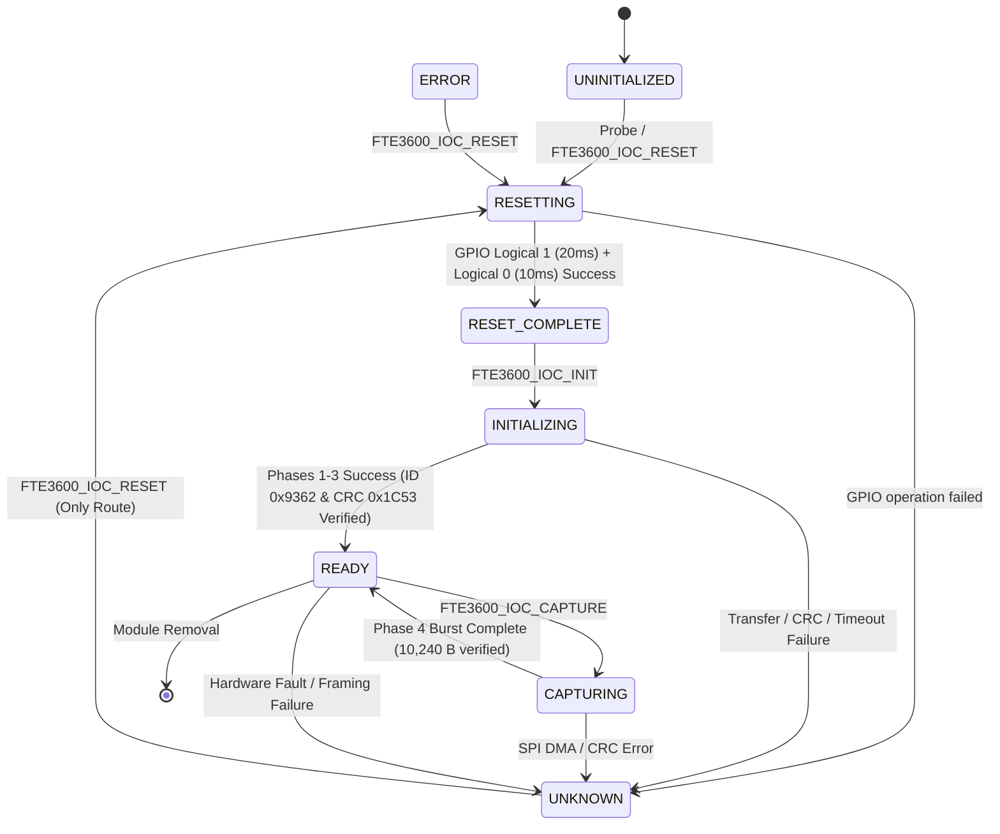

# Stage 2E.1.1 — Independent Architecture Correction and Implementation Readiness Review

**Target System:** Dynabook Satellite Pro C40-J (`PYS46G-06J02D`)  
**Target Silicon:** FocalTech FT9362 / FW9369 (Hardware Chip ID `0x9362`)  
**SPI Host Controller:** Intel Tiger Lake-LP PCH LPSS SPI2 (`pxa2xx-spi.2`, PCI `00:15.0`)  
**Reset Line:** Intel PCH Pad 14 (GPP_B14 / `SPKR` / `\_SB.GPI0` Pin 14)  
**Interrupt Line:** Intel PCH Pad 229 (GPP_D0 / `CPU_GP_0` / `\_SB.GPI0` Pin 323)  
**Document ID:** `STAGE2E1_1_ARCHITECTURE_CORRECTION_REPORT`  
**Execution Mode:** STRICTLY SOFTWARE-ONLY (Static Analysis, Architecture Correction, and Verification Audit)  
**Hardware Safety Gate:** **CLOSED (`bin/fw9369-hw-tool` exits with code 1 unconditionally)**  

---

## 1. Executive Summary & Status Audit

Stage 2E.1.1 performs an exhaustive, adversarial re-audit of the Stage 2E.1 Unified Kernel Driver Architecture Design (`STAGE2E1_KERNEL_ARCHITECTURE_DESIGN.md`). The objective is to identify, correct, and prove every technically inaccurate, inverted, or unsubstantiated claim prior to any software implementation in Stage 2E.2.

### 1.1 Disaggregated Status Matrix

To prevent conflation between theoretical design, static source analysis, offline mock testing, and actual physical hardware verification, the status is formally partitioned:

| Domain | Status | Authoritative Determination |
| :--- | :--- | :--- |
| **Architecture Design** | **APPROVED** | Unified in-kernel SPI + GPIO reset architecture corrected and validated against kernel subsystem semantics. |
| **Static Source Verification** | **VERIFIED WITH LIMITATIONS** | ACPI tables, PCH registers, and reference source cross-referenced; hardware transfer limits and DMA paths documented with open questions. |
| **Offline Software Tests** | **PASS (227 / 227)** | Mock-tooling and transport unit test suites pass completely (100%), but **do not validate kernel driver code**. |
| **Hardware Verification** | **UNVERIFIED (ZERO EXECUTION)** | No hardware reset pulse, no FIFO burst read, and no kernel driver interaction has occurred since Stage 2A. |
| **Hardware Authorization Gate** | **STRICTLY CLOSED** | `bin/fw9369-hw-tool` is sealed with exit code 1. Physical hardware access remains prohibited. |

### 1.2 Authoritative Stage Verdict

$$\mathbf{APPROVED\;FOR\;SOFTWARE\;IMPLEMENTATION\;—\;WITH\;DOCUMENTED\;LIMITATIONS}$$

---

## 2. Findings and Corrections

### Correction 1: Active-Low GPIO Semantics Inversion

#### The Error in Stage 2E.1
Stage 2E.1 asserted:
```c
f->reset_gpio = devm_gpiod_get(&spi->dev, "reset", GPIOD_OUT_LOW);
// ...
gpiod_set_value_cansleep(f->reset_gpio, 0); // Assert reset (low)
msleep(20);
gpiod_set_value_cansleep(f->reset_gpio, 1); // Deassert reset (high)
```
**This logic was completely inverted.**

#### Kernel API Evidence (`include/linux/gpio/consumer.h`)
In the Linux kernel's descriptor-based GPIO API (`gpiolib`):
- `gpiod_set_value()` and `gpiod_set_value_cansleep()` operate on **logical values**, not raw physical voltages:
  - **Logical `1` (`true`)** means **ASSERTED / ACTIVE**.
  - **Logical `0` (`false`)** means **DEASSERTED / INACTIVE**.
- When a GPIO descriptor is flagged with `active_low = true` (via ACPI mapping or Device Tree `GPIO_ACTIVE_LOW`):
  - Requesting logical `1` directs the low-level controller driver to drive the physical pin **LOW (0V)**.
  - Requesting logical `0` directs the low-level controller driver to drive the physical pin **HIGH (3.3V)**.
- If a driver executes `gpiod_set_value_cansleep(desc, 0)` expecting to drive physical low, it actually commands logical inactive, driving physical **HIGH** (deasserting reset). Conversely, calling `gpiod_set_value_cansleep(desc, 1)` commands logical active, driving physical **LOW** (asserting reset).

Furthermore, regarding `GPIOD_OUT_LOW` at acquisition:
```c
enum gpiod_flags {
    GPIOD_ASIS  = 0,
    GPIOD_IN    = GPIOD_FLAGS_BIT_DIR_SET,
    GPIOD_OUT_LOW   = GPIOD_FLAGS_BIT_DIR_SET | GPIOD_FLAGS_BIT_DIR_OUT,
    GPIOD_OUT_HIGH  = GPIOD_FLAGS_BIT_DIR_SET | GPIOD_FLAGS_BIT_DIR_OUT | GPIOD_FLAGS_BIT_DIR_VAL,
    ...
};
```
- In `gpiolib.c`, `GPIOD_OUT_LOW` initializes the line to **logical 0 (inactive)**. For an active-low line, logical 0 sets physical line **HIGH (3.3V)**.
- Therefore, acquiring with `GPIOD_OUT_LOW` ensures the peripheral is held **deasserted (operational HIGH)** upon acquisition.
- However, if probe fails immediately after acquisition, or if the driver needs to avoid any glitch during initialization, acquiring with `GPIOD_ASIS` preserves the firmware-established state (`0x84000201` = physical HIGH), followed by an explicit reset sequence.

#### Corrected Reset Pulse Implementation
```c
/* 1. Acquire descriptor: logical 0 (inactive = physical HIGH) */
data->reset_gpiod = devm_gpiod_get(&spi->dev, "reset", GPIOD_OUT_LOW);
if (IS_ERR(data->reset_gpiod))
    return PTR_ERR(data->reset_gpiod);

/* 2. Explicit Reset Pulse Sequence:
 *    - Logical 1: Physical LOW (Reset Asserted)
 *    - Logical 0: Physical HIGH (Reset Deasserted)
 */
int fte3600_hw_reset_pulse(struct fte3600_data *data)
{
    /* Enforce pre-reset bus settle (inactive) */
    gpiod_set_value_cansleep(data->reset_gpiod, 0);
    msleep(10);

    /* Assert reset: logical 1 -> physical 0V */
    gpiod_set_value_cansleep(data->reset_gpiod, 1);
    msleep(20); /* Documented assert hold time (recovery.c:19) */

    /* Deassert reset: logical 0 -> physical 3.3V */
    gpiod_set_value_cansleep(data->reset_gpiod, 0);
    msleep(10); /* Post-reset settling window (factory_startup.c:341) */

    return 0;
}
```

---

### Correction 2: ACPI GPIO Mapping and Device Binding Order

#### The Error in Stage 2E.1
Stage 2E.1 showed:
```c
f->reset_gpio = devm_gpiod_get(&spi->dev, "reset", GPIOD_OUT_LOW);
```
without defining how the name `"reset"` resolves to ACPI `_CRS` resources.

#### Source & Firmware Evidence
1. **DSDT Firmware Structure (`_SB.PC00.SPI1.FP01`):**
   - The ACPI DSDT provides generic resource descriptors:
     - Resource 0: `SpiSerialBusV2`
     - Resource 1: `GpioIo (Exclusive, PullDefault, 0, "\\_SB.GPI0") { 14 }`
     - Resource 2: `GpioInt (Edge, ActiveHigh, ExclusiveAndWake, PullNone, "\\_SB.GPI0") { 323 }`
   - The DSDT does **not** provide named `_DSD` (Device Specific Data) properties (e.g. `"reset-gpios"`).
2. **ACPI Translation Requirement:**
   - Without a driver-registered mapping table, `devm_gpiod_get(&spi->dev, "reset", ...)` queries ACPI `_DSD`, fails to find `"reset-gpios"`, and returns `-ENOENT`.
   - The translation mapping **must** be explicitly supplied by the driver using `devm_acpi_dev_add_driver_gpios()`.
3. **Target Device Attachment:**
   - In a native `spi_driver`, `probe(struct spi_device *spi)` receives `spi`.
   - The physical device is `&spi->dev`, whose companion is `ACPI_COMPANION(&spi->dev)`.
   - `devm_acpi_dev_add_driver_gpios(&spi->dev, fte3600_acpi_gpios)` must be called on `&spi->dev` **before** calling `devm_gpiod_get(&spi->dev, "reset", ...)`.

#### Corrected ACPI Mapping Specification
```c
static const struct acpi_gpio_params reset_gpios = { 0, 0, true };  /* Index 0, pin 0, active_low = true */
static const struct acpi_gpio_params irq_gpios   = { 1, 0, false }; /* Index 1, pin 0, active_low = false */

static const struct acpi_gpio_mapping fte3600_acpi_gpios[] = {
    { "reset-gpios", &reset_gpios, 1 },
    { "irq-gpios",   &irq_gpios,   1 },
    { },
};

/* In fte3600_spi_probe(struct spi_device *spi): */
ret = devm_acpi_dev_add_driver_gpios(&spi->dev, fte3600_acpi_gpios);
if (ret)
    return dev_err_probe(&spi->dev, ret, "Failed to add ACPI driver GPIO mapping\n");

data->reset_gpiod = devm_gpiod_get(&spi->dev, "reset", GPIOD_OUT_LOW);
if (IS_ERR(data->reset_gpiod))
    return dev_err_probe(&spi->dev, PTR_ERR(data->reset_gpiod), "Failed to get reset GPIO\n");
```

---

### Correction 3: Reset Reliability, Electrical Verification, and State Invariants

#### The Error in Stage 2E.1
Stage 2E.1 characterized hardware reset as a "hardware-verified capability" that "reliably restores the sensor from `UNKNOWN` to `ASSUMED_LOCKED`."

#### Physical and Architectural Reality
1. **Kernel GPIO Return Status $\neq$ Physical Voltage:**
   - A return code of `0` from `gpiod_set_value_cansleep()` indicates solely that the Linux kernel wrote the target bit into the Intel PCH LPSS GPIO memory-mapped register (`GPIOTXSTATE` in `PADCFG0`).
   - The PCH LPSS pad controller does **not** provide electrical loopback telemetry on Pad 14.
   - The kernel driver cannot measure the physical voltage at the sensor pin.
2. **Reset Pulse $\neq$ Sensor Ready:**
   - An unverified or failing reset line leaves internal silicon logic undetermined.
   - The FT9362 silicon does not expose a readable power-on reset completion bit.
3. **Reference Timing vs. Verified Timing:**
   - Reference implementations (`recovery.c:9-21`, `factory_startup.c:191-215`) document:
     - 10 ms pre-pulse idle (deasserted).
     - 20 ms assert hold time (asserted low).
     - 10 ms to 20 ms post-deassert settle latency.
   - Stage 2E.1 arbitrarily proposed 5 ms post-reset settle latency without empirical support.
   - **Correction:** The settle delay must match the reference implementation (minimum 10 ms, recommended 20 ms).
4. **State Transition Rule:**
   - Executing the reset sequence moves state from `UNKNOWN` to `RESET_COMPLETE` (software sequence complete), **not** `READY` or `ASSUMED_LOCKED`.
   - The transition to a verified operational state occurs **only** after subsequent SPI transactions successfully validate chip ID `0x9362` and wire CRC `0x1C53`.
   - If GPIO acquisition or pulsing returns an error, the state remains strictly `UNKNOWN`.

---

### Correction 4: Reassessment of SPI DMA, `GFP_DMA`, and Controller Constraints

#### The Error in Stage 2E.1
Stage 2E.1 claimed that allocating dynamic buffers with:
```c
kmalloc(size, GFP_KERNEL | GFP_DMA)
```
"resolves the 10,246-byte FIFO transfer."

#### Kernel Memory & Controller Reality
1. **`GFP_DMA` is Inappropriate and Unnecessary:**
   - On x86_64, `GFP_DMA` forces allocations into `ZONE_DMA`, which is physically restricted to memory addresses below 16 MB (`0x00000000` to `0x00FFFFFF`).
   - `ZONE_DMA` is a severely memory-constrained legacy zone intended for 24-bit ISA DMA devices.
   - Modern PCI / LPSS DMA engines (such as Intel Tiger Lake LPSS SPI `00:15.0`) utilize 32-bit or 64-bit DMA addressing (`ZONE_DMA32` or normal memory).
   - Allocating 16 KiB buffers from `ZONE_DMA` causes unnecessary zone exhaustion and risks `-ENOMEM`.
   - **Correction:** Standard `kmalloc(size, GFP_KERNEL)` must be used.
2. **Automatic SPI Core DMA Mapping:**
   - In Linux SPI architecture, `spi_sync()` invokes `spi_map_buf()`, which dynamically generates scatter-gather tables and invokes `dma_map_single()` / `dma_map_sg()` for heap buffers allocated with `kmalloc(..., GFP_KERNEL)`.
3. **PXA2xx SPI Controller Limits (`drivers/spi/spi-pxa2xx.c`):**
   - The PXA2xx controller driver defines:
     - `MAX_DMA_LEN = SZ_64K` (65,536 bytes).
     - `controller->max_dma_len = MAX_DMA_LEN`.
     - `controller->max_transfer_size = pxa2xx_spi_max_dma_transfer_size` (returns 64 KiB).
   - The 10,246-byte Phase 4 burst read falls comfortably below the 64 KiB controller limit.
   - In `struct spi_transfer`, setting `cs_change = 0` guarantees that the SPI core and controller hold chip-select continuously asserted across the entire 10,246 bytes.
4. **Hardware Verification Limitation:**
   - Whether DMA mode is actively enabled by the running kernel's PCI glue driver (`pxa2xx-spi-pci.c`) or whether it falls back to interrupt-driven PIO mode has not been verified on this hardware.
   - However, both DMA and PIO paths in `spi-pxa2xx.c` support transfers up to `MAX_DMA_LEN` with `cs_change = 0`.
   - The 10,246-byte transfer remains **unverified on physical hardware** and must be tested in a future authorized hardware stage.

---

### Correction 5: Mutex, Threaded IRQ, and Concurrency Architecture

#### The Error in Stage 2E.1
Stage 2E.1 vaguely stated that "one mutex serializes SPI, reset and IRQ handling" without specifying execution contexts or deadlock avoidance.

#### Execution Context Requirements
1. **Hard IRQ Context Restrictions:**
   - Hard IRQ handlers run in atomic interrupt context with preemption disabled.
   - `mutex_lock()` and `spi_sync()` **can sleep** and are strictly illegal in hard IRQ context. Calling either causes a kernel panic (`BUG: scheduling while atomic`).
2. **Threaded IRQ Handler (`devm_request_threaded_irq`):**
   - The driver must register a threaded interrupt:
     ```c
     ret = devm_request_threaded_irq(&spi->dev, data->irq, NULL,
                                     fte3600_irq_thread,
                                     IRQF_TRIGGER_RISING | IRQF_ONESHOT,
                                     "fte3600-irq", data);
     ```
   - Passing `NULL` for the primary handler causes the IRQ core to use the default stub that returns `IRQ_WAKE_THREAD`.
   - `fte3600_irq_thread` runs in a dedicated kernel thread context where sleeping, acquiring mutexes, and calling `spi_sync()` are fully permitted.
3. **`IRQF_ONESHOT` Semantic:**
   - Because Pad 229 is configured with `PullNone` (high-impedance when idle), floating noise could trigger spurious interrupts.
   - `IRQF_ONESHOT` ensures the interrupt line remains masked at the PCH interrupt controller until the threaded handler completes, preventing interrupt storms.
4. **IRQ Acknowledgement Requires SPI:**
   - Reference driver analysis (`fw9369_release.c:309-326`) reveals that clearing the FT9362 interrupt requires reading status register `0x1A82` and writing back the status to register `0x1A84` over SPI.
   - The threaded IRQ handler acquires `mutex_lock(&data->lock)`, executes the SPI clear sequence, updates internal state, and wakes userspace pollers.
5. **Race Condition Prevention & Removal Ordering:**
   - **SPI Capture vs. IRQ:** When a long-running frame capture holds `data->lock`, an incoming IRQ wakes the thread, which blocks at `mutex_lock(&data->lock)` until capture completes. No deadlock occurs.
   - **Reset vs. SPI:** Reset acquires `data->lock`, ensuring no SPI operations run while reset is asserted.
   - **Device Removal:** On unbind, `data->shutdown = true` is set, `devm_free_irq()` is called to disable the interrupt source before mutex destruction, pending transfers are aborted, and character device nodes are unregistered.

---

### Correction 6: Character Device ABI and libfprint Driver Integration

#### The Error in Stage 2E.1
Stage 2E.1 claimed that `/dev/fte3600` integrates "directly with libfprint's `fpi_ssm`."

#### Architectural Reality
1. **`fpi_ssm` is an Internal Userspace API:**
   - `fpi_ssm` (Synchronous State Machine) is an internal C API implemented within the `libfprint` library repository (`libfprint/fpi-ssm.h`).
   - The Linux kernel does **not** communicate with `fpi_ssm`.
   - An unmodified distribution installation of `libfprint` has no native knowledge of `/dev/fte3600` or the FT9362 sensor.
2. **Concrete Integration Path:**
   - Upstream integration requires authoring a custom `libfprint` driver plugin (e.g. `libfprint/drivers/fte3600/fte3600.c`) that subclasses `FpImageDevice`.
   - Device discovery is triggered via udev rules matching `/dev/fte3600` (`ENV{ID_FPRINT_DRIVER}="fte3600"`).
   - The userspace driver opens `/dev/fte3600` and dispatches ioctls from within libfprint's asynchronous GLib event loop.
3. **UAPI Character Device ABI Hardening:**
   - **Fixed-Width Types:** Structures must strictly use Linux fixed-width types (`__u32`, `__u8`, `__s32`) defined in `<linux/types.h>`.
   - **No Padding Ambiguity:** Align all struct fields to 64-bit boundaries to guarantee identical memory layout on 32-bit compat userspace and 64-bit kernels, eliminating `compat_ioctl` translation bugs.
   - **Magic Number & Direction:** Standardized using `_IO`, `_IOW`, `_IOR`, `_IOWR` with magic `'F'`.
   - **Single-Open Lease:** Enforce single-client exclusive access (`O_EXCL` or atomic flags) to prevent concurrent userspace processes from interleaving sensor commands.
   - **Interruptible Waits:** Mutex acquisitions in ioctl handlers must use `mutex_lock_interruptible()` to allow responsive process termination (`SIGINT` / `SIGTERM`).

---

### Correction 7: Pad 229 / Interrupt Configuration Audit

#### Findings
1. **ACPI DSDT Configuration:**
   - ACPI declares: `GpioInt (Edge, ActiveHigh, ExclusiveAndWake, PullNone, "\\_SB.GPI0") { 323 }`.
   - Pin 323 corresponds to Intel PCH Pad 229 (`CPU_GP_0` / GPP_D0).
2. **Historical Register Discrepancy:**
   - Baseline pre-test: `0x80100100 0x00000029` (uninitialized firmware state).
   - Post-test Stage 1: `0x82000100 0x00000029` (pad routed to GPIO RX mode).
   - Bit 1 (`PADCFG0_GPIORXSTATE`) fluctuates depending on floating wire state due to `PullNone`.
   - Pin remains in safe high-impedance input mode (`PADCFG0_GPIOTXDIS = 1`).
3. **IRQ Resource Resolution:**
   - The Linux SPI core resolves ACPI interrupts automatically. If declared as `GpioInt`, `spi->irq` is populated by `acpi_dev_gpio_irq_get()`.
   - If `spi->irq <= 0`, driver queries `gpiod_to_irq(data->irq_gpiod)`.
   - Trigger mode must be requested as `IRQF_TRIGGER_RISING | IRQF_ONESHOT`.

---

## 3. Revised Architecture and State Diagrams

### 3.1 Revised Kernel Driver Architecture

```
+---------------------------------------------------------------------------------------------------+
|                                 REVISED KERNEL DRIVER ARCHITECTURE                                |
|                                                                                                   |
|  [Hardware & Firmware Layer]                                                                      |
|  +---------------------------------------------------------------------------------------------+  |
|  | Intel LPSS SPI2 Controller (pxa2xx-spi.2)   |  Intel PCH Pad 14 (Reset)  |  Pad 229 (IRQ)   |  |
|  | ACPI _CRS: SpiSerialBusV2 (1 MHz, Mode 0)   |  ACPI _CRS: GpioIo (Idx 0) |  GpioInt (Idx 1) |  |
|  +---------------------------------------------------------------------------------------------+  |
|                                                |                                                  |
|  [Kernel Driver Subsystem Layer: fte3600.ko]  v                                                  |
|  +---------------------------------------------------------------------------------------------+  |
|  |  Direct ACPI SPI Driver Binding: struct spi_driver .acpi_match_table = "FTE3600"            |  |
|  |  ACPI Driver GPIO Registration: devm_acpi_dev_add_driver_gpios(&spi->dev, mapping)           |  |
|  |                                                                                             |  |
|  |  +---------------------------------------------------------------------------------------+  |  |
|  |  |                                struct fte3600_data                                    |  |  |
|  |  |                                                                                       |  |  |
|  |  |  - struct mutex lock;              // Strict serialization of reset, SPI, and IRQ    |  |  |
|  |  |  - struct spi_device *spi;         // Native spi_sync() engine                        |  |  |
|  |  |  - struct gpio_desc *reset_gpiod;  // devm_gpiod_get("reset", GPIOD_OUT_LOW)         |  |  |
|  |  |  - int irq;                        // devm_request_threaded_irq(..., IRQF_ONESHOT)   |  |  |
|  |  |  - enum fte3600_state state;       // Explicit 8-state tracking                       |  |  |
|  |  |  - wait_queue_head_t event_wq;     // Non-blocking poll() / read() notifications      |  |  |
|  |  +---------------------------------------------------------------------------------------+  |  |
|  |                                                                                             |  |
|  |  Execution Paths:                                                                           |  |
|  |  1. Reset Path:       mutex_lock() -> gpiod(1) [20ms] -> gpiod(0) [10ms] -> mutex_unlock()  |  |
|  |  2. SPI Sync Path:   mutex_lock() -> spi_sync(cs_change=0, GFP_KERNEL) -> mutex_unlock()    |  |
|  |  3. Threaded IRQ:     mutex_lock() -> SPI read 0x1A82 / write 0x1A84 -> wake_up() -> unlock |  |
|  +---------------------------------------------------------------------------------------------+  |
|                                                |                                                  |
|  [Userspace Boundary]                         v                                                  |
|  +---------------------------------------------------------------------------------------------+  |
|  |  /dev/fte3600 (Character Device Node, Permissions: 0660 root:plugdev)                      |  |
|  |  - FTE3600_IOC_RESET, FTE3600_IOC_INIT, FTE3600_IOC_CAPTURE, FTE3600_IOC_GET_STATE         |  |
|  |  - Strict prohibition of raw register read/write operations (EFUSE 0xF1/0xF4 protected)     |  |
|  +---------------------------------------------------------------------------------------------+  |
|                                                |                                                  |
|  [Userspace Daemon Layer]                      v                                                  |
|  +---------------------------------------------------------------------------------------------+  |
|  |  Custom libfprint Driver (FpImageDevice) -> GLib Event Loop / fprintd Daemon               |  |
+---------------------------------------------------------------------------------------------------+
```

### 3.2 Revised State Machine & Recovery Invariants



---

## 4. Preconditions for Stage 2E.2 Software Implementation

Before authoring code for `fte3600.ko` in Stage 2E.2, the following engineering preconditions must be met:

1. **UAPI Header Definition (`kernel/fte3600.h`):**
   - Create a clean UAPI header defining fixed-width struct layouts (`__u32`, `__u8`), explicit padding, ioctl magic `'F'`, and driver version defines.
2. **Clean Driver Structure (`kernel/fte3600.c`):**
   - Author the native `spi_driver` implementation without carrying over Stage 1 platform glue, bus notifiers, or raw `/dev/spidev` exposure.
3. **Compilation Verification:**
   - Must build cleanly against running kernel headers (`7.2.8-9-omarchy`) with `-Wall -Wextra -Werror` and zero warnings.
4. **Hardware Gate Intact:**
   - `bin/fw9369-hw-tool` must remain sealed with exit code 1.
   - Stage 2E.2 is strictly software compilation and offline mock verification.

---

## 5. Prohibited Hardware Operations

The following hardware actions remain **STRICTLY PROHIBITED** until a formal, separately authorized Hardware Test Plan is approved:

- $\times$ Binding `fte3600.ko` to the physical SPI device `spi-FTE3600:00`.
- $\times$ Loading `fte3600.ko` into the running kernel with live ACPI enumeration active.
- $\times$ Toggling Pad 14 (Reset GPIO) on live silicon.
- $\times$ Unmasking or servicing live interrupts on Pad 229.
- $\times$ Issuing physical SPI transactions to `/dev/spidev1.0` or controller `pxa2xx-spi.2`.
- $\times$ Accessing or probing registers `0xF1` or `0xF4` (EFUSE / OTP).
- $\times$ Executing Phase 4 capture or Phase 5 autonomous arming on physical hardware.

---

## 6. Summary of Changed Files & Test Verification

| File | Nature of Change |
| :--- | :--- |
| `STAGE2E1_1_ARCHITECTURE_CORRECTION_REPORT.md` | Created comprehensive architecture correction report (this document). |
| `diagnostics/STAGE2E1_1_ARCHITECTURE_CORRECTION_REPORT.md` | Mirrored report in diagnostics repository. |
| `STAGE2E1_KERNEL_ARCHITECTURE_DESIGN.md` | Corrected active-low GPIO semantics, ACPI mapping order, `GFP_DMA` usage, threaded IRQ architecture, libfprint integration, and partitioned status fields. |
| `diagnostics/STAGE2E1_KERNEL_ARCHITECTURE_DESIGN.md` | Mirrored updated design document in diagnostics repository. |
| `PROGRESS.md` | Added Stage 2E.1.1 milestone review and historical continuity. |

### Verification of Offline Gate & Tests
- Hardware Gate: `bin/fw9369-hw-tool` -> **Exit Code 1 (PASS)**
- Offline Test Suite: `bin/fw9369-tests` -> **227 / 227 Passed (100.0%)**
