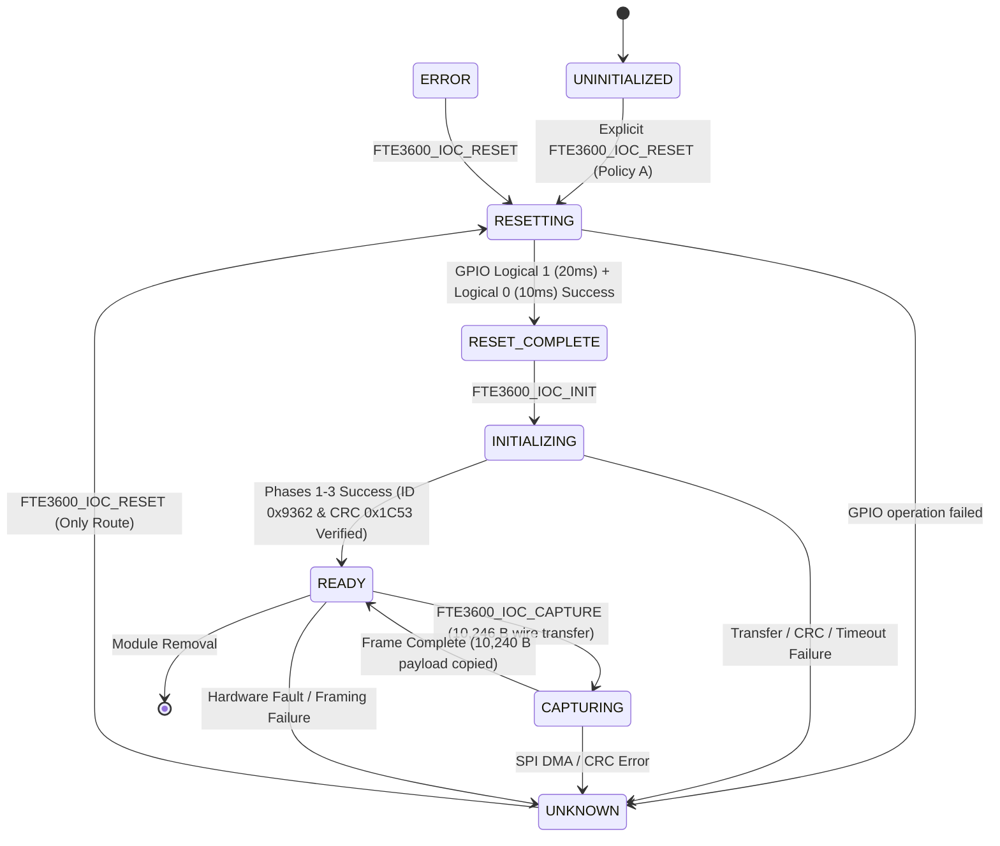

# Stage 2E.1 — Unified Kernel Driver Architecture Design

**Target System:** Dynabook Satellite Pro C40-J (`PYS46G-06J02D`)  
**Target Silicon:** FocalTech FT9362 / FW9369 (Chip ID `0x9362`)  
**SPI Host Controller:** Intel Tiger Lake-LP PCH LPSS SPI2 (`pxa2xx-spi.2`, PCI `00:15.0`)  
**Reset Line:** Intel PCH Pad 14 (GPP_B14 / `SPKR` / `\_SB.GPI0` Pin 14)  
**Interrupt Line:** Intel PCH Pad 229 (GPP_D0 / `CPU_GP_0` / `\_SB.GPI0` Pin 323)  
**Document ID:** `STAGE2E1_KERNEL_ARCHITECTURE_DESIGN`  
**Execution Mode:** STRICTLY SOFTWARE-ONLY (Architecture Design, Safety Review, and Static Analysis)  

---

## 1. Disaggregated Status Matrix & Safety Boundary

| Domain | Status | Specification / Safety Boundary |
| :--- | :--- | :--- |
| **Architecture Design** | **APPROVED (PRECONDITIONS SATISFIED)** | In-kernel SPI + GPIO reset architecture with Policy A probe lifecycle and atomic single-open. |
| **Static Source Verification** | **VERIFIED WITH LIMITATIONS** | ACPI tables, PCH registers, and reference source cross-referenced; hardware transfer limits and DMA paths documented with open questions. |
| **Offline Software Tests** | **PASS (227 / 227)** | Mock-tooling and transport unit test suites pass completely (100%), but **do not validate kernel driver code**. |
| **Hardware Verification** | **UNVERIFIED (ZERO EXECUTION)** | Stage 2A was the last authorized hardware operation. No reset pulse has been hardware-verified. No FIFO burst transfer has been hardware-verified. No unified kernel driver has been implemented or tested. |
| **Hardware Execution Authorization** | **STRICTLY CLOSED** | Hardware execution gate in `bin/fw9369-hw-tool` remains CLOSED (unconditional exit code 1). |

### Authoritative Stage Verdict

$$\mathbf{PRECONDITIONS\;SATISFIED\;—\;STAGE\;2E.2\;SOFTWARE\;IMPLEMENTATION\;MAY\;BEGIN}$$

---

## 2. Executive Summary

Stage 2E.1 establishes the comprehensive architectural blueprint for a unified, production-grade Linux kernel driver (`fte3600.ko`) for the FocalTech FT9362 / FW9369 fingerprint sensor.

This design addresses the critical limitations identified in Stage 2D, Stage 2D.3, Stage 2E.1.1, and Stage 2E.1.2:
1. **Kernel-Managed Reset Control:** Under pure-spidev, the driver has zero hardware reset capability because ACPI `Exclusive` reservations bar userspace GPIO access. By uniting SPI transport and GPIO reset under a single kernel driver, Pad 14 reset control is restored.
2. **Elimination of the Userspace Buffer Limit Hazard (`spidev.bufsiz`):** Mainline `spidev` defaults to a 4,096-byte transfer limit. An in-kernel driver utilizing `spi_sync()` allocates contiguous kernel DMA buffers dynamically, supporting the 10,246-byte Phase 4 burst read without requiring custom module parameters.
3. **Strict Reset and SPI Serialization:** In-kernel mutex locking guarantees that SPI transactions cannot occur while reset is asserted, and reset cannot be pulsed during an active SPI transaction.
4. **Policy A Probe Lifecycle & Controlled Recovery:** Probe is strictly passive, acquiring resources and setting state to `UNINITIALIZED` without emitting hardware reset pulses. Reset is executed exclusively upon explicit userspace request (`FTE3600_IOC_RESET`). A successful pulse reaches `RESET_COMPLETE`; subsequent SPI verification of chip ID `0x9362` and CRC `0x1C53` is required to reach `READY`.
5. **Secure, Controlled Userspace Interface:** Replaces raw register access with an explicit, high-level character device interface (`/dev/fte3600`) with atomic single-open enforcement, protecting non-volatile EFUSE registers (`0xF1`, `0xF4`) from accidental corruption.

---

## 3. Evaluation of Existing Kernel Implementation (`kernel/fte3600.c`)

The Stage 1 implementation (`kernel/fte3600.c`) was designed as an ACPI "glue" driver that split hardware access across three independent devices (`/dev/spidev1.0`, `/dev/gpiochip1`, and `/dev/uio0`).

```
[Stage 1 Architecture: Fragmented Tri-Device Model]
ACPI FP01 ──► Linux Kernel ──┬──► spidev.ko ────────────► /dev/spidev1.0 (SPI Bus)
                             ├──► fte3600.ko (Glue) ────► /dev/gpiochip1 (Reset Pad 14)
                             └──► uio.ko (UIO Core) ────► /dev/uio0      (IRQ Pad 229)
* Hazard: Zero kernel-side synchronization between SPI, Reset, and IRQ operations.
```

### 3.1 Reusable Functionality
- **ACPI `_CRS` Resource Parsing (`fte3600_resource()`):** Successfully decodes `SPISerialBusV2`, `GpioIo`, and `GpioInt` descriptors, extracting connection speeds, polarities, and resource indices.
- **ACPI Driver GPIO Mapping:** Uses `acpi_dev_add_driver_gpios()` to associate symbolic names (`reset-gpios`, `irq-gpios`) with ACPI CRS indices, enabling standard `gpiolib` descriptor acquisition.
- **Power Management Notifier (`fte3600_pm_notify()`):** Hooks `PM_SUSPEND_PREPARE` and `PM_POST_RESTORE` to ensure the sensor is cleanly held in reset during system sleep states.

### 3.2 Components Requiring Redesign
1. **Eliminate Bus Notifier Discovery:** Stage 1 used `bus_register_notifier(&spi_bus_type, ...)` to watch for `spidev` bindings. The revised driver must register directly as a native `spi_driver` matching `FTE3600`.
2. **Eliminate Userspace spidev:** All SPI transactions must be executed in-kernel using `spi_sync()`.
3. **Eliminate Virtual GPIO Chip and UIO Node:** The custom `/dev/gpiochip1` and `/dev/uio0` nodes are eliminated and replaced by a single unified character device (`/dev/fte3600`).

---

## 4. Proposed Unified Driver Architecture

The unified architecture establishes single ownership over all sensor resources within a single kernel module:

```
+---------------------------------------------------------------------------------------------------+
|                                 REVISED KERNEL DRIVER ARCHITECTURE                                |
|                                                                                                   |
|  [Hardware & Firmware Layer]                                                                      |
|  +---------------------------------------------------------------------------------------------+  |
|  | Intel LPSS SPI2 Controller (pxa2xx-spi.2)   |  Intel PCH Pad 14 (Reset)  |  Pad 229 (IRQ)   |  |
|  | ACPI _CRS: SpiSerialBusV2 (1 MHz, Mode 0)   |  ACPI _CRS: GpioIo (Idx 0) |  GpioInt (Idx 1) |  |
|  +---------------------------------------------------------------------------------------------+  |
|                                                |                                                  |
|  [Kernel Driver Subsystem Layer: fte3600.ko]  v                                                  |
|  +---------------------------------------------------------------------------------------------+  |
|  |  Direct ACPI SPI Driver Binding: struct spi_driver .acpi_match_table = "FTE3600"            |  |
|  |  ACPI Driver GPIO Registration: devm_acpi_dev_add_driver_gpios(&spi->dev, mapping)           |  |
|  |                                                                                             |  |
|  |  +---------------------------------------------------------------------------------------+  |  |
|  |  |                                struct fte3600_data                                    |  |  |
|  |  |                                                                                       |  |  |
|  |  |  - struct mutex lock;              // Strict serialization of reset, SPI, and IRQ    |  |  |
|  |  |  - struct spi_device *spi;         // Native spi_sync() engine                        |  |  |
|  |  |  - struct gpio_desc *reset_gpiod;  // devm_gpiod_get("reset", GPIOD_OUT_LOW)         |  |  |
|  |  |  - int irq;                        // devm_request_threaded_irq(..., IRQF_ONESHOT)   |  |  |
|  |  |  - atomic_t is_open;               // Single-open exclusive lease                     |  |  |
|  |  |  - atomic_t offline;               // Device removal / shutdown flag                  |  |  |
|  |  |  - enum fte3600_state state;       // Explicit 8-state tracking                       |  |  |
|  |  |  - wait_queue_head_t event_wq;     // Non-blocking poll() / read() notifications      |  |  |
|  |  +---------------------------------------------------------------------------------------+  |  |
|  |                                                                                             |  |
|  |  Execution Paths:                                                                           |  |
|  |  1. Reset Path:       mutex_lock() -> gpiod(1) [20ms] -> gpiod(0) [10ms] -> mutex_unlock()  |  |
|  |  2. SPI Sync Path:   mutex_lock() -> spi_sync(cs_change=0, GFP_KERNEL) -> mutex_unlock()    |  |
|  |  3. Threaded IRQ:     mutex_lock() -> wake_up() -> unlock (0x1A84 write strictly BLOCKED)  |  |
|  +---------------------------------------------------------------------------------------------+  |
|                                                |                                                  |
|  [Userspace Boundary]                         v                                                  |
|  +---------------------------------------------------------------------------------------------+  |
|  |  /dev/fte3600 (Character Device Node, Permissions: 0660 root:plugdev)                      |  |
|  |  - FTE3600_IOC_RESET, FTE3600_IOC_INIT, FTE3600_IOC_CAPTURE, FTE3600_IOC_GET_STATE         |  |
|  |  - Strict prohibition of raw register read/write operations (EFUSE 0xF1/0xF4 protected)     |  |
|  +---------------------------------------------------------------------------------------------+  |
|                                                |                                                  |
|  [Userspace Daemon Layer]                      v                                                  |
|  +---------------------------------------------------------------------------------------------+  |
|  |  Custom libfprint Driver (FpImageDevice) -> GLib Event Loop / fprintd Daemon               |  |
+---------------------------------------------------------------------------------------------------+
```

---

## 5. Reset GPIO Ownership, Policy A Lifecycle, and Semantics

### 5.1 ACPI Resource Mapping and Device Attachment
- **ACPI Declaration:** `\_SB.PC00.SPI1.FP01` contains `GpioIo` at resource index 0 (`Pin 14`).
- **Translation Map Required:** The firmware DSDT contains no `_DSD` naming properties. The driver must explicitly register driver GPIO mappings before requesting descriptors:
```c
static const struct acpi_gpio_params reset_gpios = { 0, 0, true };  /* Index 0, pin 0, active_low = true */
static const struct acpi_gpio_params irq_gpios   = { 1, 0, false }; /* Index 1, pin 0, active_low = false */

static const struct acpi_gpio_mapping fte3600_acpi_gpios[] = {
    { "reset-gpios", &reset_gpios, 1 },
    { "irq-gpios",   &irq_gpios,   1 },
    { },
};
```
- In `probe(struct spi_device *spi)`, `devm_acpi_dev_add_driver_gpios(&spi->dev, fte3600_acpi_gpios)` must be called against `&spi->dev` **prior** to `devm_gpiod_get(&spi->dev, "reset", GPIOD_OUT_LOW)`.

### 5.2 Policy A Probe and Reset Lifecycle
- **Probe Behavior:** Strictly passive. Acquires descriptors with `GPIOD_OUT_LOW` (logical 0 = physical HIGH / inactive), registers `/dev/fte3600`, and sets state to `UNINITIALIZED`. Zero reset pulses are driven during probe.
- **Explicit Reset Trigger:** Reset occurs exclusively when userspace issues `ioctl(fd, FTE3600_IOC_RESET)`.
- **Active-Low GPIO Semantics:**
  - Logical `1` means **ACTIVE (Asserted)** $\rightarrow$ physical **LOW (0V)**.
  - Logical `0` means **INACTIVE (Deasserted)** $\rightarrow$ physical **HIGH (3.3V)**.
- **Reset Sequence Implementation:**
```c
int fte3600_hw_reset_pulse(struct fte3600_data *data)
{
    /* Enforce pre-reset bus settle (inactive) */
    gpiod_set_value_cansleep(data->reset_gpiod, 0);
    msleep(10);

    /* Assert reset: logical 1 -> physical 0V */
    gpiod_set_value_cansleep(data->reset_gpiod, 1);
    msleep(20); /* Documented assert hold time (recovery.c:19) */

    /* Deassert reset: logical 0 -> physical 3.3V */
    gpiod_set_value_cansleep(data->reset_gpiod, 0);
    msleep(10); /* Post-reset settling window (factory_startup.c:341) */

    return 0;
}
```
- *Limitation Note:* A return code of 0 confirms PCH pad register write acceptance; physical voltage has not been independently measured.

---

## 6. Kernel SPI Transport, DMA, and Packet Length Design

### 6.1 SPI Bus Parameters
- Controller: Intel Tiger Lake-LP PCH LPSS SPI2 (`pxa2xx-spi.2`).
- Mode: SPI Mode 0 (`CPOL = 0, CPHA = 0`).
- Word Size: 8 bits (`spi->bits_per_word = 8`).
- Clock Frequency: 1 MHz (`spi->max_speed_hz = 1000000`).
- Chip Select: Active-low, continuous assertion across transfers (`cs_change = 0`).

### 6.2 FIFO Packet Length Discrepancy Resolved
- **Full Wire Transfer Length:** **10,246 bytes** (`FW9369_FIFO_TRANSFER_LEN`).
  - Prefix Header: 6 bytes (`[ 0x10, 0xEF, 0x9A, 0x05, 0x14, 0x00 ]`).
  - Payload: 10,240 bytes (5,120 16-bit words).
  - Trailer/CRC: 0 bytes.
- **Application Image Buffer:** **10,240 bytes** (`FW9369_IMAGE_BYTES`).
  - Copied to userspace buffer from `rx[6]`, stripping prefix bytes.

### 6.3 DMA Allocation and Controller Limits
- **Memory Allocation:** Standard `kmalloc(size, GFP_KERNEL)` must be used. `GFP_DMA` is **prohibited** (unnecessarily restricts allocations to 16 MB ISA zone on x86_64).
- **Streaming DMA Mapping:** Handled dynamically by the SPI core (`spi_map_buf()`).
- **Controller Limits:** PXA2xx driver configures `MAX_DMA_LEN = 64 KiB`. Since $10,246 < 65,536$, the 10,246-byte transfer falls within controller limits with continuous CS# assertion (`cs_change = 0`).
- *Limitation Note:* Burst transfer is supported by controller driver structures, but has not yet been executed or verified on physical hardware.

---

## 7. Mutex, Threaded IRQ, and Concurrency Architecture

### 7.1 Threaded IRQ Handler & Request Flags
- Pad 229 is declared in ACPI as `GpioInt (Edge, ActiveHigh, ExclusiveAndWake, PullNone)`.
- The driver registers the threaded IRQ passing **only `IRQF_ONESHOT`** (with `IRQF_TRIGGER_NONE`), safely inheriting ACPI firmware configuration:
```c
ret = devm_request_threaded_irq(&spi->dev, data->irq, NULL,
                                fte3600_irq_thread,
                                IRQF_ONESHOT,
                                "fte3600-irq", data);
```
- **Interrupt Acknowledgement Boundary:**
  - Physical acknowledgement via register `0x1A84` is **STRICTLY BLOCKED** pending separate protocol authorization.
  - The driver in Stage 2E.2 **must NOT silently access `0x1A84`**.
  - `IRQF_ONESHOT` keeps the interrupt masked at the PCH controller, safely preventing interrupt storms without requiring register writes to `0x1A84`.

### 7.2 Mutual Exclusion and Serialization
- A single `struct mutex lock` serializes all SPI transfers, reset pulses, and IRQ event handling.
- Mutex acquisition uses `mutex_lock_interruptible()` to ensure clean process termination on signals (`SIGINT`/`SIGTERM`).
- If a frame capture is active when an IRQ fires, the threaded IRQ handler blocks on `data->lock` until capture completes. No deadlock occurs.
- Device removal sets `atomic_set(&data->offline, 1)`, frees the IRQ source before destroying mutexes, and wakes sleeping userspace pollers.

---

## 8. Initialization and Recovery State Machine



---

## 9. Userspace Interface Design (`/dev/fte3600`)

### 9.1 UAPI Character Device ABI

```c
#define FTE3600_IOC_MAGIC  'F'

/* Reset sensor hardware (Pulses Pad 14 low for 20 ms) */
#define FTE3600_IOC_RESET         _IO(FTE3600_IOC_MAGIC, 0x01)

/* Execute Phase 1 & Phase 2 Initialization */
#define FTE3600_IOC_INIT          _IOWR(FTE3600_IOC_MAGIC, 0x02, struct fte3600_init_params)

/* Execute Phase 4 Frame Capture (Submits 10,246 B wire transfer, returns 10,240 B payload) */
#define FTE3600_IOC_CAPTURE       _IOR(FTE3600_IOC_MAGIC, 0x03, struct fte3600_frame_buffer)

/* Arm Finger Detection (Phase 5 touch interrupt) */
#define FTE3600_IOC_ARM           _IOW(FTE3600_IOC_MAGIC, 0x04, struct fte3600_arm_params)

/* Query Driver Telemetry and State */
#define FTE3600_IOC_GET_STATE     _IOR(FTE3600_IOC_MAGIC, 0x05, struct fte3600_state_snapshot)
```

### 9.2 ABI Rules and Security
- All structs use fixed-width types (`__u32`, `__u8`) with 64-bit alignment to ensure 32-bit compat compatibility.
- Arbitrary register read/write ioctls are strictly barred to prevent EFUSE (`0xF1`, `0xF4`) tampering.
- Exclusive access enforced via driver-owned atomic open counter (`atomic_cmpxchg(&data->is_open, 0, 1)`).
- Mutex acquisition uses `mutex_lock_interruptible()` to ensure clean process termination.

---

## 10. libfprint Compatibility and Integration Strategy

- **`fpi_ssm` Clarification:** `fpi_ssm` is an internal libfprint C library state machine API. The Linux kernel does not communicate with `fpi_ssm`.
- **Integration Mechanism:** Upstream integration requires a dedicated `libfprint` driver plugin subclassing `FpImageDevice`.
- **Discovery:** Triggered via udev rule matching `/dev/fte3600` (`ENV{ID_FPRINT_DRIVER}="fte3600"`).
- **Operation:** The userspace plugin opens `/dev/fte3600`, polls for interrupt events via GLib, and invokes ioctls for reset, initialization, and frame capture.

---

## 11. Implementation Milestones and Preconditions

1. **Milestone 1: UAPI & Skeleton:** Author `kernel/fte3600.h` with fixed-width structures and `kernel/fte3600.c` registering as a native `spi_driver`.
2. **Milestone 2: ACPI GPIO & Reset:** Implement `devm_acpi_dev_add_driver_gpios` and Policy A passive probe lifecycle.
3. **Milestone 3: Kernel SPI Transport:** Implement `spi_sync()` engine with CRC verification and dynamic `GFP_KERNEL` DMA allocation for 10,246-byte wire transfers.
4. **Milestone 4: Character Device & Threaded IRQ:** Implement `/dev/fte3600` file operations with atomic single-open enforcement, `IRQF_ONESHOT` registration without trigger override, and stubbed/blocked `0x1A84` access.
5. **Milestone 5: Offline Mock Validation:** Verify state transitions, mutex invariants, and ioctl validation offline without loading onto physical hardware.

---

## 12. Final Verdict

$$\mathbf{PRECONDITIONS\;SATISFIED\;—\;STAGE\;2E.2\;SOFTWARE\;IMPLEMENTATION\;MAY\;BEGIN}$$

### Documented Limitations & Prohibitions
1. Hardware execution remains strictly sealed (`bin/fw9369-hw-tool` exits with code 1).
2. Physical voltage on Pad 14 has not been measured or hardware-verified.
3. The 10,246-byte burst transfer has not been executed on physical hardware.
4. Physical acknowledgement via register `0x1A84` is strictly blocked pending separate authorization.
5. The 227/227 offline unit tests validate mock userspace tooling, not the kernel driver.
6. Physical hardware binding, module loading, and GPIO toggling remain strictly prohibited until separately authorized.
