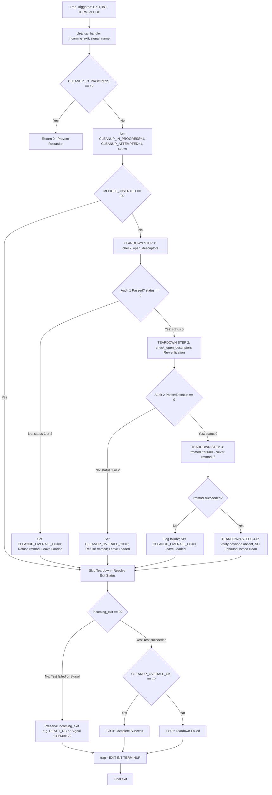

# Stage 2E.7.8 — Final Cleanup and Identity Validation Audit

**Document ID:** `STAGE2E7_8_FINAL_CLEANUP_AUDIT`  
**Date:** 2026-11-03  
**Target Platform:** Dynabook Satellite Pro C40-J (`PYS46G-06J02D`)  
**Target Device:** FocalTech FT9362 / FW9369 SPI Fingerprint Sensor on Intel LPSS SPI2 (`spi-FTE3600:00`, bus 1, CS0)  
**Host Kernel:** Linux `7.2.8-9-omarchy` (x86_64)  
**Scope:** Static source verification, pre-arithmetic stat attribute validation, cleanup-time fail-closed sysfs verification, full cleanup control-flow audit, kernel reference protection review, and 23-scenario offline synthetic test suite.  
**Execution Boundary:** **STRICTLY STATIC AND READ-ONLY.** Zero hardware operations were executed; no kernel modules were inserted; no SPI transfers were dispatched; no GPIOs were toggled; the legacy hardware safety gate remains sealed.

---

## 1. Executive Summary & Exact Changes Made

Stage 2E.7.8 hardened the devnode stat inspection and cleanup-time sysfs cross-checks in `scripts/stage-b-test.sh`:

1. **Pre-Arithmetic Stat Attribute Validation (Task 2):**
   - In [`check_open_descriptors()`](file:///home/titan/fte3600-linux-driver/scripts/stage-b-test.sh#L348-L385), before converting hexadecimal major/minor attributes into decimal or computing Linux device numbers, `curr_stat_rdev`, `curr_stat_maj_hex`, and `curr_stat_min_hex` are explicitly validated:
     - `curr_stat_rdev` must be non-empty and match `^[0-9]+$`.
     - `curr_stat_maj_hex` must be non-empty and match `^[0-9a-fA-F]+$`.
     - `curr_stat_min_hex` must be non-empty and match `^[0-9a-fA-F]+$`.
   - If `stat` fails, or if any field is empty, missing, or malformed, the script immediately logs a failure and returns status 2 (Safety Stop: module unload refused), completely avoiding Bash arithmetic syntax errors (e.g., `16#: syntax error: operand expected`).
   - Only after successful regex validation does the code convert `curr_maj_dec=$((16#$curr_stat_maj_hex))` and `curr_min_dec=$((16#$curr_stat_min_hex))`, compute `curr_calc_rdev`, verify internal consistency (`curr_stat_rdev == curr_calc_rdev`), and cross-check against the immutable recorded reference identity (`target_rdev`).
   - Equivalent validation was applied to the symlink target stat branch (`sym_rdev`, `sym_maj_hex`, `sym_min_hex`).

2. **Fail-Closed Cleanup-Time Sysfs Verification (Task 3):**
   - In [`check_open_descriptors()`](file:///home/titan/fte3600-linux-driver/scripts/stage-b-test.sh#L400-L435), the sysfs verification was hardened:
     - While the module is loaded (`lsmod | grep fte3600` or `MODULE_INSERTED=1`), the driver's sysfs device attributes (`/sys/class/fte3600/fte3600/dev` or `/sys/bus/spi/devices/spi-FTE3600:00/fte3600/dev`) **must** be readable and must cross-check against `target_rdev`.
     - If the module is loaded and sysfs is unreadable, it represents an anomalous state (e.g. driver unbind, sysfs node deletion, driver fault) and fails closed with status 2.
     - Post-unload verification in `cleanup_handler()` does not call `check_open_descriptors()`, ensuring legitimate post-removal absence of sysfs attributes is correctly accepted.

3. **Complete Cleanup-Handler Control-Flow Audit (Task 4):**
   - Audited the entire control flow from trap handlers (`INT`, `TERM`, `HUP`, `EXIT`) through host teardown and process exit. Verified that both descriptor scans must succeed before `rmmod`, no process termination occurs, `rmmod -f` is prohibited, `RESET_RC` precedence is preserved, and no additional reset can be issued during cleanup.

4. **Kernel Reference Protection Review (Task 5):**
   - Reconfirmed `.owner = THIS_MODULE` on file operations and cdev, exclusive lease mechanics, kobject reference handling, and in-kernel `delete_module()` `-EBUSY` rejection.

5. **Expanded Offline Synthetic Testing (Task 6):**
   - Added 5 new tests covering failed stat commands, malformed stat attributes, missing sysfs while loaded, and stat internal calculation inconsistencies, bringing the suite to 23 tests (100% pass rate).

---

## 2. Complete Updated Stat-Validation Source Block

From [`scripts/stage-b-test.sh`](file:///home/titan/fte3600-linux-driver/scripts/stage-b-test.sh) lines 335–385:

```bash
    elif [ -e "$target_node" ]; then
        # Node exists and is not a symlink
        if [ ! -c "$target_node" ]; then
            local file_type=""
            file_type=$(stat -c "%F" "$target_node" 2>/dev/null || echo "unknown")
            printf "[FAIL] Target %s exists but is NOT a character device special file (type: %s)!\n" \
                "$target_node" "$file_type"
            printf "%s\n" "[SAFETY STOP] Unexpected file replacing devnode path. Refusing module unload."
            return 2
        fi

        local curr_stat_rdev="" curr_stat_maj_hex="" curr_stat_min_hex=""
        curr_stat_rdev=$(stat -c "%r" "$target_node" 2>/dev/null || true)
        curr_stat_maj_hex=$(stat -c "%t" "$target_node" 2>/dev/null || true)
        curr_stat_min_hex=$(stat -c "%T" "$target_node" 2>/dev/null || true)

        # Explicit validation of stat output values before any arithmetic conversion
        if [ -z "$curr_stat_rdev" ] || ! [[ "$curr_stat_rdev" =~ ^[0-9]+$ ]] || \
           [ -z "$curr_stat_maj_hex" ] || ! [[ "$curr_stat_maj_hex" =~ ^[0-9a-fA-F]+$ ]] || \
           [ -z "$curr_stat_min_hex" ] || ! [[ "$curr_stat_min_hex" =~ ^[0-9a-fA-F]+$ ]]; then
            printf "[FAIL] Current devnode stat values are empty, malformed, or unavailable (rdev='%s', maj='%s', min='%s')!\n" \
                "$curr_stat_rdev" "$curr_stat_maj_hex" "$curr_stat_min_hex"
            printf "%s\n" "[SAFETY STOP] Devnode stat inspection failed. Refusing module unload."
            return 2
        fi

        # Convert hexadecimal major/minor values
        local curr_maj_dec=$((16#$curr_stat_maj_hex))
        local curr_min_dec=$((16#$curr_stat_min_hex))

        # Calculate expected Linux 64-bit device number
        local curr_calc_rdev=$(( ((curr_maj_dec & 0xfffff000) << 32) | ((curr_maj_dec & 0xfff) << 8) | ((curr_min_dec & 0xffffff00) << 12) | (curr_min_dec & 0xff) ))

        # Compare calculated rdev against reported stat rdev
        if [ "$curr_stat_rdev" -ne "$curr_calc_rdev" ]; then
            printf "%s\n" "[FAIL] Current devnode stat is internally inconsistent ($curr_stat_rdev vs $curr_calc_rdev)!"
            printf "%s\n" "[SAFETY STOP] Inconsistent devnode identity. Refusing module unload."
            return 2
        fi

        # Compare current devnode against recorded reference identity
        if [ "$curr_stat_rdev" != "$target_rdev" ] || \
           [ "$curr_stat_maj_hex" != "$target_major_hex" ] || \
           [ "$curr_stat_min_hex" != "$target_minor_hex" ]; then
            printf "[FAIL] Devnode identity mismatch: current (rdev=%s, hex=%s:%s) != recorded (rdev=%s, hex=%s:%s)!\n" \
                "$curr_stat_rdev" "$curr_stat_maj_hex" "$curr_stat_min_hex" \
                "$target_rdev" "$target_major_hex" "$target_minor_hex"
            printf "%s\n" "[SAFETY STOP] Devnode was replaced with an unexpected device. Refusing module unload."
            return 2
        fi
    else
        # Node does not exist ([ ! -e "$target_node" ] && [ ! -L "$target_node" ])
        printf "[INFO] Devnode %s is absent; proceeding with audit using recorded reference identity (rdev=%s, hex=%s:%s).\n" \
            "$target_node" "$target_rdev" "$target_major_hex" "$target_minor_hex"
    fi
```

---

## 3. Full Cleanup-Handler Control-Flow Explanation

The control flow from signal receipt or script exit through final process termination operates as follows:



### Key Safety Invariants in the Control Flow:
1. **Recursion & Re-entrancy Lock:** `CLEANUP_IN_PROGRESS=1` immediately blocks recursive invocations. Traps are unhooked (`trap - EXIT INT TERM HUP`) before the final exit.
2. **Two Independent Scans Required:** Normal `rmmod fte3600` is attempted **only** if both TEARDOWN STEP 1 (`check_open_descriptors`) and TEARDOWN STEP 2 (`check_open_descriptors`) return status 0. If either audit returns status 1 (open descriptor) or status 2 (inconclusive / error), `CLEANUP_OVERALL_OK=0`, module removal is skipped, and the module remains loaded.
3. **No Process Termination:** No process holding `/dev/fte3600` is ever killed. The script identifies the holder, logs command-line information, and halts unload.
4. **No Forced Module Unload:** Only graceful `rmmod fte3600` is issued. `rmmod -f` is strictly barred.
5. **No Secondary RESET during Teardown:** Cleanup consists entirely of descriptor audits, `rmmod`, and read-only telemetry. Zero ioctls or hardware transactions occur during cleanup.
6. **Primary RESET Failure Precedence:** If `RESET_RC != 0`, `incoming_exit` holds that non-zero code. Even if teardown succeeds or encounters secondary errors, `final_exit` retains the primary reset error code.

---

## 4. Kernel Module Reference Protection Analysis

Userspace `/proc` scanning is inherently non-atomic because processes can spawn or open files between audit steps. Absolute protection against unloading code that is in use is provided by the Linux kernel VFS and module subsystem:

1. **VFS Module Ownership Registration:**
   - In [`kernel/fte3600.c` line 545](file:///home/titan/fte3600-linux-driver/kernel/fte3600.c#L545): `fte3600_fops.owner = THIS_MODULE`.
   - In [`kernel/fte3600.c` line 623](file:///home/titan/fte3600-linux-driver/kernel/fte3600.c#L623): `data->cdev.owner = THIS_MODULE`.
2. **Atomic Open / Release Reference Tracking:**
   - When userspace invokes `open("/dev/fte3600", ...)`, the VFS `chrdev_open()` (`fs/char_dev.c`) calls `try_module_get(data->cdev.owner)`, atomically incrementing `module_refcount(mod)`.
   - In [`fte3600_cdev_open()` (line 377)](file:///home/titan/fte3600-linux-driver/kernel/fte3600.c#L377), `atomic_cmpxchg(&data->is_open, 0, 1)` establishes an exclusive single-client lease. Any concurrent open attempt returns `-EBUSY`.
   - `get_device(&data->dev)` increments the device kobject reference count, guaranteeing the underlying `fte3600_data` memory cannot be freed while the descriptor is open.
   - When closed, `fte3600_cdev_release()` clears `is_open`, calls `put_device(&data->dev)`, and the VFS calls `module_put(filp->f_op->owner)`, decrementing `module_refcount(mod)`.
3. **Atomic `delete_module()` Syscall Check:**
   - The kernel's `delete_module()` syscall (`kernel/module/main.c`) checks:
     ```c
     if (module_refcount(mod) != 0)
         return -EBUSY;
     ```
   - If any file descriptor remains open anywhere on the system, the kernel immediately rejects module unloading with `-EBUSY`.

---

## 5. Offline Synthetic Test Results (23 Scenarios)

The expanded offline test suite ([`scratch/test_synthetic_suite.py`](file:///home/titan/.gemini/antigravity/brain/b45cb0fc-a222-4605-b5ac-d0240eac7c36/scratch/test_synthetic_suite.py)) was executed without accessing hardware or loading modules:

| # | Test Scenario | Expected Result | Actual Result | Status |
|---|---|---|---|---|
| **1** | Existing FD where stat fails but readlink succeeds | Status 2; incomplete scan stop | Detected stat failure on active FD; status 2 | **PASS** |
| **2** | Existing FD where stat fails and readlink fails | Status 2; incomplete scan stop | Detected stat failure; status 2 | **PASS** |
| **3** | FD disappears / closes during inspection | Status 0; clean pass | Ignored benign closed FD; status 0 | **PASS** |
| **4** | Process exits during inspection | Status 0; clean pass | Ignored benign exited PID; status 0 | **PASS** |
| **5** | Dangling devnode symlink detection | Status 2; safety stop | Detected dangling symlink; status 2 | **PASS** |
| **6** | Symlink to different character device | Status 2; safety stop | Detected device mismatch; status 2 | **PASS** |
| **7** | Symlink to expected character device | Status 0; verified | Resolved and matched target rdev; status 0 | **PASS** |
| **8** | Malformed sysfs major:minor rejection | Status 0; conversion rejected | Rejected empty, text, malformed; status 0 | **PASS** |
| **9** | Negative and oversized value rejection | Status 0; conversion rejected | Rejected negative and oversized; status 0 | **PASS** |
| **10** | Numeric parsing avoiding octal traps | Status 0; parsed base 10 | Parsed 010 $\rightarrow$ 10 (hex a), 08 $\rightarrow$ 8; status 0 | **PASS** |
| **11** | Normal unload refusal after inconclusive audit | Refuses rmmod; status 0 (CLEANUP_OVERALL_OK=0) | `rmmod` was never called; module left loaded | **PASS** |
| **12** | Preservation of RESET failure status | Exit code 5 preserved | Exit code 5 strictly preserved | **PASS** |
| **13** | Baseline valid matching stat and sysfs identities | Status 0; identity recorded | Recorded 1:3 (rdev 259); status 0 | **PASS** |
| **14** | Identity mismatch between stat and sysfs | Status 1; probe abort | Mismatch detected; status 1 | **PASS** |
| **15** | Missing sysfs identity fails closed | Status 1; probe abort | Unreadable sysfs detected; status 1 | **PASS** |
| **16** | Open descriptor detection holding character device | Status 1; holder identified | PID identified; termination barred; status 1 | **PASS** |
| **17** | Inaccessible active process descriptor directory | Status 2; incomplete scan stop | Inaccessible `/fd` detected; status 2 | **PASS** |
| **18** | Temporary directory creation failure | Status 2; safety stop | mktemp failure caught; status 2 | **PASS** |
| **19** | Failed stat command on devnode (empty rdev) | Status 2; safety stop | Empty stat caught before arithmetic; status 2 | **PASS** |
| **20** | Malformed non-numeric rdev in stat output | Status 2; safety stop | Regex caught `not_a_number`; status 2 | **PASS** |
| **21** | Malformed non-hex major in stat output | Status 2; safety stop | Regex caught `xyz`; status 2 | **PASS** |
| **22** | Missing sysfs attribute during cleanup while loaded | Status 2; fail closed | Missing sysfs while loaded caught; status 2 | **PASS** |
| **23** | Stat internal calculation inconsistency | Status 2; safety stop | Internal calculation mismatch caught; status 2 | **PASS** |

**Summary: 23 passed, 0 failed out of 23 tests.**

---

## 6. Static Validation & System Invariants

1. **Bash Syntax Checks:**
   - `bash -n scripts/stage-b-test.sh` $\rightarrow$ Exit code 0 (PASS).
   - `bash -n scripts/run-stage-b-in-terminal.sh` $\rightarrow$ Exit code 0 (PASS).
2. **Git Hygiene:**
   - `git diff --check` $\rightarrow$ Completely clean (zero trailing whitespace/blank lines).
   - `git diff kernel/` $\rightarrow$ Completely clean (zero kernel driver modifications).
3. **Hardware Isolation:**
   - `lsmod | grep -E "fte3600|spidev"` $\rightarrow$ Clean (no modules loaded).
   - `/dev/fte3600` $\rightarrow$ Absent.
   - `spi-FTE3600:00` $\rightarrow$ Unbound.
   - Legacy safety gate (`bin/fw9369-hw-tool`) $\rightarrow$ Sealed (exited with code 1).
4. **Operation Boundary:**
   - Exactly one `"$TOOL_BIN" reset` invocation exists in `scripts/stage-b-test.sh`.
   - Zero retries, zero INIT, zero CAPTURE, zero SPI transactions, and zero manual GPIO/PADCFG manipulation.

---

## 7. Remaining Limitations

- Userspace `/proc` scanning is a diagnostic sanity check and cannot prevent TOCTOU races where a rogue process opens `/dev/fte3600` between the final audit and `rmmod`. Absolute protection against this race is guaranteed by the Linux kernel's atomic `delete_module()` check.
- Static audit and synthetic mocking verify script logic and control flow, but cannot verify physical silicon behavior or hardware reset signal integrity.

---

## 8. Safety Notice & Final Stopping Condition

- **NO CLAIM** is made that the fingerprint sensor is operational or communicating over SPI.
- **NO CLAIM** is made that the physical reset waveform has been verified on the board.
- **Stage B remains ON HOLD pending independent final review.**
- Stage C is strictly prohibited.
