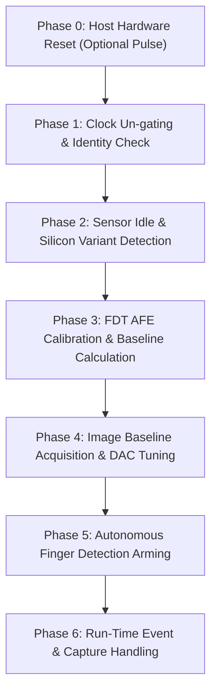
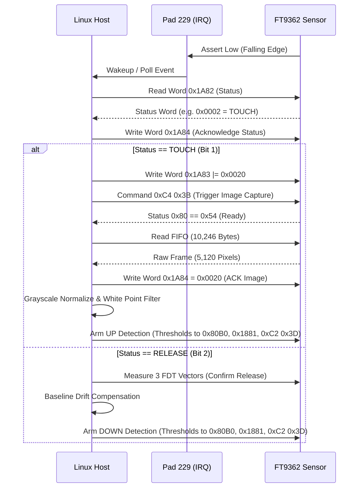

# FT9362 / FW9369 Register-Level Initialization Sequence

**Document ID:** `FT9362_INITIALIZATION_SEQUENCE`  
**Date:** 2026-11-02  
**Target Device:** FocalTech FT9362 Fingerprint Sensor (FW9369 Architecture)  
**Host SPI Bus:** Mode 0 (`CPOL=0, CPHA=0`), 8 bits/word, 1 MHz clock  
**Source References:**  
- `research/libfprint-fte3600/libfprint/drivers/fte3600/fw9369_startup.c`
- `research/libfprint-fte3600/libfprint/drivers/fte3600/fw9369_fdt.c`
- `research/libfprint-fte3600/libfprint/drivers/fte3600/capture.c`
- `research/libfprint-fte3600/libfprint/drivers/fte3600/fw9369_release.c`
- `research/dynabook-windows-driver/extracted/Drivers/ftWbioUmdfDriverV2.dll`
- `research/ftexx00-ubuntu/alt/focal_spi.c`

---

## 1. FocalTech SPI Framing and Command Encoding

All SPI transactions are full-duplex transfers with CS asserted low for the duration of each transfer frame. The sensor command framing follows standard FocalTech protocol formats:

### 1.1 Direct 3-Byte Control Command
Used to send state-machine commands (e.g. Wake, Idle, Trigger).
- **MOSI:** `[ CMD_A, CMD_B, 0x00 ]` (3 bytes)
- **MISO:** Ignored (clocked out during transfer)

Common command pairs:
| Command Pair | Function | Description |
| :--- | :--- | :--- |
| `0x5A, 0xA5, 0x00` | Sensor Wake / Active | Enters active state from idle |
| `0xC0, 0x3F, 0x00` | Sensor Sleep / Deep Idle | Used during idle check fallback |
| `0xA5, 0x5A, 0x00` | Sensor Standby / Ready | Prepares sensor registers for access |
| `0xC2, 0x3D, 0x00` | Trigger FDT Scan | Initiates autonomous finger detection |
| `0xC4, 0x3B, 0x00` | Trigger Image Scan | Initiates full-frame capacitive capture |

### 1.2 8-Bit Byte Register Write (4 Bytes)
- **MOSI:** `[ 0x09, 0xF6, ADDR_8, DATA_8 ]`
- **MISO:** `[ 0x00, 0x00, 0x00, 0x00 ]`

### 1.3 8-Bit Byte Register Read (5 Bytes)
- **MOSI:** `[ 0x08, 0xF7, ADDR_8, 0x00, 0x00 ]`
- **MISO:** `[ 0x00, 0x00, 0x00, 0x00, DATA_8 ]` (Data received in byte 4)

### 1.4 16-Bit Word Register Write (8 Bytes)
- **MOSI:** `[ 0x05, 0xFA, (0x80 | (ADDR_16 >> 8)), (ADDR_16 & 0xFF), 0x00, 0x01, (DATA_16 >> 8), (DATA_16 & 0xFF) ]`
- **MISO:** `[ 0x00, 0x00, 0x00, 0x00, 0x00, 0x00, 0x00, 0x00 ]`

### 1.5 16-Bit Word Register Read (12 Bytes)
- **MOSI:** `[ 0x04, 0xFB, (0x80 | (ADDR_16 >> 8)), (ADDR_16 & 0xFF), 0x00, 0x01, 0x00, 0x00, 0x00, 0x00, 0x00, 0x00 ]`
- **MISO:** `[ 0x00, 0x00, 0x00, 0x00, 0x00, 0x00, DATA_H, DATA_L, CRC_H, CRC_L, 0x00, 0x00 ]`
  - Bytes 6–7: Received 16-bit word (Big-Endian).
  - Bytes 8–9: Hardware CRC-CCITT of the received word.

### 1.6 Multi-Word Block / Bank Write (6 + 2*N Bytes)
Used to write channel threshold banks (e.g. 8 words = 16 bytes payload):
- **MOSI:** `[ 0x05, 0xFA, 0x80, BANK_ADDR, 0x00, COUNT, WORD_0_H, WORD_0_L, ..., WORD_N_H, WORD_N_L ]`

### 1.7 Multi-Word Block / Bank Read (6 + 2*N Bytes)
Used to read ADC measurement channels (e.g. 4 channels = 8 bytes data):
- **MOSI:** `[ 0x04, 0xFB, 0x80, BANK_ADDR, 0x00, COUNT, 0x00, ... ]`
- **MISO:** Bytes 6 to `6 + 2*N - 1` contain the 16-bit words.

### 1.8 Burst Image FIFO Read (10,246 Bytes)
Used to read a raw 64 × 80 capacitive fingerprint frame (5,120 pixels × 2 bytes = 10,240 bytes):
- **MOSI Prefix (6 Bytes):** `[ 0x06, 0xF9, 0x9A, 0x05, 0x14, 0x00 ]` followed by 10,240 dummy bytes (`0x00`).
- **MISO:** Bytes 6 to 10,245 contain 5,120 16-bit big-endian ADC pixel values.

---

## 2. Complete Step-by-Step Initialization Sequence

---

### Phase 0: Hardware Reset and Settle (Cold Start / Recovery)
*Reference: `research/ftexx00-ubuntu/alt/focal_spi.c:162-181`*

When recovering from an unknown state or performing a full cold start:
1. Ensure `RST_N` (PCH Pad 14) is held low (logical active): wait 5–10 ms.
2. Deassert `RST_N` high (logical inactive): write physical high (`0x84000201`).
3. Delay 50 ms to allow the sensor internal power-on reset (POR) circuit and ROM bootloader to settle.
*(Note: As verified in Stage 2A, if the system firmware already booted the machine with Pad 14 held high, Phase 1 can proceed directly).*

---

### Phase 1: Clock Un-gating & Identity Verification
*Reference: `research/libfprint-fte3600/libfprint/drivers/fte3600/fw9369_startup.c:326-347`*

1. **Clock Un-gating:**
   - Write byte `0x01` to register `0xC6`:
     - MOSI: `[ 0x09, 0xF6, 0xC6, 0x01 ]`
   - Wait 4 ms with CS deasserted.
   - Read byte from register `0xC6`:
     - MOSI: `[ 0x08, 0xF7, 0xC6, 0x00, 0x00 ]`
     - Verify received byte == `0x01`. (Repeat up to 31 times if not ready).
2. **Silicon Identity Check:**
   - Read 16-bit word from register `0x1A8B`:
     - MOSI: `[ 0x04, 0xFB, 0x9A, 0x8B, 0x00, 0x01, 0x00, 0x00, 0x00, 0x00, 0x00, 0x00 ]`
     - Verify MISO bytes 6–7 == `0x9362`.
     - Verify CRC-CCITT (bytes 8–9) matches polynomial `0x1021`.
3. **Interrupt Flags Clear:**
   - Write word `0xFFFF` to register `0x1A84`:
     - MOSI: `[ 0x05, 0xFA, 0x9A, 0x84, 0x00, 0x01, 0xFF, 0xFF ]`

---

### Phase 2: Sensor Idle & Silicon Variant Detection
*Reference: `research/libfprint-fte3600/libfprint/drivers/fte3600/fw9369_startup.c:98-111, 350-380`*

1. **Sensor Idle Handshake:**
   - Command: `[ 0x5A, 0xA5, 0x00 ]`
   - Wait 1 ms.
   - Read byte from `0x80`: `[ 0x08, 0xF7, 0x80, 0x00, 0x00 ]`.
   - If received byte != `0x50`:
     - Command: `[ 0xC0, 0x3F, 0x00 ]`
     - Wait 1 ms.
   - Command: `[ 0xA5, 0x5A, 0x00 ]`
2. **Configuration Pulses:**
   - Loop `i` from 0 to 1:
     - Write byte to `0xF1`: `(i == 0) ? 0x03 : 0x13`
     - Write byte to `0xF4`: `0xC0`
     - Write byte to `0xF4`: `0xC1`
     - Write byte to `0xF4`: `0xC0`
     - Write byte to `0xF4`: `0xC0`
     - Read byte from `0xF3`
3. **Foundry / Process Detection:**
   - Read byte from `0x9B` up to 10 times:
     - `code = read_byte(0x9B) >> 2`
     - If `code == 0x13`: `foundry = 0xAA` (SMIC silicon variant; sets period = 150)
     - If `code == 0x00`: Standard silicon variant (sets period = 200)
4. **Second Interrupt Clear & Reset State:**
   - Write word `0xFFFF` to register `0x1A84`.
   - Initialize internal tracking parameters:
     - `image_dac = 54`
     - `fdt_dac = 27` (for channel_mode 1)
     - `image_median = 512`
     - `period = (foundry == 0xAA) ? 150 : 200`
     - `shift = 2`, `image_count = 1`

---

### Phase 3: FDT (Finger Detection Threshold) Calibration
*Reference: `research/libfprint-fte3600/libfprint/drivers/fte3600/fw9369_fdt.c:135-260, 310-360`*

FDT calibration tunes the analog frontend for the capacitive touch sense electrodes.

1. **AFE Register Configuration:**
   - Set idle state (`0x5A 0xA5 ... 0xA5 0x5A`).
   - Write word `0x1801` = `0xFC80 | fdt_dac` (AFE DAC control).
   - Write word `0x180C` = `0x0000` (calibration mode active).
   - Write word `0x1881` = `((1000/rate - 1) << 8) | ((repeat - 1) << 2)` (Timing control).
   - Write word `0x1800` = `0x07FE` (4-channel differential mode).
   - Write word `0x1804` = `0x27C8 | (multiplier - 1)` (Integration multiplier).
   - Write word `0x1807` = `0x1671`.
   - Write word `0x1808` = `0x0801`.
   - Write word `0x1887` = `0x0005`.
   - Read/Modify word `0x1806`: preserve `0xC07F`, set `0x0980`.
   - Read/Modify word `0x180A`: preserve `0xC000`, set `0x0987`.
   - Read/Modify word `0x180B`: preserve `0xC000`, set `0x0491`.
   - Read/Modify word `0x1805`: clear bit 4 (`& 0xFFEF`).
   - Write word `0x180D` = `(value & 0xFC00) | 0x0384`.
   - Read/Modify word `0x1888`: preserve `0xFC03`, clear rest.
2. **Protected Register Bank Update:**
   - Unlock protected registers: write byte `0x9A` = `0x5A`.
   - Modify registers `0x00C0`, `0x00C1`, `0x00C2`:
     - `0x00C0`: preserve `0xE000`, set `0x0444`.
     - `0x00C1`: preserve `0xFFC0`, set `0x0021`.
     - `0x00C2`: preserve `0xFFFF`, set `0x00C0`.
   - Lock protected registers: write byte `0x9A` = `0x00`.
3. **Threshold & Filter Configuration:**
   - Modify word `0x1880`: `(threshold_high << 8) | threshold_low` (`0x2D32` for 45/50).
   - Modify word `0x1881`: preserve `0xFFFE`, set `0x0082`.
   - Modify word `0x1884`: preserve `0xFFF8`, set `(average - 1)` (`0x0003` for 4-sample avg).
   - Write word `0x1A8A` = `0x00FF`.
   - Modify word `0x1A83`: set bit 3 (`| 0x0008`).
4. **FDT Calibration DAC Search:**
   - Binary search sweeps `fdt_dac` (0..127) using physical ADC reads until channel voltages land within the target window (target ~512 ADC counts).
5. **Channel Baseline Measurement (10 Samples):**
   - Sample 10 consecutive channel measurements:
     - Trigger scan: modify `0x1881` |= 2, command `[ 0xC2, 0x3D, 0x00 ]`, delay 1 ms, write `0x1885` = 1.
     - Poll status word `0x1A82`: wait until bit 3 (`0x0008`) is set.
     - Read 4 channels: MOSI `[ 0x04, 0xFB, 0x80, (foundry==0xAA ? 0xE8 : 0xB8), 0x00, 0x04, ... ]`.
   - Compute channel minima across the 10 samples: verify `300 <= minima[c] <= 700`.
   - Compute touch threshold:
     `fdt_reference[c] = fdt_down[c] = fdt_up[c] = max(0, minima[c] - 30)`.
   - Compute CRC: `fdt_down_crc = crc(fdt_down, 4)`.

---

### Phase 4: Image Baseline Acquisition & DAC Tuning
*Reference: `research/libfprint-fte3600/libfprint/drivers/fte3600/fw9369_startup.c:265-315` and `capture.c:165-280`*

1. **Capacitive Pixel Array AFE Setup:**
   - Write word `0x1801` = `0xFC80 | image_dac`.
   - Write word `0x1800` = `0x4FFE` (Full image capture mode).
   - Write word `0x1804` = `0x27C0 | shift | (shift >= 2 ? 8 : 0)`.
   - Modify words `0x1806`, `0x180A`, `0x180B`.
   - Write word `0x1807` = `((period - 1) << 5) | 1`.
   - Write word `0x1887` = `0x0002`.
   - Modify word `0x1805`: clear bits 4..7 (`& 0xFF0F`).
   - Modify word `0x1811`: preserve `0xFC00`, set `0x01FE`.
   - Modify word `0x1A83`: set bits 5 and 6 (`0x0060`).
   - Write byte sequences:
     - `0x8E = 0xF4`
     - `0x90 = 0x00`
     - `0x91 = 0x07`
     - `0x92 = 0xD0`
     - `0x90 = 0x01`
2. **DAC Binary Search (`fte3600_image_search`):**
   - Perform binary search on `image_dac` (0..127):
     - For each candidate DAC, acquire 1 frame:
       - Command `[ 0xC4, 0x3B, 0x00 ]` (Trigger image capture).
       - Wait 1 ms.
       - Poll byte `0x80`: wait until value == `0x54` (capture complete).
       - Modify word `0x1800` |= 1; wait 1 ms.
       - Read FIFO (10,246 bytes): `[ 0x06, 0xF9, 0x9A, 0x05, 0x14, 0x00 ]` + 10,240 dummy bytes.
       - Clear image flag: write word `0x0020` to `0x1A84`.
     - Calculate median pixel intensity of the 5,120 16-bit samples.
     - Search stops when median is closest to 512 (typically `dac` ~ 54–60).
3. **Store Baseline Frame:**
   - Store the calibrated frame into `baseline[5120]`.
   - Compute baseline CRC: `baseline_crc = crc(baseline, 128)`.
   - Set baseline ready flags: `baseline_flag_1 = 1`, `baseline_flag_2 = 1`.

---

### Phase 5: Autonomous Finger Detection Arming
*Reference: `research/libfprint-fte3600/libfprint/drivers/fte3600/fw9369_startup.c:385-420` and `fw9369_release.c:270-320`*

1. **Write Calibrated Thresholds to Sensor Bank:**
   - Unlock protected registers: write byte `0x9A` = `0x5A`.
   - Write 8 threshold words to address `0x80B0` (or `0x80E0` if foundry == `0xAA`):
     - MOSI: `[ 0x05, 0xFA, 0x80, BANK_ADDR, 0x00, 0x08, T0_H, T0_L, ..., T7_H, T7_L ]`
   - Lock protected registers: write byte `0x9A` = `0x00`.
2. **Configure Interrupt Status & Wake Flags:**
   - Read word `0x1881`, modify `(value & 0xFF7C) | 0x0081` (Arm Down detection), write back.
   - Read word `0x1A83`, modify `(value & 0xFF80) | 0x0016` (Linux detection mode), write back.
   - Clear all pending interrupt events: write word `0x002F` to `0x1A84`.
3. **Start Autonomous Detector:**
   - Command: `[ 0xC2, 0x3D, 0x00 ]`
   - Wait 1 ms with CS high.
4. **Result:**
   - The sensor enters autonomous low-power finger detection.
   - CS is released high; SPI bus is completely idle.
   - When a finger is placed on the sensor, the sensor automatically drives the hardware interrupt line (PCH Pad 229) low and latches status in register `0x1A82`.

---

### Phase 6: Run-Time Event Handling & Image Acquisition
*Reference: `research/libfprint-fte3600/libfprint/drivers/fte3600/fw9369_release.c:515-640` and `capture.c`*

---

## 3. Register Summary Map

| Register | Width | Access | Name / Function |
| :--- | :--- | :--- | :--- |
| `0x80` | 8-bit | RO | Sensor State Status (`0x50` = ready, `0x54` = frame ready) |
| `0x8E`..`0x92` | 8-bit | WO | AFE Timing and Gain Configuration |
| `0x9A` | 8-bit | WO | Protected Register Lock/Unlock (`0x5A` = unlock, `0x00` = lock) |
| `0x9B` | 8-bit | RO | Foundry Process ID (`code >> 2 == 0x13` -> SMIC `0xAA`) |
| `0xC6` | 8-bit | RW | Clock / Power Gating (`0x01` = ungate clock / awake) |
| `0xF1`..`0xF4` | 8-bit | RW | Digital Core Configuration & Pulse Generation |
| `0x1800` | 16-bit | RW | Capture Mode Control (`0x07FE` = FDT, `0x4FFE` = Image) |
| `0x1801` | 16-bit | RW | AFE DAC Level Control (`0xFC80 \| DAC`) |
| `0x1804` | 16-bit | RW | Integration Shift and Multiplier |
| `0x1805` | 16-bit | RW | Analog Control Flags |
| `0x1806`..`0x180B` | 16-bit | RW | Front-End Filter & Clock Multipliers |
| `0x180C` | 16-bit | RW | Calibration Mode Active Flag (`0x0000` = cal, `0x0600` = run) |
| `0x180D` | 16-bit | RW | Analog Trimming Offset |
| `0x1811` | 16-bit | RW | Bias Current Trimming |
| `0x1880` | 16-bit | RW | FDT Threshold Registers (`High[15:8] \| Low[7:0]`) |
| `0x1881` | 16-bit | RW | Detector State & Rate Control (`0x81` = Arm Down, `0x00` = Arm Up) |
| `0x1884` | 16-bit | RW | FDT Multi-Sample Averaging Control |
| `0x1885` | 16-bit | WO | FDT Manual Measure Trigger (`1` = start) |
| `0x1887` | 16-bit | RW | Channel Route Multiplexer (`5` = FDT, `2` = Image) |
| `0x1888` | 16-bit | RW | Secondary AFE Tuning |
| `0x1A82` | 16-bit | RO | Interrupt Status Flags (Bit 1=Touch, Bit 2=Release, Bit 5=Image) |
| `0x1A83` | 16-bit | RW | Linux Event Mask & Detection Sub-mode |
| `0x1A84` | 16-bit | WO | Interrupt Acknowledge Register (Writing clears flags) |
| `0x1A8A` | 16-bit | RW | Interrupt Mask Control |
| `0x1A8B` | 16-bit | RO | Silicon Chip ID Register (Returns `0x9362` + CRC) |
| `0x80B0` | Bank | RW | Calibrated FDT Threshold Bank (8 words) |
