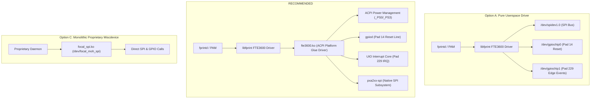

# FT9362 Linux Driver Architecture Specification

**Document ID:** `FT9362_LINUX_DRIVER_ARCHITECTURE`  
**Date:** 2026-11-02  
**Target Hardware:** Dynabook Satellite Pro C40-J (`PYS46G-06J02D`)  
**Host Controller:** Intel LPSS SPI (`pxa2xx-spi.2`) / Tiger Lake-UP3 PCH-LP GPIO  
**Target Subsystems:** Linux SPI (`spidev`), Linux GPIO (`gpiolib` / `gpiochip`), Linux UIO / Interrupts, `libfprint` v2

---

## 1. Architectural Overview & Design Goals

The Dynabook Satellite Pro C40-J integrates a FocalTech FT9362 fingerprint sensor connected via a 4-wire SPI bus and two dedicated PCH GPIO lines (Pad 14 for reset, Pad 229 for interrupts) under ACPI device `\_SB.PCI0.SPI2.FP00` (HID `FTE3600`).

The primary objectives for the Linux driver architecture are:
1. **Safety & Non-Destructiveness:** Zero risk to host stability, peripheral buses, or hardware wear.
2. **Upstream Compatibility:** Full compatibility with modern systemd/PAM biometric authentication via standard `fprintd` and `libfprint` v2.
3. **Robust Power Management:** Safe handling of Modern Standby (S0ix / S2idle) and S3 sleep states.
4. **Maintenance Simplicity:** Minimizing reliance on fragile kernel out-of-tree builds where standard kernel interfaces suffice.

---

## 2. Evaluation of Architectural Options



### Option A: Pure Userspace Architecture (`spidev` + `libgpiod`)
- **Mechanism:** The host binds `spidev` directly to `spi-FTE3600:00` using `driver_override`. The reset line (Pad 14) and interrupt line (Pad 229) are requested via the Linux GPIO character device API (`/dev/gpiochip0`, `/dev/gpiochip1`).
- **Advantages:**
  - Zero out-of-tree kernel modules required.
  - Immune to kernel updates / ABI breakage.
  - Prototyping and diagnostics can run with standard tools.
- **Disadvantages:**
  - Interrupt latency: Polling `/dev/gpiochip1` for line edge events in userspace incurs context-switch overhead compared to kernel IRQ handlers.
  - Power management: Userspace cannot hook into kernel ACPI power transitions (`_PS0`/`_PS3`, suspend/resume notifier) directly without a systemd sleep hook.
  - Pad numbering: Requires user-space code to correlate ACPI pin tables to physical gpiochip offsets (Pad 14 on Community 0, Pad 229 on Community 1).

### Option B: Dual-Tier Architecture (Glue Module + `libfprint` Driver) — **RECOMMENDED**
- **Mechanism:** A thin kernel platform driver (`fte3600.ko`, as implemented in `kernel/fte3600.c`) claims the ACPI device `FTE3600`. It configures power management, claims the reset GPIO and interrupt GPIO, and exposes clean, well-scoped character interfaces:
  - SPI: Standard `spidev` bound to the ACPI child device.
  - Reset: Exposed via a controlled GPIO interface or sysfs reset trigger.
  - Interrupt: Exposed via a standard Userspace I/O (UIO) device (`/dev/uio*`) that unblocks `poll()` on physical falling edges.
  Userspace (`libfprint`) implements the sensor protocol, AFE tuning, calibration, and image processing.
- **Advantages:**
  - Robust interrupt delivery with zero polling overhead.
  - Perfect integration with kernel ACPI PM (`suspend_noirq`, `resume_noirq`, runtime PM).
  - Clean separation: Kernel module contains zero proprietary sensor registers or algorithms; userspace contains the biometric logic.
- **Disadvantages:**
  - Requires maintaining a small out-of-tree kernel module (via DKMS).

### Option C: Monolithic Kernel Miscdevice (`focal_spi.ko`)
- **Mechanism:** As seen in `research/ftexx00-ubuntu/alt/focal_spi.c`, an all-in-one kernel driver creating `/dev/focal_moh_spi`.
- **Disadvantages:**
  - Non-standard interface rejected by upstream `libfprint`.
  - Tightly coupled custom ioctl interface that breaks across kernel major versions.
  - Discouraged in modern Linux systems.

---

## 3. Recommended Implementation Roadmap

To achieve maximum reliability without risking system stability, development is structured into two sequential tiers:

### Tier 1: User-Space Standalone Diagnostic Suite
Before integrating into the desktop biometric stack, implement a standalone userspace test suite (`tools/stage2b-calibrate.c` and `tools/stage2c-capture.c`):
- Uses pure `spidev` (as proven in Stage 2A).
- Interacts with Pad 14 and Pad 229 via `/dev/gpiochip*`.
- Verifies AFE DAC calibration, 4-channel FDT measurements, and raw frame acquisition into PPM/PGM image files.
- Provides static proof of sensor operation without modifying `/etc/pam.d` or installing background daemons.

### Tier 2: System-Level `libfprint` & Platform Driver Integration
Once Tier 1 captures pristine fingerprint frames:
1. Compile and install `kernel/fte3600.c` as a DKMS package (`fte3600-dkms`).
2. Build the `libfprint` FTE3600 driver plugin (integrating `fw9369_startup.c`, `fw9369_fdt.c`, `capture.c`, `fw9369_release.c`, and `fw9369_grayscale.c`).
3. Deploy udev rules (`/usr/lib/udev/rules.d/70-fte3600.rules`) granting the `fprint` system group access to the character devices.
4. Restart `fprintd.service` and enroll fingerprints using standard `fprintd-enroll`.

---

## 4. Component Interface Specifications

### 4.1 Kernel Subsystem Interfaces (`kernel/fte3600.c`)
- **ACPI Match Table:** `ACPI_DEVICE_ID` matching `"FTE3600"`.
- **SPI Resource:** Discovers SPI serial bus parameters from `_CRS` (`Mode 0`, `1 MHz`, `Active Low CS`).
- **Reset Resource:** Discovers `GpioIo` pin 14. Requests line using `GPIOD_OUT_LOW` (active-low logical representation; 0 = physical High / inactive).
- **Interrupt Resource:** Discovers `GpioInt` pin 229. Requests IRQ with `IRQF_TRIGGER_FALLING | IRQF_ONESHOT`.
- **UIO Interface:** Registers a UIO device (`/dev/uioX`) named `fte3600-irq`. In the hardirq handler, calls `uio_event_notify()` to wake waiting userspace threads.
- **Power Management:** Hooks `dev_pm_ops`:
  - `suspend`: Sends sensor to sleep (or asserts reset), marks device inactive.
  - `resume`: Restores power, deasserts reset, re-arms UIO.

### 4.2 Userspace Protocol Layer (`libfprint`)
The userspace driver is structured as a standard `FpDevice` class in `libfprint`:
1. **Device Discovery:** Matches `spidev` node with ACPI ancestry pointing to `FTE3600`.
2. **Session Open:**
   - Opens `/dev/spidevX.Y`, sets `SPI_IOC_WR_MODE32` to 0, speed to 1 MHz, bits to 8.
   - Opens `/dev/uioX` for interrupt notifications.
3. **Startup & Baseline Initialization:**
   - Executes Phase 1 to Phase 5 of the initialization sequence.
   - Computes FDT thresholds and acquires the baseline frame into memory.
4. **Finger Polling (`fpi_device_action_next`):**
   - Polls `/dev/uioX` with timeout.
   - On interrupt, reads status word `0x1A82`.
   - If Touch detected (`0x0002`), triggers image scan, reads 10,246 bytes from FIFO, processes image, and passes candidate print to `fpi_image_device_report_finger()`.
   - Normalizes grayscale using `fw9369_grayscale.c` floating-point pipeline.
   - Matches or enrolls via standard Bozorth3 / NBIS minutiae algorithms in `libfprint`.
5. **Finger Release & Drift Compensation:**
   - On release interrupt (`0x0004`), updates FDT drift tracking, runs warm baseline update, and re-arms DOWN detection.

---

## 5. Security & Permission Architecture

1. **Least Privilege Principle:**
   Direct root execution is not required for daily operation.
2. **Udev Rules (`70-fte3600.rules`):**
   ```udev
   # FTE3600 character interfaces restricted to fprint group
   SUBSYSTEM=="spidev", ATTRS{name}=="FTE3600:00", GROUP="fprint", MODE="0660"
   SUBSYSTEM=="uio", ATTRS{name}=="fte3600-irq", GROUP="fprint", MODE="0660"
   SUBSYSTEM=="gpio", KERNELS=="*fte3600*", GROUP="fprint", MODE="0660"
   ```
3. **SELinux / AppArmor:**
   Standard `fprintd` policies accommodate spidev/uio file descriptors when scoped by udev tagging.
