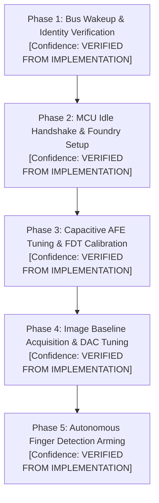

# FW9369 Unified Sensor Initialization Specification

**Specification Document:** `FW9369_UNIFIED_INITIALIZATION_SPECIFICATION`  
**Revision:** 1.0  
**Date:** 2026-11-02  
**Target Silicon:** FocalTech FT9362 / FW9369 (Chip ID `0x9362`, CRC `0x1C53`)  
**Target Host Controller:** Intel Tiger Lake-LP PCH LPSS SPI (`pxa2xx-spi.2`) / Dynabook Satellite Pro C40-J  
**Transport Medium:** Linux `/dev/spidev1.0` (SPI Mode 0, 8 bits/word, 1,000,000 Hz, `spidev.bufsiz >= 65536`)  
**Scope:** Canonical, mathematically and empirically reconciled specification governing all initialization, calibration, and capture operations.  
**Execution Boundary:** Specification document only. Hardware execution is strictly prohibited.

---

## 1. Complete Operation Ordering

The initialization pipeline consists of five strictly ordered operational phases:



---

## 2. Register and Command Allowlist by Phase

Every allowable register access is strictly categorized and assigned an authoritative confidence classification:

| Phase | Register / Command | Type | MOSI Payload / Packet | Purpose | Confidence Classification |
| :--- | :--- | :---: | :--- | :--- | :--- |
| **Phase 1** | `0xC6` | W/R | `[ 0x09, 0xF6, 0xC6, 0x01 ]`<br>`[ 0x08, 0xF7, 0xC6, 0x00, 0x00 ]` | Un-gate transceiver clock; verify `0x01` | **VERIFIED FROM IMPLEMENTATION** |
| **Phase 1** | `0x1A8B` | R | `[ 0x04, 0xFB, 0x9A, 0x8B, 0x00, 0x00, 0x00, 0x00, 0x00, 0x00 ]` | Read Chip ID; verify `0x9362` + CRC `0x1C53` | **CORROBORATED BY INDEPENDENT SOURCE** |
| **Phase 1** | `0x1A84` | W | `[ 0x05, 0xFA, 0x9A, 0x84, 0x00, 0x01, 0xFF, 0xFF ]` | Clear pending interrupt latches | **VERIFIED FROM IMPLEMENTATION** |
| **Phase 2** | `0x5A 0xA5` | CMD | `[ 0x5A, 0xA5, 0x00 ]` | MCU `wake` request to prepare idle | **VERIFIED FROM IMPLEMENTATION** |
| **Phase 2** | `0x80` | R | `[ 0x08, 0xF7, 0x80, 0x00, 0x00 ]` | Verify MCU state `0x50` (idle) | **VERIFIED FROM IMPLEMENTATION** |
| **Phase 2** | `0xC0 0x3F` | CMD | `[ 0xC0, 0x3F, 0x00 ]` | Exception strobe (only if `0x80 != 0x50`) | **VERIFIED FROM IMPLEMENTATION** |
| **Phase 2** | `0xA5 0x5A` | CMD | `[ 0xA5, 0x5A, 0x00 ]` | MCU `end` delimiter (mandatory termination) | **VERIFIED FROM IMPLEMENTATION** |
| **Phase 2** | `0xF1` | W | `[ 0x09, 0xF6, 0xF1, 0x03 ]`<br>`[ 0x09, 0xF6, 0xF1, 0x13 ]` | Foundry test clock gating | **VERIFIED FROM IMPLEMENTATION** |
| **Phase 2** | `0xF4` | W | `[ 0x09, 0xF6, 0xF4, 0xC0 ]` | Foundry test control | **VERIFIED FROM IMPLEMENTATION** |
| **Phase 2** | `0x1A83` | W | `[ 0x05, 0xFA, 0x9A, 0x83, 0x00, 0x01, 0x00, 0x10 ]` | Foundry test strobe pulse | **VERIFIED FROM IMPLEMENTATION** |
| **Phase 3** | `0x1801` | W/R | `[ 0x05, 0xFA, 0x98, 0x01, 0x00, 0x01, 0xFC, 0x80 | dac ]` | FDT DAC tuning setting (`0..127`) | **VERIFIED FROM IMPLEMENTATION** |
| **Phase 3** | `0x1800..0x180D` | W/R | AFE configuration table words | Program capacitive integration & timing | **VERIFIED FROM IMPLEMENTATION** |
| **Phase 3** | `0x1881, 0x1887` | W/R | AFE configuration table words | Timing control and channel mode | **VERIFIED FROM IMPLEMENTATION** |
| **Phase 3** | `0x9A` | W | `[ 0x09, 0xF6, 0x9A, 0x5A ]` / `[ 0x09, 0xF6, 0x9A, 0x00 ]` | Unlock / Lock protected analog trims | **VERIFIED FROM IMPLEMENTATION** |
| **Phase 3** | `0x00C0..0x00C2`| R/W | Protected analog trim registers | Analog front-end fine trim (requires 0x9A=0x5A) | **VERIFIED FROM IMPLEMENTATION** |
| **Phase 3** | `0x1885` | W | `[ 0x05, 0xFA, 0x98, 0x85, 0x00, 0x01, 0x00, 0x01 ]` | Trigger FDT measurement scan | **VERIFIED FROM IMPLEMENTATION** |
| **Phase 3** | `0x1A82` | R | `[ 0x04, 0xFB, 0x9A, 0x82, 0x00, 0x01, 0, 0, 0, 0, 0, 0 ]` | Poll ADC ready bit (bit 3) | **VERIFIED FROM IMPLEMENTATION** |
| **Phase 3** | `0x80B8` | R | `[ 0x04, 0xFB, 0x80, 0xB8, 0x00, 0x04, ... ]` | Read 4-channel FDT ADC measurements + CRC | **VERIFIED FROM IMPLEMENTATION** |
| **Phase 4** | `0x1804, 0x1807`| W | Pixel integration shift & period words | Configure pixel sampling engine | **VERIFIED FROM IMPLEMENTATION** |
| **Phase 4** | `0x8E, 0x90..0x92`| W | Burst frame configuration bytes | Arm frame DMA readout | **VERIFIED FROM IMPLEMENTATION** |
| **Phase 4** | FIFO Read | R | `[ 0x06, 0xF9, 0x9A, 0x05, 0x14, 0x00 ]` + 10,240 zero bytes | Burst read 5,120 16-bit raw pixel words | **VERIFIED FROM IMPLEMENTATION** |
| **Phase 5** | `0x80B0..0x80B3`| W | Calibrated `fdt_down[0..3]` threshold vector | Program detection threshold limits | **VERIFIED FROM IMPLEMENTATION** |
| **Phase 5** | `0x1A83, 0x1A84`| W | Set interrupt configuration bits (`0x16`, `0x2F`) | Arm hardware interrupt line | **VERIFIED FROM IMPLEMENTATION** |
| **Phase 5** | `0xC2 0x3D` | CMD | `[ 0xC2, 0x3D, 0x00 ]` | Arm autonomous detection state machine | **VERIFIED FROM IMPLEMENTATION** |

---

## 3. Forbidden Register and Command List

Access to the following registers and command sequences is **STRICTLY PROHIBITED**:

| Register / Command | Prohibition Category | Reason & Danger |
| :--- | :---: | :--- |
| **OTP / Flash Programming** | **PROHIBITED** | Writing to OTP/EFUSE registers risks permanent silicon destruction. |
| **`write_byte(0x9A, 0x5A)` without RAII Lock** | **PROHIBITED** | Leaving `0x9A` unlocked exposes analog trim banks to accidental corruption. |
| **Standalone `0x5A` without `0xA5`** | **PROHIBITED** | Strands the MCU command decoder in an un-terminated dialog. |
| **Segmented FIFO Reads** | **PROHIBITED** | Deasserting CS# mid-frame resets sensor read pointer and corrupts image. |
| **Direct PCH MMIO Writes** | **PROHIBITED** | Violates kernel isolation; risks chipset peripheral bus crash. |
| **Writing to Pad 14 via userspace** | **PROHIBITED** | ACPI exclusive line; causes `-EBUSY` or kernel desynchronization. |

---

## 4. SPI Packet Formats

The FT9362 uses a framed SPI wire protocol with complementary command nibbles:

1. **Byte Write (`0x09`):**
   `MOSI: [ 0x09, 0xF6, <ADDR_8>, <DATA_8> ]`
2. **Byte Read (`0x08`):**
   `MOSI: [ 0x08, 0xF7, <ADDR_8>, 0x00, 0x00 ]`  
   `MISO: [ 0x00, 0x00, 0x00, 0x00, <DATA_8> ]` (data returned at byte index 4).
3. **Word Write (`0x05`):**
   `MOSI: [ 0x05, 0xFA, 0x80 | (ADDR >> 8), ADDR & 0xFF, (COUNT >> 8), COUNT & 0xFF, DATA_MSB, DATA_LSB ]`
4. **Word Read (`0x04`):**
   `MOSI: [ 0x04, 0xFB, 0x80 | (ADDR >> 8), ADDR & 0xFF, (COUNT >> 8), COUNT & 0xFF, 0x00, 0x00, ... ]`  
   `MISO: [ Preamble 6 bytes ... DATA_MSB, DATA_LSB, ..., CRC_MSB, CRC_LSB ]`
5. **Command Packet:**
   `MOSI: [ <CMD_A>, <CMD_B>, 0x00 ]` (e.g. `[ 0x5A, 0xA5, 0x00 ]`, `[ 0xA5, 0x5A, 0x00 ]`, `[ 0xC2, 0x3D, 0x00 ]`).
6. **Burst FIFO Read:**
   `MOSI: [ 0x06, 0xF9, 0x9A, 0x05, 0x14, 0x00, <10240 zero bytes> ]`  
   `MISO: [ 6 dummy bytes ... 10240 big-endian pixel payload bytes ]`

---

## 5. Timing Requirements

- **SPI Clock Speed:** 1,000,000 Hz (1.00 MHz $\pm 1\%$).
- **Transceiver Stabilization Delay:** 4 ms mandatory sleep following `write_byte(0xC6, 0x01)`.
- **Command Settle Delays:** 1 ms sleep following `idle()` wake (`0x5A 0xA5`) and `arm()` (`0xC2 0x3D`).
- **ADC Ready Polling Interval:** 1 ms sleep between polls of register `0x1A82`.
- **FIFO Transfer Duration:** $\approx 82$ ms continuous CS# assertion for 10,246 bytes.

---

## 6. Polling and Timeout Rules

To prevent deadlock under physical failure:
- **`0xC6` Transceiver Negotiation Loop:** Maximum 31 iterations.
- **`0x80` Idle Handshake Polling:** Maximum 10 retries with 1 ms sleep between iterations.
- **`0x1A82` ADC Ready Polling:** Maximum 5 iterations (5 ms total). If bit 3 does not assert, flag timeout.
- **FDT Calibration Search Loop:** Maximum 32 trials in `fte3600_calibrate_channels()`.
- **Image DAC Search Loop:** Maximum 20 trials in `fte3600_image_search()`.
- **Hard Timeout Rule:** No polling loop may execute indefinitely or exceed 100 ms total elapsed time.

---

## 7. Protected-Register Handling Specification

1. **RAII Wrapper Mandate:**
   Any code accessing bank `0x00C0` or `0x80B0` must execute unlock and lock via an unconditional cleanup wrapper:
   ```c
   write_byte(fd, 0x9A, 0x5A);
   int status = execute_trims(fd);
   write_byte(fd, 0x9A, 0x00); /* Unconditionally executed regardless of status */
   ```
2. **Signal Blocking:** Signals `SIGINT`, `SIGTERM`, and `SIGHUP` must be blocked across the unlock-write-lock window.
3. **No False Readback Claims:** Software cannot independently verify the physical lock state via SPI read. If submission of `0x9A = 0x00` fails, software must raise a critical fault and instruct the operator to perform an ACPI S5 cold reboot.

---

## 8. FIFO Requirements

- **Linux Module Configuration:** `spidev` must be loaded with parameter `bufsiz=65536`.
- **Buffer Allocation:** Single contiguous user memory buffer of 10,246 bytes.
- **No Segmentation:** Segmentation across multiple SPI transfers is strictly prohibited.
- **CS Configuration:** `cs_change` must be `0` in `struct spi_ioc_transfer`.

---

## 9. Calibration Data Structures

1. **FDT Calibration State (`struct fdt_state`):**
   - `fdt_dac`: Setting `0..127` in register `0x1801`.
   - `minima[4]`: Tracked minimum ADC count per channel ($300 \le minima[c] \le 700$).
   - `fdt_down[4]`: Calculated threshold vector: $fdt\_down[c] = \max(0, minima[c] - 30)$.
   - `fdt_down_crc`: 16-bit CRC across `fdt_down[0..3]`.
2. **Image Baseline State (`struct baseline_state`):**
   - `image_dac`: Tuned pixel DAC ($0..127$, nominal ~54).
   - `baseline[5120]`: 16-bit big-endian pixel baseline array ($64 \times 80$).
   - `baseline_crc`: 16-bit signature calculated over first 128 words.

---

## 10. CRC Definitions

All CRCs use standard CRC-CCITT parameters:
- **Polynomial:** $x^{16} + x^{12} + x^5 + 1$ (`0x1021`).
- **Initial Seed:** `0xFFFF`.
- **Reflection / XOR:** None (MSB-first, final XOR `0x0000`).
- **Wire CRCs (Chip ID & FDT):** Big-endian byte order over received payload bytes.
- **Host CRCs (Thresholds & Baseline):** Little-endian serialization per 16-bit word (`byte 0 = word & 0xFF`, `byte 1 = (word >> 8) & 0xFF`).

---

## 11. Failure-State Handling

- Any protocol mismatch (`0xC6 != 1`, `ID != 0x9362`, `0x80 != 0x50` after retries, ADC timeout) triggers **Immediate Abort**.
- The abort handler executes guaranteed lock `write_byte(0x9A, 0x00)` and initiates host-side rollback.
- In-band recovery command `[ 0xC0, 0x3F, 0x00 ]` is permitted ONLY during the `idle()` handshake retry window.

---

## 12. Host-Side Rollback Requirements

Upon completion or abort of any userspace operation:
1. Deassert CS# and close `/dev/spidev1.0`.
2. Unbind `spi-FTE3600:00` from `spidev` via `/sys/bus/spi/drivers/spidev/unbind`.
3. Restore `driver_override` to empty string (`""`).
4. Unload `spidev` kernel module via `modprobe -r spidev`.
5. Verify `/dev/spidev*` device nodes are absent.

---

## 13. Sensor-State Uncertainties

- **Register `0xC6` Persistence:** Whether `0xC6` remains set or autonomously decays while laptop standby power is maintained is **UNKNOWN**. Every initialization sequence must explicitly rewrite `0xC6 = 0x01`.
- **Silicon Lock State Verification:** Whether the sensor hardware latch actually re-locked `0x9A` cannot be confirmed via software readback. It remains **PHYSICALLY UNVERIFIABLE VIA IN-BAND READBACK**.

---

## 14. Required Recovery Assumptions

Because Pad 14 cannot be toggled from userspace:
- Software must assume that an unrecoverable sensor lockup cannot be cleared via SPI or GPIO.
- **The only certified, non-intrusive recovery method is an ACPI S5 Cold Reboot (full system shutdown and cold power restart).**
