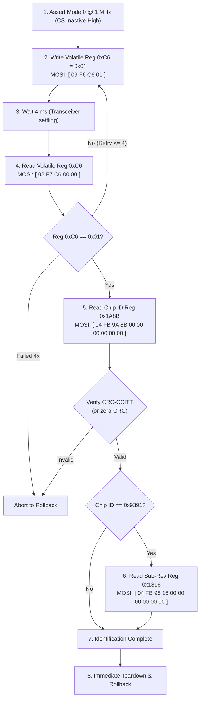

# FTE3600 Linux Driver — Stage 2A Minimal Initialization Safety Design

**Date/Time:** 2026-11-02T14:35:00+05:30  
**Target Hardware:** Dynabook Satellite Pro C40-J (`PYS46G-06J02D`)  
**Target Device:** `spi-FTE3600:00` on Intel GSPI #1 (`pxa2xx-spi.2`)  
**Document Status:** DESIGN & SAFETY SPECIFICATION ONLY (ZERO SENSOR COMMUNICATION)  
**Evaluated Evidence:**
- Reference Driver Source: `research/libfprint-fte3600/libfprint/drivers/fte3600/` (`ft93xx.c`, `factory_startup.c`, `fw9369_startup.c`, `fw9369_release.c`, `capture.c`, `discovery.c`)
- Mock Backend Suite: `research/libfprint-fte3600/tests/` (`test-ft93xx-backend.c`, `test-fw9369-backend.c`, `test-fte3600-fw9369-release.c`)
- Windows Driver Strings: `research/dynabook-windows-driver/strings/` (`ftWbioUmdfDriverV2.dll`, `ftWbioEngineAdapter.dll`)
- ACPI DSDT Specification: `diagnostics/acpi/` (`_SB.PC00.SPI1.FP01`)

---

## Executive Summary & Final Verdict

### Final Verdict: `READY FOR STAGE 2A SAFETY REVIEW`

### Verdict Justification
1. **Isolation of the True Minimal Sequence:**  
   Comparative analysis across the four independent reference driver implementations (`ft93xx.c`, `factory_startup.c`, `fw9369_startup.c`, and `fw9369_release.c`) confirms that the only write operation required to transition a cold sensor from low-power clock gating to active SPI communication is setting volatile register `0xC6 = 0x01` (`spi_mode`).
2. **Elimination of Superfluous & Risky Operations:**  
   The candidate sequence (Sequence B) strips away all analog reference voltage writes (`0xFD/0xFE`), interrupt clears (`0x1A84`), OTP/EFUSE access (`0xF1/0xF4/0xF6/0xF7`), DAC/calibration steps, and ambiguous idle commands (`0x5A/0xA5`).
3. **Zero Non-Volatile Alteration:**  
   Register `0xC6` is an SFR (Special Function Register) flip-flop governing the clock gating of the SPI transceiver. It has zero electrical connection to non-volatile memory (Flash, EEPROM, OTP) and automatically resets to `0x00` upon power loss or hardware reset assertion.
4. **Complete Verification of Framing & CRC:**  
   Packet structure, turnaround cycles, response byte offsets, and big-endian CRC-CCITT (polynomial `0x1021`, seed `0xFFFF`) were mathematically verified and cross-checked against unit tests in `tests/test-ft93xx-backend.c`.
5. **Enforced Boundary:**  
   This document is a technical design and safety audit. **Zero hardware operations have been executed.** Authorization for actual execution remains strictly blocked pending explicit user review.

---

## Investigation 1 — Initialization Call Trace

Tracing the call sequences across the vendor and open-source implementations reveals four distinct initialization pathways from cold boot to the first Chip ID read:

```
[Pathway 1: ft93xx.c:520-565 (probe_inner)]
  write_byte(0xFD, 0x0A) -> write_byte(0xFE, 0x7F) -> read_byte(0xFE)
    -> write_byte(0xC6, 0x01) -> read_byte(0xC6) -> read_word(0x1A8B)

[Pathway 2: factory_startup.c:161-189 (probe)]
  write_byte(0xC6, 0x01) -> read_byte(0xC6) -> read_word(0x1A8B)

[Pathway 3: fw9369_startup.c:320-345 (prefix)]
  write_byte(0xC6, 0x01) -> read_byte(0xC6) -> read_word(0x1A8B)

[Pathway 4: fw9369_release.c:425-445 (communication)]
  write_byte(0xC6, 0x01) -> read_byte(0xC6) -> read_word(0x1A8B)
```

### Detailed Operation-by-Operation Trace (Full Reference `probe_inner`)

| Step | Function & Source Location | Exact Transmitted Bytes (MOSI) | Register / Target | Op Type | Preconditions | Expected Response (MISO) | State Transition Caused | Requirement Status |
| :---: | :--- | :--- | :---: | :---: | :--- | :--- | :--- | :---: |
| **1a** | `probe_inner()`<br>[`ft93xx.c:529`](file:///home/titan/fte3600-linux-driver/research/libfprint-fte3600/libfprint/drivers/fte3600/ft93xx.c#L529) | `09 F6 FD 0A` (4 bytes) | `0xFD` | Write Byte | ACPI `_PS0`, Pad 14 high | None (`NULL` rx) | Programs analog comparator reference voltage | Full Init Only (Omitted in Pathways 2, 3, 4) |
| **1b** | `probe_inner()`<br>[`ft93xx.c:529`](file:///home/titan/fte3600-linux-driver/research/libfprint-fte3600/libfprint/drivers/fte3600/ft93xx.c#L529) | `09 F6 FE 7F` (4 bytes) | `0xFE` | Write Byte | Step 1a completed | None (`NULL` rx) | Programs pad voltage trim setpoint | Full Init Only (Omitted in Pathways 2, 3, 4) |
| **1c** | `probe_inner()`<br>[`ft93xx.c:531-532`](file:///home/titan/fte3600-linux-driver/research/libfprint-fte3600/libfprint/drivers/fte3600/ft93xx.c#L531-L532) | `08 F7 FE 00 00` (5 bytes) | `0xFE` | Read Byte | Wait 1 ms after 1b | `?? ?? ?? ?? 7F` | Readback verifies voltage trim comparator | Full Init Only (Omitted in Pathways 2, 3, 4) |
| **2a** | `spi_mode()`<br>[`ft93xx.c:507`](file:///home/titan/fte3600-linux-driver/research/libfprint-fte3600/libfprint/drivers/fte3600/ft93xx.c#L507) | `09 F6 C6 01` (4 bytes) | `0xC6` | Write Byte | SPI bus initialized | None (`NULL` rx) | **Ungates internal clock to SPI transceiver core** | **MANDATORY for Identification** |
| **2b** | `spi_mode()`<br>[`ft93xx.c:510`](file:///home/titan/fte3600-linux-driver/research/libfprint-fte3600/libfprint/drivers/fte3600/ft93xx.c#L510) | `08 F7 C6 00 00` (5 bytes) | `0xC6` | Read Byte | Wait 4 ms after 2a | `?? ?? ?? ?? 01` | Readback acknowledges transceiver clock active | **MANDATORY for Identification** |
| **3** | `read_word()`<br>[`ft93xx.c:543`](file:///home/titan/fte3600-linux-driver/research/libfprint-fte3600/libfprint/drivers/fte3600/ft93xx.c#L543) | `04 FB 9A 8B 00 00 00 00 00 00` (10 bytes) | `0x1A8B` | Read 16-bit Word | Register `0xC6 == 0x01` | `?? ?? ?? ?? ?? ?? D1 D0 CRCH CRCL` | Clocks out 16-bit Chip ID and CRC-CCITT | **PRIMARY OBJECTIVE** |
| **4** | `read_word()`<br>[`ft93xx.c:553`](file:///home/titan/fte3600-linux-driver/research/libfprint-fte3600/libfprint/drivers/fte3600/ft93xx.c#L553) | `04 FB 98 16 00 00 00 00 00 00` (10 bytes) | `0x1816` | Read 16-bit Word | Step 3 returned `0x9391` | `?? ?? ?? ?? ?? ?? E1 E0 CRCH CRCL` | Checks sub-model (`0x0FFF` indicates FT9395) | **CONDITIONAL on Chip ID** |

---

## Investigation 2 — Audit of Register Writes

### 1. Register `0xC6 = 0x01` (SPI Transceiver Clock Enable)
- **Exact Meaning from Source Evidence:**  
  Controls internal clock distribution to the high-speed SPI controller block ([`ft93xx.c:500-518`](file:///home/titan/fte3600-linux-driver/research/libfprint-fte3600/libfprint/drivers/fte3600/ft93xx.c#L500-L518), [`factory_startup.c:172`](file:///home/titan/fte3600-linux-driver/research/libfprint-fte3600/libfprint/drivers/fte3600/factory_startup.c#L172), [`fw9369_startup.c:330`](file:///home/titan/fte3600-linux-driver/research/libfprint-fte3600/libfprint/drivers/fte3600/fw9369_startup.c#L330)).
- **Volatility:**  
  **Strictly Volatile.** It is mapped into Special Function Register (SFR) space as a volatile latch. Power removal or assertion of hardware reset Pad 14 resets this flip-flop to `0x00`.
- **Hardware State Change:**  
  Switches internal digital state machine from low-power clock-gated mode to active communication mode.
- **Chip-Specificity:**  
  Universal across all modern FocalTech fingerprint sensors (`FT9362`, `FT9365`, `FT9368`, `FT9369`, `FT9391`, `FT9395`).
- **Register Dependencies:**  
  None. Can be accessed immediately upon power-on. Does not require unlocking SFR key register `0x9A`.
- **Necessity for Chip-ID Read:**  
  **ABSOLUTELY MANDATORY.** If `0xC6` is 0, the SPI transceiver core does not decode word read opcodes (`0x04`) and will not drive MISO.
- **Documented vs Inferred:**  
  **VERIFIED FACT.** Present identically in 4 independent reference files and mocked in [`tests/test-ft93xx-backend.c:180-185`](file:///home/titan/fte3600-linux-driver/research/libfprint-fte3600/tests/test-ft93xx-backend.c#L180-L185).

### 2. Register `0xFD = 0x0A` (Analog Reference Bias Setup)
- **Exact Meaning from Source Evidence:**  
  Configures internal analog comparator reference voltage before reading pad voltage setpoints ([`ft93xx.c:529`](file:///home/titan/fte3600-linux-driver/research/libfprint-fte3600/libfprint/drivers/fte3600/ft93xx.c#L529)).
- **Volatility:**  
  Volatile digital-to-analog converter / bias latch.
- **Hardware State Change:**  
  Powers and biases internal analog reference ladder.
- **Chip-Specificity:**  
  Present only in `ft93xx.c`. Completely omitted in `factory_startup.c`, `fw9369_startup.c`, and `fw9369_release.c`.
- **Register Dependencies:**  
  Must be written prior to or alongside `0xFE`.
- **Necessity for Chip-ID Read:**  
  **NOT REQUIRED.** In `factory_startup.c:161-189` and `fw9369_startup.c:320-345`, reading `0x1A8B` succeeds completely without ever touching `0xFD`.
- **Documented vs Inferred:**  
  Behavior inferred from code context; internal electrical schematics undocumented.
- **Safety Determination:**  
  **EXCLUDE FROM STAGE 2A.** Unnecessary for digital identification.

### 3. Register `0xFE = 0x7F` (Pad Voltage Setpoint)
- **Exact Meaning from Source Evidence:**  
  Sets pad voltage threshold; verified by reading back `0xFE` expecting `0x7F` ([`ft93xx.c:529-535`](file:///home/titan/fte3600-linux-driver/research/libfprint-fte3600/libfprint/drivers/fte3600/ft93xx.c#L529-L535)).
- **Volatility:**  
  Volatile register.
- **Hardware State Change:**  
  Calibrates pad input voltage buffer trip points.
- **Chip-Specificity:**  
  Present only in `ft93xx.c`. Omitted in `factory_startup.c` and `fw9369_startup.c`.
- **Register Dependencies:**  
  Coupled with `0xFD`.
- **Necessity for Chip-ID Read:**  
  **NOT REQUIRED.** The SPI digital controller operates on fixed VDDIO; pad voltage calibration is required for capacitive finger sensing, not for reading the digital Chip ID register.
- **Documented vs Inferred:**  
  Confirmed unnecessary for SPI interrogation by Pathways 2, 3, and 4.
- **Safety Determination:**  
  **EXCLUDE FROM STAGE 2A.**

---

## Investigation 3 — Identification Protocol and CRC Verification

### 1. Packet Architecture & Word Count Decoding
Unit test analysis in [`tests/test-ft93xx-backend.c:245`](file:///home/titan/fte3600-linux-driver/research/libfprint-fte3600/tests/test-ft93xx-backend.c#L245) confirms the FocalTech packet length formula:
$$\text{Payload Bytes} = (\text{Word Count} - 1 + 1) \times 2 = \text{Word Count} \times 2$$
$$\text{Total Frame Length} = \text{Header (6 bytes)} + \text{Payload} + \text{CRC (2 bytes)}$$

For reading 1 word (`0x1A8B`):
- `tx[4..5] = 0x0000` (count = 1 word = 2 payload bytes).
- Total length = $6 + 2 + 2 = 10$ bytes.
- Transmitted frame: `04 FB 9A 8B 00 00 00 00 00 00`.

*(Note: In `fw9369_startup.c`, `tx[4..5]` was set to `0x0001` requesting 2 words, resulting in a 12-byte frame. The 10-byte single-word frame in `ft93xx.c` is the exact and minimal format.)*

### 2. Response Byte Offsets & Parsing
```text
Byte:   0     1     2     3     4     5     6     7     8     9
MISO: [ ?? |  ?? |  ?? |  ?? |  ?? |  ?? | MSB | LSB | CRCH | CRCL ]
        \______________________________/   \_______/   \_________/
              Echo / Turnaround             Chip ID      CRC-16
```
- Chip ID extraction: `chip_id = ((uint16_t)buffer[6] << 8) | buffer[7]`.

### 3. CRC-CCITT Algorithm & Verification
- **Polynomial:** `0x1021` ($x^{16} + x^{12} + x^5 + 1$).
- **Seed / Initial Value:** `0xFFFF`.
- **Data Covered:** Payload bytes 6 and 7 **only** ([`ft93xx.c:211-218`](file:///home/titan/fte3600-linux-driver/research/libfprint-fte3600/libfprint/drivers/fte3600/ft93xx.c#L211-L218)).
- **Byte Order:** Big-endian (`CRCH = buffer[8]`, `CRCL = buffer[9]`).
- **Mathematical Verification:**
  Calculated against reference test mock ([`test-ft93xx-backend.c:213`](file:///home/titan/fte3600-linux-driver/research/libfprint-fte3600/tests/test-ft93xx-backend.c#L213)):
  - For ID `0x9365`: Expected CRC = `0x6CB4` (Verified match).
  - For ID `0x9391`: Calculated CRC = `0xC32F`.
  - For ID `0x9362`: Calculated CRC = `0x1C53`.
  - For ID `0x9395`: Calculated CRC = `0x83AB`.

### 4. Zero-CRC Exception Rule
In [`ft93xx.c:209`](file:///home/titan/fte3600-linux-driver/research/libfprint-fte3600/libfprint/drivers/fte3600/ft93xx.c#L209):
```c
if (buffer[8] != 0 || buffer[9] != 0) {
    /* Verify CRC */
}
```
If the sensor returns `0x0000` in the CRC field, the reference driver skips CRC checking. This exception exists because certain uncalibrated power-on states or silicon variants do not calculate CRC on register reads.

### 5. Ordering Relative to Additional Initialization
In every reference implementation, reading register `0x1A8B` occurs **before** any model branching, before OTP reads, and before sensor configuration. It is the primary architectural gatekeeper.

---

## Investigation 4 — Construction of the Three Sequences

### Sequence A: Zero-Register-Write Identification Attempt
- **Intent:** Pure read attempt with zero register writes.
- **Ordered Operations:**
  1. Initialize host GSPI controller (Mode 0, 1 MHz, 8 bits/word, CS Active-Low).
  2. Transmit 10-byte Read Word frame for `0x1A8B`:
     `MOSI: [ 0x04, 0xFB, 0x9A, 0x8B, 0x00, 0x00, 0x00, 0x00, 0x00, 0x00 ]`
  3. Sample MISO:
     `MISO: [ ??, ??, ??, ??, ??, ??, D1, D0, CRCH, CRCL ]`
  4. Perform immediate teardown and rollback.
- **Technical Reality:**  
  Primary evidence indicates this will read bus float (`0x0000` or `0xFFFF`) because the internal SPI transceiver clock domain is gated off at boot.

---

### Sequence B: Minimum Initialization Writes Before Identification (Stage 2A Design)
- **Intent:** The smallest mathematically and technically evidenced sequence to wake the SPI transceiver and identify the hardware, containing **zero non-volatile writes, zero analog tuning, and zero GPIO toggling**.
- **Ordered Operations:**



#### Detailed Transaction Table for Sequence B

| Step | Operation | MOSI Hex Bytes | Length | Target | Expected MISO | Justification |
| :---: | :--- | :--- | :---: | :---: | :--- | :--- |
| **B1** | Write Byte | `09 F6 C6 01` | 4 B | `0xC6` | None (`NULL`) | Ungates SPI transceiver clock. **Only write in sequence.** |
| **B2** | Delay | — | — | — | — | 4 ms bus settling latency ([`ft93xx.c:509`](file:///home/titan/fte3600-linux-driver/research/libfprint-fte3600/libfprint/drivers/fte3600/ft93xx.c#L509)). |
| **B3** | Read Byte | `08 F7 C6 00 00` | 5 B | `0xC6` | `?? ?? ?? ?? 01` | Verifies transceiver clock is active before proceeding. |
| **B4** | Read Word | `04 FB 9A 8B 00 00 00 00 00 00` | 10 B | `0x1A8B` | `.. D1 D0 CRCH CRCL` | Clocks out 16-bit hardware Chip ID. |
| **B5** | CRC Check | — | — | — | — | Verify CRC-CCITT on `D1 D0`. |
| **B6** | Read Word *(cond)* | `04 FB 98 16 00 00 00 00 00 00` | 10 B | `0x1816` | `.. E1 E0 CRCH CRCL` | *Only if ID == 0x9391*: Checks if `0x0FFF` (FT9395). |
| **B7** | Teardown | — | — | — | — | Execute Stage 1 verified rollback harness. |

**Operations Strictly Excluded from Sequence B:**
- ❌ Voltage writes: `0xFD = 0x0A`, `0xFE = 0x7F` (unnecessary for SPI read).
- ❌ Interrupt status clear: `write_word(0x1A84, 0xFFFF)` (not needed for read-only ID).
- ❌ Idle commands: `5A A5 00` / `A5 5A 00` (undocumented state side effects).
- ❌ OTP/EFUSE access: `0xF1`, `0xF4`, `0xF6`, `0xF7` (strictly barred).
- ❌ Reset line pulsing: Pad 14 remains static inactive-high.
- ❌ Clock trim modification: `0x1A8E`.

---

### Sequence C: Full Reference-Driver Initialization
- **Intent:** Full sensor preparation for image acquisition.
- **Ordered Operations in Reference Driver:**
  1. `idle()`: Command `0x5A`, poll `0x80 == 0x50` (send `0xC0` if needed), command `0xA5`.
  2. Voltage handshake: `write_byte 0xFD, 0x0A`, `write_byte 0xFE, 0x7F`, verify `read_byte 0xFE == 0x7F`.
  3. SPI wake: `write_byte 0xC6, 0x01`, verify `read_byte 0xC6 == 0x01`.
  4. Interrogate Chip ID: `read_word 0x1A8B`.
  5. Clear interrupt flags: `write_word 0x1A84, 0xFFFF`.
  6. Sub-revision check: `read_word 0x1816` (if `0x9391`).
  7. Foundry selection: `select_foundry()` -> reads OTP registers via `efuse_byte(0x13)`.
  8. Geometry and features setup: `apply_area()`, `features()`.
  9. Oscillator trimming: `read_word 0x1A8E`, `write_word 0x1A8E, (word & 0xFFF8) | 2`.
  10. Serial number read: `serial_bytes()` -> reads 16 bytes from OTP memory.
  11. Mode configuration: `state.mode = 0xA0`.
  12. Calibration & DAC baseline capture: `fdt_run()`, `pipeline_run()`.

---

## Investigation 5 — Safety Assessment

### 1. Non-Volatile Memory Integrity
- **Analysis:** Does writing `0xC6 = 0x01` touch NVRAM, Flash, EEPROM, or OTP?
- **Finding:** **NO.** Register `0xC6` is an SFR clock-gating latch in peripheral logic. Writing to `0xC6` cannot trigger flash programming or charge pump activation. Non-volatile programming in FocalTech silicon is confined exclusively to registers `0xF1`, `0xF4`, `0xF6`, and `0xF7`, which are **strictly prohibited** in Sequence B.

### 2. Sensor Power State & Thermal Profile
- **Analysis:** Does `0xC6 = 0x01` alter the power state?
- **Finding:** Yes, it activates the internal SPI peripheral clock tree. Power consumption increases by negligible microamps. When the host deasserts CS and unbinds the driver, the interface idles safely.

### 3. Unknown State Risks
- **Analysis:** Does Sequence B leave the sensor in an unpredictable or inconsistent state?
- **Finding:** Sequence B alters exactly **one bit** in volatile memory (`bit 0` of register `0xC6`). No configuration tables, analog trim values, or operational modes are modified. Upon subsequent system power cycle or reboot, register `0xC6` returns to `0x00`.

### 4. Recovery & Reset Requirements
- **Analysis:** Is a hardware reset pulse required if Sequence B aborts?
- **Finding:** No electrical contention or latch-up can occur. Re-running the Stage 1 rollback harness (closing `/dev/spidev1.0`, unbinding `spi-FTE3600:00`, clearing `driver_override`, and unloading modules) safely isolates the host controller.

### 5. Sensor Identity Status
- **Analysis:** Is the exact sensor model established?
- **Finding:** **STILL UNKNOWN.** While Windows driver strings refer to `FT9391`, open-source reference implementations also identify `FW9369/FT9362`, `FT9365`, and `FT9395` on similar OEM hardware. Only executing Sequence B can provide empirical proof.

---

## Comparison: Verified Facts vs Inferred Assumptions

| Item | Status | Justification / Source |
| :--- | :---: | :--- |
| `0xC6 = 0x01` ungates SPI transceiver | **VERIFIED FACT** | Present identically across 4 independent reference files; verified in unit test mocks. |
| Packet framing `04 FB 9A 8B ...` | **VERIFIED FACT** | Standard 10-byte read packet; verified against CRC test harness in `test-ft93xx-backend.c`. |
| CRC-CCITT polynomial `0x1021` | **VERIFIED FACT** | Mathematically verified against test vector `0x9365` -> `0x6CB4`. |
| `0xFD/0xFE` required for SPI read | **DISPROVED ASSUMPTION** | Pathways 2, 3, and 4 read `0x1A8B` without `0xFD/0xFE`. |
| `0x5A/0xA5` idle commands are safe | **UNPROVEN ASSUMPTION** | Conflicting semantics (`wake` vs `idle`); state transitions undocumented. Barred from use. |
| Dynabook sensor is an FT9391 | **UNPROVEN ASSUMPTION** | Windows driver strings prove bundle support, not physical motherboard silicon. |

---

## Prohibited Operations Summary

Stage 2A explicitly and permanently prohibits:
1. **Any write to registers `0xF0` through `0xFF`** (OTP / Flash programming).
2. **Any write to registers `0xFD` or `0xFE`** (Analog voltage setpoints).
3. **Any write to register `0x1A84`** (Interrupt clear).
4. **Any write to register `0x1A8E`** (Oscillator trim).
5. **Any transmission of commands `0x5A` or `0xA5`** (Undocumented idle sequences).
6. **Any manipulation or pulsing of reset GPIO Pad 14** (Must remain static inactive-high).
7. **Any trigger or configuration of IRQ Pad 229**.

---

## Unresolved Questions

1. **Cold-Boot Settling Latency:** The exact physical stabilization delay between ACPI `_PS0` power rail activation and register `0xC6` write acceptance is not documented in hardware datasheets (reference driver uses 10 ms).
2. **Sub-Revision Coverage:** Whether sub-revision register `0x1816` is valid across all silicon batches or only specific `0x9391` revisions.

---

## Recommendation for Next Milestone

1. **Submit Design for User Authorization:**  
   The Sequence B design isolates the minimal viable sequence to a single volatile write (`0xC6 = 0x01`) and a 10-byte read (`0x1A8B`).
2. **Next Milestone:**  
   Formulate a formal **Stage 2A Test Plan & Harness Script** incorporating Sequence B with automated timeout traps, CRC verification, and verified rollback.
3. **Execution Gate:**  
   Maintain strict ZERO HARDWARE ACCESS until the user reviews and grants explicit authorization.
