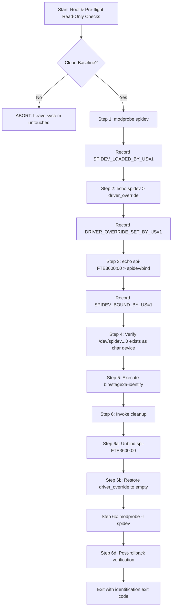

# Stage 2A — Pure spidev Architecture Revision Report

**Date:** 2026-11-02  
**Target Platform:** Dynabook Satellite Pro C40-J (`PYS46G-06J02D`)  
**Target Device:** `spi-FTE3600:00` on Intel GSPI #1 (`pxa2xx-spi.2`)  
**Architecture Revision:** **v2.0 (Pure spidev Architecture)**  
*(Elimination of `fte3600.ko`, UIO, and GPIO dependencies)*  
**Status:** STATIC PREPARATION & VALIDATION ONLY (Zero Hardware Access)

---

## 1. Executive Summary

Following the static register decode and hardware evidence audit in `diagnostics/STAGE2A_RESET_LINE_ROLLBACK_AUDIT.md`, the Stage 2A implementation has been revised to eliminate all dependencies on the Stage 1 kernel glue driver (`fte3600.ko`) and `uio.ko`.

### Key Architectural Shifts:
1. **Pad 14 Hardware Reality:** PCH Pad 14 was proven by baseline measurements (`diagnostics/privileged/pinctrl.txt:20`) and register decode (`PADCFG0 = 0x84000201`) to be **already configured by UEFI BIOS firmware at boot as an active push-pull output driving physical HIGH (3.3V)**. It does not require a driver to hold the reset line inactive.
2. **Elimination of Collateral Risk on Pad 229:** Loading `fte3600.ko` caused `pinctrl-intel` to permanently alter Pad 229's hardware register (`0x80100100` -> `0x82000100`) because Linux `gpiolib` does not restore hardware registers upon descriptor release (`gpiod_put()`). By running Stage 2A through pure `spidev`, Pad 229 is **never claimed or touched**, preserving its exact pristine state.
3. **Radical Simplification & Reduced Blast Radius:**
   - Out-of-tree kernel modules loaded: **0** (neither `fte3600.ko` nor `uio.ko` is loaded).
   - In-tree kernel modules loaded: **1** (`spidev` only).
   - GPIO lines claimed: **0** (neither Pad 14 nor Pad 229 is touched).
   - Character devices created: **1** (`/dev/spidev1.0` only; zero `/dev/uio*`, zero `/dev/gpiochip*`).
   - Host rollback: **100% deterministic** unbind and module unload.

---

## 2. Files Changed and Preservation Status

| File | Status | Modifications Made |
| :--- | :---: | :--- |
| `scripts/stage2a-test.sh` | **Revised (v2.0)** | Completely removed `fte3600.ko` loading, `uio.ko` loading, UIO ownership tracking, GPIO claims, and platform device status checks. Streamlined lifecycle to `spidev` module load, `driver_override` setting, device bind, `stage2a-identify` invocation, and deterministic 3-step rollback. |
| `scripts/run-stage2a-in-terminal.sh` | **Revised (v2.0)** | Updated banner and informational messages to reflect pure-spidev architecture. |
| `diagnostics/STAGE2A_EXECUTION_CHECKLIST.md` | **Revised (v2.0)** | Updated operational checklist: superseded dual-driver model, removed UIO and `fte3600` pre-checks and rollback steps. |
| `tools/stage2a-identify.c` | **Preserved (Unchanged)** | Retained exact 5 approved SPI transactions, big-endian CRC-CCITT validation, variant gating, and immediate STOP behavior. Hardened previously with `fstat(S_ISCHR)` and `SPI_IOC_RD_*` readback checks. |
| `kernel/fte3600.c` & `scripts/stage1-test.sh` | **Preserved (Unchanged)** | Stage 1 implementation preserved untouched as historical reference. |

---

## 3. Why `fte3600.ko` and UIO Are No Longer Required

### 3.1 Reset-Line Electrical State
- The assumption in earlier planning was that Pad 14 might be an unmanaged floating input relying on a weak pull-up resistor.
- The bitwise decode of baseline register `PADCFG0 = 0x84000201` conclusively disproved that assumption:
  - Bit 8 (`PADCFG0_GPIOTXDIS` = 0): Output transmitter is **ENABLED**.
  - Bit 0 (`PADCFG0_GPIOTXSTATE` = 1): Output state is **HIGH (3.3V)**.
  - Bit 9 (`PADCFG0_GPIORXDIS` = 1): Input receiver is **DISABLED**.
  - Bits 26:25 (`PADCFG0_RXEVCFG` = `0b10`): Event/interrupt generation is **DISABLED**.
- The physical reset line is already held in the inactive-high state (3.3V) by the Intel PCH output driver continuously from system boot onward.
- No kernel driver is required to drive Pad 14 high.

### 3.2 SPI Bus and Controller Independence
- The host Intel GSPI #1 controller (`pci0000:00:15.0` / `pxa2xx-spi.2`) is driven by the mainline kernel's `pxa2xx-spi` driver, which enumerates `spi_master/spi1`.
- The ACPI device `\_SB.PC00.SPI1.FP01` is automatically instantiated as SPI slave `spi-FTE3600:00`.
- Mainline `spidev` binds directly to `spi-FTE3600:00` via the standard kernel sysfs interface `driver_override`.
- `fte3600.ko` does not provide SPI functionality, nor does it intermediate SPI transfers.
- In Stage 1 testing (`diagnostics/stage1-results.txt:28`), `spi-FTE3600:00` successfully bound to `spidev` and created `/dev/spidev1.0` *before* `fte3600.ko` was loaded, proving complete architectural independence.

### 3.3 Interrupt Independence
- Stage 2A is a purely synchronous, command-response identification sequence over SPI.
- It does not wait on, unmask, or process hardware interrupts.
- UIO (`uio.ko`) and the UIO device node `/dev/uio0` served only to export Pad 229's interrupt to userspace. Because interrupts are unused, both `uio.ko` and `fte3600.ko` are completely superfluous.

---

## 4. Revised Execution Sequence & Resource Ownership Model

The revised `scripts/stage2a-test.sh` enforces the following lifecycle:



### Resource Ownership Guarantees:
- **`SPIDEV_LOADED_BY_US`:** Initial check verifies `spidev` is ABSENT. `spidev` is loaded and flagged. Cleanup unloads `spidev` only if this flag is set.
- **`DRIVER_OVERRIDE_SET_BY_US`:** Initial check verifies `driver_override` is empty. Updated and verified. Cleanup restores original empty string only if this flag is set.
- **`SPIDEV_BOUND_BY_US`:** Initial check verifies `spi-FTE3600:00` is UNBOUND. Bound and verified. Cleanup unbinds only if this flag is set and target matches canonical spidev path.
- **Critical Sections & Deferred Signals:** All modifying steps are wrapped in `enter_critical` / `leave_critical`. `SIGINT` (Ctrl+C) and `SIGTERM` arriving during state transitions are deferred until ownership variables are reconciled, ensuring cleanup always operates on known state.

---

## 5. Failure-Path and STOP Policy Analysis

Every possible failure during the revised lifecycle halts immediately and initiates automated rollback:

| Failure Point | Detection Mechanism | Immediate Action | Rollback Action |
| :--- | :--- | :--- | :--- |
| **Non-root invocation** | `id -u != 0` | Aborts with error. | Zero changes made; nothing to roll back. |
| **Kernel mismatch** | `uname -r != 7.2.8-9-omarchy` | Aborts with error. | Zero changes made; nothing to roll back. |
| **Binary missing** | `! -x bin/stage2a-identify` | Aborts with error. | Zero changes made; nothing to roll back. |
| **Dirty baseline** | `spidev` PRESENT, device bound, or pre-existing `/dev/spidev*` | Aborts with error. | Refuses to proceed; leaves system untouched. |
| **`modprobe spidev` error** | Command code != 0 or state != PRESENT | Halts in critical section. | Cleanup skips unbind/override; leaves module if uncertain. |
| **`driver_override` error** | Readback does not match `"spidev"` | Halts in critical section. | Cleanup unbinds (if bound) and restores override. |
| **Bind error** | Driver link != canonical spidev | Halts in critical section. | Cleanup unbinds, restores override, unloads `spidev`. |
| **Missing `/dev/spidev1.0`** | Path not found or `! -c` | Halts with error. | Full rollback: unbind, restore override, unload `spidev`. |
| **Identification failure (Codes 1–9)** | `stage2a-identify` returns non-zero | Tool terminates, closes fd. | Full rollback: unbind, restore override, unload `spidev`. Preserves exit code. |
| **User Interrupt (`SIGINT`/`SIGTERM`)** | Signal trapped | Halts tool, initiates rollback. | Full rollback executed cleanly; exits with signal code (130/143). |

---

## 6. SPI Transaction Restrictions

The identification binary `bin/stage2a-identify` enforces the exact 5 transactions approved in Phase 1:

1. **Operation 1 (Clock Ungate):** Write 4 bytes: `0x09 0xF6 0xC6 0x01`. CS asserted during transfer, deasserted high upon completion.
2. **Operation 2 (Stabilization Delay):** Host sleep 4 ms (`usleep(4000)`). **CS held deasserted high.**
3. **Operation 3 (Clock Verify):** Read 5 bytes: `0x08 0xF7 0xC6 0x00 0x00`. Requires `buffer[4] == 0x01`. Mismatch triggers immediate STOP (exit code 5).
4. **Operation 4 (Chip ID Query):** Read 10 bytes: `0x04 0xFB 0x9A 0x8B ...`. Computes CRC-CCITT over `buffer[6..7]`.
   - Requires non-zero and non-0xFFFF (exit code 6 on float/ground).
   - Validates CRC-CCITT (exit code 7 on mismatch).
   - Variant gate: Accepts strictly `0x9362`, `0x9365`, or `0x9391` (exit code 8 on unknown ID).
5. **Operation 5 (Sub-Revision Query):** Read 10 bytes: `0x04 0xFB 0x98 0x16 ...`. *Executed strictly if base ID is `0x9391`*. Distinguishes `FT9395` (`0x0FFF`) from standard `FT9391`.

**Prohibitions Maintained:**
- Zero OTP/EFUSE writes (`0xF0-0xFF`).
- Zero analog configuration writes (`0xFD/0xFE`).
- Zero sleep commands (`0x5A/0xA5`).
- Zero flash programming (`0xC0`).
- Zero retry loops or reset toggling.

---

## 7. Remaining Uncertainties

1. **Sensor-Internal State of Register `0xC6`:**
   - Writing `0xC6 = 0x01` ungates the sensor's internal SPI transceiver clock.
   - The available evidence does not prove the persistence, decay, or autonomous reset behavior of register `0xC6`. Whether it retains `0x01`, decays over time, or autonomously resets via an undocumented internal watchdog timer is an unknown sensor-internal state.
   - Host-side rollback releases all host resources, halts the SPI bus clock, and deasserts CS high, but cannot confirm the physical internal state of the sensor.
   - A full ACPI S5 cold reboot or power cycle should be performed if a return to the guaranteed unclocked power-on baseline is required.
2. **Target Silicon Identification:**
   - The exact silicon revision installed in this specific Dynabook unit (`PYS46G-06J02D`) will be established only upon reading register `0x1A8B`.

---

## 8. Offline Validation Results

The revised implementation was strictly tested offline without accessing hardware:

1. **C Source Compilation:**
   ```bash
   gcc -O2 -Wall -Wextra -Werror -o bin/stage2a-identify tools/stage2a-identify.c
   ```
   *Result:* Exited 0 with 0 warnings.
2. **Bash Syntax Verification:**
   ```bash
   bash -n scripts/stage2a-test.sh
   bash -n scripts/run-stage2a-in-terminal.sh
   ```
   *Result:* Exited 0 with 0 syntax errors on both scripts.
3. **Offline CLI Checks:**
   ```bash
   bin/stage2a-identify
   # Exited 1: Usage printed.
   bin/stage2a-identify /dev/nonexistent
   # Exited 1: Cannot open file.
   bin/stage2a-identify README.md
   # Exited 1: README.md is not a character device!
   ```
   *Result:* Verified safe validation and exit code 1.
4. **Sysfs Path Inspection:**
   - Verified `/sys/bus/spi/devices/spi-FTE3600:00` exists.
   - Verified `driver` link is absent (UNBOUND).
   - Verified `driver_override` is empty.
   - Verified `spidev` module is ABSENT.
   - Verified `/dev/spidev*` character devices are ABSENT.

---

## 9. Explicit Confirmation of Zero Hardware Access

**I hereby confirm:**
- No kernel modules were loaded or unloaded.
- No SPI transactions were performed.
- No character devices were opened.
- No GPIO lines or PCH registers were written or claimed.
- Neither `scripts/stage2a-test.sh` nor `scripts/run-stage2a-in-terminal.sh` was executed.
- The hardware state of the Dynabook Satellite Pro C40-J remains in its exact baseline state.

---

## 10. Mandatory Stop & Final Authorization Boundary

**STOP.**  
The revised pure-spidev architecture is fully prepared and statically validated.  
Hardware execution remains strictly unauthorized. Awaiting your separate, explicit instruction.
