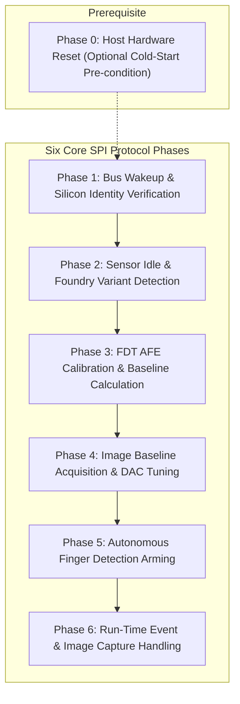
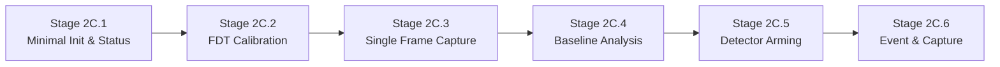

# Stage 2B.1 — Stage 2C Phased Decomposition & Execution Gate

**Document ID:** `STAGE2B1_STAGE2C_DECOMPOSITION`  
**Date:** 2026-11-02  
**Target Hardware:** FocalTech FT9362 Fingerprint Sensor  
**Host Controller:** Intel LPSS SPI (`pxa2xx-spi.2`) / Dynabook Satellite Pro C40-J  
**Document Purpose:** Deconstruct Stage 2C into six independently reviewable, incremental, gated sub-stages.  
**Execution Boundary:** Static design only. No implementation or hardware testing is authorized.

---

## 1. Phase Numbering & Architectural Correction

### 1.1 Resolution of Previous Organizational Inconsistency
In the initial research report ([STAGE2B_FW9369_RESEARCH.md](file:///home/titan/fte3600-linux-driver/diagnostics/STAGE2B_FW9369_RESEARCH.md)) and sequence documentation ([FT9362_INITIALIZATION_SEQUENCE.md](file:///home/titan/fte3600-linux-driver/diagnostics/FT9362_INITIALIZATION_SEQUENCE.md)), the initialization workflow was described in introductory text as "six phases" but enumerated as **Phase 0 through Phase 6** (a total of seven distinct operational blocks).

This organizational inconsistency is formally corrected as follows:
- **Phase 0 (Host Hardware Setup / Reset Pulse)** is a **pre-condition / hardware prerequisite** for cold start/recovery, not a sensor SPI protocol phase.
- The sensor SPI communication protocol consists of **six core functional phases** (Phases 1 through 6).

The unified phase taxonomy is established below:

---

## 2. Decomposition of Stage 2C into Six Incremental Sub-Stages

To ensure complete safety and prevent unintended side effects, Stage 2C must NOT be executed as a single monolithic script. It is divided into six independently authorized sub-stages (Stages 2C.1 through 2C.6).

---

### Sub-Stage 2C.1: Minimal Wakeup, Status Verification & Variant Check
*Corresponds to Phase 1 & Phase 2*

- **Objective:** Verify sensor power un-gating, confirm chip ID `0x9362`, verify non-destructive sensor idle handshake, and check if foundry register `0x9B` can be read without triggering OTP read strobes.
- **Register Writes:**
  - `0xC6 = 0x01` (Write byte: `[ 09 F6 C6 01 ]`)
  - `0x1A84 = 0xFFFF` (Write word: `[ 05 FA 9A 84 00 01 FF FF ]`)
  - Commands: `[ 5A A5 00 ]`, `[ C0 3F 00 ]` (if needed), `[ A5 5A 00 ]`
- **Register Reads:**
  - `0xC6` (Read byte: verify `0x01`)
  - `0x1A8B` (Read word: verify `0x9362` and CRC-CCITT `0x1C53`)
  - `0x80` (Read byte: verify `0x50` ready)
  - `0x9B` (Read byte: check if foundry code `0x13` or `0x00` is present at boot)
- **Expected Results:**
  - Sensed register `0xC6` returns `0x01`.
  - ID word returns `0x9362` with matching CRC.
  - Sensed status byte `0x80` returns `0x50`.
- **Risks:** **LOW.** Identical to Stage 2A with addition of the idle command pair.
- **Required Authorization:** Explicit user authorization for Sub-Stage 2C.1.

---

### Sub-Stage 2C.2: FDT Calibration & Threshold Calculation
*Corresponds to Phase 3*

- **Objective:** Configure capacitive sense frontend, sweep `fdt_dac` to center baseline channels at ~512, sample 10 measurement vectors, and calculate touch threshold vector `fdt_down`.
- **Register Writes:**
  - AFE setup: `0x1800` (`0x07FE`), `0x1801` (`0xFC80 | fdt_dac`), `0x1804` (`0x27C8`), `0x1807` (`0x1671`), `0x1808` (`0x0801`), `0x1887` (`0x0005`), filter registers `0x1806`, `0x180A`, `0x180B`, `0x1805`, `0x180D`, `0x1888`.
  - Protected bank `0x00C0`..`0x00C2`:
    - Strict encapsulation: write `0x9A = 0x5A` -> modify `0x00C0`..`0x00C2` -> write `0x9A = 0x00` -> verify `0x9A == 0x00`.
  - Threshold control: `0x1880` (`0x2D32`), `0x1881` (`0x0082`), `0x1884` (`0x0003`), `0x1A8A` (`0x00FF`), `0x1A83` (`0x0008`).
  - Scan triggers: `0x1885 = 1`, command `[ C2 3D 00 ]`.
- **Register Reads:**
  - Status `0x1A82` (bit 3 poll).
  - 4 measurement channels from `0x80B8` (or `0x80E8`).
- **Expected Results:**
  - Converged `fdt_dac` (typically ~27).
  - Channel minima between 300 and 700 counts.
  - Calculated `fdt_down` thresholds and valid CRC.
- **Risks:** **MEDIUM.** Involves unlocking register `0x9A` (must have mandatory `finally` lock and readback verification).
- **Required Authorization:** Explicit user authorization after 2C.1 passes.

---

### Sub-Stage 2C.3: Single-Frame Acquisition & Image DAC Search
*Corresponds to Phase 4 (Capture Part)*

- **Objective:** Sweep `image_dac` to locate the optimal pixel array operating point (median ~512), trigger an image scan, and burst-read one 10,246-byte frame from the FIFO.
- **Prerequisite Check:** Kernel module `spidev` MUST be verified loaded with `bufsiz >= 65536`.
- **Register Writes:**
  - Pixel AFE: `0x1800 = 0x4FFE`, `0x1801 = 0xFC80 | image_dac`, `0x1804`, `0x1807`, `0x1887 = 0x0002`, `0x1811`, `0x1A83 |= 0x0060`, timing writes `0x8E`..`0x92`.
  - Trigger command: `[ C4 3B 00 ]`.
  - FIFO prefix: `[ 06 F9 9A 05 14 00 ]` followed by 10,240 clock bytes.
  - Image ACK: write word `0x0020` to `0x1A84`.
- **Register Reads:**
  - Byte `0x80` (poll for `0x54` frame ready).
  - FIFO buffer (10,246 bytes).
- **Expected Results:**
  - Status `0x80` transitions to `0x54`.
  - Exactly 10,246 bytes received over SPI without truncation or `EMSGSIZE`.
  - Frame median pixel value lands in range `[480, 544]`.
- **Risks:** **MEDIUM.** Large buffer allocation; DMA transfer on host controller.
- **Required Authorization:** Explicit user authorization after 2C.2 passes.

---

### Sub-Stage 2C.4: Baseline Analysis & Storage (Pure Host Offline)
*Corresponds to Phase 4 (Storage Part)*

- **Objective:** Analyze the 5,120 raw 16-bit pixel samples from Stage 2C.3 offline. Verify pixel noise spread, compute the 128-word baseline CRC, and export the frame to disk as a portable graymap (`.pgm` / `.png`) for visual inspection.
- **Register Writes:** **NONE.** (Pure host CPU computation).
- **Expected Results:**
  - Standard deviation / spread < 150 counts.
  - Baseline CRC computed.
  - Baseline image written to `diagnostics/baseline-frame.pgm`.
- **Risks:** **NONE.** (Zero hardware interaction).
- **Required Authorization:** Autonomous / offline after 2C.3.

---

### Sub-Stage 2C.5: Autonomous Finger Detection Arming
*Corresponds to Phase 5*

- **Objective:** Write calibrated FDT thresholds to bank `0x80B0` (or `0x80E0`), arm the autonomous detector for DOWN (touch) events, clear interrupt flags, and issue trigger command `0xC2 0x3D`.
- **Register Writes:**
  - Unlock: `write_byte(0x9A, 0x5A)`.
  - Bank write: write 8 words to `0x80B0` (or `0x80E0`).
  - Lock: `write_byte(0x9A, 0x00)` + readback verify.
  - Detector config: `0x1881` (`(val & 0xFF7C) | 0x0081`), `0x1A83` (`(val & 0xFF80) | 0x0016`).
  - Flag clear: write word `0x002F` to `0x1A84`.
  - Trigger command: `[ C2 3D 00 ]`.
- **Expected Results:**
  - Sensor enters autonomous listening mode.
  - CS is released high; SPI bus rests idle.
- **Risks:** **MEDIUM.** Pad 229 interrupt line will transition when touch occurs.
- **Required Authorization:** Explicit user authorization after 2C.4 passes.

---

### Sub-Stage 2C.6: Runtime Touch & Release Event Handling
*Corresponds to Phase 6*

- **Objective:** Listen for Pad 229 falling-edge interrupts. On interrupt, read status `0x1A82`, acknowledge via `0x1A84`, capture frame if touch is detected, and re-arm detector for release.
- **Register Writes:**
  - Status ACK: write word to `0x1A84`.
  - Capture trigger: command `[ C4 3B 00 ]` (on touch).
  - Re-arm trigger: command `[ C2 3D 00 ]` (for release).
- **Expected Results:**
  - Successful detection of finger touch and lift.
  - Live candidate print captured and saved to disk.
- **Risks:** **MEDIUM.** Interrupt loop must not hang or cause interrupt storm.
- **Required Authorization:** Explicit user authorization after 2C.5 passes.

---

## 3. Sub-Stage Risk and Gate Matrix

| Stage | Operation Summary | Register Access Scope | Key Safety Gate | Authorization Status |
| :---: | :--- | :--- | :--- | :---: |
| **2C.1** | Minimal Init & Status | `0xC6`, `0x1A8B`, `0x1A84`, `0x80`, `0x9B` | Pre-flight check, zero OTP writes | **PENDING USER AUTHORIZATION** |
| **2C.2** | FDT Calibration | AFE `0x18xx`, `0x9A`, Bank `0x00C0` | Mandatory `finally` lock on `0x9A` | **BLOCKED** (Awaiting 2C.1) |
| **2C.3** | Single Frame Capture | Pixel AFE `0x18xx`, FIFO (10,246 B) | `spidev.bufsiz >= 65536` verified | **BLOCKED** (Awaiting 2C.2) |
| **2C.4** | Baseline Storage | Pure Host CPU | Frame variance check < 150 | **BLOCKED** (Awaiting 2C.3) |
| **2C.5** | Detector Arming | `0x9A`, Bank `0x80B0`, `0x1881`, `0xC2 0x3D` | Mandatory `finally` lock on `0x9A` | **BLOCKED** (Awaiting 2C.4) |
| **2C.6** | Event & Live Capture | IRQ poll, `0x1A82`, `0x1A84`, FIFO | Watchdog timeout on IRQ poll | **BLOCKED** (Awaiting 2C.5) |
