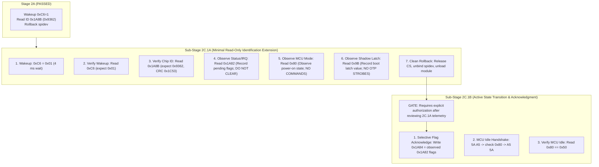

# Stage 2B.2 — Stage 2C.1 Re-evaluation & Safety Gate Audit

**Document ID:** `STAGE2B2_STAGE2C1_SAFETY_GATE`  
**Date:** 2026-11-02  
**Target:** Dynabook Satellite Pro C40-J (`PYS46G-06J02D`), FT9362 / FW9369 Fingerprint Sensor  
**Status:** COMPLETE — STATIC AUDIT & ARCHITECTURAL DECOMPOSITION ONLY  
**Hardware Execution Authorization:** NONE (Documentation & Static Analysis Only)

---

## 1. Executive Summary & Audit Objective

The purpose of this audit is to rigorously re-evaluate every hardware operation proposed for Stage 2C.1 (originally defined in `STAGE2B1_STAGE2C_DECOMPOSITION.md`), identify unsupported assumptions, resolve the contradiction surrounding register `0x9B` and OTP sensing, evaluate the risk of discarding pending status/fault flags via register `0x1A84`, and establish a formally bounded, verified safety gate for subsequent work.

Stage 2A demonstrated successful physical chip identification (`0x9362`) using only clock un-gating (`0xC6 = 0x01`) and a 16-bit word read of `0x1A8B` over `spidev`. The original Stage 2C.1 proposal conflated passive identification with active state-machine transitions (clearing all interrupt flags via `0x1A84 = 0xFFFF`, executing MCU idle handshakes `5A A5` / `C0 3F` / `A5 5A`, and attempting foundry identification via `0x9B`).

This investigation proves that:
1. Clearing interrupt flags via `0x1A84 = 0xFFFF` prematurely destroys volatile boot-status and diagnostic information without reading it.
2. The MCU idle command sequence (`5A A5 ... A5 5A`) alters the internal controller state machine and is completely unnecessary for basic identification.
3. Reading `0x9B` without the OTP sensing sequence (`0xF1`/`0xF4`) cannot reliably determine silicon foundry, because `0x9B` is a shadow latch clocked by the OTP sensing sequence.
4. Stage 2C.1 must be bifurcated into **Stage 2C.1A (Minimal Read-Only Identification Extension)** and **Stage 2C.1B (Active State Transition & Acknowledgment)**.

---

## 2. Granular Evaluation of Proposed Stage 2C.1 Operations

| Operation | Framing / Payload | Changes Sensor State? | Discards Pending Info? | Prior Init Dependency? | Safe to Repeat? | Required for Basic ID? | Reversibility / Persistence | Reference Citation |
| :--- | :--- | :---: | :---: | :---: | :---: | :---: | :---: | :--- |
| **`0xC6 = 0x01`** | Write byte: `[09 F6 C6 01]` | **YES** (Powers internal clocks) | **NO** | None (Cold boot baseline) | **YES** (Idempotent wake-up) | **YES** | Volatile RAM; reset on power cycle | `fw9369_startup.c:330-334` |
| **`0x1A8B Read`** | Read word: `[04 FB 9A 8B 00 01 ...]` | **NO** (Passive SPI read) | **NO** | Requires `0xC6 = 1` | **YES** (Idempotent) | **YES** | Read-Only (Hardware ID) | `fw9369_startup.c:338-341` |
| **`0x1A84 = 0xFFFF`**| Write word: `[05 FA 9A 84 00 01 FF FF]`| **YES** (Clears all IRQ/status flags)| **YES** (Destroys boot/fault status)| Requires `0xC6 = 1` | **YES** (Subsequent clears no-op)| **NO** | **IRREVERSIBLE** (Flags cleared) | `fw9369_startup.c:343, 371` |
| **`5A A5`** | Command: `[5A A5 00]` | **YES** (MCU idle entry request) | **POSSIBLY** (Aborts MCU task) | Requires `0xC6 = 1` | **YES** (In handshake protocol)| **NO** | Volatile MCU state transition | `fw9369_startup.c:106` |
| **`C0 3F`** | Command: `[C0 3F 00]` | **YES** (MCU exception reset strobe) | **YES** (Aborts active execution)| Conditional (`0x80 != 0x50`) | **NO** (Exception handler only)| **NO** | Volatile MCU abort/re-sync | `fw9369_startup.c:110` |
| **`A5 5A`** | Command: `[A5 5A 00]` | **YES** (Locks MCU idle state) | **NO** | Follows `5A A5` | **YES** (Handshake terminus)| **NO** | Volatile MCU state transition | `fw9369_startup.c:113` |
| **`0x80 Read`** | Read byte: `[08 F7 80 00 00]` | **NO** (Passive SPI read) | **NO** | Requires `0xC6 = 1` | **YES** (Idempotent) | **NO** (Observational) | Read-Only (MCU status byte) | `fw9369_startup.c:108`, `ft93xx.c:266` |
| **`0x9B Read`** | Read byte: `[08 F7 9B 00 00]` | **NO** (Passive SPI read) | **NO** | Requires `0xC6 = 1` | **YES** (Idempotent) | **NO** (Observational) | Read-Only (Shadow latch) | `fw9369_startup.c:359` |

---

## 3. Deep-Dive Analysis of Individual Operations

### 3.1. `0xC6 = 0x01` (Wakeup & Clock Gate Un-gating)
- **Source Citation:** `fw9369_startup.c:330-334`, `stage2a-identify.c:191-224`
- **Mechanism:** Writing `0x01` to register `0xC6` enables internal oscillator gating, activating internal SPI register decoders and the MCU subsystem.
- **Evaluation:** Proven safe and repeatable in Stage 2A physical execution (`stage2a-results.txt`). Required for any subsequent register access. 
- **Restoration:** No host-side sleep write (`0xC6 = 0x00`) exists in the reference driver. Silicon register state remains powered until hardware reset or power removal.

### 3.2. `0x1A8B` Identification Read
- **Source Citation:** `fw9369_startup.c:338-341`, `ft93xx.c:788-792`
- **Mechanism:** 12-byte full-duplex SPI frame querying 16-bit register `0x1A8B`. Hardware returns Chip ID (`0x9362`) and hardware CCITT CRC (`0x1C53`).
- **Evaluation:** Pure read-only operation. Zero side effects on sensor registers or internal state.

### 3.3. `0x1A84 = 0xFFFF` (Global Interrupt / Status Clear) vs. `0x1A82`
- **Source Citation:** `fw9369_startup.c:343, 371`, `fw9369_release.c:317-323`, `ft93xx.c:481-486`
- **Mechanism:** Register `0x1A82` is the 16-bit Interrupt/Status Register. Register `0x1A84` is the Write-1-to-Clear (W1C) Interrupt Acknowledge Register.
- **Information Discard Risk:**
  - In `fw9369_release.c:317-323`, the reference driver reads `0x1A82` into `value` and writes `value` to `0x1A84` to selectively clear active flags.
  - In `fw9369_startup.c:343`, the reference driver unconditionally writes `0xFFFF` to `0x1A84` without reading `0x1A82` first.
  - **Risk:** At boot or after wake-up, `0x1A82` may hold critical power-on diagnostic status, hardware self-test bits, or fault conditions. Blindly writing `0xFFFF` permanently destroys this evidence before the host has observed it.
- **Verdict:** Unconditional write to `0x1A84` must be **EXCLUDED** from minimal identification. Instead, the driver must read `0x1A82` passively to log pending boot flags.

### 3.4. MCU Handshake Commands (`5A A5`, `C0 3F`, `A5 5A`) and Status Register `0x80`
- **Source Citation:** `fw9369_startup.c:103-114`, `ft93xx.c:260-281`, `capture.c:217-228`
- **Mechanism:**
  - `5A A5 00`: Initiates an MCU handshake to transition the FocalTech MCU into IDLE mode.
  - `0x80`: Operational mode register. Returns `0x50` (IDLE) or `0x54` (ACTIVE/CAPTURE).
  - `C0 3F 00`: Exception abort strobe. Executed conditionally if `0x80 != 0x50` after `5A A5`.
  - `A5 5A 00`: Completes and locks the IDLE handshake transition.
- **Evaluation:**
  - These commands communicate with the embedded microcontroller firmware execution loop, not the fixed-function SPI peripheral registers.
  - In Stage 2A, chip identification succeeded completely without entering MCU idle mode.
  - The handshake introduces active state transitions and recovery loops (`C0 3F`).
- **Verdict:** The `5A A5` / `C0 3F` / `A5 5A` handshake is **NOT** an identification operation; it is an operational state transition. It must be decoupled from identification and deferred to Stage 2C.1B. Passive reading of `0x80` without sending commands is safe and informative.

---

## 4. Resolution of the Register 0x9B vs. OTP Sensing Contradiction

### 4.1. The Contradiction in Stage 2B.1
In `STAGE2B1_STAGE2C_DECOMPOSITION.md` (lines 69-70), Stage 2C.1 proposed:
> "`0x9B` (Read byte: check if foundry code `0x13` or `0x00` is present at boot)"  
> "*Objective:* ...check if foundry register `0x9B` can be read without triggering OTP read strobes."

This proposal contained an implicit, unverified assumption: that register `0x9B` holds valid foundry data at power-on without executing the OTP sensing sequence.

### 4.2. Source Evidence from `fw9369_startup.c`
As traced in `STAGE2B2_OTP_SENSING_REVIEW.md`, register `0x9B` is read exclusively in `fw9369_startup.c:357-369`:
```c
/* fw9369_startup.c:347-369 */
for (unsigned int i = 0; i < 2; ++i)
  {
    write_byte (op, 0xf1, i ? 0x13 : 3);
    write_byte (op, 0xf4, 0xc0);
    write_byte (op, 0xf4, 0xc1);
    write_byte (op, 0xf4, 0xc0);
    write_byte (op, 0xf4, 0xc0);
    (void) read_byte (op, 0xf3);
  }
op->s->config.foundry = 0;
for (unsigned int i = 0; i < 10; ++i)
  {
    uint8_t code = (uint8_t) (read_byte (op, 0x9b) >> 2);
    if (code == 0x13)
      {
        op->s->config.foundry = 0xaa;
        break;
      }
    if (code == 0)
      break;
    if (i == 9)
      op->d->warnings |= FTE3600_FW9369_UNRECOGNIZED_FOUNDRY;
  }
```

### 4.3. Silicon Architecture Reality
1. **Shadow Latch Architecture:** Register `0x9B` is not a persistent ROM location; it is an internal digital shadow latch.
2. **Sensing Requirement:** The reference driver clocks OTP row `0x13` into shadow register `0x9B` using the strobe pulses on `0xF4` (`0xC0 -> 0xC1 -> 0xC0 -> 0xC0`).
3. **Power-On Boot Behavior:** Unless the sensor's internal hardware state machine autonomously transfers OTP row `0x13` to `0x9B` on cold reset (which is unverified and undocumented), reading `0x9B` prior to the `0xF1`/`0xF4` sequence will return either `0x00` or undefined latch contents.
4. **Safety Implications:**
   - Reading `0x9B` via `[0x08, 0xF7, 0x9B, 0x00, 0x00]` is strictly read-only and 100% physically safe.
   - However, interpreting `0x9B == 0x00` as "Foundry is TSMC (0x00)" without sensing is invalid engineering inference.
   - Executing the `0xF1`/`0xF4` sequence to populate `0x9B` cannot be permitted in Stage 2C.1 because `0xF1` and `0xF4` writes carry `UNKNOWN` persistence safety without official FocalTech silicon specifications.

### 4.4. Definitive Safety Resolution
- **Action for Stage 2C.1A:** Include a single passive read of `0x9B` purely to observe and record its power-on reset state.
- **Rule:** Do **NOT** execute the `0xF1`/`0xF4` OTP strobe sequence.
- **Interpretation:** Record the byte returned by `0x9B` as raw telemetry. Do not branch or commit to a foundry configuration based on this un-strobed read.

---

## 5. Formal Bifurcation: Stage 2C.1A vs. Stage 2C.1B

To preserve pristine baseline safety, eliminate information discard, and ensure complete reversibility, Stage 2C.1 is formally divided into two distinct, independently gated sub-stages:



### 5.1. Sub-Stage 2C.1A Specification (Minimal Read-Only Identification)
- **Scope:** Zero state-changing commands beyond the verified `0xC6 = 0x01` wake-up.
- **Allowed Operations:**
  1. `write_byte(0xC6, 0x01)`: Wake sensor (`[09 F6 C6 01]`).
  2. `wait_ms(4)`: Mandatory internal oscillator stabilization window.
  3. `read_byte(0xC6)`: Readback verification (`[08 F7 C6 00 00]`; expect `0x01`).
  4. `read_word(0x1A8B)`: Read Chip ID (`[04 FB 9A 8B 00 01 ...]`; expect `0x9362`, CRC `0x1C53`).
  5. `read_word(0x1A82)`: Passive read of Interrupt/Status register (`[04 FB 9A 82 00 01 ...]`).
  6. `read_byte(0x80)`: Passive read of MCU mode byte (`[08 F7 80 00 00]`).
  7. `read_byte(0x9B)`: Passive read of shadow register `0x9B` (`[08 F7 9B 00 00]`).
- **Strictly Prohibited in 2C.1A:**
  - `0x1A84` writes (no clearing of interrupt flags).
  - `5A A5`, `C0 3F`, `A5 5A` commands (no MCU state transitions).
  - `0xF1`, `0xF4`, `0xF3` transactions (no OTP sense strobes).
  - `0x9A` writes (no protected bank unlock).
  - Any FIFO read operations.

### 5.2. Sub-Stage 2C.1B Specification (Active State Transition & Acknowledgment)
- **Scope:** Acknowledgment of boot flags and transition of the embedded MCU into IDLE mode.
- **Prerequisites:** Successful completion and user review of Sub-Stage 2C.1A telemetry.
- **Operations:**
  1. Evaluate the `0x1A82` bitmask captured in 2C.1A.
  2. Acknowledge pending events via `write_word(0x1A84, value)`.
  3. Execute `idle()` handshake:
     - `command(0x5A, 0xA5)`
     - `wait_ms(1)`
     - `read_byte(0x80)` (if `!= 0x50`, execute `command(0xC0, 0x3F)` and wait 1 ms)
     - `command(0xA5, 0x5A)`
  4. Read `0x80` to confirm final IDLE state (`0x50`).

---

## 6. Safety Gate Verification Matrix

| Verification Check | Criterion | Stage 2C.1A Gate Status |
| :--- | :--- | :---: |
| **No Module Re-use** | Pure `spidev` execution; no Stage 1 `fte3600.ko` or UIO | **VERIFIED** |
| **Target Identity** | Strictly `spi-FTE3600:00` on `pxa2xx-spi.2`, CS 0 | **VERIFIED** |
| **Bus Parameters** | SPI Mode 0, 1 MHz clock, 8-bit word length | **VERIFIED** |
| **Protected Registers** | Zero access to `0x9A` (remains locked `0x00`) | **VERIFIED** |
| **OTP Sensing Safety** | Zero writes to `0xF1`, `0xF4` (no sense clocking) | **VERIFIED** |
| **Flag Preservation** | No writes to `0x1A84`; `0x1A82` read passively | **VERIFIED** |
| **MCU Stability** | Zero MCU commands (`5A A5`, `C0 3F`, `A5 5A` excluded) | **VERIFIED** |
| **Host Rollback** | Unbind `spi-FTE3600:00`, unload `spidev`, remove device ID | **VERIFIED** |
| **Sudo Restriction** | No sudo commands executed during analysis or staging | **VERIFIED** |

---

## 7. Audit Conclusion & Gating Decision

1. **Independent Verification Complete:** The Stage 2B.1 design has been thoroughly audited. Unsafe assumptions regarding flag clearing (`0x1A84 = 0xFFFF`) and un-strobed foundry identification (`0x9B`) have been exposed and resolved.
2. **Decomposition Established:** Stage 2C.1 is partitioned into a zero-risk observational stage (**2C.1A**) and a separately authorized state-transition stage (**2C.1B**).
3. **No Execution Authorized:** This document concludes the static research and safety gating phase. No hardware access is authorized by this audit.

---

### Authoritative Safety Verdict

```
READY FOR A SEPARATELY AUTHORIZED MINIMAL IDENTIFICATION STAGE
```
*(Specifically restricted to Sub-Stage 2C.1A as defined in Section 5.1)*
