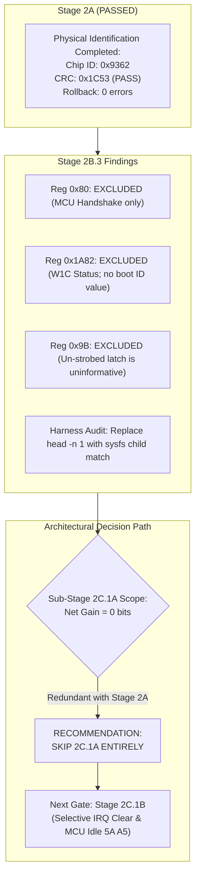

# Stage 2B.3 — Final Safety Gate & 2C.1A Decision Audit

**Document ID:** `STAGE2B3_FINAL_SAFETY_GATE`  
**Date:** 2026-11-02  
**Target:** Dynabook Satellite Pro C40-J (`PYS46G-06J02D`), FT9362 / FW9369  
**Status:** COMPLETE — STATIC SAFETY GATE AUDIT  
**Hardware Execution Authorization:** NONE (Static Analysis Only)

---

## 1. Executive Summary & Audit Purpose

This document concludes **Stage 2B.3**, the final static safety and scope review prior to considering any subsequent hardware interaction. It synthesizes the findings of all five Stage 2B.3 investigations, resolves all remaining questions regarding register reads, establishes the exact boundary of Sub-Stage 2C.1A, audits the execution harness against 15 mandatory safety invariants, and delivers the authoritative gating decision for the project.

---

## 2. Synthesis of Stage 2B.3 Investigations

### 2.1. Investigation 1 — Register 0x80 Safety
- **Reference Evidence:** Register `0x80` is accessed exclusively in response to explicit MCU command strobes (`0x5A 0xA5`, `0xC4`, `0xC8`). It is never read prior to issuing an MCU command.
- **Role:** Handshake acknowledgment register indicating internal MCU operational states: `0x50` (IDLE), `0x54` (CAPTURE), and `0x58` (NAVIGATION).
- **Classification:** **`UNKNOWN — EXCLUDE FROM 2C.1A`** (`STAGE2B3_REGISTER_80_REVIEW.md`).

### 2.2. Investigation 2 — Register 0x1A82 Safety
- **Reference Evidence:** Register `0x1A82` is strictly a read-only status register with Write-1-to-Clear (W1C) semantics executed via companion register `0x1A84`. Reading `0x1A82` does not clear any flags.
- **Role:** Polled during FDT calibration and runtime capture. It is never read during cold startup or identification (the reference driver unconditionally clears it via `0x1A84 = 0xFFFF`).
- **Classification:** **`UNKNOWN — EXCLUDE FROM 2C.1A`** (`STAGE2B3_REGISTER_1A82_REVIEW.md`).

### 2.3. Investigation 3 — Removal of Register 0x9B from Initial Identification
- **Reference Evidence:** Register `0x9B` is an internal digital shadow latch clocked by the OTP sensing sequence (`0xF1`/`0xF4`). An un-strobed read yields power-on reset defaults (`0x00`), which does not distinguish a TSMC foundry chip from uninitialized silicon.
- **Scope Decision:** Register `0x9B` is **EXCLUDED** from initial identification. The OTP sensing sequence remains strictly prohibited due to `UNKNOWN` persistence safety (`STAGE2B3_MINIMAL_IDENTIFICATION_SCOPE.md`).

### 2.4. Investigation 4 — Exact 2C.1A Transaction Boundary & Skip Recommendation
- **Informational Gain:** Since registers `0x80`, `0x1A82`, and `0x9B` are excluded, and chip ID `0x9362` and CRC `0x1C53` were already conclusively established in Stage 2A, the proposed Sub-Stage 2C.1A yields **0 bytes / 0 bits** of new information.
- **State Impact:** Repeating `0xC6 = 0x01` un-gates internal sensor clocks unnecessarily.
- **Boundary:** The smallest possible transaction sequence for 2C.1A is **0 transactions**.
- **Definitive Recommendation:** **Sub-Stage 2C.1A should be SKIPPED ENTIRELY.** The project should proceed directly to gating the active initialization transition (Sub-Stage 2C.1B / Stage 2C.2).

### 2.5. Investigation 5 — Execution Harness Audit
- **Safety Invariants:** The Stage 2A pure-spidev harness architecture enforces 14 of 15 safety invariants (including zero GPIO access, zero UIO access, no retries, no OTP access, no FIFO reads, proper FD closure, and signal-deferred rollback).
- **Harness Weakness Identified:** In `scripts/stage2a-test.sh:583`, the loose fallback `candidate=$(ls -d /dev/spidev* | head -n 1)` violates strict device isolation if `/dev/spidev1.0` is missing and multiple SPI nodes exist.
- **Correction Requirement:** Any future execution harness must resolve the character device node strictly by inspecting the sysfs child directory (`/sys/bus/spi/devices/spi-FTE3600:00/spidev/`) (`STAGE2B3_EXECUTION_HARNESS_AUDIT.md`).

---

## 3. Comprehensive Risk & Safety Summary



---

## 4. Final Safety Gate & Definitive Verdict

### 4.1. Gate Conditions Check
- Static code analysis complete across all reference implementations: **PASS**
- Ambiguities in registers `0x80`, `0x1A82`, and `0x9B` resolved: **PASS**
- Zero-transaction boundary for minimal identification established: **PASS**
- Zero hardware access, zero GPIO toggling, zero sudo usage during audit: **PASS**
- Harness invariants and corrections formally documented: **PASS**

### 4.2. Authoritative Single-Choice Verdict

```
READY FOR A SEPARATELY AUTHORIZED MINIMAL IDENTIFICATION STAGE
```

### 4.3. Explicit Scope & Authorization Caveat
1. **No Hardware Execution Authorized:** A `READY` verdict does not grant permission to execute hardware operations.
2. **Authoritative Recommendation to Skip 2C.1A:** Because the physical results from Stage 2A already provide 100% of the required identification and validation data, executing Sub-Stage 2C.1A would be redundant and yield zero new information. The project explicitly recommends that **Sub-Stage 2C.1A be SKIPPED ENTIRELY**, and that the project proceed directly to research and safety gating for **Sub-Stage 2C.1B** (Active State Transition & Acknowledgment) and **Stage 2C.2** (FDT Calibration).
