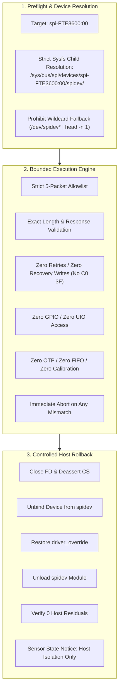

# Stage 2B.4 — Execution Harness Specifications & Safety Invariants for 2C.1B

**Document ID:** `STAGE2B4_EXECUTION_HARNESS_REQUIREMENTS`  
**Date:** 2026-11-02  
**Target:** Dynabook Satellite Pro C40-J (`PYS46G-06J02D`), FT9362 / FW9369  
**Status:** COMPLETE — STATIC SPECIFICATION ONLY  
**Hardware Execution Authorization:** NONE (Static Specification Only)

---

## 1. Executive Summary

This document specifies the exact architectural and safety requirements that must govern any future, separately authorized execution harness for **Sub-Stage 2C.1B**. 

In accordance with strict project constraints, **no executable scripts or binaries are created or modified during this task**. This specification serves as the authoritative blueprint for building a safe, bounded, and verified harness if and when the user explicitly authorizes Stage 2C.1B implementation.

---

## 2. Mandatory Architectural Invariants

Any future execution harness for Sub-Stage 2C.1B must strictly implement and guarantee each of the following 14 invariants:



---

### Invariant 1: Strict Sysfs Child Device Resolution (No Wildcard Fallback)
- **Problem in Stage 2A:** `scripts/stage2a-test.sh:583` contained a loose fallback `candidate=$(ls -d /dev/spidev* | head -n 1)`.
- **Mandatory Harness Requirement:** The harness must resolve the character device exclusively through the kernel sysfs device tree of `spi-FTE3600:00`:
```bash
# Corrected Canonical Resolution Architecture
SPIDEV_CHILD_DIR="/sys/bus/spi/devices/spi-FTE3600:00/spidev"
if [ ! -d "$SPIDEV_CHILD_DIR" ]; then
    echo "Error: Device spi-FTE3600:00 did not spawn a spidev child node!" >&2
    exit 1
fi
child_node=$(ls "$SPIDEV_CHILD_DIR" | head -n 1)
if [ -z "$child_node" ] || [ ! -c "/dev/$child_node" ]; then
    echo "Error: Resolved node '/dev/$child_node' is not a character device!" >&2
    exit 1
fi
TARGET_SPIDEV_NODE="/dev/$child_node"
```
- **Guarantee:** Under no circumstances may an arbitrary `/dev/spidev*` node be selected.

---

### Invariant 2: Explicit SPI Transaction Allowlist
The C binary must reject any command or register access outside the strictly approved 5-packet sequence:
1. `Write Byte 0xC6 = 0x01` (`[ 0x09, 0xF6, 0xC6, 0x01 ]`, length 4)
2. `Read Byte 0xC6` (`[ 0x08, 0xF7, 0xC6, 0x00, 0x00 ]`, length 5)
3. `Command Opcode 0x5A` (`[ 0x5A, 0xA5, 0x00 ]`, length 3)
4. `Read Byte 0x80` (`[ 0x08, 0xF7, 0x80, 0x00, 0x00 ]`, length 5)
5. `Command Opcode 0xA5` (`[ 0xA5, 0x5A, 0x00 ]`, length 3)

---

### Invariant 3: Exact Packet Length & Buffer Sizing
- All transfers must be submitted via `ioctl(fd, SPI_IOC_MESSAGE(1), &tr)`.
- The return value of `ioctl` must strictly equal the exact byte count of the buffer (`4`, `5`, or `3`).
- Any return value `< 0` or `!= len` must trigger immediate termination.

---

### Invariant 4: Exact Response Validation & Immediate Abort
- Wakeup readback must strictly satisfy `rx[4] == 0x01`.
- MCU status readback must strictly satisfy `rx[4] == 0x50`.
- If any byte mismatches, the harness must log the observed telemetry and **abort immediately**.
- Sending recovery command `[ 0xC0, 0x3F, 0x00 ]` is strictly **PROHIBITED**.

---

### Invariant 5: Zero Automatic Retries
- Upstream retry loops (e.g. looping 32 times on `0xC6` or 5 times on `0x80`) are strictly forbidden.
- Each transaction is single-shot.

---

### Invariant 6: Zero Hardware Reset Pulses
- PCH Pad 14 (sensor reset line) must not be requested, configured, or toggled.
- The reset line must remain in its firmware-configured high-Z pull-up state.

---

### Invariant 7: Zero GPIO / UIO Access
- No character devices `/dev/gpiochip*` or `/dev/uio*` may be opened.
- Module `fte3600` must be confirmed `ABSENT`.

---

### Invariant 8: Zero OTP / EFUSE / Flash Access
- Registers `0xF0` through `0xFF` are strictly blocked.
- No sense amplifier clocking sequences (`0xF1` / `0xF4`) are permitted.

---

### Invariant 9: Zero FIFO / Burst Readout
- Burst read command `[ 0x06, 0xF9, ... ]` is prohibited.
- Transfer sizes are restricted to $\le 5$ bytes.

---

### Invariant 10: Zero Automatic Progression
- The binary must exit with code `0` immediately after issuing `command(0xA5)`.
- It must not proceed to AFE tuning, baseline calibration, or finger detection.

---

### Invariant 11: File Descriptor Lifetime & CS Deassertion
- In every execution branch (normal exit or error exit), the SPI file descriptor must be explicitly closed before the program returns.
- Closing `fd` deasserts Chip-Select (CS pulled high by hardware pull-up).

---

### Invariant 12: Signal-Protected Host Rollback
- Modifying host operations (`modprobe spidev`, sysfs binding) must be wrapped in signal-deferred critical sections.
- The rollback script must unbind `spi-FTE3600:00`, clear `driver_override`, unload `spidev`, and verify that `/proc/modules` and `/sys/bus/spi/devices/` are pristine.

---

### Invariant 13: Explicit Rollback Status Reporting
- The rollback routine must maintain a `CLEANUP_ERRORS` counter.
- If any host cleanup step fails, the harness must emit a prominent failure banner and return non-zero.

---

### Invariant 14: Clear Sensor State Disclosure
- The harness must print an explicit notice stating that host cleanup restores host baseline only, and does not claim to restore the sensor's physical internal state.

---

## 3. Specification Status

This specification is complete. It provides an airtight set of architectural constraints for any future Stage 2C.1B execution harness.
