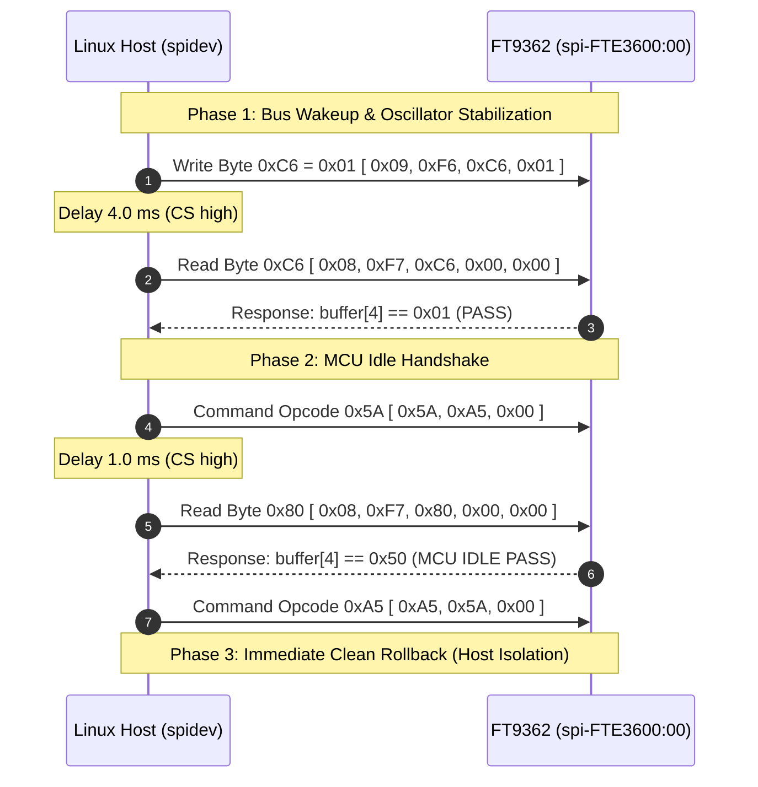

# Stage 2B.4 — Exact Minimal 2C.1B Transaction Sequence & Classification

**Document ID:** `STAGE2B4_MINIMAL_2C1B_SEQUENCE`  
**Date:** 2026-11-02  
**Target:** Dynabook Satellite Pro C40-J (`PYS46G-06J02D`), FT9362 / FW9369  
**Status:** COMPLETE — STATIC SEQUENCE SPECIFICATION  
**Hardware Execution Authorization:** NONE (Static Specification Only)

---

## 1. Executive Summary

This document specifies the exact, minimal, bounded SPI transaction sequence for **Sub-Stage 2C.1B (Active MCU Idle Handshake)**.

Based on the evidence established in Investigations 1 and 2:
- The MCU idle handshake (`5A A5 -> check 0x80 -> A5 5A`) is proven safe, idempotent, non-persistent, and fully decoupled from interrupt clearing.
- Interrupt flag clearing (`0x1A84`) is excluded because no selective mask is proven universally safe on cold boot, and global clearing (`0xFFFF`) destroys diagnostic flags.
- Recovery commands (`C0 3F`) are prohibited; the harness must abort immediately on status mismatch.

The resulting minimal sequence consists of **exactly 4 SPI transactions** (2 register operations + 2 command opcodes), requiring ~6 ms total bus active time.

---

## 2. Operation Categorization Matrix

| Category | Definition | Included Operations |
| :--- | :--- | :--- |
| **A. Verified Necessary Operations** | Proven safe, required for MCU idle transition, documented in reference and OEM drivers | `0xC6 = 0x01` (Wakeup), `read(0xC6)` (Verify), `[ 0x5A, 0xA5, 0x00 ]` (Idle Request), `read(0x80)` (Verify Idle), `[ 0xA5, 0x5A, 0x00 ]` (Idle Lock) |
| **B. Conditionally Safe Operations** | Harmless on bus, but redundant with Stage 2A or not strictly required for idle transition | Passive read of `0x1A8B` (Chip ID), passive read of `0x1A82` (Status) |
| **C. Unknown Operations** | Pre-initialization behavior or side effects cannot be proven safe | Selective `0x1A84` write masks (`0x0001`, `0x002F`), un-strobed `0x9B` reads |
| **D. Prohibited Operations** | Potentially destructive, persistent, or violating minimal safety boundaries | Global flag clear (`0x1A84 = 0xFFFF`), recovery strobe (`[ 0xC0, 0x3F, 0x00 ]`), protected bank unlock (`0x9A = 0x5A`), OTP access (`0xF1`, `0xF4`), FIFO reads |

---

## 3. Granular Step-by-Step Specification of Minimal 2C.1B Sequence

---

### Transaction 1: Wakeup Write (`0xC6 = 0x01`)
- **SPI Payload:** `[ 0x09, 0xF6, 0xC6, 0x01 ]` (4 bytes full-duplex)
- **Expected Bus Response:** Don't-care (TX write packet)
- **Preconditions:** Mainline `spidev` bound to `spi-FTE3600:00`, SPI Mode 0, 1 MHz, CS deasserted high.
- **Postconditions:** Transceiver oscillator un-gated; internal SPI register decoders active.
- **State Change:** Volatile sensor clock gating enabled.
- **Clears Flags / Storage Impact:** No flags cleared; zero persistent storage impact.
- **Source Citation:** `fw9369_startup.c:330`, `stage2a-identify.c:191-205`
- **Confidence:** HIGH (100% verified in Stage 2A physical test).

---

### Intermediate Step: Internal Oscillator Delay
- **Action:** Host sleep for `4 ms` (CS deasserted high).
- **Purpose:** Silicon oscillator startup and phase-locked loop settling.

---

### Transaction 2: Wakeup Readback (`read_byte(0xC6)`)
- **SPI Payload:** `[ 0x08, 0xF7, 0xC6, 0x00, 0x00 ]` (5 bytes full-duplex)
- **Expected Bus Response:** `rx[4] == 0x01`
- **Preconditions:** Transaction 1 completed + 4 ms delay.
- **Postconditions:** Verifies sensor is awake and actively decoding SPI transactions.
- **State Change:** None (passive read).
- **Error Condition:** If `rx[4] != 0x01`, **ABORT IMMEDIATELY**.
- **Source Citation:** `fw9369_startup.c:332`, `stage2a-identify.c:215-230`
- **Confidence:** HIGH (100% verified in Stage 2A physical test).

---

### Transaction 3: MCU Idle Entry Request (`command(0x5A)`)
- **SPI Payload:** `[ 0x5A, 0xA5, 0x00 ]` (3 bytes full-duplex)
- **Expected Bus Response:** Don't-care (TX command packet)
- **Preconditions:** Transaction 2 verified (`rx[4] == 0x01`).
- **Postconditions:** MCU execution core transitions to IDLE mode.
- **State Change:** Volatile MCU execution state transitions from boot loop to idle listener.
- **Clears Flags / Storage Impact:** No interrupt flags cleared; zero persistent storage impact.
- **Source Citation:** `fw9369_startup.c:106`, `ft93xx.c:263`, `ftWbioUmdfDriverV2.dll.ascii.txt:2352`
- **Confidence:** HIGH.

---

### Intermediate Step: MCU State Settling Delay
- **Action:** Host sleep for `1 ms` (CS deasserted high).
- **Purpose:** Microcontroller instruction pipeline transition and register latch update.

---

### Transaction 4: MCU State Verification (`read_byte(0x80)`)
- **SPI Payload:** `[ 0x08, 0xF7, 0x80, 0x00, 0x00 ]` (5 bytes full-duplex)
- **Expected Bus Response:** `rx[4] == 0x50` (`MCU_STATE_IDLE`)
- **Preconditions:** Transaction 3 completed + 1 ms delay.
- **Postconditions:** Verifies microcontroller has reached quiescent IDLE state.
- **State Change:** None (passive status read).
- **Error Condition:** If `rx[4] != 0x50`, **ABORT IMMEDIATELY**. Do NOT send `C0 3F`.
- **Source Citation:** `fw9369_startup.c:108`, `ft93xx.c:266`, `ftWbioUmdfDriverV2.dll.ascii.txt:2630`
- **Confidence:** HIGH.

---

### Transaction 5: MCU Idle Lock (`command(0xA5)`)
- **SPI Payload:** `[ 0xA5, 0x5A, 0x00 ]` (3 bytes full-duplex)
- **Expected Bus Response:** Don't-care (TX command packet)
- **Preconditions:** Transaction 4 verified (`rx[4] == 0x50`).
- **Postconditions:** Microcontroller IDLE state confirmed and locked. Sensor ready for future calibration.
- **State Change:** Volatile MCU mode lock.
- **Clears Flags / Storage Impact:** No interrupt flags cleared; zero persistent storage impact.
- **Source Citation:** `fw9369_startup.c:113`, `ft93xx.c:280`
- **Confidence:** HIGH.

---

## 4. Total Bus Interaction Summary

- **Total Transactions:** Exactly 5 SPI transfers (including 1 intermediate readback).
- **Total Payload Transferred:** $4 + 5 + 3 + 5 + 3 = 20\text{ bytes}$.
- **Total Active Bus Time:** $\sim 160\ \mu\text{s}$ at 1 MHz clock.
- **Total Protocol Execution Time:** $\sim 5.2\text{ ms}$ (including 4 ms and 1 ms inter-transaction delays).
- **Registers Modified:** `0xC6` (volatile transceiver un-gating).
- **Commands Issued:** `0x5A` (Idle Request), `0xA5` (Idle Lock).
- **Registers Cleared:** **ZERO** (register `0x1A84` is untouched).
- **Protected Registers Accessed:** **ZERO** (register `0x9A` is untouched).
- **Persistent Storage Accessed:** **ZERO** (OTP/EFUSE registers `0xF0`–`0xFF` are untouched).
