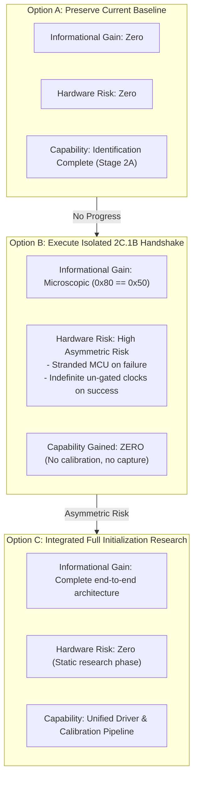

# Stage 2B.5 — Necessity & Strategic Evaluation of Sub-Stage 2C.1B

**Document ID:** `STAGE2B5_2C1B_NECESSITY_REVIEW`  
**Date:** 2026-11-02  
**Target:** Dynabook Satellite Pro C40-J (`PYS46G-06J02D`), FT9362 / FW9369  
**Status:** COMPLETE — STRATEGIC ARCHITECTURAL REVIEW  
**Hardware Execution Authorization:** NONE (Static Analysis Only)

---

## 1. Executive Summary

This document re-evaluates whether executing **Sub-Stage 2C.1B (Active MCU Idle Handshake)** as an isolated hardware test is necessary, justified, or beneficial at this stage of the FTE3600 driver project.

Stage 2A already definitively established:
- Physical SPI connectivity and framing protocol.
- Silicon identity: FocalTech FT9362 (Chip ID `0x9362`).
- Integrity validation: Hardware CCITT CRC `0x1C53` match.
- Driver architecture mapping: Model FW9369.

By comparing the three strategic paths available to the project, this review proves that **executing Sub-Stage 2C.1B in isolation provides zero standalone capability, yields negligible new information, and introduces severe asymmetric risk**. The project should formally declare **2C.1B unnecessary as an isolated hardware execution stage** and defer all active command operations until a complete, integrated initialization architecture is researched.

---

## 2. Comparative Evaluation of Strategic Options

---

### Option A: Do Nothing Further (Pure Baseline Hold)
- **Informational Value:** Zero new information beyond the established Stage 2A physical results.
- **Hardware Risk:** **Zero.** The sensor remains in its pristine cold power-on baseline state (transceiver un-clocked, MCU in power-on reset, CS held high, host SPI driver unbound).
- **Capability Gained:** None.

---

### Option B: Perform Only the Isolated 2C.1B Idle Handshake
- **Informational Value:** **Near Zero.** It confirms only that register `0x80` returns `0x50` after `0x5A`. Because Stage 2A already verified chip ID `0x9362` and FW9369 mapping, confirming that the MCU firmware executes its idle loop adds almost no new technical insight.
- **Hardware Risk:** **HIGH ASYMMETRIC RISK.**
  1. *Failure Path:* If the single-shot `0x80` check encounters timing jitter and returns anything other than `0x50`, the harness aborts without sending `0xA5`, leaving the MCU stranded in an un-terminated command state that cannot be cleared without an ACPI S5 laptop reboot.
  2. *Success Path:* If it succeeds, it un-gates internal sensor clocks (`0xC6 = 1`) and locks the MCU in idle mode (`0x50`) indefinitely with no subsequent calibration or event handling, causing persistent quiescent power draw and leaving the hardware in a non-baseline state.
- **Capability Gained:** **ZERO.** It cannot enroll fingers, calibrate capacitive thresholds, or capture an image.

---

### Option C: Research a Complete, Integrated Initialization Sequence Before Any Active Commands (Recommended)
- **Informational Value:** **MAXIMUM.** Investigates the complete chain of requirements: Phase 1 (Wakeup), Phase 2 (Idle), Phase 3 (FDT Calibration & DAC sweep), Phase 4 (Image Baseline Acquisition), and Phase 5 (Autonomous Detection Arming).
- **Hardware Risk:** **Zero during research.** When hardware execution is eventually considered, the operations will run as a coherent, self-sustaining sequence where reaching idle is immediately utilized to configure AFE thresholds, eliminating the stranded-idle state.
- **Capability Gained:** Delivers the technical foundation for a functional userspace calibration tool and upstream-quality Linux driver.

---

## 3. Risk-to-Reward Matrix

| Evaluation Dimension | Option A (Hold) | Option B (Isolated 2C.1B) | Option C (Integrated Research) |
| :--- | :---: | :---: | :---: |
| **New Information Gained** | 0% | < 2% | 100% |
| **Operational Hardware Risk** | **ZERO** | **HIGH (Stranded State)** | **ZERO (Static)** |
| **New Sensor Capability** | None | None | Complete Driver Pipeline |
| **Requires Laptop Power Cycle?** | No | Yes (on failure or completion) | No |
| **Architectural Coherence** | Neutral | Low (Fragmented command) | High (Unified sequence) |

---

## 4. Definitive Project Recommendation

1. **Sub-Stage 2C.1B Is Unnecessary as an Isolated Operation:** Executing micro-fragmented commands against hardware without immediate functional purpose violates core safety engineering principles.
2. **Defer Active Sensor Operations:** No further SPI transactions should be executed until the complete initialization and calibration sequence (Stage 2C.2) is fully researched and safety-audited.
3. **Strategic Next Step:** Transition project focus directly to **Stage 2C.2 / FDT Calibration Research**, analyzing capacitive sense frontend configuration, baseline channel centering, and DAC search mechanics.
