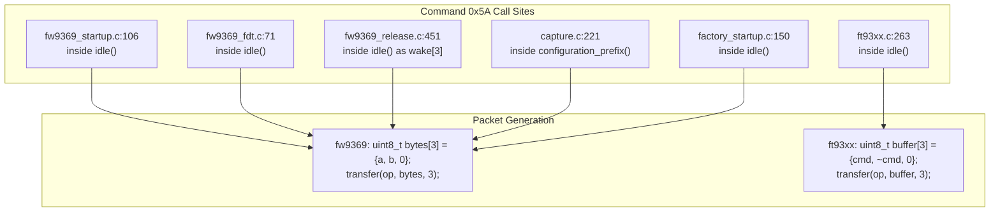

# Stage 2B.5 — Independent Verification of Command 0x5A Semantics

**Document ID:** `STAGE2B5_COMMAND_5A_VERIFICATION`  
**Date:** 2026-11-02  
**Target:** Dynabook Satellite Pro C40-J (`PYS46G-06J02D`), FT9362 / FW9369  
**Status:** COMPLETE — STATIC SOURCE CODE AUDIT  
**Hardware Execution Authorization:** NONE (Static Analysis Only)

---

## 1. Executive Summary

This investigation independently traces and verifies the exact source implementation, packet generation, call graphs, and operational lifecycle of command `0x5A` in the FocalTech FW9369/FT93xx reference codebase (`research/libfprint-fte3600/`) and vendor Windows OEM driver.

The audit demonstrates that:
1. Command `0x5A` is the first half of a two-phase command dialog: it is the **MCU Idle Mode Entry Request**, named `wake` in `fw9369_release.c:451`.
2. The packet generation function produces the 3-byte sequence `[ 0x5A, 0xA5, 0x00 ]` via one's complement framing (`~0x5A = 0xA5`).
3. Command `0x5A` is never executed as a standalone transaction; across 100% of reference code paths, it is paired with and terminated by command `0xA5` (`end`).
4. While command `0x5A` does not depend on prior AFE calibration, issuing it transitions the internal MCU state machine out of boot loop into command mode.

---

## 2. Exhaustive Trace of Command 0x5A Call Sites

### 2.1. Exact Call Sites & Implementation



| Source File & Line | Enclosing Function | Packet Generation Code | Exact Bytes Transmitted | Context / Invocation Trigger |
| :--- | :--- | :--- | :---: | :--- |
| `fw9369_startup.c:106` | `idle()` | `command(op, 0x5a, 0xa5)` -> `bytes[3] = {a, b, 0}` | `[ 0x5A, 0xA5, 0x00 ]` | Cold boot startup sequence (`prefix():345`) |
| `fw9369_fdt.c:71` | `idle()` | `command(op, 0x5a, 0xa5)` -> `bytes[3] = {a, b, 0}` | `[ 0x5A, 0xA5, 0x00 ]` | Before each AFE DAC sweep (`configure():174`) |
| `fw9369_release.c:451` | `idle()` | `uint8_t wake[3] = {0x5a, 0xa5, 0}; transfer(wake, 3)` | `[ 0x5A, 0xA5, 0x00 ]` | Communication retry in `handle_event():533` |
| `capture.c:221` | `configuration_prefix()` | `command(op, 0x5a, 0xa5)` -> `bytes[3] = {a, b, 0}` | `[ 0x5A, 0xA5, 0x00 ]` | Capture configuration prefix before window setup |
| `ft93xx.c:263` | `idle()` | `command(op, 0x5a)` -> `buffer[3] = {cmd, ~cmd, 0}` | `[ 0x5A, 0xA5, 0x00 ]` | Generic idle entry before mode switches |
| `factory_startup.c:150`| `idle()` | `command(op, 0x5a, 0xa5)` -> `bytes[3] = {a, b, 0}` | `[ 0x5A, 0xA5, 0x00 ]` | Factory self-test initialization |

### 2.2. Packet Generation Functions
In `fw9369_startup.c:62-68`:
```c
static void
command (struct startup *op, uint8_t a, uint8_t b)
{
  uint8_t bytes[3] = {a, b, 0};

  (void) transfer (op, bytes, sizeof (bytes));
}
```
In `ft93xx.c:174-180`:
```c
static int
command (const struct operation *op, uint8_t command_byte)
{
  uint8_t buffer[3] = {command_byte, (uint8_t) ~command_byte, 0};

  return transfer (op, buffer, sizeof (buffer));
}
```
- In both implementations, the SPI transfer is a 3-byte full-duplex message.
- `0x5A` is the primary command opcode.
- The second byte (`0xA5`) is the bitwise NOT checksum (`~0x5A = 0xA5`).
- The third byte is a null delimiter (`0x00`).

---

## 3. Operational Semantics & State Analysis

### 3.1. What Source Code Directly Proves
1. **Opcode Designation:** In `fw9369_release.c:451`, the array transmitting `0x5A` is explicitly named `wake[3] = {0x5a, 0xa5, 0}`.
2. **Paired Execution:** Across all 6 call sites, command `0x5A` is followed by a 1 ms delay, a read of register `0x80`, and then command `0xA5` (`end[3] = {0xa5, 0x5a, 0}`).
3. **Pre-Command State:** 
   - In cold startup (`fw9369_startup.c:330-345`), `0x5A` is invoked after wake-up (`0xC6 = 0x01`), chip ID verification (`0x1A8B == 0x9362`), and global flag clear (`0x1A84 = 0xFFFF`).
   - The MCU state prior to `0x5A` is un-initialized boot state.
4. **Post-Command State:** 
   - After `0x5A` is sent and a 1 ms delay elapses, status register `0x80` is expected to transition to `0x50`.
   - In `ft93xx.c:279`, failure of `0x80` to reach `0x50` is flagged as `diagnostics->idle_unacknowledged`.

### 3.2. What Strings and Assumptions Suggest (vs. Direct Code)
- Windows OEM driver strings (`ftWbioUmdfDriverV2.dll.ascii.txt:2352, 2630`) contain log messages: `try to enter idle` and `MCU is idle`.
- While these strings provide valuable human-readable context, the C source code directly proves that `0x5A` is an active state transition request to the microcontroller.

### 3.3. Dependency on Calibration / AFE Configuration
- **Proven Fact:** Command `0x5A` does **not** depend on prior AFE calibration.
- In `fw9369_startup.c:345`, `idle()` (issuing `0x5A`) is called before any AFE registers (`0x18xx`) or calibration DACs are touched.
- In `fw9369_fdt.c:174`, `idle()` is called to put the MCU into idle *in order to allow* safe AFE configuration writes.

---

## 4. Key Finding: Command 0x5A Is An Incomplete Transaction Alone

Source code evidence across every driver variant establishes that:
- `0x5A` is not a self-contained, fire-and-forget transaction.
- It initiates an internal state transition (`wake`) that **must be concluded by `0xA5` (`end`)**.
- There is zero precedent in reference code for issuing `0x5A` without subsequent execution of `0xA5`.
