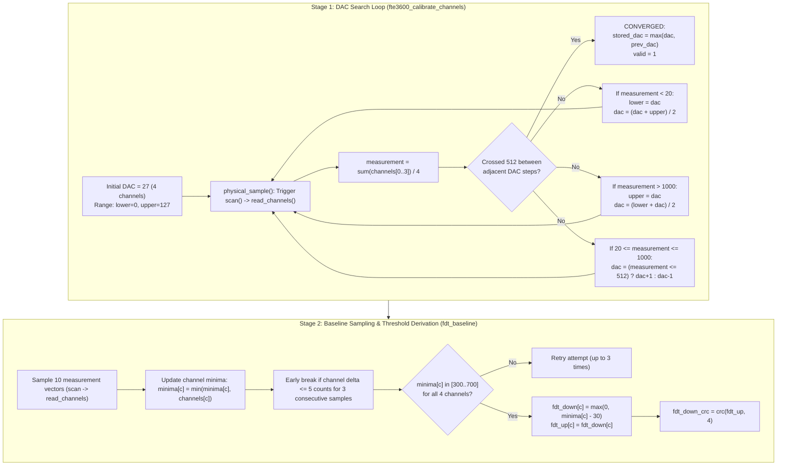

# Stage 2C.2 — FDT Calibration Algorithm & Frontend Architecture Review

**Document ID:** `STAGE2C2_FDT_CALIBRATION_REVIEW`  
**Date:** 2026-11-02  
**Target:** Dynabook Satellite Pro C40-J (`PYS46G-06J02D`), FT9362 / FW9369  
**Status:** COMPLETE — STATIC SOURCE CODE AUDIT  
**Hardware Execution Authorization:** NONE (Static Analysis Only)

---

## 1. Executive Summary

This investigation audits the complete Finger Detection Threshold (FDT) calibration algorithm and capacitive analog frontend (AFE) tuning pipeline implemented in `fw9369_fdt.c`, `calibration.c`, and `fw9369_startup.c`.

The audit verifies that:
1. **AFE DAC Tuning Target:** The algorithm sweeps `fdt_dac` (a 7-bit value from 0 to 127 in register `0x1801`) using a hybrid binary/linear search to center the 4-channel average ADC baseline at **512 counts** (on a 10-bit ADC, range 0..1023).
2. **Measurement Procedure:** The driver samples 10 consecutive measurement frames across 4 capacitive channels, computing the minimum ADC value per channel (`minima[c]`).
3. **Threshold Formula Confirmed:** The formula for deriving the finger detection touch threshold is verified against source code (`fw9369_startup.c:194`):
   $$\text{fdt\_down}[c] = \max(0, \text{minima}[c] - 30)$$
4. **Volatile Storage:** Thresholds are stored strictly in volatile host memory and uploaded to volatile sensor register bank `0x80B0` during arming. They are **never written to persistent OTP, EFUSE, or flash**.

---

## 2. AFE & Threshold Register Catalog

| Register Address | Access Type | Operational Purpose in FDT Calibration | Value / Bitmask Written |
| :---: | :---: | :--- | :--- |
| **`0x1801`** | Write 16-bit | AFE Capacitive Channel DAC Setting | `0xFC80 | dac` (where `dac` $\in [0..127]$) |
| **`0x1800`** | Write 16-bit | AFE Channel Mode & Enable Window | `0x07FE` (for 4-channel mode) |
| **`0x1804`** | Write 16-bit | Integration Multiplier & Shift Control | `0x27C8 | (multiplier - 1)` |
| **`0x1807`** | Write 16-bit | Measurement Period / Timing Clock | `0x1671` |
| **`0x1808`** | Write 16-bit | FDT Row / Scan Configuration | `0x0801` |
| **`0x1887`** | Write 16-bit | Sensing Mode Control | `0x0005` |
| **`0x180C`** | Write 16-bit | Calibration Mode Filter Override | `0x0600` (during calibration), `0` (normal) |
| **`0x1806`** | Modify 16-bit| AFE Analog Filter Configuration 1 | `(val & 0xC07F) | 0x0980` |
| **`0x180A`** | Modify 16-bit| AFE Analog Filter Configuration 2 | `(val & 0xC000) | 0x0987` |
| **`0x180B`** | Modify 16-bit| AFE Analog Filter Configuration 3 | `(val & 0xC000) | 0x0491` |
| **`0x1805`** | Modify 16-bit| Internal Oscillator Tuning | `val & 0xFFEF` |
| **`0x180D`** | Write 16-bit | AFE Clock Gate Divider | `(val & 0xFC00) | 0x0384` |
| **`0x1888`** | Modify 16-bit| Gain Compensation Trim | `val & 0xFC03` |
| **`0x9A`** | Write 8-bit | Protected Bank Unlock / Lock Register | `0x5A` (Unlock), `0x00` (Lock) |
| **`0x00C0`..`0x00C2`**| Write 16-bit | Protected AFE Gain / Channel Balance Bank | `0x0444`, `0x0021`, `0x00C0` |
| **`0x1880`** | Modify 16-bit| FDT Hardware Detection Threshold | `(thresh_high << 8) | thresh_low` |
| **`0x1881`** | Write 16-bit | FDT Enable & Timing Register | Set bit 1 (`value | 2`) to enable scan |
| **`0x1884`** | Modify 16-bit| Hardware Sample Averaging Count | `(val & 0xFFF8) | (average - 1)` |
| **`0x1885`** | Write 16-bit | FDT Hardware Trigger Strobe | `1` (triggers single scan) |
| **`0x1A82`** | Read 16-bit | Interrupt & Event Status Register | Poll bit 3 (`val & 8 != 0` -> Measurement Ready) |
| **`0x1A83`** | Modify 16-bit| FDT Interrupt Mask Register | Set bit 3 (`val | 0x0008`) |
| **`0x1A8A`** | Write 16-bit | Hardware Filter Enable Mask | `0x00FF` |
| **`0x80B0`** | Write 22-byte| Protected FDT Threshold Vector Bank | 8 words (loaded with `fdt_down[c]`) |

---

## 3. The Two-Stage Calibration Architecture

FDT calibration in `fw9369_startup.c:143-199` is divided into two sequential algorithms:



---

## 4. Source Evidence for Threshold Formula

In `fw9369_startup.c:192-198`:
```c
/* fw9369_startup.c:192-198 */
for (size_t c = 0; c < 4; ++c)
  {
    uint16_t value = minima[c] < 31 ? 0 : (uint16_t) (minima[c] - 30);
    op->s->fdt_reference[c] = op->s->fdt_down[c] = op->s->fdt_up[c] = value;
  }
op->s->fdt_down_crc = op->s->fdt_up_crc = crc (op->s->fdt_up, 4);
```
- **Underflow Protection:** `minima[c] < 31 ? 0 : minima[c] - 30` prevents 16-bit underflow.
- **Sensitivity Window:** Subtracting 30 ADC counts establishes the capacitive touch threshold. When a finger contacts the sensor surface, capacitive coupling pulls channel charge down; when charge drops below `fdt_down[c]` (i.e. $> 30$ counts below baseline), hardware asserts the `down` interrupt (bit 1 in `0x1A82`).

---

## 5. Non-Executable Algorithm Pseudocode

```text
ALGORITHM: FW9369_FDT_Calibration (Conceptual Specification Only)

INPUT:
    config: FDT configuration parameters (channel_mode = 1 [4 channels])
    io: SPI transport interface

OUTPUT:
    calibrated_dac: 7-bit DAC value (0..127)
    fdt_down[4]: 4-word touch threshold vector
    fdt_crc: 16-bit CCITT CRC of threshold vector

PROCEDURE:
    1. Enter MCU Idle State:
         SEND command [ 0x5A, 0xA5, 0x00 ]
         WAIT 1 ms
         READ register 0x80 (ASSERT == 0x50)
         SEND command [ 0xA5, 0x5A, 0x00 ]

    2. AFE Static Configuration:
         WRITE 0x1800 = 0x07FE (4-channel mode)
         WRITE 0x1804 = 0x27C8 (integration multiplier)
         WRITE 0x1807 = 0x1671
         WRITE 0x1808 = 0x0801
         WRITE 0x1887 = 0x0005
         CONFIGURE analog filters (0x1806, 0x180A, 0x180B, 0x1805, 0x180D, 0x1888)

    3. Protected Bank 0x00C0 Setup:
         WRITE 0x9A = 0x5A (Unlock bank)
         TRY:
             WRITE 0x00C0 = 0x0444
             WRITE 0x00C1 = 0x0021
             WRITE 0x00C2 = 0x00C0
         FINALLY:
             WRITE 0x9A = 0x00 (Lock bank guaranteed)

    4. Stage 1: DAC Binary/Linear Centering Search:
         dac = 27, lower = 0, upper = 127, prev_dac = 0, prev_meas = 0
         FOR count = 0 TO 63:
             WRITE 0x1801 = (0xFC80 | dac)
             channels = Execute_Physical_Scan()
             meas = (channels[0] + channels[1] + channels[2] + channels[3]) / 4

             IF (dac == prev_dac + 1 AND prev_meas <= 512 AND meas > 512) OR
                (prev_dac == dac + 1 AND meas <= 512 AND prev_meas > 512):
                 calibrated_dac = MAX(dac, prev_dac)
                 BREAK (Converged)

             IF meas < 20:
                 lower = dac; dac = (dac + upper) / 2
             ELSE IF meas > 1000:
                 upper = dac; dac = (lower + dac) / 2
             ELSE:
                 dac = (meas <= 512) ? dac + 1 : dac - 1

    5. Stage 2: 10-Sample Baseline Acquisition & Threshold Calculation:
         minima[0..3] = { 1023, 1023, 1023, 1023 }
         FOR sample = 0 TO 9:
             channels = Execute_Physical_Scan()
             FOR c = 0 TO 3:
                 minima[c] = MIN(minima[c], channels[c])

         FOR c = 0 TO 3:
             ASSERT 300 <= minima[c] <= 700 (Reject if saturated or noisy)
             fdt_down[c] = (minima[c] < 31) ? 0 : (minima[c] - 30)

         fdt_crc = CRC_CCITT(fdt_down, 4 words)
         RETURN (calibrated_dac, fdt_down, fdt_crc)
```
