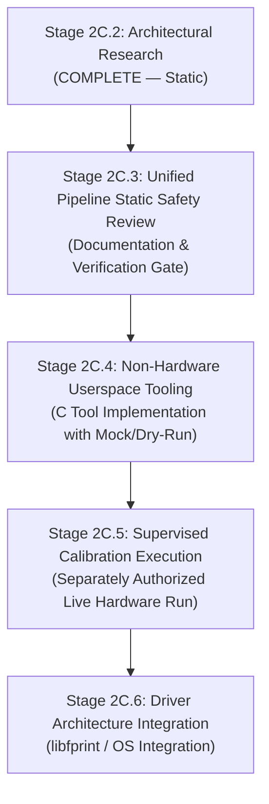

# Stage 2C.2 — Future Stage Decomposition & Execution Roadmap

**Document ID:** `STAGE2C2_FUTURE_STAGE_DECOMPOSITION`  
**Date:** 2026-11-02  
**Target Hardware:** Dynabook Satellite Pro C40-J (`PYS46G-06J02D`)  
**Target Silicon:** FocalTech FT9362 / FW9369 (Chip ID `0x9362`, CRC `0x1C53`)  
**Document Purpose:** Formally define the safe, phased progression from Stage 2C.2 research through production driver integration.  
**Execution Boundary:** Static roadmap definition only. Hardware execution is strictly prohibited.

---

## 1. Evolution from Preliminary Sub-Stage Plans

In Stage 2B.1, Stage 2C was initially conceptualized as six small hardware sub-stages (2C.1 through 2C.6). However, empirical analysis and safety reviews across Stages 2B.2 through 2B.5 proved that:

1. **Stage 2C.1A (Identification)** was redundant because physical identification and CRC validation were already achieved in Stage 2A.
2. **Stage 2C.1B (Active Handshake `0x5A`/`0xA5` in isolation)** was hazardous and unproductive because asserting MCU idle handshake without immediately continuing to AFE tuning or detector arming leaves the internal microcontroller in an indeterminate intermediate state.
3. **The Sensor Pipeline is Atomically Coupled:** FDT calibration and image baseline acquisition share interdependent AFE states, volatile RAM buffers, and protected register transactions (`0x9A`).

Therefore, isolated piecemeal SPI experiments are cancelled. The future project workflow is restructured into four disciplined, logically complete stages:

---

## 2. Detailed Stage Decomposition

### Stage 2C.3: Static Safety Review of Unified Startup & Calibration Pipeline
- **Focus:** Complete, byte-exact static specification of the unified initialization transaction sequence.
- **Hardware Execution:** **STRICTLY PROHIBITED (0% hardware access).**
- **Prerequisites:** Stage 2C.2 research deliverables accepted.
- **Required Understanding:**
  - Unified register sequence from Phase 1 through Phase 4.
  - Formal proof of RAII / structured lock cleanup for register `0x9A`.
  - Byte-level MOSI/MISO packet layouts for all 18 AFE write operations.
  - Parameterized binary/linear search loops for FDT and image DAC tuning.
- **Key Operations:**
  - Author a unified, cycle-accurate specification document detailing every SPI packet.
  - Review defensive timeout bounds for all polling loops (maximum 20 iterations / 100 ms).
  - Validate mathematical bounds of DAC searches and threshold calculations.
- **Primary Risks:**
  - Specification errors or missed register writes resulting in bad calibration tables.
- **Static Safety Gate:**
  - Formal sign-off on the unified sequence document; zero unresolved protected register questions.

---

### Stage 2C.4: Non-Hardware Userspace Tool Implementation (`fte3600-tool`)
- **Focus:** Authoring, compiling, and unit-testing a production-grade userspace utility in C without touching hardware.
- **Hardware Execution:** **STRICTLY PROHIBITED (0% hardware access).**
- **Prerequisites:** Stage 2C.3 static specification approved.
- **Required Understanding:**
  - Linux `spidev` IOCTL API (`SPI_IOC_MESSAGE(N)`).
  - Linux module parameter `spidev.bufsiz=65536` configuration.
  - Mocking / dry-run harness architecture.
  - Offline CRC-CCITT (polynomial `0x1021`) verification algorithms.
- **Key Operations:**
  - Develop `tools/fte3600-tool.c` implementing:
    - Unified initialization, AFE setup, FDT calibration, and baseline capture.
    - Strict RAII error handling ensuring lock byte `0x9A = 0x00` is always transmitted on failure.
    - Explicit `--dry-run` and `--mock` modes that simulate sensor register responses.
    - Offline unit tests verifying FIFO unpacking, median calculation, and CRC checks.
  - Build and verify binary in userspace without root privileges.
- **Primary Risks:**
  - Accidental invocation against live `/dev/spidev*` without authorization (prevented by mandatory safety command-line flags and environment variable gates).
- **Safety Gate:**
  - 100% test pass rate across synthetic test vectors; tool verified to cleanly handle simulated communication timeouts and parity/CRC errors.

---

### Stage 2C.5: Supervised Hardware FDT & Baseline Calibration Execution
- **Focus:** A single, end-to-end, controlled live hardware test to calibrate AFE and capture the baseline frame.
- **Hardware Execution:** **AUTHORIZED ONLY UPON EXPLICIT HUMAN SUPERVISOR APPROVAL.**
- **Prerequisites:**
  - Stage 2C.4 tool fully validated in mock mode.
  - Written, peer-reviewed Operator Procedure and Checklist.
  - User explicitly supplies runtime authorization.
- **Required Understanding:**
  - Intel LPSS SPI FIFO behavior under 10,246-byte DMA transfers.
  - Host rollback procedure (guaranteed unbind, module unload).
  - Platform recovery limits (Pad 14 cannot be pulsed; ACPI S5 cold reboot is required if sensor stalls).
- **Key Operations:**
  - Configure `spidev.bufsiz=65536`.
  - Bind `spi-FTE3600:00` to `spidev`.
  - Execute `fte3600-tool` to calibrate FDT DAC, acquire 10-sample FDT baseline, tune Image DAC, and acquire 10,240-byte baseline frame.
  - Store calibrated FDT thresholds and baseline frame in volatile user session storage.
  - Immediately execute complete host rollback (unbind and unload).
- **Primary Risks:**
  - Sensor AFE saturation or non-converging DAC loop (mitigated by 20-iteration hard loop caps).
  - SPI controller DMA timeout (mitigated by 100 ms timeout configurations).
- **Safety Gate / Success Criteria:**
  - FDT channel minima fall within valid window (`300..700`).
  - Baseline frame CRC matches calculated 128-word CRC.
  - Host rollback completes with 0 errors (`spidev` absent, `/dev/spidev*` absent).

---

### Stage 2C.6: Driver Architecture Integration (`libfprint` / Kernel Module)
- **Focus:** Integrating the validated initialization and capture algorithms into Linux biometric subsystems.
- **Hardware Execution:** Controlled biometric enrollment and verification.
- **Prerequisites:** Stage 2C.5 successfully captures valid baseline frames and confirms FDT thresholds.
- **Required Understanding:**
  - `libfprint` driver state machine (Enroll, Verify, Identify).
  - Platform GPIO interrupt handling (Pad 229 / ACPI 323) via `libgpiod` or kernel UIO/platform driver.
  - Image normalization, contrast enhancement, and minutiae extraction pipelines.
- **Key Operations:**
  - Port validated calibration algorithms into `research/libfprint-fte3600` or an independent modern libfprint driver module.
  - Configure `fprintd` system service and PAM integration (`pam_fprintd.so`).
  - Perform live fingerprint enrollment and authentication tests.
- **Primary Risks:**
  - OS desktop environment compatibility; PAM lockout on authentication failure.
- **Success Criteria:**
  - Full end-to-end user authentication from Linux login screen (GDM / SDDM).

---

## 3. Comparative Summary Matrix

| Stage | Mode | HW Access? | Core Deliverable | Safety Gate |
| :--- | :--- | :---: | :--- | :--- |
| **Stage 2C.2** | Research | **NO** | 6 architectural reports + state record + roadmap | Gate review approved |
| **Stage 2C.3** | Specification | **NO** | Cycle-accurate byte-level execution spec | Formal sequence audit |
| **Stage 2C.4** | Implementation | **NO** | `tools/fte3600-tool` with mock/dry-run test suite | 100% offline unit test pass |
| **Stage 2C.5** | Hardware Test | **YES (Supervised)** | Calibrated FDT & Baseline Frame telemetry | Valid CRC & clean rollback |
| **Stage 2C.6** | System Integration| **YES (Runtime)** | Production `libfprint` driver & PAM auth | Desktop login working |

---

## 4. Hardware Isolation & Safety Rules

1. **Static Analysis Enforcement:** Stages 2C.2, 2C.3, and 2C.4 must remain 100% non-hardware touching.
2. **Execution Boundary:** No hardware test script or binary shall be executed without a dedicated, human-authorized Stage 2C.5 execution checklist.
3. **No Intrusive Pad Restoration:** Platform Pad 14 and Pad 229 must not be manipulated via direct MMIO or unsafe kernel hacks.
