# Stage 2C.2 — Complete FW9369 Initialization Architecture Reconstruction

**Document ID:** `STAGE2C2_INITIALIZATION_SEQUENCE`  
**Date:** 2026-11-02  
**Target:** Dynabook Satellite Pro C40-J (`PYS46G-06J02D`), FT9362 / FW9369  
**Status:** COMPLETE — STATIC ARCHITECTURAL RECONSTRUCTION  
**Hardware Execution Authorization:** NONE (Static Analysis Only)

---

## 1. Executive Summary

This investigation reconstructs the end-to-end initialization, calibration, and arming architecture of the FocalTech FT9362 sensor under the FW9369 driver architecture. Tracing directly through `research/libfprint-fte3600/libfprint/drivers/fte3600/` (`fw9369_startup.c`, `fw9369_fdt.c`, `fw9369_release.c`, `capture.c`, `calibration.c`, `image.c`), this document establishes the definitive 7-phase operational pipeline.

The reconstruction proves that:
1. The FT9362 / FW9369 pathway **does not require an external firmware download**; operational firmware resides in internal ROM / hardwired silicon state machines.
2. Initialization is an integrated, tightly-coupled multi-phase pipeline:
   - Phase 0: Reset Prerequisites
   - Phase 1: Bus Wakeup & Silicon Identification
   - Phase 2: MCU Idle Handshake & Foundry Detection
   - Phase 3: Capacitive Frontend (AFE) Tuning & FDT Calibration
   - Phase 4: Image DAC Centering & Baseline Frame Acquisition
   - Phase 5: Autonomous Finger Detection Arming
   - Phase 6: Runtime Event Handling & Live Touch Capture
3. Executing isolated command fragments (such as standalone idle handshakes) creates stranded hardware states; the sequence is architected to progress continuously from idle directly into calibration and arming.

---

## 2. Complete FW9369 Call Graph & Phase Overview

```mermaid
flowchart TD
    subgraph P0["Phase 0: Reset Prerequisites"]
        P0_PIN["PCH Pad 14 (SPKR/Reset): High-Z Pull-up (Firmware 0x84000201)"]
    end

    subgraph P1["Phase 1: Bus Wakeup & Identification"]
        P1_WAKE["write_byte(0xC6, 1) -> wait 4ms -> read_byte(0xC6) == 1"]
        P1_ID["read_word(0x1A8B, &id) == 0x9362 (CRC 0x1C53)"]
        P1_CLR["write_word(0x1A84, 0xFFFF)"]
    end

    subgraph P2["Phase 2: MCU Idle Handshake & Foundry"]
        P2_IDLE["command(0x5A, 0xA5) -> wait 1ms -> read_byte(0x80) == 0x50 -> command(0xA5, 0x5A)"]
        P2_OTP["prefix() OTP sense: 0xF1=3, 0xF4 strobes -> 0xF1=0x13, 0xF4 strobes"]
        P2_FND["read_byte(0x9B) >> 2: 0x13 -> SMIC (0xAA); 0 -> TSMC (0x00)"]
        P2_CLR["write_word(0x1A84, 0xFFFF)"]
    end

    subgraph P3["Phase 3: AFE Setup & FDT Calibration"]
        P3_CFG["configure(): AFE registers 0x1800..0x180D, 0x1881, 0x1887"]
        P3_LOCK["write_byte(0x9A, 0x5A) -> modify bank 0x00C0..0x00C2 -> write_byte(0x9A, 0)"]
        P3_SWEEP["fte3600_calibrate_channels(): sweep fdt_dac (0..127) targeting median ~512"]
        P3_MEAS["10 samples fdt_call(MEASURE) -> minima[c] -> fdt_down[c] = max(0, minima[c]-30)"]
    end

    subgraph P4["Phase 4: Image Baseline Acquisition"]
        P4_SRCH["fte3600_image_search(): sweep image_dac targeting median ~512"]
        P4_FIFO["frames(): command(0xC4, 0x3B) -> poll 0x80==0x54 -> FIFO 10,246 B (prefix 0x06 0xF9...)"]
        P4_BASE["Unpack 5,120 16-bit pixels -> compute 128-word CRC -> store baseline in host RAM"]
    end

    subgraph P5["Phase 5: Finger Detection Arming"]
        P5_LOCK["write_byte(0x9A, 0x5A) -> write 8 words fdt_down to 0x80B0 -> write_byte(0x9A, 0)"]
        P5_ARM["write_word(0x1881, 0x81) -> write_word(0x1A83, 0x16) -> write_word(0x1A84, 0x2F)"]
        P5_TRIG["command(0xC2, 0x3D) -> wait 1ms -> armed"]
    end

    subgraph P6["Phase 6: Runtime IRQ & Live Capture"]
        P6_IRQ["PCH Pad 229 IRQ fires -> read_word(0x1A82, &status)"]
        P6_DOWN["If status & 2 (DOWN): capture live frame via FIFO"]
        P6_ACK["write_word(0x1A84, status) -> re-arm UP detection"]
    end

    P0 --> P1
    P1 --> P2
    P2 --> P3
    P3 --> P4
    P4 --> P5
    P5 --> P6
```

---

## 3. Granular Phase-by-Phase Technical Trace

### Phase 0: Reset Prerequisites
- **Source Citation:** `linux_board.c:445-455`, `STAGE1_GPIO_RESTORATION_INVESTIGATION.md`
- **Electrical Condition:** Physical reset line Pad 14 must be high-Z pull-up (`0x84000201`), holding the active-low `RST_N` pin at VCC.
- **Prerequisite State:** Sensor powered, hardware reset deasserted.
- **Hardware Operations:** Passive confirmation of baseline. (No GPIO toggling permitted).

### Phase 1: Bus Wakeup & Silicon Identification
- **Source Citation:** `fw9369_startup.c:325-343`, `stage2a-identify.c:191-260`
- **Operations:**
  1. `write_byte (op, 0xc6, 1)`: Packet `[ 0x09, 0xF6, 0xC6, 0x01 ]` (Un-gates transceiver clock).
  2. `wait_ms (op, 4)`: Oscillator stabilization.
  3. `read_byte (op, 0xc6)`: Packet `[ 0x08, 0xF7, 0xC6, 0x00, 0x00 ]` (Expect `0x01`).
  4. `read_word (op, 0x1a8b, &id)`: Packet `[ 0x04, 0xFB, 0x9A, 0x8B, 0x00, 0x01, ... ]` (Returns `0x9362`, CRC `0x1C53`).
  5. `write_word (op, 0x1a84, 0xffff)`: Packet `[ 0x05, 0xFA, 0x9A, 0x84, 0x00, 0x01, 0xFF, 0xFF ]` (Wipes power-on interrupt flags).
- **State Change:** Volatile sensor clock gating enabled; power-on flags cleared.

### Phase 2: MCU Idle Handshake & Foundry Detection
- **Source Citation:** `fw9369_startup.c:344-380`
- **Operations:**
  1. `idle(op)`:
     - `command(op, 0x5a, 0xa5)`: Packet `[ 0x5A, 0xA5, 0x00 ]` (Idle request).
     - `wait_ms(op, 1)`: MCU pipeline settling.
     - `read_byte(op, 0x80)`: Packet `[ 0x08, 0xF7, 0x80, 0x00, 0x00 ]` (Expect `0x50`). If `!= 0x50`, `command(op, 0xc0, 0x3f)`.
     - `command(op, 0xa5, 0x5a)`: Packet `[ 0xA5, 0x5A, 0x00 ]` (Idle lock).
  2. OTP Sensing: `0xF1 = 3`, `0xF4` strobes (`0xC0, 0xC1, 0xC0, 0xC0`), `0xF1 = 0x13`, `0xF4` strobes.
  3. Foundry Read: `read_byte(op, 0x9b) >> 2`: `0x13` -> SMIC (`0xAA`); `0` -> TSMC (`0x00`).
  4. Global Flag Clear: `write_word(op, 0x1a84, 0xffff)`.
  5. Host Parameters: `period = (foundry == 0xAA) ? 150 : 200; shift = 2; image_count = 1;`.

### Phase 3: Capacitive Frontend (AFE) Tuning & FDT Calibration
- **Source Citation:** `fw9369_fdt.c:166-275`, `fw9369_startup.c:143-199`, `calibration.c:7-74`
- **Operations:**
  1. `configure(&op)`:
     - `idle(&op)`: Puts MCU into idle.
     - `0x1801 = 0xFC80 | dac`: Sets initial AFE DAC (default 27).
     - `0x180C = (calibrating == 0 ? 0x0600 : 0)`: Filter calibration mode.
     - `0x1881`: Timing register setup.
     - AFE registers: `0x1800` (`0x07FE`), `0x1804` (`0x27C8`), `0x1807` (`0x1671`), `0x1808` (`0x0801`), `0x1887` (`5`).
     - Protected Bank Unlock: `write_byte(op, 0x9a, 0x5a)`.
     - Protected Bank Write: Modifies registers `0x00C0`..`0x00C2` (AFE gain & balance).
     - Protected Bank Lock: `write_byte(op, 0x9a, 0)`.
     - Threshold registers: `0x1880`, `0x1884`, `0x1A8A = 0x00FF`, `0x1A83`.
  2. `fte3600_calibrate_channels()`: Sweeps `fdt_dac` across 0..127 to center 4-channel average at ADC 512.
  3. `fdt_baseline()`: Takes 10 measurement vectors (`scan()` -> `read_channels()`).
  4. Computes `minima[c]` (must fall in 300..700).
  5. Calculates `fdt_down[c] = fdt_up[c] = max(0, minima[c] - 30)`.
  6. Computes 4-word CCITT CRC.

### Phase 4: Image DAC Centering & Baseline Frame Acquisition
- **Source Citation:** `fw9369_startup.c:263-309`, `capture.c:250-295`, `image.c:75-140`
- **Operations:**
  1. `fte3600_image_search()`: Sweeps `image_dac` (initial 54, bounds 1..125) targeting image median 512.
  2. Frame Capture:
     - `configuration_prefix(&op)` -> `idle()` -> writes `0x1801 = 0xFC80 | image_dac`, `0x1800 = 0x4FFE`.
     - Strobe `command(0xC4, 0x3B)` -> Polls `read_byte(0x80) == 0x54` (capture ready).
     - Write `0x1800 = value | 1`.
     - FIFO Transfer: Transmits 10,246 bytes full-duplex starting with prefix `[ 0x06, 0xF9, 0x9A, 0x05, 0x14, 0x00 ]`.
     - Acknowledges FIFO read: `write_word(op, 0x1a84, 0x0020)`.
  3. Unpacks 5,120 big-endian 16-bit pixel samples ($64 \times 80$ array).
  4. Stores baseline in host memory: `memcpy(s->baseline, s->work_image, sizeof(s->baseline))`.
  5. Computes 128-word CRC: `s->baseline_crc = crc(s->baseline, 128)`.

### Phase 5: Autonomous Finger Detection Arming
- **Source Citation:** `fw9369_startup.c:385-420`
- **Operations:**
  1. Calls `fdt_call(CONFIGURE)`.
  2. Sets `arm_mode = 1`.
  3. Protected Bank Unlock: `write_byte(op, 0x9a, 0x5a)`.
  4. Threshold Loading: Writes 22-byte packet `[ 0x05, 0xFA, 0x80, (foundry == 0xAA ? 0xE0 : 0xB0), 0, 8, ... ]` writing the 8-word `fdt_down` threshold vector into bank `0x80B0`.
  5. Protected Bank Lock: `write_byte(op, 0x9a, 0)`.
  6. Hardware Control: `write_word(op, 0x1881, (value & 0xFF7C) | 0x81)`.
  7. Linux Detection Mask: `write_word(op, 0x1a83, (value & 0xFF80) | 0x16)`.
  8. Clear Pending Interrupts: `write_word(op, 0x1a84, 0x002F)`.
  9. Arm Strobe: `command(op, 0xc2, 0x3d)` -> `wait_ms(op, 1)`.
- **Postcondition:** The sensor is autonomously scanning capacitive channels in hardware low-power mode, asserting Pad 229 IRQ when a finger touches.

### Phase 6: Runtime Event Handling & Touch Capture
- **Source Citation:** `fw9369_release.c:510-610`
- **Operations:**
  1. Pad 229 Edge IRQ arrives at host CPU.
  2. Host reads `read_word(0x1a82, &status)`.
  3. If `status & 2` (`down` event): Host calls `image_update()` to capture live frame.
  4. Acknowledges IRQ: `write_word(0x1a84, status)`.
  5. Re-arms detection for `up` event: calls `arm_detection(FTE3600_FW9369_UP)`.
  6. Evaluates fingerprint minutiae in userspace (`libfprint`).
