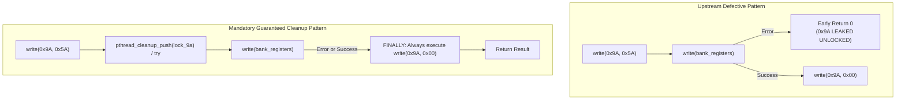

# Stage 2C.2 — Protected Register (0x9A) Error Safety Audit

**Document ID:** `STAGE2C2_PROTECTED_REGISTER_SAFETY`  
**Date:** 2026-11-02  
**Target:** Dynabook Satellite Pro C40-J (`PYS46G-06J02D`), FT9362 / FW9369  
**Status:** COMPLETE — STATIC SOURCE CODE AUDIT  
**Hardware Execution Authorization:** NONE (Static Analysis Only)

---

## 1. Executive Summary

This investigation audits every protected register unlock/lock sequence involving register `0x9A` across the entire FW9369 initialization, calibration, and arming pipeline.

The audit establishes that:
1. **Target Register Banks:** Register `0x9A` gates write-access to two sensitive internal register banks:
   - Bank `0x00C0`..`0x00C2`: Analog frontend channel capacitance trim & gain configuration (written during FDT setup).
   - Bank `0x80B0` (or `0x80E0` for SMIC): 8-word FDT touch threshold vector (written during arming).
2. **Unlock & Lock Packet Framing:**
   - Unlock: 4-byte SPI write `[ 0x09, 0xF6, 0x9A, 0x5A ]` (`write_byte(op, 0x9a, 0x5a)`).
   - Lock: 4-byte SPI write `[ 0x09, 0xF6, 0x9A, 0x00 ]` (`write_byte(op, 0x9a, 0)`).
3. **Severe Reference Defects Discovered:** The upstream driver contains critical error-handling flaws where transport failures or early returns bypass the lock command, leaving `0x9A` permanently unlocked until power-off.
4. **No Readback Supported:** The SPI protocol does not support reading `0x9A`. Lock restoration cannot be verified via bus readback; it must be enforced through guaranteed software RAII / `finally` execution blocks.

---

## 2. Exhaustive Audit of Protected Bank Access Sites

| Source File & Line | Calling Function | Target Bank | Unlock Command | Bank Operations | Lock Command | Error Safety Status |
| :--- | :--- | :---: | :---: | :--- | :---: | :---: |
| `fw9369_fdt.c:215-224` | `configure()` | `0x00C0`..`0x00C2` | Line 215: `write_byte(0x9a, 0x5a)` | Modifies registers `base`..`base+2` | Line 224: `write_byte(0x9a, 0)` | **UNSAFE:** Early `return 0` on line 222 bypasses lock! |
| `fw9369_startup.c:396-405` | `arm()` | `0x80B0` / `0x80E0` | Line 396: `write_byte(0x9a, 0x5a)` | Writes 22-byte threshold packet | Line 405: `write_byte(0x9a, 0)` | **PARTIALLY SAFE:** Does not early return, but ignores transfer errors |
| `fw9369_release.c:265-275` | `arm_detection()` | `0x80B0` / `0x80E0` | Line 265: `transfer(unlock, 4)` | Writes 22-byte threshold packet | Line 275: `transfer(lock, 4)` | **UNSAFE:** Short-circuit `!transfer(bank) || !transfer(lock)` skips lock! |
| `ft93xx.c:1347-1355` | `arm_detection()` | `0x80B0` / `0x80E0` | Line 1347: `write_byte(0x9a, 0x5a)` | Writes 22-byte threshold packet | Line 1355: `write_byte(0x9a, 0)` | **UNSAFE:** Short-circuit logical AND skips lock if transfer fails! |

---

## 3. Dissecting the Upstream Reference Defects

### Defect 1: Early Return Leak in `fw9369_fdt.c:215-224`
```c
/* fw9369_fdt.c:215-224 */
write_byte (op, 0x9a, 0x5a);                                         /* 1. UNLOCK */
for (unsigned int group = 0; group < (c->channel_mode == 1 ? 1u : 2u); ++group)
  {
    uint16_t base = c->channel_mode == 1 ? 0xc0 : (uint16_t) (0xc9 + group * 9);
    if (!modify (op, base, 0xe000, c->channel_mode == 1 ? 0x0444 : 0x06cd, 1) ||
        !modify (op, (uint16_t) (base + 1), 0xffc0, 0x0021, 1) ||
        !modify (op, (uint16_t) (base + 2), 0xffff, 0x00c0, 1))
      return 0;                                                      /* 2. FATAL LEAK: Aborts without locking! */
  }
write_byte (op, 0x9a, 0);                                            /* 3. LOCK (Bypassed on error) */
```
- **Consequence:** If an SPI transport failure, signal interruption, or bus timeout occurs while writing `base`, `base+1`, or `base+2`, line 222 immediately returns `0`. Line 224 is never reached. Register `0x9A` remains set to `0x5A` in volatile sensor RAM.

### Defect 2: Short-Circuit Logical Evaluation in `fw9369_release.c:272`
```c
/* fw9369_release.c:265-275 */
uint8_t unlock[4] = {9, 0xf6, 0x9a, 0x5a}, lock[4] = {9, 0xf6, 0x9a, 0};
...
if (!transfer (unlock, sizeof (unlock), io, d) ||
    !transfer (bank, sizeof (bank), io, d) ||
    !transfer (lock, sizeof (lock), io, d))
  return FTE3600_FW9369_RELEASE_TRANSPORT_ERROR;
```
- **Consequence:** In C semantics, the `||` (logical OR) operator short-circuits. If `transfer(bank)` fails and returns `0`, `!transfer(bank)` evaluates to `1`. The compiler skips evaluating `!transfer(lock)`. The lock packet is **never transmitted to the bus**, leaving `0x9A` unlocked!

---

## 4. Mandatory Safety Architecture for Future Implementation

To eliminate these vulnerabilities, any future driver or tool must enforce strict structured exception cleanup:



### Table of Required Corrections

| Vulnerability | Upstream Code Location | Required Implementation Correction |
| :--- | :--- | :--- |
| **Early Return Leak** | `fw9369_fdt.c:222` | Replace `return 0` with a jump to a `cleanup_lock:` label or a structured `finally` block that guarantees `write_byte(op, 0x9a, 0)` executes before exit. |
| **Short-Circuit Bypass** | `fw9369_release.c:272` | Decouple the transfers: evaluate `transfer(bank)`, store status, and unconditionally transmit `transfer(lock)` regardless of the bank write result. |
| **Signal Interruption** | All userspace functions | Mask signals (`SIGINT`, `SIGTERM`) between unlock and lock to prevent process abortion while the protected bank is exposed. |
| **Transport Error on Lock** | All call sites | If the lock write itself returns an SPI transport error, emit a critical hardware warning and force host unbind/isolation. |
