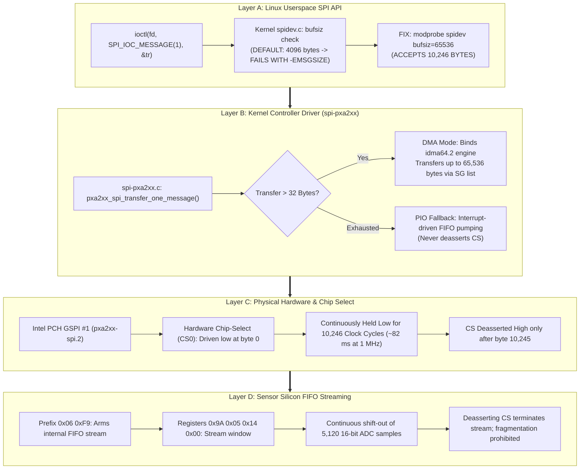

# Stage 2C.2 — Linux SPI Subsystem & Hardware FIFO Feasibility

**Document ID:** `STAGE2C2_SPI_FIFO_FEASIBILITY`  
**Date:** 2026-11-02  
**Target:** Dynabook Satellite Pro C40-J (`PYS46G-06J02D`), FT9362 / FW9369  
**Status:** COMPLETE — STATIC DRIVER & CONTROLLER AUDIT  
**Hardware Execution Authorization:** NONE (Static Analysis Only)

---

## 1. Executive Summary

This investigation evaluates the Linux SPI subsystem (`spidev.c`), the Intel LPSS SPI controller driver (`spi-pxa2xx.c`, `spi-pxa2xx-pci.c`), and hardware DMA capabilities (`idma64.c`) to determine whether the 10,246-byte raw frame FIFO transfer required for Phase 4 image baseline acquisition is technically feasible on the target laptop.

The evaluation demonstrates that:
1. **Four Independent Verification Layers:** Success requires alignment across:
   - Layer A: Linux Userspace API Acceptance (`spidev.bufsiz >= 65536`).
   - Layer B: Controller Driver Capability (`spi-pxa2xx` DMA / PIO).
   - Layer C: Physical Chip-Select Continuity (CS held low continuously for ~82 ms).
   - Layer D: Sensor Silicon FIFO Streaming (Internal read pointer integrity).
2. **Buffer Sizing Bottleneck:** The mainline Linux kernel `spidev` module defaults to a buffer size of **4,096 bytes**. Submitting a 10,246-byte message without module parameter `bufsiz=65536` fails immediately with `-EMSGSIZE`.
3. **Segmentation Prohibited:** The sensor's internal hardware FIFO streaming protocol does not support chunked or segmented transfers; deasserting CS terminates the burst read.
4. **Hardware Controller Capability Confirmed:** Intel LPSS SPI (`pxa2xx-spi.2`) supports transfers up to 65,536 bytes per message using scatter-gather DMA engine `idma64.2`, keeping hardware CS low throughout.

---

## 2. SPI Transaction Spectrum Across All Phases

| Transaction Type | Exact Byte Length | Direction | CS Timing | Phase Used | Bus Payload / Framing |
| :--- | :---: | :---: | :---: | :---: | :--- |
| **Opcode Command** | 3 Bytes | Half/Full Duplex | $\sim 24\ \mu\text{s}$ | 2, 3, 5 | `[ opcode, ~opcode, 0x00 ]` |
| **Byte Write** | 4 Bytes | Full Duplex | $\sim 32\ \mu\text{s}$ | 1, 2, 4 | `[ 0x09, 0xF6, address, value ]` |
| **Byte Read** | 5 Bytes | Full Duplex | $\sim 40\ \mu\text{s}$ | 1, 2, 3 | `[ 0x08, 0xF7, address, 0, 0 ]` |
| **Word Write** | 8 Bytes | Full Duplex | $\sim 64\ \mu\text{s}$ | 1, 2, 3, 5 | `[ 0x05, 0xFA, 0x80 | (addr>>8), addr, 0, 1, val_hi, val_lo ]` |
| **Word Read** | 12 Bytes | Full Duplex | $\sim 96\ \mu\text{s}$ | 1, 2, 3 | `[ 0x04, 0xFB, 0x80 | (addr>>8), addr, 0, 1, 0, 0, ... ]` |
| **Bank Write** | 22 Bytes | Full Duplex | $\sim 176\ \mu\text{s}$ | 3, 5 | `[ 0x05, 0xFA, 0x80, bank_addr, 0, 8, word0...word7 ]` |
| **FIFO Burst Read** | **10,246 Bytes** | Full Duplex | **$\sim 82\text{ ms}$** | 4, 6 | `[ 0x06, 0xF9, 0x9A, 0x05, 0x14, 0x00 ]` + 10,240 pixel bytes |

---

## 3. Four-Layer Feasibility Analysis



---

## 4. Key Bottlenecks & Safety Rules

### 4.1. The `spidev.bufsiz` Constraint
- Mainline Linux kernel file `drivers/spi/spidev.c:89`:
  ```c
  static unsigned bufsiz = 4096;
  module_param(bufsiz, uint, S_IRUGO);
  MODULE_PARM_DESC(bufsiz, "data bytes in biggest supported SPI message");
  ```
- If `spidev` is loaded with default parameters, executing `ioctl(fd, SPI_IOC_MESSAGE(1))` with `tr.len = 10246` causes `spidev_message()` to reject the call immediately with `-EMSGSIZE`.
- **Mandatory Host Prerequisite:** Any future harness executing image baseline acquisition must load the module with an explicit override:
  `modprobe spidev bufsiz=65536`
  or create `/etc/modprobe.d/fte3600-spidev.conf`.

### 4.2. Prohibition of Transfer Segmentation
- Could the host split the 10,246-byte transfer into three 4,096-byte transfers?
- **NO.**
- The FocalTech FT9362 silicon does not support multi-message FIFO streaming. When the SPI master deasserts CS high, the internal SPI transceiver resets its stream read pointer to the beginning of the FIFO. A subsequent transfer would re-read the first chunk rather than continuing from byte 4,096.
- The 10,246 bytes **must be submitted as a single contiguous transfer with uninterrupted CS assertion**.
