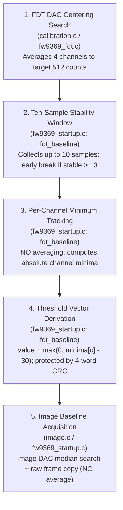

# Stage 2C.3 — FDT Sampling, Averaging, and Baseline Reconciliation

**Document ID:** `STAGE2C3_FDT_SAMPLING_RECONCILIATION`  
**Date:** 2026-11-02  
**Target Silicon:** FocalTech FT9362 / FW9369  
**Source Code Baseline:** `research/libfprint-fte3600/libfprint/drivers/fte3600/` (`calibration.c`, `fw9369_fdt.c`, `fw9369_startup.c`, `image.c`, `fw9369_release.c`)  
**Scope:** Investigation 1 — Rigorous comparative analysis and correction of FDT sampling, channel arithmetic, stability tracking, and baseline operations.  
**Execution Boundary:** Static analysis only. Zero hardware access.

---

## 1. Executive Summary & Correction of Conflated Operations

In earlier reports (including [STAGE2C2_FDT_CALIBRATION_REVIEW.md](file:///home/titan/fte3600-linux-driver/diagnostics/STAGE2C2_FDT_CALIBRATION_REVIEW.md)), the phrase "10-sample baseline averaging loop" was used to describe the FDT threshold calibration routine. 

**Independent static re-verification of the original source code proves this was an incorrect conflation.**

The reference driver implementation divides capacitive sensing and baseline preparation into **five completely distinct, non-interchangeable mathematical operations**:



There is **ZERO temporal averaging** across the 10 FDT stability samples. The threshold is calculated strictly from the **per-channel minimum**, not an average or low-pass filter.

---

## 2. Detailed Technical Breakdown by Operation

### Operation 1: FDT DAC Centering Search & ADC Sampling
- **Source Locations:** [calibration.c:7-68](file:///home/titan/fte3600-linux-driver/research/libfprint-fte3600/libfprint/drivers/fte3600/calibration.c#L7-L68), [fw9369_fdt.c:205-240](file:///home/titan/fte3600-linux-driver/research/libfprint-fte3600/libfprint/drivers/fte3600/fw9369_fdt.c#L205-L240).
- **Function:** `fte3600_calibrate_channels()` calling `physical_sample()`.
- **Target Parameter:** Register `0x1801` (bits `[6:0]`, `0xFC80 | dac`), default initial seed `27` for 4-channel mode (`channel_mode == 1`).
- **Algorithm:**
  1. Sets bounds: `lower = 0`, `upper = 127`.
  2. Iterates up to `FTE3600_CALIBRATION_MAX_SAMPLES` (32 or 64).
  3. In each trial, invokes `physical_sample()` which writes `0x1801`, triggers scan via `0x1885 = 1` and `0x1881 |= 2`, polls `0x1A82 & 8`, and reads 4 channel words from register bank `0x80B8` (or `0x80E8`).
  4. Computes spatial channel average across the 4 physical sensing zones:
     $$\text{measurement} = \left\lfloor \frac{\sum_{c=0}^{3} \text{channels}[c]}{4} \right\rfloor$$
  5. Centering rule: If `measurement` crosses 512 counts between adjacent DAC settings (`dac == prev + 1` with `prev <= 512` and `meas > 512`, or vice-versa), search succeeds. Returns the higher DAC value.
  6. Binary acceleration: If `measurement < 20`, binary splits upward (`*stored_dac = (dac + upper) / 2`); if `measurement > 1000`, binary splits downward (`*stored_dac = (lower + dac) / 2`); otherwise steps linearly by $\pm 1$.
- **Termination:** Convergence at 512 boundary, or failure if `dac < 1 || dac > 125` or iterations exhausted.

---

### Operation 2: Ten Consecutive Stability Samples
- **Source Location:** [fw9369_startup.c:166-189](file:///home/titan/fte3600-linux-driver/research/libfprint-fte3600/libfprint/drivers/fte3600/fw9369_startup.c#L166-L189).
- **Function:** Loop in `fdt_baseline()`.
- **Number of Samples:** At most 10 iterations (`sample = 0..9`).
- **Stability Logic:**
  - Tracks stability counter `stable`.
  - On each sample, computes difference against previous sample across all 4 channels:
    ```c
    if (sample && ((int) channels[c] - previous[c] > 5 ||
                   (int) previous[c] - channels[c] > 5))
      stable = 1;
    ```
    If any channel fluctuates by more than 5 counts, `stable` resets to 1; otherwise `stable` increments (`++stable`).
  - **Early Exit Condition:**
    ```c
    if (sample && stable >= 3)
      break;
    ```
    If 3 consecutive samples remain within a \(\pm 5\)-count jitter window across all 4 channels, the sampling loop terminates immediately without taking all 10 samples.

---

### Operation 3: Per-Channel Minimum Calculation
- **Source Location:** [fw9369_startup.c:164-177](file:///home/titan/fte3600-linux-driver/research/libfprint-fte3600/libfprint/drivers/fte3600/fw9369_startup.c#L164-L177).
- **Initialization:** `minima[c] = 1023` for `c = 0..3`.
- **Sample Update:**
  ```c
  if (channels[c] < minima[c])
    minima[c] = channels[c];
  ```
- **Nature:** This is an absolute **minimum envelope tracker**, NOT an accumulator or rolling mean. It preserves the lowest capacitance count observed during the stable quiet period.
- **Validation Bounds:**
  ```c
  for (size_t c = 0; c < 4; ++c)
    if (minima[c] < 300 || minima[c] > 700)
      result = FTE3600_FW9369_STARTUP_FAILED;
  ```
  Every channel's minimum must lie strictly between 300 and 700 counts. If any channel falls outside this window, the attempt fails and restarts (up to 3 overall attempts).

---

### Operation 4: Threshold Vector Derivation & CRC
- **Source Location:** [fw9369_startup.c:191-198](file:///home/titan/fte3600-linux-driver/research/libfprint-fte3600/libfprint/drivers/fte3600/fw9369_startup.c#L191-L198).
- **Threshold Formula:**
  $$fdt\_down[c] = fdt\_up[c] = fdt\_reference[c] = \begin{cases} 0 & \text{if } minima[c] < 31 \\ minima[c] - 30 & \text{otherwise} \end{cases}$$
- **Data Structure:** 4 words of `uint16_t` stored in `state->fdt_down[0..3]`.
- **Integrity Protection:**
  ```c
  op->s->fdt_down_crc = op->s->fdt_up_crc = crc (op->s->fdt_up, 4);
  ```
  A 16-bit CRC-CCITT is calculated across the 4 derived threshold words.

---

### Operation 5: Image Baseline Acquisition & Absence of Temporal Averaging
- **Source Locations:** [image.c:70-137](file:///home/titan/fte3600-linux-driver/research/libfprint-fte3600/libfprint/drivers/fte3600/image.c#L70-L137), [fw9369_startup.c:277-310](file:///home/titan/fte3600-linux-driver/research/libfprint-fte3600/libfprint/drivers/fte3600/fw9369_startup.c#L277-L310).
- **Image DAC Tuning:** `fte3600_image_search()` adjusts `image_dac` (starting at 54) targeting a 512 median pixel count over the active region (rows 1..78, cols 2..61).
- **Baseline Capture Execution:**
  - In [fw9369_startup.c:381](file:///home/titan/fte3600-linux-driver/research/libfprint-fte3600/libfprint/drivers/fte3600/fw9369_startup.c#L381), `image_count` is set to `1` by default:
    ```c
    op->s->image_count = 1;
    ```
  - When `image_count == 1`, exactly **one raw image frame** (10,240 bytes / 5,120 pixels) is captured into `work_image`.
  - For cold initialization (`reset == 1`):
    ```c
    memcpy (s->baseline, s->work_image, sizeof (s->baseline));
    ```
    The cold baseline is an **unaltered, bit-exact copy of that single raw frame**. There is no frame averaging, no temporal filtering, and no division.
  - If `image_count > 1` were ever configured, the loop in lines 289–295 performs raw modular sample accumulation (`work_image[p] += raw[p]`), not averaging.
  - For warm recalibration (`reset == 0`), `warm_baseline()` performs selective pixel replacement based on neighbor support, not an average filter.

---

## 3. Comparison Matrix: Source Code vs. Previous Assertions

| Dimension | Previous Inaccurate Assertion | Verified Source Reality | Impact on Implementation |
| :--- | :--- | :--- | :--- |
| **FDT 10 Samples** | "10-sample baseline averaging loop" | Up to 10 samples tracking **per-channel minimum** with early exit if \(\ge 3\) stable | Must calculate minimum, not mean. Must support early exit on stability. |
| **FDT Sample Count** | "Fixed 10 samples" | Variable: 3 to 10 samples | Stopping condition depends on \(\pm 5\) count stability over 3 consecutive steps. |
| **Threshold Calculation** | Inferred from average | Derived directly as \(minima[c] - 30\) | Mathematical implementation must match source exactly. |
| **Cold Image Baseline** | Inferred multi-frame filter | Single frame copy (`image_count = 1`, `memcpy`) | Zero mathematical filtering on cold image baseline. |
| **Image Frame CRC** | Inferred full-frame CRC | 128 words (first 2 rows) only | Checksum verification is a 256-byte header signature, not full 10,240-byte buffer. |
