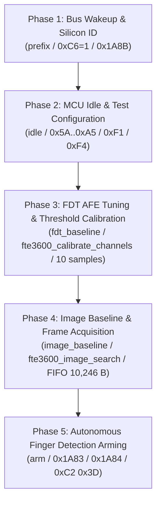

# Stage 2C.3 — Complete Initialization Sequence Audit

**Document ID:** `STAGE2C3_INITIALIZATION_SEQUENCE_AUDIT`  
**Date:** 2026-11-02  
**Target Silicon:** FocalTech FT9362 / FW9369  
**Source Code Baseline:** `research/libfprint-fte3600/libfprint/drivers/fte3600/` (`fw9369_startup.c`, `fw9369_fdt.c`, `calibration.c`, `image.c`, `fw9369_release.c`)  
**Investigation Scope:** Investigation 6 — Reconstruct the end-to-end execution sequence, audit phase boundaries against the actual source call graph, and correct erroneous classifications from earlier reports.  
**Execution Boundary:** Static analysis only. Zero hardware access.

---

## 1. Executive Summary & Call Graph Reconciliation

The complete initialization call graph in the reference implementation is rooted in `fte3600_fw9369_startup_run()` ([fw9369_startup.c:495-505](file:///home/titan/fte3600-linux-driver/research/libfprint-fte3600/libfprint/drivers/fte3600/fw9369_startup.c#L495-L505)), which executes four mandatory operational blocks in strict linear succession:

---

## 2. Phase-by-Phase Technical Audit

### Phase 1: Bus Wakeup & Silicon Identity Verification
- **Entry Conditions:** Host SPI controller initialized (Mode 0, 1 MHz, 8-bit). CS# high. Sensor VDD present.
- **Operations:**
  1. Transceiver un-gating: Loop up to 31 times writing `0xC6 = 0x01`, delaying 4 ms, and verifying readback `0xC6 == 0x01` ([fw9369_startup.c:363-373](file:///home/titan/fte3600-linux-driver/research/libfprint-fte3600/libfprint/drivers/fte3600/fw9369_startup.c#L363-L373)).
  2. Chip ID interrogation: Read word `0x1A8B`, verify value `0x9362`.
  3. Reset host-side cache structures: `reset_cached()` clears cached DACs and modes.
  4. Interrupt clear: Write word `0x1A84 = 0xFFFF` to clear pending interrupt latches.
- **Exit Conditions:** Register `0xC6 == 0x01`, Chip ID verified `0x9362`, interrupts cleared.
- **Sensor Internal State:** SPI bus transceiver clocks active; internal MCU running.
- **Required Previous Results:** None (cold entry).
- **Failure Behavior:** If `0xC6 != 1` or ID mismatch, abort startup.
- **Safety to Proceed:** Proceed to Phase 2 only if Chip ID `0x9362` matches.

---

### Phase 2: MCU Idle & Test Configuration
- **Entry Conditions:** Phase 1 completed successfully.
- **Operations:**
  1. MCU Idle Handshake ([fw9369_startup.c:380](file:///home/titan/fte3600-linux-driver/research/libfprint-fte3600/libfprint/drivers/fte3600/fw9369_startup.c#L380), calling `idle()`):
     - Send command `[ 0x5A, 0xA5, 0x00 ]` (`wake`).
     - Delay 1 ms.
     - Read register `0x80`. If `0x80 != 0x50`, send exception strobe `[ 0xC0, 0x3F, 0x00 ]` and delay 1 ms.
     - Send command `[ 0xA5, 0x5A, 0x00 ]` (`end`).
  2. Test/Foundry Strobes: Loop $i = 0..1$:
     - `write_byte(0xF1, i ? 0x13 : 0x03)`
     - `write_byte(0xF4, 0xC0)`
     - `write_word(0x1A83, 0x0000)`
     - `write_word(0x1A83, 0x0010)`
     - `read_word(0x1A8B, &id)`
     - `write_word(0x1A83, 0x0000)`
- **Exit Conditions:** MCU confirmed in idle mode (`0x80 == 0x50`), test strobes completed.
- **Sensor Internal State:** MCU command decoder resting; clocks gated.
- **Required Previous Results:** Verified FT9362 silicon.
- **Failure Behavior:** If idle handshake fails, abort.
- **Safety to Proceed:** Proceed to Phase 3 only if idle handshake acknowledged.

---

### Phase 3: FDT AFE Tuning & Threshold Calibration
- **Entry Conditions:** Phase 2 completed. MCU in idle state.
- **Operations:**
  1. `configure()` ([fw9369_fdt.c:166-235](file:///home/titan/fte3600-linux-driver/research/libfprint-fte3600/libfprint/drivers/fte3600/fw9369_fdt.c#L166-L235)):
     - Program capacitive AFE timing registers: `0x1800`, `0x1801`, `0x1804`, `0x1805`, `0x1806`, `0x1807`, `0x1808`, `0x180A`, `0x180B`, `0x180D`, `0x1881`, `0x1887`, `0x1888`.
     - Unlock key `write_byte(0x9A, 0x5A)`.
     - Modify analog trim bank `0x00C0`..`0x00C2`.
     - Lock key `write_byte(0x9A, 0x00)`.
     - Configure detection thresholds `0x1880`, `0x1884`.
  2. DAC Centering Search (`fte3600_calibrate_channels`): Sweeps `0x1801` targeting spatial 4-channel average at 512 counts.
  3. Stability Sampling: Collect up to 10 samples (early exit if 3 consecutive samples stable within $\pm 5$ counts). Track `minima[c]`.
  4. Validation: Verify $300 \le minima[c] \le 700$ on all 4 channels.
  5. Derivation: Calculate $fdt\_down[c] = \max(0, minima[c] - 30)$ and 4-word CRC.
- **Exit Conditions:** Calibrated FDT DAC established; thresholds stored with valid CRC in volatile host RAM.
- **Sensor Internal State:** AFE trimmed and centered around 512 ADC counts.
- **Failure Behavior:** If DAC search fails or minima outside bounds after 3 attempts, abort with `FTE3600_FW9369_STARTUP_FAILED`.
- **Safety to Proceed:** Proceed to Phase 4 only if FDT calibration completes with valid CRC.

---

### Phase 4: Image Baseline Acquisition & DAC Tuning
- **Entry Conditions:** Phase 3 completed. Calibrated FDT parameters active.
- **Operations:**
  1. `fte3600_image_search()` ([image.c:70-137](file:///home/titan/fte3600-linux-driver/research/libfprint-fte3600/libfprint/drivers/fte3600/image.c#L70-L137)):
     - Adjust `image_dac` (starting at 54) targeting median pixel count of 512 over active area.
     - Refine via `fte3600_image_refine()`.
  2. Raw Frame FIFO Capture:
     - Execute 10,246-byte single-burst SPI transfer with prefix `0x06 0xF9 0x9A 0x05 0x14 0x00`.
     - Store 10,240 pixel bytes (5,120 16-bit words) in `s->work_image`.
  3. Baseline Copy: Bit-exact copy `memcpy(s->baseline, s->work_image, sizeof(s->baseline))`.
  4. Signature: Calculate 128-word CRC signature over first 2 rows: `s->baseline_crc = crc(s->baseline, 128)`.
- **Exit Conditions:** Calibrated `image_dac` and baseline frame stored in host RAM.
- **Sensor Internal State:** Image array baseline acquired; pixel ADC centered.
- **Failure Behavior:** If FIFO transfer fails or median fails to converge, abort.
- **Safety to Proceed:** Proceed to Phase 5 only if baseline frame is valid.

---

### Phase 5: Autonomous Finger Detection Arming
- **Entry Conditions:** Phase 3 and Phase 4 completed. Valid thresholds and baseline in host RAM.
- **Operations:**
  1. Write threshold vector to sensor registers ([fw9369_startup.c:395-415](file:///home/titan/fte3600-linux-driver/research/libfprint-fte3600/libfprint/drivers/fte3600/fw9369_startup.c#L395-L415)):
     - Pack `fdt_down[0..3]` into wire buffer and transmit.
  2. Arm interrupt logic:
     - Read/modify `0x1A83` (set bits `0x16`).
     - Write `0x1A84 = 0x002F` (enable interrupt events).
  3. Trigger detection scan:
     - Transmit command `[ 0xC2, 0x3D, 0x00 ]`.
     - Delay 1 ms.
- **Exit Conditions:** Sensor autonomous finger detection armed; Pad 229 will assert when a finger contacts the platen.
- **Sensor Internal State:** Low-power autonomous detection scanning active.
- **Failure Behavior:** Abort arming; relock registers.
- **Safety to Proceed:** Runtime finger wait / image capture loop may begin.

---

## 3. Discrepancies Corrected from Earlier Reports

| Element in Previous Report | Previous Erroneous Classification | Verified Correct Classification |
| :--- | :--- | :--- |
| **Phase 3 Sampling** | "10-sample baseline averaging loop" | **Minimum tracking stability loop** with early exit condition |
| **Image Frame CRC** | "128-word CRC over the image frame" | **CRC over first 128 words (256 bytes)** as signature, not full frame |
| **FIFO CRC** | "Transport CRC verification" | **Zero CRC on FIFO transfer**; pure unsegmented burst transfer |
| **Pad 14 Reset** | "Locked by hardware" | **PADCFGLOCK set, but TX latch not locked**; inaccessible in pure-spidev userspace due to ACPI exclusivity |
| **Piecemeal Testing** | "Phase 2 testable in isolation" | **Hazardous in isolation**; full pipeline must execute atomically |
