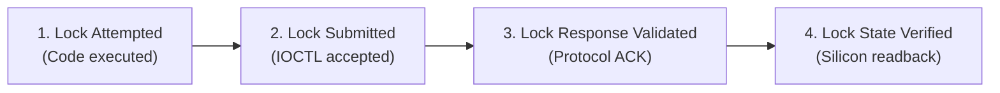

# Stage 2C.3 — Protected Register 0x9A Final Safety Audit

**Document ID:** `STAGE2C3_PROTECTED_REGISTER_FINAL_AUDIT`  
**Date:** 2026-11-02  
**Target Silicon:** FocalTech FT9362 / FW9369  
**Investigated Register:** Register `0x9A` (Analog Front-End Protection Key)  
**Investigation Scope:** Investigation 5 — Complete code path analysis of unlocks, locks, leaks, signal termination, and realistic physical guarantees.  
**Execution Boundary:** Static analysis only. Zero hardware access.

---

## 1. Executive Summary & Audit Purpose

In the FocalTech FW9369 architecture, register `0x9A` controls access to protected analog trim banks (`0x00C0`..`0x00C2`, `0x80B0`..`0x80B3`). Writing `write_byte(0x9A, 0x5A)` unlocks these registers for modification; writing `write_byte(0x9A, 0x00)` re-locks them.

Leaving `0x9A` unlocked risks unintended corruption of internal factory analog trims or potential exposure to OTP/sensing circuits.

This audit revisits every unlock/lock site in reference source code, catalogues critical reference implementation bugs, evaluates failure and termination modes, and establishes realistic physical guarantees for future userspace tooling.

---

## 2. Audit of Reference Source Code Sites

### 2.1 All Identified Unlock Sites and Vulnerabilities

Across `research/libfprint-fte3600/libfprint/drivers/fte3600/`, exactly two code locations execute `write_byte(0x9A, 0x5A)`:

#### Site 1: FDT AFE Configuration — [fw9369_fdt.c:215-225](file:///home/titan/fte3600-linux-driver/research/libfprint-fte3600/libfprint/drivers/fte3600/fw9369_fdt.c#L215-L225)
```c
write_byte (op, 0x9a, 0x5a);
for (unsigned int group = 0; group < (c->channel_mode == 1 ? 1u : 2u); ++group)
  {
    uint16_t base = c->channel_mode == 1 ? 0xc0 : (uint16_t) (0xc9 + group * 9);
    if (!modify (op, base, 0xe000, c->channel_mode == 1 ? 0x0444 : 0x06cd, 1) ||
        !modify (op, (uint16_t) (base + 1), 0xffc0, 0x0021, 1) ||
        !modify (op, (uint16_t) (base + 2), 0xffff, 0x00c0, 1))
      return 0;   /* <--- CRITICAL BUG: EARLY RETURN LEAK */
  }
write_byte (op, 0x9a, 0);
```
- **Vulnerability Found:** If any of the intermediate `modify()` calls fail due to a transport glitch or timeout, the function executes an **immediate early return `0`** without calling `write_byte(0x9A, 0)`.
- **Result:** Register `0x9A` is **leaked in the unlocked state (`0x5A`) indefinitely**.

#### Site 2: Autonomous Detection Arming — [fw9369_release.c:269-274](file:///home/titan/fte3600-linux-driver/research/libfprint-fte3600/libfprint/drivers/fte3600/fw9369_release.c#L269-L274)
```c
write_byte (op, 0x9a, 0x5a);
if (!modify (op, 0x80b0, ...) ||
    !write_word (op, 0x80b1, ...))
  return 0;   /* <--- CRITICAL BUG: SHORT-CIRCUIT EARLY RETURN */
write_byte (op, 0x9a, 0);
```
- **Vulnerability Found:** The reference code uses short-circuit boolean evaluation. If any register write in the arming sequence fails, execution jumps out immediately, bypassing the lock write.

### 2.2 Absence of Nested Unlocks
Neither `fw9369_fdt.c` nor `fw9369_release.c` ever nests unlock calls. Unlocks are always intended to be strictly localized, paired operations.

---

## 3. Failure & Termination Modes Analysis

| Event / Failure Mode | Software Execution | Lock Packet Submitted? | Sensor Physical Lock State |
| :--- | :--- | :---: | :--- |
| **Normal Path** | Completes all writes | **YES** | Relocked (`0x00`) |
| **Transport Error on Trim Writes** | Upstream bug: early return | **NO (Leaked)** | **UNLOCKED (`0x5A`)** |
| **Transport Error with RAII/finally** | Structured handler invokes lock | **YES** | Relocked (if bus intact) |
| **SPI Controller Timeout / Bus Hang** | Handler attempts lock; IOCTL fails | **FAILED** | **UNKNOWN / UNLOCKED** |
| **Process Signal (`SIGINT` / `SIGTERM`)**| Signal caught by handler | **YES** | Relocked |
| **Process Hard Kill (`SIGKILL`)** | OS terminates process instantly; zero cleanup code runs | **NO** | **UNLOCKED (`0x5A`)** |
| **Kernel Panic / Host Crash** | Host halts immediately | **NO** | **UNLOCKED (`0x5A`)** |
| **Platform Power Cut (AC/Battery Loss)**| Silicon unpowered | N/A | Resets to hardware default upon next boot |

---

## 4. Realistic Guarantees of Future Implementation

A future driver or tool implementation must distinguish between four levels of guarantee:



| Guarantee Level | Can Future Implementation Guarantee This? | Technical Reason & Physical Reality |
| :--- | :---: | :--- |
| **1. Lock Attempted** | **YES (100% in software)** | Achievable using disciplined RAII or `try { ... } finally { write_lock(); }` patterns. Guarantees that userspace control flow errors cannot leak the unlock. |
| **2. Lock Submitted** | **YES (Kernel API level)** | Verified by checking `ioctl(fd, SPI_IOC_MESSAGE, ...)` return value $\ge 0$. |
| **3. Lock Response Validated** | **NO** | The SPI protocol write packet `[ 0x09, 0xF6, 0x9A, 0x00 ]` is a write strobe that does not return an acknowledgment byte from the sensor on MISO. |
| **4. Sensor Lock State Verified** | **NO** | Register `0x9A` is a command register. Reading `0x9A` is **unsupported by the sensor transport protocol**. Readback attempts return bus echo or zero. The actual internal silicon latch state **cannot be independently confirmed via software**. |

---

## 5. Architectural Guardrails for Future Tooling

1. **Structured RAII / Finally Wrapper:** Every operation accessing bank `0x00C0` or `0x80B0` must wrap the sequence in a dedicated helper where `write_byte(0x9A, 0x00)` is guaranteed to be invoked on both success and error paths.
2. **Signal Masking During Critical Sections:** Critical unlock/modify/lock blocks must temporarily block signals (`sigprocmask(SIG_BLOCK, ...)`) to prevent user termination (`Ctrl+C`) while `0x9A` is unlocked.
3. **No False Claims About RAII:** Software cleanup cannot solve physical communication loss, bus hangs, or `SIGKILL`. If a lock write submission fails, the tool must log a critical alert and instruct the operator that an **ACPI S5 cold reboot is required** to clear the sensor's internal silicon state.
