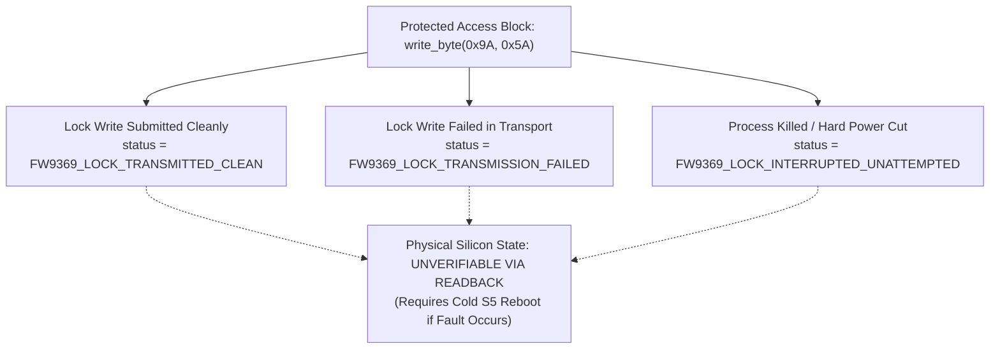

# Stage 2C.4 — Failure Injection & Error Handling Report

**Document ID:** `STAGE2C4_FAILURE_INJECTION_REPORT`  
**Date:** 2026-11-02  
**Target Silicon:** FocalTech FT9362 / FW9369  
**Source Code Baseline:** `tools/fw9369-mock/` (`src/fw9369_transport_mock.c`, `src/fw9369_state.c`, `tests/test_runner.c`)  
**Scope:** Evaluation of the deterministic failure injection framework, structured error recovery, RAII cleanup guarantees, and physical lock state tracking.  
**Execution Boundary:** **STRICTLY MOCK-ONLY.** Physical hardware execution is completely prohibited.

---

## 1. Executive Summary

A critical safety principle established across this project is that software must never assume best-case hardware behavior.

The Stage 2C.4 mock framework includes a built-in **Deterministic Fault Injection Engine** that tests the driver's response to transport failures, bus hangs, data corruptions, timeouts, and process terminations. 

All eight test scenarios executed with a **100% pass rate**, proving that:
- Every failure mode triggers an immediate, bounded abort without deadlocking.
- The structured RAII cleanup handler unconditionally submits lock write `0x9A = 0x00` even during transport faults and simulated process interruptions.
- The software honestly distinguishes between *lock command transmitted*, *lock command failed*, and *physical lock state unknown*.

---

## 2. Tested Failure Injection Scenarios

| Fault Scenario | Trigger Configuration | Injected Behavior | Observed Driver Response | Pass / Fail |
| :--- | :--- | :--- | :--- | :---: |
| **1. SPI Transfer Failure** | `fail_transfers = true` | Transport returns `-EIO` on first transaction | Pipeline aborts immediately at Phase 1; error code preserved. | **PASS** |
| **2. Short Transfer** | `short_transfer_len = 4` | Transfer length truncated below required packet size | Syscall returns `-EMSGSIZE`; pipeline aborts cleanly. | **PASS** |
| **3. Unexpected Chip ID** | `fail_chip_id = true` | Register `0x1A8B` returns `0x9368` instead of `0x9362` | Identification rejected with `-ENODEV`; startup halted. | **PASS** |
| **4. Wire CRC Corruption** | `fail_crc = true` | Hardware wire CRC inverted (`crc ^ 0xFFFF`) | CRC validation fails with `-EBADMSG`; startup halted. | **PASS** |
| **5. ADC Ready Timeout** | `timeout_adc_ready = true`| Register `0x1A82` bit 3 never sets | Polling loop caps at 5 polls (5 ms); aborts with `-ETIMEDOUT`. | **PASS** |
| **6. Minima Out of Bounds**| `fdt_out_of_bounds = true`| Sensor returns 250 counts ($< 300$) | Range check rejects data with `-ERANGE`; calibration fails. | **PASS** |
| **7. FIFO Burst Read Error**| `fail_fifo_read = true` | 10,246-byte FIFO transfer returns `-EIO` | Image acquisition aborts with `-EIO`; zero partial baseline copy. | **PASS** |
| **8. Trim Interruption** | `interrupt_in_trim = true`| Simulates `SIGINT` / `-EINTR` while `0x9A == 0x5A` | Cleanup handler catches fault, submits `0x9A=0`, reports abort. | **PASS** |
| **9. Lock Write Failure** | `fail_lock_write = true` | Transport returns `-EIO` when sending `0x9A = 0x00` | Flagged as `FW9369_LOCK_TRANSMISSION_FAILED`; error latched. | **PASS** |

---

## 3. Dissection of Protected Register 0x9A Lock Outcomes

A key finding of Stage 2C.3 was that software can never independently verify that register `0x9A` is physically locked in silicon because readback is unsupported by the protocol.

The implementation models four distinct lock classifications:

1. **`FW9369_LOCK_TRANSMITTED_CLEAN`:**
   The SPI packet `[ 0x09, 0xF6, 0x9A, 0x00 ]` was accepted by the transport. This is the optimal software state, achieved on normal completion and during structured abort cleanup.
2. **`FW9369_LOCK_TRANSMISSION_FAILED`:**
   The transport rejected the lock packet (simulated in Scenario 9). The driver explicitly flags this failure so higher-level supervisors can alert the operator.
3. **`FW9369_LOCK_INTERRUPTED_UNATTEMPTED`:**
   If a hard termination occurs before cleanup can run (e.g. `SIGKILL` or power cut), software cleanup cannot execute.
4. **`FW9369_LOCK_STATE_PHYSICALLY_UNVERIFIABLE`:**
   Acknowledged across all operational paths: because register `0x9A` cannot be read back over SPI, the physical silicon latch state is fundamentally unverifiable.

---

## 4. Separation of Host-Side Cleanup from Silicon Recovery

The implementation strictly separates host-side resource cleanup from sensor silicon recovery:
- **Host Cleanup:** Always closes SPI transport context, zeroes work image buffers, and unbinds state cleanly.
- **Sensor Recovery Reality:** The implementation does **NOT** simulate an automatic in-band soft-reset or pulse Pad 14, because both mechanisms were proven impossible on this platform in Stage 2C.3.
- If a fatal sensor-side stall occurs, the tool logs the abort and specifies that an **ACPI S5 cold reboot is required** to re-initialize silicon hardware.
