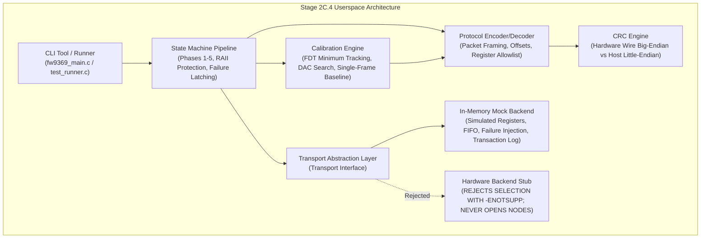

# Stage 2C.4 — Implementation Plan: Mock-Only FW9369 Userspace Tooling

**Document ID:** `STAGE2C4_IMPLEMENTATION_PLAN`  
**Date:** 2026-11-02  
**Target Silicon:** FocalTech FT9362 / FW9369  
**Specification Baseline:** `diagnostics/FW9369_UNIFIED_INITIALIZATION_SPECIFICATION.md`  
**Execution Boundary:** **STRICTLY MOCK-ONLY.** Hardware execution, device node access, GPIO manipulation, and kernel module loading are strictly prohibited.

---

## 1. Executive Architecture Overview

Stage 2C.4 develops a production-grade, modular C userspace software package that implements the verified FW9369 initialization, calibration, and image acquisition protocols against an in-memory mock transport.



The system is strictly partitioned so that:
1. All protocol, calibration, and state machine algorithms execute identically regardless of whether they talk to mock or real hardware.
2. The transport layer is an abstract interface `struct fw9369_transport`.
3. The only enabled transport is `fw9369_transport_mock`. Any attempt to request a hardware transport immediately aborts with an error without discovering or opening any file descriptor.

---

## 2. Mock Transport Interface Design

### 2.1 Interface Definition
The abstract transport definition:
```c
struct fw9369_transport {
    void *context;
    int (*transfer)(void *context, const uint8_t *tx, uint8_t *rx, size_t len);
    void (*delay_ms)(void *context, uint32_t ms);
    void (*delay_us)(void *context, uint32_t us);
    void (*close)(void *context);
};
```

### 2.2 Mock Transport Capabilities
The mock backend (`fw9369_transport_mock`) maintains:
- **Simulated Sensor Register Map:**
  - Standard byte registers (`0xC6`, `0x80`, `0x8E`, `0x90`..`0x92`, `0xF1`, `0xF4`, `0x9A`).
  - Word registers (`0x1800`..`0x180D`, `0x1880`..`0x1888`, `0x1A82`, `0x1A83`, `0x1A84`, `0x1A8B`).
  - Analog trim bank (`0x00C0`..`0x00C2`) accessible **only** when `0x9A == 0x5A`.
  - FDT channel measurement buffers (`0x80B8` / `0x80E8`) with hardware CRC generation.
  - Image FIFO buffer (10,240 pixel bytes = 5,120 16-bit words) filled with deterministic synthetic pixel patterns.
- **Transaction Logger:**
  - Complete history of every transmitted MOSI packet, MISO response, transfer length, and timestamp.
  - Inspectable by unit tests to verify packet count, byte ordering, and command sequencing.
- **Deterministic Failure Injection Engine:**
  - Configurable fault triggers:
    - Transfer error (returns $-EIO$).
    - Short transfer (transfers fewer bytes than requested).
    - Timeout simulation (simulates expired polling loop).
    - Corrupted CRC injection.
    - Unexpected Chip ID simulation (e.g. `0x9368` or `0x0000`).
    - FDT stability jitter injection (prevents early exit).
    - Calibration data out of bounds ($< 300$ or $> 700$).
    - Protected register lock failure injection (fails on `write_byte(0x9A, 0x00)`).
    - Interruption simulation during open protected window.

---

## 3. Sensor State Machine & Error Handling

### 3.1 Five-Phase Pipeline
The state machine strictly mirrors the canonical specification:
- **Phase 1: Bus Wakeup & Identity Verification**
  - Asserts `0xC6 = 0x01`, waits 4 ms, verifies readback `0x01`.
  - Reads `0x1A8B`, validates Chip ID `0x9362` and hardware CRC `0x1C53`.
  - Clears interrupts via `0x1A84 = 0xFFFF`.
- **Phase 2: MCU Idle Handshake & Test Configuration**
  - Issues `wake` command `[ 0x5A, 0xA5, 0x00 ]`, delays 1 ms.
  - Reads `0x80`, expects `0x50` (sends `[ 0xC0, 0x3F, 0x00 ]` on retry if needed).
  - Issues `end` delimiter `[ 0xA5, 0x5A, 0x00 ]`.
  - Issues test strobes on `0xF1`, `0xF4`, `0x1A83`.
- **Phase 3: Capacitive AFE Tuning & FDT Calibration**
  - Programs AFE timing registers.
  - Unlocks `write_byte(0x9A, 0x5A)`, modifies trims `0x00C0`..`0x00C2`, unconditionally locks `write_byte(0x9A, 0x00)`.
  - Executes hybrid binary/linear DAC centering search on `0x1801` targeting spatial 4-channel average at 512 counts.
  - Samples stability window (up to 10 samples, early exit if 3 consecutive stable within $\pm 5$ counts).
  - Tracks absolute per-channel minima: $minima[c] = \min(minima[c], sample[c])$.
  - Verifies $300 \le minima[c] \le 700$.
  - Derives thresholds: $fdt\_down[c] = \max(0, minima[c] - 30)$.
  - Calculates 4-word little-endian CRC.
- **Phase 4: Image Baseline Acquisition & DAC Tuning**
  - Adjusts `image_dac` targeting median pixel count of 512.
  - Reads single-burst 10,246-byte FIFO transfer (`[ 0x06, 0xF9, 0x9A, 0x05, 0x14, 0x00 ]` + 10,240 bytes).
  - Performs bit-exact copy into `s->baseline` (`image_count = 1`, `memcpy`, zero filtering).
  - Calculates 128-word little-endian CRC signature over first 2 rows.
- **Phase 5: Autonomous Finger Detection Arming**
  - Transmits calibrated threshold vector to `0x80B0`..`0x80B3`.
  - Sets interrupt enable bits on `0x1A83` and `0x1A84`.
  - Arms autonomous scanning via `[ 0xC2, 0x3D, 0x00 ]`.

### 3.2 Error & Interruption Handling Strategy
- **Immediate Abort on Protocol Mismatch:** Any unexpected status code or CRC error aborts the sequence.
- **Structured RAII Lock Enforcement:**
  Whenever `0x9A = 0x5A` is sent, execution enters a protected block. A cleanup macro/wrapper guarantees that `0x9A = 0x00` is submitted to the transport before returning or propagating an error.
- **Physical Lock State Truthfulness:**
  The state machine records four distinct lock outcomes:
  1. `LOCK_TRANSMITTED_CLEAN`: Lock command accepted by transport.
  2. `LOCK_TRANSMISSION_FAILED`: Lock command rejected by transport.
  3. `LOCK_INTERRUPTED_UNATTEMPTED`: Process interrupted before lock could be submitted.
  4. `LOCK_STATE_PHYSICALLY_UNVERIFIABLE`: Stated across all paths because readback of `0x9A` is unsupported.

---

## 4. Calibration Data Structures & Algorithms

```c
struct fw9369_fdt_calibration {
    uint8_t  fdt_dac;              /* Setting 0..127 in register 0x1801 */
    uint16_t minima[4];            /* Per-channel minimum observed (300..700) */
    uint16_t fdt_down[4];          /* Derived thresholds: max(0, minima[c] - 30) */
    uint16_t fdt_down_crc;         /* Little-endian 4-word CRC */
    uint8_t  stability_samples;    /* Actual sample count (3..10) */
    bool     valid;                /* Calibration completion flag */
};

struct fw9369_image_baseline {
    uint8_t  image_dac;            /* Tuned DAC (nominal ~54) */
    uint16_t median;               /* Target 512 */
    uint16_t baseline[5120];       /* 64x80 raw frame (10,240 bytes) */
    uint16_t baseline_crc;         /* 128-word CRC signature (rows 0-1) */
    bool     valid;                /* Baseline ready flag */
};
```

---

## 5. CRC Implementations & Test Vectors

Two distinct CRC functions are implemented:
1. `fw9369_crc_wire(const uint8_t *bytes, size_t len)`:
   - Evaluates standard CRC-CCITT (poly `0x1021`, seed `0xFFFF`, no reflection, no XOR) byte-by-byte in big-endian wire order.
   - Test Vector: `[ 0x93, 0x62 ]` $\rightarrow$ `0x1C53`.
2. `fw9369_crc_words_le(const uint16_t *words, size_t count)`:
   - Evaluates CRC-CCITT expanding each 16-bit word little-endian (`byte 0 = word & 0xFF`, `byte 1 = (word >> 8) & 0xFF`).
   - Test Vector 1: `words = [ 0, 0, 0, 0 ]` $\rightarrow$ `0x313E`.
   - Test Vector 2: `words = [ 512, 512, 512, 512 ]` $\rightarrow$ `0x5B7C`.
   - Test Vector 3: `words = [ 482, 482, 482, 482 ]` $\rightarrow$ `0x081D`.

---

## 6. Test Suite Strategy

Automated test runner (`test_runner.c`) executing 12 test suites:
1. `test_crc`: Validates all wire and host test vectors, little-endian expansion, and boundary counts.
2. `test_protocol`: Validates packet encoding/decoding, lengths, and opcode validation.
3. `test_allowlist`: Validates strict allowlist and verifies rejection of forbidden opcodes.
4. `test_mock_transport`: Validates in-memory register state, transaction logging, and zero device access.
5. `test_fdt_centering`: Validates hybrid DAC centering search convergence.
6. `test_fdt_minimum_tracking`: Validates per-channel minimum tracking and early stability exit ($\ge 3$ stable).
7. `test_baseline_copy`: Validates single-frame copy into `baseline`, zero filtering, and 128-word CRC.
8. `test_fifo_framing`: Validates 10,246-byte FIFO framing, 6-byte prefix, and rejection of chunking.
9. `test_pipeline_clean`: Validates end-to-end initialization and detection arming on mock.
10. `test_failure_injection`: Validates transfer error, CRC fault, bad chip ID, timeouts, and out-of-bounds calibration.
11. `test_protected_register_cleanup`: Validates RAII lock submission, simulated lock failure, and uncertain silicon state.
12. `test_hardware_rejection`: Deliberately attempts to configure a hardware backend and verifies that it is immediately rejected with `-ENOTSUP` without attempting to open any device node.

---

## 7. Explicit Boundaries: Facts, Inferences, and Unknowns

| Category | Component / Behavior | Status & Treatment |
| :--- | :--- | :--- |
| **Verified Reality** | Chip ID `0x9362`, CRC `0x1C53` | Implemented and verified via exact test vectors. |
| **Verified Reality** | Register layouts & packet framing | Implemented strictly from canonical specification. |
| **Verified Reality** | Threshold math: $minima[c] - 30$ | Implemented bit-exact; no averaging. |
| **Verified Reality** | Cold baseline: single frame copy | Implemented as bit-exact `memcpy`; zero filtering. |
| **Verified Reality** | Pad 14 cannot be pulsed in pure-spidev | Upstream reset pulses excluded from pipeline. |
| **Verified Reality** | Pad 229 is High-Z input (`0x82000100`) | Direct MMIO manipulation excluded. |
| **Simulation Assumption** | Synthetic pixel values in FIFO | Populated with deterministic gradient pattern (median 512). |
| **Simulation Assumption** | Instantaneous ADC ready poll | Simulated ADC asserts bit 3 on first or second poll. |
| **Unresolved Hardware Reality** | Physical persistence of `0xC6` | Assumed unknown; tool unconditionally writes `0xC6 = 0x01`. |
| **Unresolved Hardware Reality** | Physical verification of `0x9A` lock | Readback unsupported; treated as physically unverifiable. |
| **Unresolved Hardware Reality** | 10,246-byte DMA feasibility | Mock validates request size only; real feasibility deferred to Stage 2C.5. |
