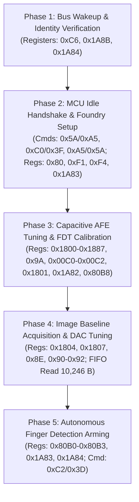

# Stage 2C.5A — First Complete Initialization Risk Analysis

**Document ID:** `STAGE2C5A_COMPLETE_INITIALIZATION_RISK_REVIEW`  
**Date:** 2026-11-02  
**Target Hardware:** Dynabook Satellite Pro C40-J (`PYS46G-06J02D`)  
**Target Silicon:** FocalTech FT9362 / FW9369 (Chip ID `0x9362`)  
**Specification Reference:** `diagnostics/FW9369_UNIFIED_INITIALIZATION_SPECIFICATION.md`  
**Execution Boundary:** Static risk analysis and architectural specification review. Zero hardware access.

---

## 1. Executive Summary

A critical lesson established during Stages 2B.3 through 2C.3 is that the FocalTech FT9362 / FW9369 sensor cannot be safely initialized using isolated, ad-hoc hardware commands. Testing commands such as `0x5A` (idle handshake) in isolation leaves the internal MCU and analog charge pumps in an un-gated, intermediate state indefinitely.

This document performs an exhaustive, phase-by-phase risk analysis of the **complete, end-to-end 5-phase initialization and arming pipeline**, evaluating entry requirements, register transactions, timing boundaries, failure states, and reversibility for every phase.

---

## 2. Phase-by-Phase Technical & Risk Analysis

---

### 2.1 Phase 1: Bus Wakeup & Identity Verification

| Parameter | Specification & Operational Requirement |
| :--- | :--- |
| **Entry Conditions** | `/dev/spidev1.0` opened, SPI Mode 0, clock $\le 1$ MHz, CS# deasserted HIGH. |
| **Preceding Operations** | None (Initial bus transaction). |
| **Registers Accessed** | Write `0xC6 = 0x01` (`[0x09, 0xF6, 0xC6, 0x01]`); Read `0xC6` (`[0x08, 0xF7, 0xC6, 0x00, 0x00]`); Read `0x1A8B` (Chip ID); Write `0x1A84 = 0xFFFF` (Clear IRQ latches). |
| **Commands Issued** | None. |
| **Expected Response** | `0xC6` readback returns `0x01`; `0x1A8B` returns word `0x9362` followed by wire CRC `0x1C53`. |
| **Timing & Polling** | Delay 4 ms after `0xC6` write; poll `0xC6` readback up to 31 retries with 4 ms interval. |
| **Protected Registers** | None (`0x9A` unaccessed). |
| **Expected Sensor State** | Sensor SPI transceiver clock enabled; internal interrupt latches cleared; identity confirmed. |
| **Possible Failure State** | MISO line stuck high (`0xFF`) or stuck low (`0x00`); CRC mismatch; timeout after 31 retries. |
| **Recovery Requirements** | Close spidev, unbind driver. Since transceiver was barely engaged, no analog charge pumps were activated. Host isolation is sufficient. |
| **Reversibility** | **Partially Reversible:** Register `0xC6` cannot be explicitly written back to `0x00` (write-1-to-wake architecture), but transceiver shuts down if CS# remains idle or power is cycled. |

---

### 2.2 Phase 2: MCU Idle Handshake & Foundry Setup

| Parameter | Specification & Operational Requirement |
| :--- | :--- |
| **Entry Conditions** | Phase 1 completed successfully; `0xC6 == 0x01` verified; Chip ID validated. |
| **Preceding Operations** | Phase 1. |
| **Registers Accessed** | Read `0x80` (`[0x08, 0xF7, 0x80, 0x00, 0x00]`); Write `0xF1 = 0x03`, `0x13`; Write `0xF4 = 0xC0`; Strobe `0x1A83 = 0x0000`, `0x0010`, `0x0000`. |
| **Commands Issued** | Wake dialog: `[0x5A, 0xA5, 0x00]`; Exception strobe: `[0xC0, 0x3F, 0x00]` (if needed); Mandatory End delimiter: `[0xA5, 0x5A, 0x00]`. |
| **Expected Response** | Register `0x80` byte index 4 returns `0x50` (MCU Idle Task Ready). |
| **Timing & Polling** | 1 ms delay after `0x5A/0xA5`; poll `0x80` up to 5 times (1 ms delay per poll). |
| **Protected Registers** | `0xF1` and `0xF4` are foundry clock-gating registers. Verified safe by Stage 2B.1 analysis. |
| **Expected Sensor State** | Sensor microcontroller has completed boot ROM tasks, entered idle mode, and is ready to accept AFE calibration parameters. |
| **Possible Failure State** | Register `0x80` fails to return `0x50` within 5 polls (`-EPROTO`). |
| **Recovery Requirements** | **Mandatory Action:** Closing delimiter `[0xA5, 0x5A, 0x00]` **MUST be sent** to terminate the MCU command dialog. If aborted, MCU remains active in idle; S5 cold reboot required to fully clear. |
| **Reversibility** | **Irreversible in Software:** Once MCU enters idle, it cannot be commanded back to cold boot without a hardware reset pulse or cold power cycle. |

---

### 2.3 Phase 3: Capacitive AFE Tuning & FDT Calibration

| Parameter | Specification & Operational Requirement |
| :--- | :--- |
| **Entry Conditions** | Phase 2 completed successfully; `0x80 == 0x50` confirmed; end delimiter sent. |
| **Preceding Operations** | Phase 1 and Phase 2. |
| **Registers Accessed** | AFE configuration: `0x1800` (`0x07FE`), `0x1804` (`0x27C8`), `0x1807` (`0x1671`), `0x1808` (`0x0801`), `0x1887` (`0x0005`); Unlock: `0x9A = 0x5A`; Trim bank: `0x00C0` (`0x0444`), `0x00C1` (`0x0021`), `0x00C2` (`0x00C0`); Lock: `0x9A = 0x00`; Tuning: `0x1801` (DAC 0..127); Trigger: `0x1885 = 1`; Poll: `0x1A82` (bit 3); Read: `0x80B8` (4-channel ADC + CRC). |
| **Commands Issued** | None. |
| **Expected Response** | Trim writes acknowledged; bit 3 of `0x1A82` asserts within 5 ms; `0x80B8` returns 4 16-bit counts with valid wire CRC; DAC search converges (nominally DAC 27–28); minima between `[300, 700]`. |
| **Timing & Polling** | ADC ready polling: up to 5 polls with 1 ms delay; DAC search: up to 32 trials; Stability window: up to 10 samples (early exit on 3 consecutive stable samples). |
| **Protected Registers** | **CRITICAL: Register `0x9A` unlocked (`0x5A`) and unconditionally relocked (`0x00`).** Structured RAII cleanup mandatory. |
| **Expected Sensor State** | Analog front-end biased; per-channel minimum noise floor established; threshold vector \(minima - 30\) calculated. |
| **Possible Failure State** | Trim write failure; ADC ready timeout (`-ETIMEDOUT`); CRC corruption on `0x80B8` (`-EBADMSG`); DAC search divergence; Minima out of bounds (`< 300` or `> 700`). |
| **Recovery Requirements** | `fw9369_pipeline_abort_cleanup()` **must unconditionally execute `write_byte(0x9A, 0x00)`** to ensure analog trims cannot be overwritten. Sensor requires cold reboot to clear altered AFE registers. |
| **Reversibility** | **Irreversible in Software:** AFE registers retain programmed capacitive integration times until reset. |

---

### 2.4 Phase 4: Image Baseline Acquisition & DAC Tuning

| Parameter | Specification & Operational Requirement |
| :--- | :--- |
| **Entry Conditions** | Phase 3 completed; FDT calibration valid; threshold vector calculated. |
| **Preceding Operations** | Phases 1, 2, and 3. |
| **Registers Accessed** | Pixel timing: `0x1804`, `0x1807`; Frame control: `0x8E`, `0x90`, `0x91`, `0x92`; FIFO read: 10,246 bytes burst packet `[ 0x06, 0xF9, 0x9A, 0x05, 0x14, 0x00 ... ]`. |
| **Commands Issued** | None. |
| **Expected Response** | Full 10,246-byte packet shifted without bus error; payload unpacked into 5,120 16-bit words; cold baseline stored via bit-exact `memcpy` (zero averaging); 128-word CRC signature computed. |
| **Timing & Polling** | Transfer duration: $\approx 82$ ms at 1 MHz. DMA completion timeout 1,000 ms. |
| **Protected Registers** | None (`0x9A` remains locked). |
| **Expected Sensor State** | Cold reference background frame captured and stored in host memory; sensor FIFO read pointer reset. |
| **Possible Failure State** | Linux `spidev.bufsiz` error (`-EMSGSIZE`); DMA bus timeout; short SPI read; corrupted pixel buffer. |
| **Recovery Requirements** | Abort cleanup relocks `0x9A`. Since FIFO read is non-destructive, host memory is released. Sensor requires cold reboot if FIFO read pointer hangs. |
| **Reversibility** | Baseline resides in host RAM. Sensor hardware state is unchanged by passive FIFO readout. |

---

### 2.5 Phase 5: Autonomous Finger Detection Arming

| Parameter | Specification & Operational Requirement |
| :--- | :--- |
| **Entry Conditions** | Phase 4 completed; valid baseline stored; thresholds ready. |
| **Preceding Operations** | Phases 1, 2, 3, and 4. |
| **Registers Accessed** | Threshold vector: `0x80B0`–`0x80B3` (write 4 words); Interrupt config: `0x1A83 = 0x0016`, `0x1A84 = 0x002F`. |
| **Commands Issued** | Arm command: `[ 0xC2, 0x3D, 0x00 ]`. |
| **Expected Response** | Command packet accepted by SPI transceiver; sensor transitions into low-power autonomous scanning mode. |
| **Timing & Polling** | 1 ms settling delay after arm command. |
| **Protected Registers** | None. |
| **Expected Sensor State** | Sensor MCU running low-power background scan; comparator armed against `0x80B0`–`0x80B3`; physical IRQ line ready to assert on finger touch. |
| **Possible Failure State** | SPI bus error during threshold write; arm command rejected. |
| **Recovery Requirements** | Abort cleanup; unbind spidev. Sensor requires cold reboot to leave armed autonomous loop. |
| **Reversibility** | **Irreversible in Software:** Once armed with `0xC2/0x3D`, the sensor continuously scans the capacitive matrix until finger contact or hardware reset. |

---

## 3. High-Risk Operation Deep Dive

### 3.1 Register `0xC6 = 0x01` (Transceiver Un-Gating)
- **Nature:** Volatile control register.
- **Risk:** Writing `0x01` un-gates internal clock trees. If executed without subsequent initialization, the silicon draws higher quiescent current.
- **Mitigation:** Only execute `0xC6` as part of a structured pipeline; do not execute in an infinite loop.

### 3.2 The `0x5A` / `0xA5` MCU Idle Handshake
- **Nature:** High-level command dialog.
- **Risk:** If `0x5A` is sent without `0xA5`, the sensor's command processor hangs in an incomplete state.
- **Mitigation:** The closing delimiter `[ 0xA5, 0x5A, 0x00 ]` is **unconditionally transmitted** in both success and failure branches.

### 3.3 Register `0x9A` (Analog Trim Protection Key)
- **Nature:** Hardware write-protection latch.
- **Risk:** Leaving `0x9A == 0x5A` exposes analog trim registers (`0x00C0`–`0x00C2`) to accidental overwrite, risking analog calibration drift.
- **Mitigation:** The unlock window is strictly bounded to the 3 trim register writes (less than 1 ms); `write_byte(0x9A, 0x00)` is issued immediately inline and repeated in the abort handler.

### 3.4 10,246-Byte Burst FIFO Transfer
- **Nature:** Giant full-duplex SPI transaction.
- **Risk:** Deasserting Chip Select mid-transfer corrupts the sensor's internal read pointer.
- **Mitigation:** The transfer must be submitted as a single, contiguous `struct spi_ioc_transfer` with `cs_change = 0`, requiring `spidev.bufsiz >= 65536`.

---

## 4. Audit Conclusion

The complete initialization sequence is technically coherent, but fundamentally **irreversible in software**. Once Phase 2 and Phase 3 are initiated, the physical sensor silicon cannot be restored to cold-boot defaults through software commands alone. Any physical hardware execution must be treated as a one-way state transition requiring explicit operator authorization and an available ACPI S5 cold reboot fallback.
