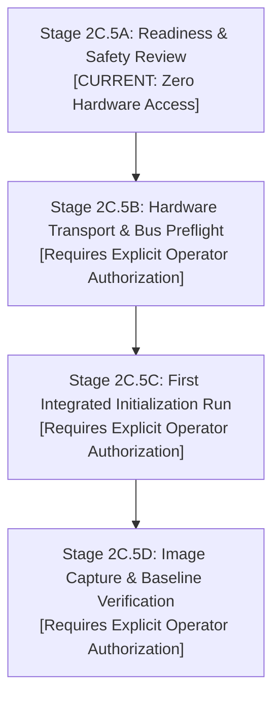

# Stage 2C.5A — Future Hardware Test Strategy & Staged Execution Plan

**Document ID:** `STAGE2C5A_FUTURE_HARDWARE_TEST_PLAN`  
**Date:** 2026-11-02  
**Target Hardware:** Dynabook Satellite Pro C40-J (`PYS46G-06J02D`)  
**Target Silicon:** FocalTech FT9362 / FW9369 (Chip ID `0x9362`)  
**Execution Authorization:** NONE. This document is a strategic design specification only. Physical hardware communication is strictly prohibited.

---

## 1. Executive Summary & Design Principles

Any future execution against physical hardware (Stage 2C.5) must adhere to a defense-in-depth engineering framework that eliminates the hazards of uncontrolled, monolithic initialization.

### Core Architectural Principles
1. **Zero Isolated Intermediate Tests:** No standalone `0x5A` test (prohibited by Stage 2B.5 due to un-gated clock hazards); no isolated FIFO reads without prior calibration.
2. **Explicit Operator Authorization Gates:** Execution is broken into distinct sub-stages, each requiring explicit operator approval before commencing.
3. **Strict Register Allowlists:** Every SPI packet is validated against the canonical allowlist before hitting `/dev/spidev1.0`.
4. **Structured RAII Lock Protection:** Every transaction involving register `0x9A` is wrapped in unconditional relock cleanup handlers.
5. **Zero Automatic Retries:** Polling loops have strict, finite bounds. If a timeout occurs, execution halts immediately rather than looping and risking bus lock.
6. **Guaranteed Host Rollback:** Every sub-stage includes an automated rollback harness ensuring `spidev` is unbound and removed upon completion or error.

---

## 2. Decomposed Sub-Stage Roadmap

---

### Sub-Stage 2C.5B: Hardware Transport Implementation & Bus Preflight
- **Objective:** Implement a dedicated, allowlist-guarded hardware transport (`fw9369_transport_hw.c`) and execute an operator-supervised read-only identity verification.
- **Operations Permitted:**
  1. Load `spidev` with `bufsiz=65536`.
  2. Bind `spi-FTE3600:00` to create `/dev/spidev1.0`.
  3. Preflight check: Verify Pad 14 (`0x84000201 [LOCKED]`) and Pad 229 (`0x82000100 [LOCKED tx]`).
  4. Write volatile `0xC6 = 0x01` and verify readback `0x01`.
  5. Read Chip ID register `0x1A8B` and verify CRC `0x1C53`.
  6. Clear interrupt latches `0x1A84 = 0xFFFF`.
  7. **Stop and Roll Back:** Unbind `spidev`, unload module, verify host isolation.
- **Explicit Operator Gate:** Requires explicit authorization before `/dev/spidev1.0` is created.

---

### Sub-Stage 2C.5C: First Integrated Initialization Run (Phases 1–3)
- **Objective:** Execute continuous Phase 1 (wake), Phase 2 (idle handshake), and Phase 3 (AFE tuning and FDT calibration) without pausing in intermediate states.
- **Operations Permitted:**
  1. Complete Sub-Stage 2C.5B preflight.
  2. Issue MCU idle wake command `0x5A/0xA5`, poll status `0x80 == 0x50` (max 5 polls), send delimiter `0xA5/0x5A`.
  3. Configure AFE timing registers (`0x1800`–`0x1887`).
  4. Unlock `0x9A = 0x5A`, write trim bank (`0x00C0`–`0x00C2`), unconditionally relock `0x9A = 0x00`.
  5. Execute FDT DAC centering search on `0x1801` (max 32 trials).
  6. Sample stability window (up to 10 samples; early exit on 3 stable samples).
  7. Derive and validate threshold vector `fdt_down[0..3] = minima - 30`.
  8. **Stop and Roll Back:** Halt before Phase 4. Unbind `spidev`, log telemetry, evaluate calibration convergence.
- **Explicit Operator Gate:** Requires explicit authorization. If FDT search diverges, operator must perform S5 cold reboot.

---

### Sub-Stage 2C.5D: Complete Pipeline & Image Capture (Phases 1–5)
- **Objective:** Execute the complete end-to-end initialization, capture cold image baseline via 10,246-byte burst FIFO read, and arm autonomous finger detection.
- **Operations Permitted:**
  1. Execute Phases 1, 2, and 3.
  2. Phase 4: Configure frame timing (`0x1804`, `0x8E`, `0x90`–`0x92`).
  3. Submit 10,246-byte burst FIFO read (`SPI_IOC_MESSAGE(1)`).
  4. Copy raw frame bit-exact via `memcpy` into baseline; compute 128-word CRC signature.
  5. Phase 5: Program threshold vector into `0x80B0`–`0x80B3`; configure IRQ `0x1A83/0x1A84`; issue arm command `0xC2/0x3D`.
  6. Verify sensor has entered low-power finger detection mode.
  7. Unbind `spidev` and conclude hardware validation.
- **Explicit Operator Gate:** Requires separate explicit authorization.

---

## 3. Safety Controls & Containment Rules

1. **Preflight Environmental Check:**
   - Host battery $> 50\%$ or connected to AC mains (prevent mid-test power cuts).
   - No concurrent SPI or GPIO access processes.
2. **Deterministic Transaction Logger:**
   - Hardware transport must record all MOSI/MISO packet buffers in memory and dump a timestamped log (`diagnostics/stage2c5-execution.log`) upon exit.
3. **No Automatic Software Reset:**
   - Because Pad 14 cannot be pulsed, the software harness will never attempt to issue GPIO reset ioctls.
4. **Immediate Emergency Stop (Ctrl+C Handler):**
   - Signal handler for `SIGINT` and `SIGTERM` captures signal, unconditionally submits `write_byte(0x9A, 0x00)` if unlocked, closes `/dev/spidev1.0`, and unbinds driver.
5. **The S5 Cold Reboot Fallback:**
   - In the event of any unrecoverable abort or sensor divergence, the operator is instructed to execute a clean power down (`shutdown -h now`), wait 10 seconds, and cold-boot.

---

## 4. Hardware Operations Requiring Explicit Authorization

The following actions **CANNOT** be executed autonomously by the AI agent and require affirmative user command:
- Loading the `spidev` module (`modprobe spidev bufsiz=65536`).
- Binding `spi-FTE3600:00` via `driver_override`.
- Opening `/dev/spidev1.0`.
- Transmitting commands `0x5A`, `0xA5`, or `0xC2 0x3D`.
- Writing to register `0x9A` or any AFE register.
- Executing the 10,246-byte FIFO transfer.

---

## 5. Audit Conclusion

The future hardware test strategy decomposes physical testing into bounded, verifiable, operator-gated sub-stages. By eliminating isolated intermediate commands and enforcing structured abort handlers, it establishes the safest possible pathway toward physical validation.
- Hardware test plan is **DESIGNED AND READY FOR OPERATOR REVIEW**.
