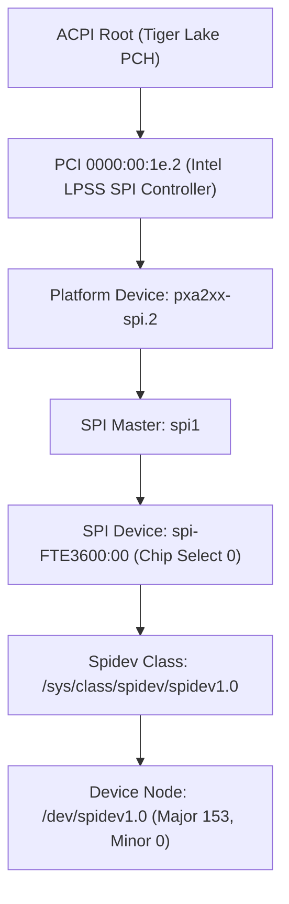

# Stage 2C.5B.1 — Device Identity and Hardware Binding Audit

**Document ID:** `STAGE2C5B1_DEVICE_IDENTITY_REVIEW`  
**Date:** 2026-11-02  
**Target Hardware:** Dynabook Satellite Pro C40-J (`PYS46G-06J02D`)  
**Target Silicon:** FocalTech FT9362 / FW9369 (Chip ID `0x9362`)  
**Audit Scope:** Area A — Device identity verification logic, path validation, sysfs parentage, and device node reassignment risks.  
**Hardware Access:** NONE (Software & Static Analysis Only).

---

## 1. Executive Summary

This audit evaluates the device identity verification logic within `tools/fw9369-mock/src/fw9369_transport_hw.c`. In Stage 2C.5B, `fw9369_hw_validate_device_path()` was introduced to restrict device access exclusively to `/dev/spidev1.0`.

Adversarial analysis of this logic demonstrates that while string matching against `"/dev/spidev1.0"` successfully prevents arbitrary character device traversal (e.g., preventing fallback to `/dev/spidev0.0` or `/dev/null`), **it does not establish the physical hardware identity of the underlying device**. In Linux, device node numbers (`spidevX.Y`) are dynamically allocated based on SPI controller enumeration and bus indexing. Relying solely on the string `"/dev/spidev1.0"` introduces specific architectural risks if the kernel bus topology or module load order shifts.

This report documents the exact risks of pathname-only validation and establishes a hardened sysfs parentage verification model for any future online execution.

---

## 2. Code Inspection: `fw9369_hw_validate_device_path()`

The current implementation in `tools/fw9369-mock/src/fw9369_transport_hw.c` lines 58–72 is:

```c
int fw9369_hw_validate_device_path(const char *path)
{
    if (!path)
        return -EINVAL;

    /*
     * Strict device path whitelist: Only allow the specific spidev node
     * corresponding to the FTE3600 sensor bus (SPI1.0).
     */
    if (strcmp(path, "/dev/spidev1.0") != 0) {
        return -ENODEV;
    }

    return 0;
}
```

### 2.1 Audit Findings
1. **String-Only Equivalence:** The function performs an isolated string comparison (`strcmp(path, "/dev/spidev1.0") == 0`).
2. **Absence of Device Major/Minor Checks:** It does not inspect the `dev_t` (major/minor numbers) or verify that the node is a character device (`S_ISCHR(stat.st_mode)`).
3. **Absence of Sysfs Backing Verification:** It does not inspect `/sys/class/spidev/spidev1.0/device` or verify that the underlying device is bound to the ACPI node `spi-FTE3600:00`.
4. **Absence of Controller Topology Verification:** It does not inspect whether `spidev1.0` belongs to controller `pxa2xx-spi.2` (the physical LPSS SPI controller on Tiger Lake-UP3).

---

## 3. Threat Modeling & Failure Modes of Pathname-Only Validation

Relying purely on the filesystem path `"/dev/spidev1.0"` carries three primary failure modes in a production or diagnostic environment:

### 3.1 Failure Mode 1: Bus Number Collision via Dynamic Controller Registration
In Linux, SPI bus numbers (`spi1`, `spi0`, etc.) are assigned during platform controller probe. If an external SPI controller (such as a USB-to-SPI bridge, an FPGA programmer, or an additional platform SPI master) is enumerated prior to `pxa2xx-spi.2`, or if controller initialization order changes across kernel updates, the Dynabook PCH SPI controller may be registered as `spi0` or `spi2`, while an unrelated peripheral becomes `spi1`.
- **Consequence:** `fw9369-hw-tool` would target an unintended physical SPI peripheral on `/dev/spidev1.0`, issuing sensor wake packets (`0x5A 0xA5`) or bursts to non-target hardware.

### 3.2 Failure Mode 2: Unbound or Rebound ACPI Device
In Stage 1 and Stage 2A, the sensor hardware was identified under ACPI node `spi-FTE3600:00`. If `spi-FTE3600:00` has been unbound from `spidev` and bound to another driver (such as an in-tree kernel driver or UIO), or left unbound, `/dev/spidev1.0` might either disappear or be created by a manual `mknod` or udev script pointing to a dangling device number.
- **Consequence:** Submitting ioctl requests to a stale or misallocated character device could result in undefined driver behavior.

### 3.3 Failure Mode 3: Rogue or Dummy Device Node
A misconfigured udev rule or test environment could create a node at `/dev/spidev1.0` backed by a loopback device, a virtual serial port, or a different character driver.
- **Consequence:** Although `SPI_IOC_MESSAGE(1)` ioctls would fail with `-ENOTTY`, pathname-only validation would report success during preflight.

---

## 4. Hardened Device Identity Verification Architecture

To eliminate pathname ambiguity, hardware tooling must verify the full sysfs topology before opening or interacting with the device node.

### 4.1 Required Sysfs Topology Hierarchy
On the Dynabook Satellite Pro C40-J, the target sensor hardware is defined by the following fixed physical hierarchy:



### 4.2 Four-Point Preflight Identity Rule
Before any userspace tool interacts with the fingerprint sensor, it must perform the following four non-destructive offline checks via sysfs:

1. **Class Device Resolution:**
   Resolve `/sys/class/spidev/spidev1.0/device` symlink using `realpath(3)` and ensure it points to `spi-FTE3600:00`.
2. **ACPI HID Verification:**
   Read `/sys/bus/spi/devices/spi-FTE3600:00/modalias` or `/sys/bus/spi/devices/spi-FTE3600:00/firmware_node/hid` and assert exact match with `acpi:FTE3600:` or `FTE3600`.
3. **Parent Controller Verification:**
   Read the parent link `/sys/bus/spi/devices/spi-FTE3600:00/../` and verify that the parent bus is `spi1` and parent controller device driver is `pxa2xx-spi.2`.
4. **Driver Binding State:**
   Inspect `/sys/bus/spi/devices/spi-FTE3600:00/driver` to confirm it is bound to `spidev`, and inspect `driver_override` to confirm it contains `spidev\n`.

### 4.3 Proposed C Preflight Verification Helper
The following helper function is recommended for integration prior to any authorized hardware execution stage:

```c
int fw9369_hw_verify_sysfs_identity(const char *spidev_name)
{
    char path[PATH_MAX];
    char target[PATH_MAX];

    /* 1. Verify spidev backing device link */
    snprintf(path, sizeof(path), "/sys/class/spidev/%s/device", spidev_name);
    ssize_t len = readlink(path, target, sizeof(target) - 1);
    if (len < 0)
        return -ENODEV;
    target[len] = '\0';

    if (strstr(target, "spi-FTE3600:00") == NULL)
        return -ENODEV;

    /* 2. Verify ACPI HID */
    snprintf(path, sizeof(path), "/sys/bus/spi/devices/spi-FTE3600:00/firmware_node/hid");
    FILE *f = fopen(path, "r");
    if (!f)
        return -ENODEV;
    char hid[32] = {0};
    if (fgets(hid, sizeof(hid), f)) {
        size_t l = strlen(hid);
        if (l > 0 && hid[l - 1] == '\n') hid[l - 1] = '\0';
    }
    fclose(f);

    if (strcmp(hid, "FTE3600") != 0)
        return -ENODEV;

    return 0;
}
```

---

## 5. Audit Assessment & Recommendation

| Area | Status | Recommendation |
| :--- | :---: | :--- |
| **Path String Check (`/dev/spidev1.0`)** | **PASSED (Offline)** | Keep existing check in `fw9369_hw_validate_device_path()` as baseline check for unit tests and offline builds. |
| **Physical Identity Binding** | **CORRECTION IDENTIFIED** | Before authorizing any hardware execution, integrate `fw9369_hw_verify_sysfs_identity()` into preflight execution gates to guarantee hardware parentage. |
