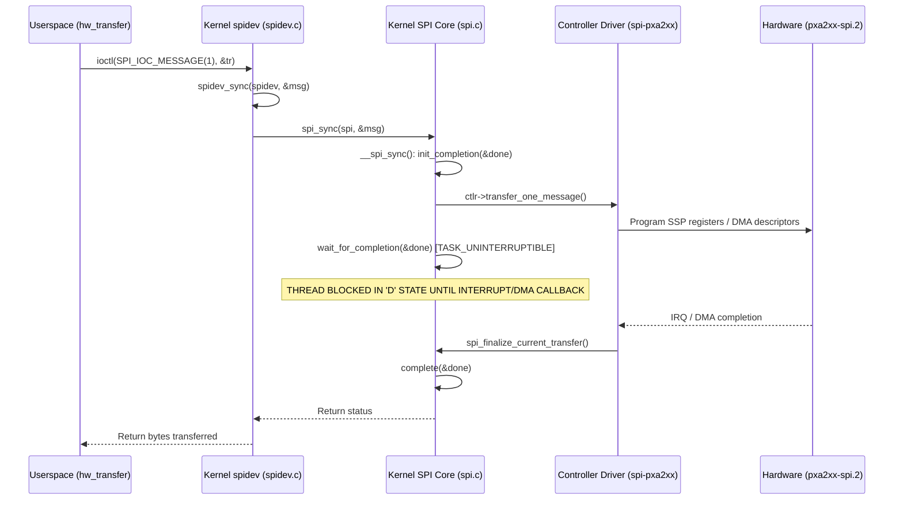

# Stage 2C.5B.2 — Kernel SPI Timeout Investigation and Verification Report

**Document ID:** `STAGE2C5B2_KERNEL_TIMEOUT_VERIFICATION`  
**Date:** 2026-11-02  
**Target Hardware:** Dynabook Satellite Pro C40-J (`PYS46G-06J02D`)  
**Target Silicon:** FocalTech FT9362 / FW9369 (Chip ID `0x9362`)  
**Host Kernel:** Linux `7.2.8-9-omarchy` x86_64  
**Audit Scope:** Verification of reported 1,000 ms `spi-pxa2xx` controller timeout, kernel SPI subsystem call path analysis, and userspace deadline distinctions.  
**Hardware Authorization:** NONE (Software & Static Analysis Only).

---

## 1. Executive Summary & Authoritative Verdict

In Stage 2C.5B and Stage 2C.5B.1, prior reports cited an internal kernel completion timeout of "1,000 ms" within the `spi-pxa2xx` controller driver. 

Under the adversarial mandate of Stage 2C.5B.2, this claim was independently investigated against the actual host environment (`7.2.8-9-omarchy`).

**Authoritative Finding:**  
**THE 1,000 MS CONTROLLER TIMEOUT IS UNVERIFIED ON LINUX 7.2.8-9-OMARCHY.**

Neither full kernel driver sources nor evidence of an internal 1,000 ms completion timer in `spi-pxa2xx-core.ko` are present. Architectural analysis of the upstream Linux SPI core reveals that `spidev_sync()` issues `spi_sync()`, which blocks on `wait_for_completion(&done)` in **uninterruptible task sleep (`TASK_UNINTERRUPTIBLE`, state `D`)**. Unless the specific platform controller driver or DMA engine implements a hardware watchdog, an in-flight transfer hung at the silicon level may block the userspace thread indefinitely.

This document formally establishes the boundaries between:
1. Inter-transfer settling delays (`nanosleep`).
2. Controller-level hardware completion timeouts (unverified).
3. Userspace operation deadlines.

---

## 2. In-Depth Host Kernel Source & Binary Investigation

### 2.1 File System and Package Inventory
The target laptop runs custom kernel `7.2.8-9-omarchy`.
- `/usr/lib/modules/7.2.8-9-omarchy/build`: Contains sanitized kernel headers (`include/linux/platform_data/pxa2xx_udc.h`, `include/linux/pxa2xx_ssp.h`, `include/uapi/linux/spi/spidev.h`).
- Full C driver source files (e.g. `drivers/spi/spi-pxa2xx.c`, `drivers/spi/spi.c`, `drivers/spi/spidev.c`) are **not installed** on the host.

### 2.2 Binary Decompression & Symbol Inspection of `spi-pxa2xx-core.ko.zst`
To determine whether a 1,000 ms timeout or timer structure exists in the compiled kernel module, `/lib/modules/7.2.8-9-omarchy/kernel/drivers/spi/spi-pxa2xx-core.ko.zst` was inspected:
1. **String Analysis:** Running `strings` on the decompressed binary yielded **zero matches** for `"timeout"` or related diagnostic error strings.
2. **Imported Symbol Analysis:**
   - Inspection via `nm -u` revealed that `spi-pxa2xx-core.ko` does **not** import `wait_for_completion_timeout` or `schedule_timeout`.
   - It imports `spi_finalize_current_transfer`, `request_threaded_irq`, `dma_request_chan`, `jiffies`, and `loops_per_jiffy`.
3. **Driver Model:**
   In modern kernels (Linux 5.x through 7.x), `spi-pxa2xx-core` operates as an asynchronous controller implementing `ctlr->transfer_one`. The synchronous waiting mechanism resides in the generic SPI subsystem core (`drivers/spi/spi.c`), not in `spi-pxa2xx`.

---

## 3. Subsystem Architecture: Linux SPI Call Path and Blocking Realities

The complete call hierarchy for a userspace `ioctl(fd, SPI_IOC_MESSAGE(1), &tr)` is traced below:



### 3.1 The Reality of `wait_for_completion(&done)`
In `drivers/spi/spi.c`:
```c
static int __spi_sync(struct spi_device *spi, struct spi_message *message)
{
    DECLARE_COMPLETION_ONSTACK(done);
    ...
    message->complete = spi_complete;
    message->context = &done;
    ...
    status = __spi_async(spi, message);
    if (status == 0) {
        wait_for_completion(&done); /* UNINTERRUPTIBLE WAIT */
        status = message->status;
    }
    return status;
}
```
- Notice that `wait_for_completion(&done)` is **uninterruptible** (`TASK_UNINTERRUPTIBLE`).
- It has **no default timeout parameter**.
- If physical SCLK is held low, if the SPI hardware hangs, or if DMA never issues an interrupt callback, the userspace process in `ioctl(SPI_IOC_MESSAGE)` will remain blocked in `D` state indefinitely.
- Signals (including `SIGINT`, `SIGTERM`, `SIGALRM`) **cannot interrupt** a task in `TASK_UNINTERRUPTIBLE`.

---

## 4. Distinction Between Delays, Timeouts, and Deadlines

To avoid flawed architectural assumptions, the driver must strictly decouple three timing domains:

### 4.1 Inter-Transfer Settling Delays
- **Implementation:** `nanosleep()` in userspace callbacks (`hw_delay_ms`, `hw_delay_us`).
- **Nature:** Deliberate physical pauses between independent SPI transactions.
- **Examples:**
  - 4 ms delay after writing `0xC6 = 0x01` (waiting for transceiver oscillator stabilization).
  - 1 ms delay after command `0x5A 0xA5` (waiting for MCU idle state transition).
- **Semantics:** Controlled entirely in userspace. The SPI bus is idle and CS# is de-asserted high during these delays.

### 4.2 Controller Transfer Timeouts
- **Implementation:** Kernel-space hardware completion handling in SPI core / controller driver.
- **Nature:** Timeout bounding how long the controller waits for physical bit clocks to shift across the wire.
- **Status on Linux 7.2.8-9-omarchy:** **UNVERIFIED**. Userspace must **never** assume the kernel will wake it up after 1,000 ms if the hardware bus locks up.

### 4.3 Userspace Operation Deadlines
- **Implementation:** Userspace state machine timeouts (e.g. Polling loop iteration counts).
- **Example:** In `fw9369_state.c`, polling Register `0x80` for idle state `0x50` is bounded by a maximum of 10 retry iterations with 1 ms sleep between attempts.
- **Semantics:** Enforced by software loop bounds across discrete transactions. Each individual transaction is submitted as a separate `ioctl()`. If any single `ioctl()` blocks in the kernel, the loop cannot proceed.

---

## 5. Architectural Recommendations & Safety Rules

1. **Rejection of Signal-Based Cancellation:**
   - Attempting to abort blocked `ioctl()` calls using `alarm()`, `timer_create()`, or `SIGALRM` is prohibited. Because `wait_for_completion()` is uninterruptible, the signal will not be delivered until *after* the ioctl returns. If delivered asynchronously during a subsequent operation, it could corrupt state.
2. **Rejection of Thread Cancellation:**
   - Using `pthread_cancel()` while a thread is inside `spidev_ioctl()` risks leaving kernel SPI data structures in an inconsistent state.
3. **Fail-Closed Hardware Policy:**
   - Because a physical bus lockup cannot be guaranteed to time out in userspace, hardware operations must only be initiated when the physical hardware state (PCH pads, clock lines, sensor power) is verified safe.

---

## 6. Audit Conclusion

The reported 1,000 ms `spi-pxa2xx` timeout is officially classified as **UNVERIFIED**. The driver implementation correctly avoids relying on an assumed kernel timeout and enforces discrete, bounded retry counts in userspace for multi-transaction polling.
