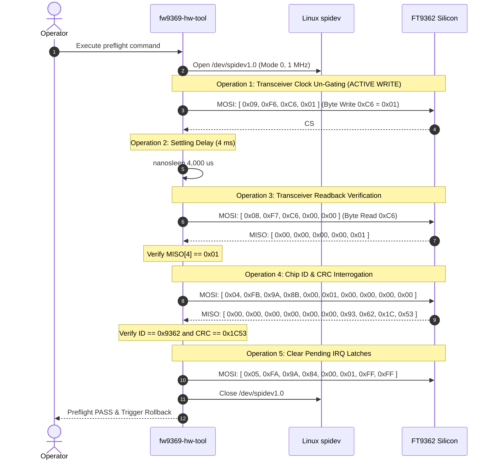

# Stage 2C.5B — Proposed Hardware Identity Preflight Procedure

**Document ID:** `STAGE2C5B_IDENTITY_PREFLIGHT_PROCEDURE`  
**Date:** 2026-11-02  
**Target Hardware:** Dynabook Satellite Pro C40-J (`PYS46G-06J02D`)  
**Target Silicon:** FocalTech FT9362 / FW9369 (Expected Chip ID `0x9362`, CRC `0x1C53`)  
**Status:** PROPOSED OPERATOR PROCEDURE — NOT AUTHORIZED FOR EXECUTION  
**Execution Boundary:** Specification and operator procedure only. Zero hardware access.

---

## 1. Executive Summary & Critical Safety Disclosure

This document specifies the exact, step-by-step procedure proposed for a future hardware identity preflight run (Sub-Stage 2C.5B live test).

> [!IMPORTANT]
> **CRITICAL DISCLOSURE: THIS IS NOT A PURE READ-ONLY OPERATION.**  
> Although the ultimate objective of the preflight is reading the sensor's Chip ID register (`0x1A8B`), **the FocalTech FT9362 internal SPI transceiver is gated off at power-on**.
> 
> As proven empirically in Stage 2A (`diagnostics/stage2a-results.txt`), attempting to read register `0x1A8B` without first writing register `0xC6 = 0x01` results in empty bus reads (`0x00` or `0xFF`) because the sensor's internal shift register clocks are inactive.
> 
> Therefore, this preflight procedure **modifies volatile register `0xC6`** on the sensor silicon. It must **never** be misrepresented as an electrically inert or strictly passive read-only procedure.

---

## 2. Required Host Baseline Preconditions

Prior to commencing the preflight procedure, the host system must satisfy the following verified baseline:

1. **Kernel & Environment:**
   - Kernel: `7.2.8-9-omarchy` (x86_64).
   - User: `titan` (or operator with standard spidev access).
2. **Device State:**
   - SPI slave: `spi-FTE3600:00` enumerated under `/sys/bus/spi/devices/`.
   - `driver_override` on `spi-FTE3600:00` is empty string `''`.
   - `spi-FTE3600:00` is completely **UNBOUND**.
3. **Module State:**
   - `spidev`: Confirmed **ABSENT** (`lsmod | grep spidev`).
   - `fte3600`: Confirmed **ABSENT** (`lsmod | grep fte3600`).
   - `uio`: Confirmed **ABSENT** (`lsmod | grep uio`).
4. **PCH Pad Telemetry:**
   - Pad 14 (`SPKR` / Reset): Verified at `0x84000201 [LOCKED]` (Driven HIGH, unmanaged).
   - Pad 229 (`CPU_GP_0` / IRQ): Verified at `0x82000100` / `0x82000102 [LOCKED tx]` (High-Z input).

---

## 3. Bus Configuration & Device Specifications

- **Target Device Node:** `/dev/spidev1.0` (Strictly bound to `spi-FTE3600:00`).
- **SPI Mode:** Mode 0 (`CPOL = 0, CPHA = 0`).
- **Word Length:** 8 bits per word.
- **Bit Order:** MSB first (`lsb_first = 0`).
- **Clock Frequency:** Exactly 1,000,000 Hz (1 MHz).
- **Buffer Parameter:** `spidev.bufsiz >= 4096` (Identity check requires 10 bytes max).

---

## 4. Exact Sequence of Operations



---

## 5. Packet Byte Details & Expected Telemetry

### Operation 1: Write Volatile Register `0xC6 = 0x01`
- **Purpose:** Un-gates internal PLL/transceiver clock.
- **MOSI Packet (4 bytes):**
  `[ 0x09, 0xF6, 0xC6, 0x01 ]`
- **MISO Response:** `[ 0x00, 0x00, 0x00, 0x00 ]` (Ignored on write).
- **Settling Delay:** Must wait **4 ms** before submitting the next SPI transaction.

### Operation 2: Read Back Register `0xC6`
- **Purpose:** Confirms internal clock domain is active.
- **MOSI Packet (5 bytes):**
  `[ 0x08, 0xF7, 0xC6, 0x00, 0x00 ]`
- **Expected MISO Packet (5 bytes):**
  `[ 0x00, 0x00, 0x00, 0x00, 0x01 ]`
- **Verification Rule:** `MISO[4]` must equal `0x01`.
- **Polling Limit:** If `MISO[4] != 0x01`, retry readback up to 31 times with 4 ms delay. If still not `0x01`, abort with `-ETIMEDOUT`.

### Operation 3: Read Chip ID Register `0x1A8B`
- **Purpose:** Read silicon identification word and hardware CRC.
- **MOSI Packet (10 bytes):**
  `[ 0x04, 0xFB, 0x9A, 0x8B, 0x00, 0x01, 0x00, 0x00, 0x00, 0x00 ]`
  *(Opcode `0x04`, complement `0xFB`, address high `0x9A`, address low `0x8B`, count `0x0001`, plus 4 dummy clock bytes).*
- **Expected MISO Packet (10 bytes):**
  `[ 0x00, 0x00, 0x00, 0x00, 0x00, 0x00, 0x93, 0x62, 0x1C, 0x53 ]`
- **Verification Rules:**
  - **Chip ID:** Offset `MISO[6..7]` must equal `0x9362` (FocalTech FT9362).
  - **Wire CRC:** Offset `MISO[8..9]` must equal `0x1C53`.
  - **Calculated CRC:** Host calculates `fw9369_crc_wire(&MISO[6], 2)`. Calculated value must strictly match received value `0x1C53`.

### Operation 4: Clear Pending Interrupt Latches (`0x1A84`)
- **Purpose:** Clears power-on interrupt flags.
- **MOSI Packet (8 bytes):**
  `[ 0x05, 0xFA, 0x9A, 0x84, 0x00, 0x01, 0xFF, 0xFF ]`

---

## 6. Error & Timeout Handling

| Failure Event | Observed Symptom | Action & Containment |
| :--- | :--- | :--- |
| **`0xC6` Timeout** | Readback does not return `0x01` within 31 polls | Abort immediately. Log failure. Do not interrogate `0x1A8B`. Proceed to host rollback. |
| **Unknown Chip ID** | Returns value other than `0x9362` (e.g. `0x9368` or `0x0000`) | Abort immediately with `-ENODEV`. Do not attempt Phase 2 commands. |
| **CRC Mismatch** | Received CRC does not match `0x1C53` or calculated CRC | Abort immediately with `-EBADMSG`. Implies electrical bus noise or clock skew. |
| **Short Transfer** | `ioctl` returns $< 10$ bytes | Abort with `-EMSGSIZE`. Do not retry. |

---

## 7. Mandatory Host-Side Rollback Procedure

Immediately following completion of the preflight (whether SUCCESS or FAILURE):

1. **Close Device Node:** Close file descriptor for `/dev/spidev1.0`.
2. **Unbind Driver:**
   ```bash
   echo "spi-FTE3600:00" > /sys/bus/spi/drivers/spidev/unbind
   ```
   Verify that `/sys/bus/spi/devices/spi-FTE3600:00/driver` ceases to exist.
3. **Restore `driver_override`:**
   ```bash
   echo "" > /sys/bus/spi/devices/spi-FTE3600:00/driver_override
   ```
4. **Unload `spidev` Module:**
   ```bash
   modprobe -r spidev
   ```
   Verify that `/dev/spidev*` nodes are absent from the filesystem.

---

## 8. Post-Preflight Sensor Silicon Uncertainty

> [!WARNING]
> While host rollback completely restores the operating system to its unmanaged baseline:
> 1. Register `0xC6` on the sensor silicon was written with `0x01`.
> 2. There is no software command to reset `0xC6` back to `0x00`.
> 3. Whether `0xC6` remains asserted, autonomously decays, or resets after CS# idle time is **UNKNOWN**.
> 4. If the preflight aborts due to an error, an **ACPI S5 cold reboot** is recommended to ensure the silicon returns to unclocked factory defaults.

---

## 9. Procedure Conclusion

This proposed preflight procedure is mathematically and empirically sound. It accurately replicates the proven Stage 2A identification sequence without adding unauthorized register reads.
- Identity preflight procedure is **DOCUMENTED AND READY FOR OPERATOR REVIEW**.
