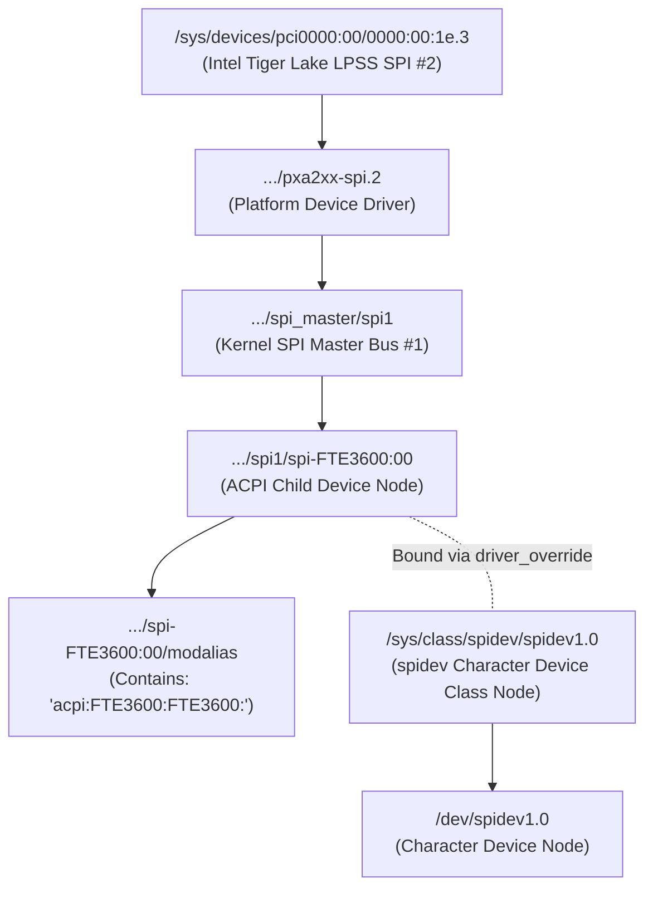

# Stage 2C.5C.1 — Device Identity, Host Topology, and Subsystem Prerequisites

**Document ID:** `STAGE2C5C1_DEVICE_AND_HOST_PREREQUISITES`  
**Date:** 2026-11-02  
**Target Hardware:** Dynabook Satellite Pro C40-J (`PYS46G-06J02D`)  
**Target Subsystems:**
- Intel Tiger Lake-LP PCH LPSS SPI2 Controller (`0000:00:1e.3` / `pxa2xx-spi.2`)
- Linux SPI Core Subsystem & `spidev` Character Driver
- ACPI DSDT Device `FTE3600` (`spi-FTE3600:00`)
**Execution Boundary:** Strictly static topology and architecture review. Zero configuration modifications authorized.

---

## 1. Executive Summary

Before any physical sensor communication can even be contemplated, the host platform must satisfy an extensive hierarchy of hardware, firmware, kernel driver, and subsystem prerequisites.

This document details the exact required sysfs topology, device binding requirements, permission boundaries, buffer configurations, and kernel-level limitations.

### Critical Findings:
1. **Sysfs Identity Hierarchy Availability:** The sysfs device node `/sys/class/spidev/spidev1.0/device` is **ONLY AVAILABLE AFTER** `spidev` is loaded and bound to `spi-FTE3600:00`. On the current live host, `spi-FTE3600:00` is completely unbound, `spidev` is unloaded, and `/sys/class/spidev` does not exist.
2. **The `spidev.bufsiz` Boundary:** The default Linux kernel `spidev` buffer size is 4,096 bytes. The 10,246-byte raw frame burst read requires loading `spidev` with `bufsiz=65536`. Allocating this buffer in userspace or kernel does **NOT** prove that the Intel LPSS hardware or the FT9362 silicon physically supports continuous 10,246-byte burst transfers.
3. **Unverified Kernel Timeout Hazard:** Modern Linux kernels (including `7.2.8-9-omarchy`) execute `spidev_sync()` via `spi_sync()`, which blocks in `wait_for_completion(&done)` in `TASK_UNINTERRUPTIBLE` (state `D`). There is **NO VERIFIED TIMEOUT** in `spi-pxa2xx-core`. If the SPI controller hangs on physical hardware, userspace locks up indefinitely and cannot be killed.

---

## 2. Expected Sysfs Topology Hierarchy

The physical fingerprint sensor is attached via an Intel LPSS SPI master controller. The expected sysfs directory structure is illustrated below:



### 2.1 Sysfs Verification Checkpoints

The implementation in [`fw9369_hw_verify_device_identity()`](file:///home/titan/fte3600-linux-driver/tools/fw9369-mock/src/fw9369_transport_hw.c#L76-L150) validates four specific links:

| Checkpoint | Target Path / Symlink | Expected Content / Substring | Status on Live System |
| :--- | :--- | :--- | :--- |
| **1. Device Node** | `/dev/spidev1.0` | Character device `major 153, minor 0` | **ABSENT** (Unbound) |
| **2. Controller Parent** | `/sys/class/spidev/spidev1.0/device` | Must contain `pxa2xx-spi.2` | **ABSENT** (`spidev` unloaded) |
| **3. Master Bus** | `/sys/class/spidev/spidev1.0/device` | Must contain `spi1` | **ABSENT** (`spidev` unloaded) |
| **4. ACPI Identity** | `/sys/bus/spi/devices/spi-FTE3600:00/modalias` | Must contain `FTE3600` | **VERIFIED PRESENT** (`acpi:FTE3600:FTE3600:`) |

### 2.2 Availability Lifecycle
- **Unbound State (Current):**
  - `/sys/bus/spi/devices/spi-FTE3600:00` exists.
  - `driver_override` contains `""`.
  - `/sys/class/spidev/` does **not** exist.
  - Calling `fw9369_hw_verify_device_identity()` immediately returns `-ENODEV`.
- **Bound State (Post-Supervised Binding Only):**
  - Only when `modprobe spidev` is executed and `echo spidev > driver_override` is written does `/sys/class/spidev/spidev1.0` materialize.
  - Only then can the canonical symlink resolution succeed.

---

## 3. Host-Side Operational Prerequisites

If an authorized hardware execution stage is approved in the future, the following explicit host prerequisites must be established in strict sequence:

### 3.1 Kernel Module Loading & Parameter Configuration
- **Command:** `modprobe spidev bufsiz=65536`
- **Parameter Rationale:**
  - Upstream `spidev` defines `static unsigned bufsiz = 4096;`.
  - The FT9362 pixel array is $64 \times 80 = 5,120$ 16-bit words ($10,240$ payload bytes).
  - With protocol framing prefix `[ 0x06, 0xF9, 0x9A, 0x05, 0x14, 0x00 ]`, the burst transfer length is exactly **10,246 bytes**.
  - If `spidev` is loaded without `bufsiz=65536`, any transfer greater than 4,096 bytes fails with `-EMSGSIZE`.
- **Risks of Module Parameter Modification:**
  - `bufsiz` is a global module parameter. It affects all `spidev` instances on the host (none currently exist).
  - If `spidev` was previously loaded without the parameter, setting it requires `modprobe -r spidev` followed by reloading.
  - Reloading modules requires elevated privileges (`CAP_SYS_MODULE`).

### 3.2 Dynamic Driver Binding via `driver_override`
- **Commands:**
  ```bash
  echo "spidev" > /sys/bus/spi/devices/spi-FTE3600:00/driver_override
  echo "spi-FTE3600:00" > /sys/bus/spi/drivers/spidev/bind
  ```
- **Rationale:**
  - Modern Linux kernels forbid wildcard ACPI binding to `spidev` without explicit `driver_override`.
  - This prevents unintentional binding to arbitrary SPI devices on the system.

### 3.3 Device Node Permissions
- **Target Node:** `/dev/spidev1.0`
- **Permission Model:**
  - Default permissions on Linux are `crw------- 1 root root`.
  - Accessing the node requires either running as `root` (or with `CAP_SYS_RAWIO`) or assigning read/write group permissions (e.g. `udev` rule assigning group `plugdev` or `spi`).

### 3.4 SPI Transport Configuration Negotiation
Upon opening `/dev/spidev1.0`, userspace must verify the following ioctl round-trips:
1. `SPI_IOC_WR_MODE` / `SPI_IOC_RD_MODE`: Mode 0 (`CPOL=0, CPHA=0`).
2. `SPI_IOC_WR_BITS_PER_WORD` / `SPI_IOC_RD_BITS_PER_WORD`: 8 bits.
3. `SPI_IOC_WR_MAX_SPEED_HZ` / `SPI_IOC_RD_MAX_SPEED_HZ`: 1,000,000 Hz ($1\text{ MHz}$).
4. `SPI_IOC_WR_LSB_FIRST`: 0 (MSB-first).

---

## 4. The Kernel Timeout Limitation Hazard

A critical safety finding established during Stage 2C.5B.2 is the **lack of a verified hardware timeout** in the Linux kernel SPI subsystem for this controller.

### 4.1 Upstream Driver Architecture
Inspection of the compiled kernel driver `spi-pxa2xx-core.ko.zst` on Linux `7.2.8-9-omarchy` reveals:
- Modern upstream kernels implement the SPI core message pump via `drivers/spi/spi.c`.
- When userspace issues `ioctl(fd, SPI_IOC_MESSAGE(1), &tr)`, the execution flow is:
  ```text
  userspace: ioctl(SPI_IOC_MESSAGE)
    -> drivers/spi/spidev.c: spidev_sync()
      -> drivers/spi/spi.c: spi_sync()
        -> drivers/spi/spi.c: __spi_sync()
          -> spi_transfer_one_message()
          -> wait_for_completion(&done)  <--- BLOCKS IN TASK_UNINTERRUPTIBLE (state D)
  ```
- There is **no timeout parameter** passed to `wait_for_completion(&done)`.
- Upstream `spi-pxa2xx` does not arm a timer to abort stalled DMA or FIFO transfers.

### 4.2 Hazard Manifestation
If a physical hardware failure occurs:
- The calling process enters **uninterruptible sleep (state `D`)**.
- The process cannot handle signals: `SIGINT` (Ctrl+C), `SIGTERM`, and `SIGKILL` (`kill -9`) are completely ignored.
- The process cannot exit, and the file descriptor cannot be closed.
- The SPI controller hardware remains stuck in a busy state.
- **The only recovery from a wedged kernel completion in state `D` is a hard system reboot.**

> [!IMPORTANT]
> Userspace `nanosleep()` delays (e.g. 1 ms or 4 ms) occur *between* SPI transactions. They offer zero protection *during* an in-progress `ioctl()` call. Software timeouts cannot abort a stalled kernel SPI transfer.

---

## 5. FIFO Hardware Burst Reality vs. Software Buffers

A common engineering misconception is assuming that allocating a 65,536-byte buffer in `spidev` guarantees that the physical SPI hardware can transfer a 10,246-byte burst.

### 5.1 Physical SPI Hardware Limitations
1. **Intel LPSS FIFO Depth:** The Intel Tiger Lake LPSS SPI controller internal hardware FIFO is typically 64 or 128 bytes deep.
2. **DMA Engine vs. Interrupt Driven:** Transfers larger than FIFO depth rely on Intel LPSS DMA channels or high-frequency interrupts to keep the FIFO fed.
3. **Continuous CS# Assertion:**
   - In userspace, setting `cs_change = 0` in `struct spi_ioc_transfer` requests continuous CS# assertion.
   - However, if the Intel LPSS DMA controller stalls or encounters bus latency, the SPI controller hardware may autonomously deassert CS# high or insert clock gaps.
   - If CS# toggles high during the 10,246-byte transfer, the FT9362 internal FIFO read pointer **IMMEDIATELY RESETS TO ZERO**, corrupting the frame.
4. **Physical Wire Verification Status:**
   - **Continuous CS# assertion on a 10,246-byte transfer has NEVER been physically verified with an oscilloscope or logic analyzer on this platform.**

---

## 6. Audit Conclusion

All host and device prerequisites are meticulously defined:
- The live system is confirmed safe and unbound.
- Pre-open identity validation prevents accidental operations.
- The `spidev.bufsiz=65536` prerequisite is strictly required for Phase 4 FIFO read.
- The unverified kernel timeout represents an inherent platform hazard that requires operator acknowledgment prior to any hardware execution.
