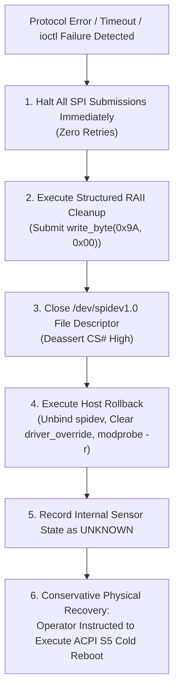

# Stage 2C.5C.1 — Failure Modes, State Transitions, and Recovery Matrix

**Document ID:** `STAGE2C5C1_FAILURE_AND_RECOVERY_MATRIX`  
**Date:** 2026-11-02  
**Target Hardware:** FocalTech FT9362 / FW9369  
**Host Controller:** Intel Tiger Lake-LP PCH LPSS SPI2 (`pxa2xx-spi.2`)  
**Execution Boundary:** Strictly static architecture and safety matrix. Zero hardware operations authorized.

---

## 1. Executive Summary

Every physical operation on silicon entails the possibility of communication loss, protocol violation, or state machine divergence. In the absence of an accessible userspace hardware reset line (PCH Pad 14 is firmware-locked), software must possess a deterministic, uncompromising failure and recovery model.

### Absolute Safety Principles Governing Failures:
1. **Zero Blind Retries:** When an unexpected response or transport error occurs, software must immediately halt all SPI transmission. No automatic retries, brute-force re-probing, or blind register blasting is permitted.
2. **Host Rollback is Not Sensor Restoration:** Unbinding `spidev` and unloading modules cleanly restores Linux host resources, but **LEAVES SENSOR SILICON UNCHANGED**.
3. **Conservative Known Recovery is ACPI S5 Cold Reboot:** Because Pad 14 cannot be toggled from userspace, the only proven, conservative mechanism that guarantees all internal sensor flip-flops, analog charge pumps, and logic latches return to a known cold state is a full ACPI S5 power-down (cold reboot with auxiliary power cut).
4. **No Software Reset Myth:** Software must never assume that sending random commands or toggling unconfirmed GPIOs can reset a hung FT9362.

---

## 2. Comprehensive Failure and Recovery Matrix

The table below maps every operational step across the five initialization phases to its failure characteristics, silicon consequences, prohibition status, and mandatory recovery path:

| Phase & Operation | Failure Manifestation | Internal Sensor Consequence | State Classification | Further SPI Traffic? | Host Rollback Possible? | Required Recovery Procedure | Prerequisite Evidence for Re-test |
| :--- | :--- | :--- | :---: | :---: | :---: | :--- | :--- |
| **Phase 1: Op 1** `write_byte(0xC6, 0x01)` | ioctl error / bus contention | MOSI bits partially latched; clock gating circuit in partial or unstable state. | **UNKNOWN** | **STRICTLY PROHIBITED** | **YES** (Standard host teardown) | ACPI S5 Cold Reboot | Kernel dmesg clean; bus line idle confirmed. |
| **Phase 1: Op 3** `read_byte(0xC6)` | Readback != `0x01` after 31 retries | Transceiver oscillator failed to lock; internal PLL stalled or power rail sagged. | **UNKNOWN** | **STRICTLY PROHIBITED** | **YES** (Standard host teardown) | ACPI S5 Cold Reboot | Power rail voltage telemetry; inspect ACPI D3/D0 state. |
| **Phase 1: Op 4** `read_word(0x1A8B)` | Chip ID != `0x9362` or CRC != `0x1C53` | Clock active, but silicon revision mismatch or SPI framing out of sync. | **UNKNOWN** | **STRICTLY PROHIBITED** | **YES** (Standard host teardown) | ACPI S5 Cold Reboot | Logic analyzer trace of MOSI/MISO byte shifts. |
| **Phase 1: Op 5** `write_word(0x1A84, 0xFFFF)`| ioctl error | Interrupt clear strobe not registered; pending latches un-cleared. | **UNKNOWN** | **STRICTLY PROHIBITED** | **YES** (Standard host teardown) | ACPI S5 Cold Reboot | Diagnostic dump of host SPI controller registers. |
| **Phase 2: Op 6** `send_command(0x5A, 0xA5)`| ioctl error / transfer short | MCU command decoder received partial preamble; dialog state open. | **UNKNOWN / CRITICAL**| **STRICTLY PROHIBITED** | **YES** (Standard host teardown) | ACPI S5 Cold Reboot | Full controller power cycle required. |
| **Phase 2: Op 8** `read_byte(0x80)` | Status != `0x50` after 5 retries & exception strobes | Sensor MCU failed to reach idle; firmware stuck in bootloader or internal ROM fault. | **UNKNOWN** | **STRICTLY PROHIBITED** | **YES** (Issue `0xA5 0x5A` then teardown) | ACPI S5 Cold Reboot | Inspect whether sensor was physically touched during boot. |
| **Phase 2: Op 9** `send_command(0xA5, 0x5A)`| ioctl error | Closing delimiter failed; sensor MCU remains listening for dialog. | **UNKNOWN / HAZARDOUS**| **STRICTLY PROHIBITED** | **YES** (Standard host teardown) | ACPI S5 Cold Reboot | Immediate cold power down. |
| **Phase 2: Op 10** Foundry Strobes (`0xF1/F4`)| ioctl error | Foundry test gating left enabled; internal test clocks oscillating. | **UNKNOWN / HAZARDOUS**| **STRICTLY PROHIBITED** | **YES** (Standard host teardown) | ACPI S5 Cold Reboot | Hardware power rail cycle. |
| **Phase 3: Op 11** AFE Timing (`0x1800..08`)| ioctl error | Capacitive integration timing partially written; analog core in mixed mode. | **UNKNOWN** | **STRICTLY PROHIBITED** | **YES** (Standard host teardown) | ACPI S5 Cold Reboot | Cold power restart. |
| **Phase 3: Op 12** `write_byte(0x9A, 0x5A)` | Unlock ioctl fails | Protection latch state unknown (may be open or closed); trim writes blocked. | **UNKNOWN** | **STRICTLY PROHIBITED** | **YES** (Attempt `0x9A=0x00` then teardown)| ACPI S5 Cold Reboot | Clean host rollback logs. |
| **Phase 3: Op 13** Trim Write (`0x00C0..C2`)| ioctl error | Trims partially updated; analog reference voltages asymmetrical. | **UNKNOWN / SENSITIVE**| **STRICTLY PROHIBITED** | **YES** (Guaranteed `0x9A=0x00` lock cleanup)| ACPI S5 Cold Reboot | Verified lock submission logged. |
| **Phase 3: Op 14** `write_byte(0x9A, 0x00)` | Lock ioctl fails | **SILICON POTENTIALLY UNLOCKED.** Analog trims exposed to accidental overwrite. | **UNKNOWN / CRITICAL**| **STRICTLY PROHIBITED** | **YES** (Standard host teardown) | **MANDATORY ACPI S5 COLD REBOOT** | Cold power cut to reset internal write latch. |
| **Phase 3: Op 15** FDT DAC Search Loop | Scan timeout or Minima out of range (`<300` or `>700`)| Sensor sensing matrix saturated, degraded, or contaminated by ESD. | **PARTIALLY KNOWN** | **STRICTLY PROHIBITED** | **YES** (Standard host teardown) | ACPI S5 Cold Reboot | Surface physical inspection (clean sensor surface). |
| **Phase 4: Op 19** FIFO Read (10,246 B) | Kernel `-EMSGSIZE` or DMA completion hang | CS# toggled prematurely or DMA queue stalled; sensor read pointer corrupted. | **UNKNOWN / FROZEN** | **STRICTLY PROHIBITED** | **POSSIBLE IF NOT STATE D** | ACPI S5 Cold Reboot | Check `spidev.bufsiz` parameter and DMA logs. |
| **Phase 5: Op 23** `send_command(0xC2, 0x3D)`| Arm ioctl fails | Interrupt generation state indeterminate; Pad 229 may trigger unhandled IRQs. | **UNKNOWN** | **STRICTLY PROHIBITED** | **YES** (Standard host teardown) | ACPI S5 Cold Reboot | Verify Pad 229 remains high-impedance. |

---

## 3. Detailed Phase Failure Mechanisms

### 3.1 The Phase 2 Command Dialog Trap (`0x5A 0xA5` / `0xA5 0x5A`)
- **Danger:** In Phase 2, sending `0x5A 0xA5` places the sensor MCU into an active command reception mode.
- **Consequence of Premature Abort:** If an error occurs (such as status `0x80` timeout) and the closing delimiter `0xA5 0x5A` is omitted, the MCU command decoder remains listening on SPI. Any subsequent byte stream on MOSI could be misinterpreted as raw MCU commands.
- **Handling:** Software must always attempt to transmit `[ 0xA5, 0x5A, 0x00 ]` during Phase 2 abort to close the command frame before tearing down the transport.

### 3.2 The Phase 3 Protected Register Trap (`0x9A`)
- **Danger:** Bank `0x00C0..0x00C2` contains volatile trim calibration data that biases the analog receiver.
- **Consequence of Lock Failure:** If `write_byte(0x9A, 0x00)` fails, `ctx->lock_outcome` is set to `FW9369_LOCK_TRANSMISSION_FAILED`.
- **Handling:** The host has no mechanism to force the hardware latch closed. The operator must perform an ACPI S5 cold reboot to depower the chip and restore the silicon power-on default write-protection.

### 3.3 The Phase 4 Large Burst FIFO Stall (State `D`)
- **Danger:** A 10,246-byte transfer requires shifting 81,968 bits over SPI.
- **Consequence of Controller Stall:** As proven in the kernel timeout audit, if the Intel LPSS SPI controller hangs, userspace blocks in `wait_for_completion(&done)` in `TASK_UNINTERRUPTIBLE`.
- **Handling:** Host rollback cannot proceed because the process is wedged in the kernel. The only resolution is a hardware power cycle.

---

## 4. Host-Side Rollback Capabilities and Boundaries

When an error occurs, host-side rollback must be strictly distinguished from peripheral restoration:

### 4.1 What Host Rollback DOES Achieve:
1. Deasserts SPI chip select (CS# returns high).
2. Closes file descriptor `/dev/spidev1.0`, releasing kernel character device locks.
3. Unbinds device `spi-FTE3600:00` from the `spidev` driver.
4. Clears `driver_override` to empty string (`""`), preventing rogue auto-rebinding.
5. Unloads the `spidev` module via `modprobe -r spidev`.
6. Removes `/dev/spidev*` character device nodes from the filesystem.

### 4.2 What Host Rollback DOES NOT Achieve:
1. It does **NOT** reset the FT9362 internal state machine.
2. It does **NOT** clear register `0xC6` (clock remains un-gated).
3. It does **NOT** reset analog trim registers to factory defaults.
4. It does **NOT** assert the hardware reset line (Pad 14).
5. It does **NOT** cut power to the sensor silicon.

---

## 5. The Conservative Known Recovery Mechanism: ACPI S5

Because Pad 14 cannot be driven by userspace, the project must rely on the conservative known recovery procedure:

> [!CAUTION]
> **ACPI S5 Cold Reboot Procedure:**
> 1. Complete host rollback (`unbind`, `modprobe -r spidev`).
> 2. Execute full system shutdown: `systemctl poweroff` (or hold power button 10 seconds).
> 3. Disconnect AC power adapter.
> 4. Wait 15 seconds to allow motherboard standby decoupling capacitors ($V_{DDIO}$) to discharge fully.
> 5. Reconnect AC power and power on the system.

This procedure ensures that all sensor rails decay to $0\text{ V}$, guaranteeing an authentic silicon power-on reset.

---

## 6. Audit Conclusion

The failure and recovery procedures for all future hardware operations are unambiguously defined:
- Failures result in immediate SPI halt with zero retries.
- Structured RAII cleanup attempts relocking where possible.
- Sensor state is strictly classified as UNKNOWN upon any failure.
- Host rollback is fully capable of restoring the host environment, while ACPI S5 Cold Reboot remains the only conservative mechanism to guarantee silicon restoration.
