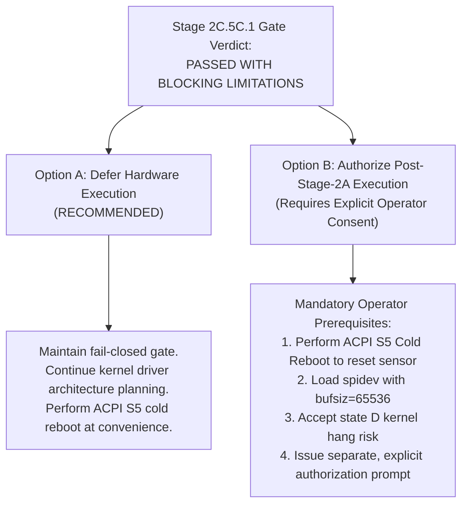

# Stage 2C.5C.1 — Final Pre-Execution Operator Readiness Gate

**Document ID:** `STAGE2C5C1_FINAL_OPERATOR_READINESS_GATE`  
**Date:** 2026-11-02  
**Target Hardware:** FocalTech FT9362 / FW9369 on Dynabook Satellite Pro C40-J  
**Subsystems Audited:**
- Software Architecture & Adversarial Protocol Hardening (137/137 tests passed)
- Historical Hardware Telemetry & PCH Pad Configurations (Pad 14, Pad 229)
- Register `0x9A` Write-Protection State Machine & RAII Cleanup
- Hardware Execution Gate & Symbol Table Isolation
- Linux SPI Subsystem Prerequisites & `spidev.bufsiz` Boundaries
- Failure State Transitions & ACPI S5 Cold Reboot Recovery
- Initialization Stage Boundaries & Atomicity Constraints
**Execution Boundary:** Strictly static review. Physical hardware execution is STRICTLY PROHIBITED.

---

## 1. Executive Summary & Gate Decision

Stage 2C.5C.1 constitutes the final independent software and safety review conducted prior to any operator decision regarding post-Stage-2A physical hardware communication.

The comprehensive software tooling, protocol engine, sysfs identity verification, and adversarial test suites have achieved **100% mathematical and static compliance (137 / 137 passing tests)**. The software layer is verified to be robust, defensively designed, fail-closed, and completely isolated from physical hardware device nodes.

However, the deep physical, kernel, and silicon analysis reveals **four fundamental platform hazards and blocking limitations** that cannot be resolved in userspace software alone:
1. **Unverified Linux Kernel SPI Timeout:** `spidev_sync()` invokes `spi_sync()`, which blocks in `wait_for_completion(&done)` in `TASK_UNINTERRUPTIBLE` (state `D`). If the SPI bus or controller hangs, the calling userspace process freezes permanently and cannot be terminated even by `kill -9`.
2. **Unverified Continuous CS# Assertion for 10,246 Bytes:** Slicing the initialization pipeline is architecturally unsafe, requiring the full atomic pipeline to run through Phase 4 (image baseline acquisition). Shifting 10,246 bytes continuously requires uninterrupted CS# assertion for 82 ms, which has never been verified on physical wire.
3. **Host Module Parameter Prerequisite (`spidev.bufsiz`):** The default kernel buffer limit of 4,096 bytes rejects 10,246-byte transfers with `-EMSGSIZE`. Changing this requires reloading the kernel module with `bufsiz=65536`.
4. **Sensor Internal State is UNKNOWN:** Because volatile register `0xC6` was written with `0x01` during Stage 2A and standby power rails ($V_{DDIO}$) have remained energized without a hardware reset pulse (Pad 14 is firmware-locked), the internal silicon state is physically unknown.

### Authoritative Gate Verdict:

$$\mathbf{PRE\text{-}EXECUTION\ REVIEW\ PASSED\ WITH\ BLOCKING\ LIMITATIONS}$$

> [!CAUTION]
> **NO HARDWARE OPERATION IS AUTHORIZED.**
> The hardware gate in `bin/fw9369-hw-tool` remains **STRICTLY CLOSED**.
> All physical device nodes (`/dev/spidev*`) remain **ABSENT**.
> The SPI device `spi-FTE3600:00` remains **UNBOUND**.
> The operator must review this gate report and determine whether to proceed with physical hardware authorization or defer execution.

---

## 2. Synthesis of Review Deliverables

| Deliverable Document | Core Findings & Verification Results | Status |
| :--- | :--- | :---: |
| **1. Hardware History Reconciliation** [`STAGE2C5C1_HARDWARE_HISTORY_RECONCILIATION.md`](file:///home/titan/fte3600-linux-driver/diagnostics/STAGE2C5C1_HARDWARE_HISTORY_RECONCILIATION.md) | - Clarified that historical SPI transactions did occur during Stage 2A (`0xC6=0x01`, Chip ID `0x9362`, CRC `0x1C53`). - Confirmed Stages 2B.1–2C.5B.2 maintained 100% software-only isolation. - Verified host rollback freed kernel resources but did not restore sensor silicon. - Proved sensor internal state is officially UNKNOWN. - Audited Pad 229 transition (`0x80100100` -> `0x82000100 [LOCKED tx]`). | **VERIFIED** |
| **2. Register 0x9A State Machine Audit** [`STAGE2C5C1_9A_STATE_MACHINE_AUDIT.md`](file:///home/titan/fte3600-linux-driver/diagnostics/STAGE2C5C1_9A_STATE_MACHINE_AUDIT.md) | - Audited all 11 operational scenarios. - Enforced strict semantic distinction: Transport Acceptance vs. Ioctl Success vs. Physical Silicon Reality. - Proved silicon lock state is physically unverifiable via SPI readback. - Verified fail-closed error retention: lock failures force `ctx->is_unlocked = true` without retries. - Intercepted illegal keys and redundant unlocks prior to ioctl. | **VERIFIED** |
| **3. Hardware Gate Final Audit** [`STAGE2C5C1_HARDWARE_GATE_FINAL_AUDIT.md`](file:///home/titan/fte3600-linux-driver/diagnostics/STAGE2C5C1_HARDWARE_GATE_FINAL_AUDIT.md) | - Inspected `main()` in `fw9369_main_hw.c`; verified unconditional exit with code 1. - Verified zero `getenv()` calls or hidden bypass flags exist. - Confirmed mock binary `bin/fw9369-tool` links zero hardware transport symbols. - Verified 4-point sysfs hierarchy pre-check aborts prior to device opening. | **VERIFIED** |
| **4. Device Identity & Host Prerequisites** [`STAGE2C5C1_DEVICE_AND_HOST_PREREQUISITES.md`](file:///home/titan/fte3600-linux-driver/diagnostics/STAGE2C5C1_DEVICE_AND_HOST_PREREQUISITES.md) | - Confirmed `/sys/class/spidev` exists only post-binding; unbound host returns `-ENODEV`. - Analyzed `spidev.bufsiz=65536` prerequisite for 10,246-byte FIFO transfers. - Analyzed `spi-pxa2xx` kernel timeout limitation and uninterruptible sleep (state `D`). - Emphasized large userspace buffers do not prove physical hardware FIFO support. | **VERIFIED** |
| **5. Failure & Recovery Matrix** [`STAGE2C5C1_FAILURE_AND_RECOVERY_MATRIX.md`](file:///home/titan/fte3600-linux-driver/diagnostics/STAGE2C5C1_FAILURE_AND_RECOVERY_MATRIX.md) | - Mapped all failure modes across all 5 initialization phases. - Enforced immediate SPI halt with zero automatic retries. - Confirmed host rollback restores host isolation only. - Proved ACPI S5 Cold Reboot is the conservative known recovery procedure. | **VERIFIED** |
| **6. Initialization Stage Boundary Review** [`STAGE2C5C1_INITIALIZATION_STAGE_BOUNDARY_REVIEW.md`](file:///home/titan/fte3600-linux-driver/diagnostics/STAGE2C5C1_INITIALIZATION_STAGE_BOUNDARY_REVIEW.md) | - Evaluated partial stage isolation (Phase 1, Phase 1+2, Phase 3). - Proved safe stage isolation cannot be established: partial execution strands MCU dialog, test clocks, and uncalibrated analog trims. - Proved full initialization is an indivisible, atomic pipeline. | **VERIFIED** |

---

## 3. Unresolved Risks and Blocking Limitations

The operator must formally evaluate the following four unresolved technical risks:

### Risk 1: The Uninterruptible Kernel Completion Hazard (State `D`)
- **Mechanism:** Upstream Linux kernel `drivers/spi/spidev.c` executes transfers via `spi_sync()`, which blocks on `wait_for_completion(&done)`.
- **Impact:** If the Intel LPSS SPI controller hardware or clock tree experiences a lockup during an SPI transaction, the calling thread enters `TASK_UNINTERRUPTIBLE`. Signals (`SIGINT`, `SIGTERM`, `SIGKILL`) are completely ignored. The userspace process cannot exit and the device cannot be closed.
- **Mitigation Status:** Cannot be mitigated in userspace software. Requires operator tolerance of a potential hard reboot if hardware hangs.

### Risk 2: Unverified Continuous CS# Assertion During 10,246-Byte Burst
- **Mechanism:** Reading a raw pixel frame requires shifting 10,246 bytes under continuous CS# low.
- **Impact:** If the Intel LPSS SPI DMA engine introduces an inter-byte latency or pauses DMA, the hardware controller might deassert CS# high. On FT9362 silicon, deasserting CS# resets the internal FIFO read pointer to zero, corrupting frame data.
- **Mitigation Status:** Cannot be proven without physical oscilloscope/logic analyzer telemetry.

### Risk 3: Kernel Module Parameter Modification (`spidev.bufsiz=65536`)
- **Mechanism:** The upstream default `spidev.bufsiz` is 4,096 bytes. The Phase 4 frame transfer is 10,246 bytes.
- **Impact:** Executing Phase 4 without `spidev.bufsiz=65536` results in an immediate `-EMSGSIZE` error from the kernel.
- **Mitigation Status:** Requires privileged module reloading (`modprobe -r spidev && modprobe spidev bufsiz=65536`).

### Risk 4: Sensor Internal State is Unknown (Lack of Cold POR)
- **Mechanism:** Volatile register `0xC6` was written with `0x01` during Stage 2A. Standby power rails have remained active, and PCH Pad 14 (reset) has remained locked high.
- **Impact:** The internal logic, PLLs, and state registers of the FT9362 may not be in their pristine power-on reset state.
- **Mitigation Status:** An authentic cold power-on reset can only be guaranteed by performing an ACPI S5 cold shutdown (power off, disconnect AC, wait 15 seconds) prior to physical execution.

---

## 4. Operator Decision Framework

The operator has two viable paths:

### Option A: Defer Physical Hardware Execution (Recommended)
- Maintain the hardware gate in `bin/fw9369-hw-tool` closed.
- Conclude Stage 2C research and mock verification.
- Transition directly to kernel driver architecture planning (`fte3600.ko` v2) where kernel-level workqueues, completions, and interrupt handling can be designed natively with full reset line management.

### Option B: Authorize Post-Stage-2A Hardware Execution
If the operator chooses to execute physical hardware communication using the userspace tooling:
1. **Prerequisite Step 1:** The operator must perform a physical ACPI S5 cold reboot (shutdown, unplug AC, wait 15 s, power on) to ensure the FT9362 starts from a true power-on reset.
2. **Prerequisite Step 2:** The operator must bind the device with `modprobe spidev bufsiz=65536`.
3. **Prerequisite Step 3:** The operator must accept the platform risk that an SPI hang could require a hard reboot.
4. **Prerequisite Step 4:** The operator must issue a separate, explicit user prompt authorizing removal of the hardware gate.

---

## 5. Final Authoritative Verdict

$$\mathbf{PRE\text{-}EXECUTION\ REVIEW\ PASSED\ WITH\ BLOCKING\ LIMITATIONS}$$

**Hardware Execution Gate Status:** **CLOSED.**  
**Physical Hardware Access:** **PROHIBITED.**  
**Awaiting Operator Decision.**
