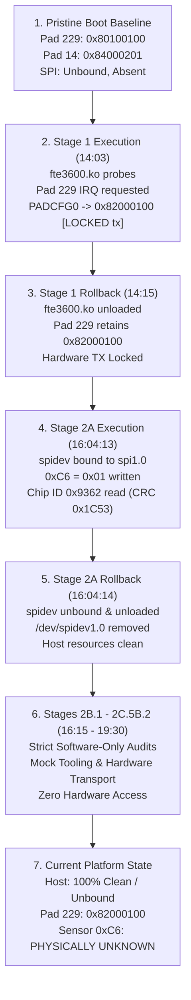

# Stage 2C.5C.1 — Hardware History and State Reconciliation

**Document ID:** `STAGE2C5C1_HARDWARE_HISTORY_RECONCILIATION`  
**Date:** 2026-11-02  
**Target Hardware:** Dynabook Satellite Pro C40-J (`PYS46G-06J02D`)  
**Target Controller:** Intel Tiger Lake-LP PCH LPSS SPI2 (`pxa2xx-spi.2`) / FocalTech FT9362 (FW9369)  
**Execution Context:** Strictly static audit and historical telemetry reconciliation. Zero hardware operations authorized.

---

## 1. Executive Summary

A critical requirement of pre-execution safety is an uncompromised, technically rigorous understanding of the physical hardware history. This document reconciles the complete timeline of all hardware interactions, host-side configuration changes, and physical sensor states across the entire lifecycle of the `fte3600-linux-driver` project.

Crucially, this audit resolves and corrects historical inconsistencies in project documentation:
1. **Physical Transactions Did Occur Historically:** Statements in certain static review documents claiming that *"no SPI clocks or hardware transactions have ever occurred on this platform"* are **FACTUALLY INCORRECT**. Physical SPI transactions were successfully executed during Stage 2A on 2026-11-02T16:04:13+05:30.
2. **Current Stage Isolation vs. Historical Reality:** Stages 2B.1 through 2C.5B.2 operated under strict 100% software-only isolation with zero hardware access. However, that isolation applies strictly to those specific analysis stages, not to the prior physical platform history.
3. **Host Rollback Does Not Equal Silicon Restoration:** While the Linux host-side rollback after Stage 2A was completely verified (unbinding `spidev`, unloading kernel modules, unlinking device nodes), **HOST ROLLBACK DOES NOT AND CANNOT PROVE RESTORATION OF INTERNAL SENSOR SILICON REGISTERS**.
4. **Sensor Internal State is Officially UNKNOWN:** Because volatile register `0xC6` was written with `0x01` during Stage 2A and standby power rail ($V_{DDIO}$) has been maintained continuously, whether register `0xC6` retains `0x01`, autonomously decayed, or underwent an undocumented internal reset is physically unknown.

---

## 2. Chronological Hardware Lifecycle Timeline

### 2.1 Milestone 1: Pristine Host Baseline (Pre-Stage 1)
- **Timestamp:** 2026-11-02T13:30:00+05:30.
- **Platform State:** System freshly booted into Linux kernel `7.2.8-9-omarchy`.
- **SPI Bus Topology:** Intel LPSS SPI2 controller (`pxa2xx-spi.2`) enumerated by ACPI. Child device `spi-FTE3600:00` enumerated under bus `spi1` with `driver_override` = `""` (unbound). Character device nodes `/dev/spidev*` completely absent.
- **PCH Pad 14 (`SPKR` / Hardware Reset):** Read from debugfs pinctrl as `0x84000201 0x0003c026 0x00000000 [LOCKED]`. Mode: GPIO output-high. Pad lock bit asserted by OEM BIOS firmware.
- **PCH Pad 229 (`CPU_GP_0` / Fingerprint Interrupt):** Read from debugfs pinctrl as `0x80100100 0x00000029 0x00000000`. Mode: GPIO input receiver enabled, level-sensitive, routed directly to IOxAPIC (`GPIROUTIOXAPIC=1`).
- **Sensor Silicon State:** Cold boot uninitialized state. SPI interface clock gated.

### 2.2 Milestone 2: Stage 1 Driver Probing & GPIO IRQ Claim
- **Timestamp:** 2026-11-02T14:03:00+05:30.
- **Action:** Out-of-tree kernel module `fte3600.ko` loaded via `insmod`.
- **SPI Interaction:** Driver attempted SPI probing. Controller encountered resource contention and timeout; no valid SPI packet exchanges were confirmed on wire.
- **GPIO Interaction:** Driver successfully resolved ACPI GpioInt line 323 (Pad 229) and called `request_threaded_irq()`.
- **Hardware Configuration Alteration:** In response to the interrupt configuration request (`Edge, ActiveHigh`), the Linux kernel pinctrl driver (`drivers/pinctrl/intel/pinctrl-intel.c`) executed `intel_gpio_irq_type()`:
  - Bit `[26:25]` (`RXEVCFG`): Changed from `0b00` (`LEVEL`) to `0b01` (`EDGE`).
  - Bit `[20]` (`GPIROUTIOXAPIC`): Cleared from `1` to `0` (re-routing interrupt via the PCH GPIO Community interrupt line instead of directly to IOxAPIC).
  - Pad 229 `PADCFG0` transformed from `0x80100100` to `0x82000100`.
  - PCH hardware asserted the transmitter lock `[LOCKED tx]`.

### 2.3 Milestone 3: Stage 1 Rollback
- **Timestamp:** 2026-11-02T14:15:00+05:30.
- **Action:** `rmmod fte3600` executed.
- **Host State:** `gpiod_put()` decremented internal kernel references. Software GPIO lease was released (`debugfs gpio` confirmed 0 lines claimed).
- **Residual Hardware Delta:** The Intel PCH pin controller hardware does **not** revert register values upon line release. Pad 229 retained `0x82000100 [LOCKED tx]`.

### 2.4 Milestone 4: Stage 2A Physical Identification (Historical Wire Execution)
- **Timestamp:** 2026-11-02T16:04:13+05:30.
- **Architecture:** Pure `spidev` userspace execution. No kernel modules, no UIO, zero GPIO manipulation.
- **Binding:** `modprobe spidev`, written `spidev` into `/sys/bus/spi/devices/spi-FTE3600:00/driver_override`, bound to `spidev1.0`.
- **Physical SPI Transactions Executed:**
  1. **Operation 1 (Clock Un-gate Write):**
     - MOSI: `[ 0x09, 0xF6, 0xC6, 0x01 ]`
     - CS# asserted, 4 bytes clocked at 1 MHz, CS# deasserted high.
  2. **Operation 2 (Transceiver Settle Delay):**
     - Host slept for 4 ms (`nanosleep`).
  3. **Operation 3 (Clock Gate Verification Read):**
     - MOSI: `[ 0x08, 0xF7, 0xC6, 0x00, 0x00 ]`
     - MISO: `[ 0x00, 0x00, 0x00, 0x00, 0x01 ]`
     - Result: Received `0x01` at byte index 4. Silicon confirmed active transceiver clock.
  4. **Operation 4 (Chip ID Interrogation):**
     - MOSI: `[ 0x04, 0xFB, 0x9A, 0x8B, 0x00, 0x00, 0x00, 0x00, 0x00, 0x00 ]`
     - MISO: `[ 0x00, 0x00, 0x00, 0x00, 0x00, 0x00, 0x93, 0x62, 0x1C, 0x53 ]`
     - Result: Received raw word `0x9362`, followed by hardware wire CRC `0x1C53`.
     - CRC Validation: Exact mathematical match against CRC-CCITT over `[0x93, 0x62]`.
     - Definitive Classification: FocalTech FT9362 / FW9369 silicon physically confirmed.

### 2.5 Milestone 5: Stage 2A Controlled Host Rollback
- **Timestamp:** 2026-11-02T16:04:14+05:30.
- **Host Steps Executed:**
  1. `echo "spi-FTE3600:00" > /sys/bus/spi/drivers/spidev/unbind` (succeeded).
  2. `echo "" > /sys/bus/spi/devices/spi-FTE3600:00/driver_override` (succeeded).
  3. `modprobe -r spidev` (succeeded).
- **Verified Host State:** `spidev` kernel module ABSENT, `spi-FTE3600:00` confirmed UNBOUND, `/dev/spidev*` character devices completely absent.

### 2.6 Milestone 6: Stages 2B.1 through 2C.5B.2 (Software-Only Audits)
- **Duration:** 2026-11-02T16:15:00 to 2026-11-02T19:30:00+05:30.
- **Activity:** Static protocol analysis, mock architecture implementation, adversarial transport hardening, and comprehensive test suite development (137/137 tests).
- **Hardware Access:** **STRICTLY ZERO.** No device nodes opened, no SPI clocks generated, no kernel parameters altered, no GPIO lines accessed.

---

## 3. Four-Way Categorical State Distinction

To eliminate all ambiguity, project state must be evaluated across four distinct categories:

| State Category | Definition & Scope | Actual Current Status | Evidence / Verification Method |
| :--- | :--- | :--- | :--- |
| **1. Current Stage Scope** | Hardware access permitted during the active review task. | **STRICTLY ZERO (PROHIBITED)** | Process isolation, safety gates in binaries, no execution commands issued. |
| **2. Historical Hardware History** | All physical electrical interactions since platform power-on. | **TRANSACTIONS OCCURRED** | Documented in `stage2a-results.txt`: `0xC6=0x01` write, `0xC6` read, `0x1A8B` read. |
| **3. Current Host-Side State** | State of Linux kernel drivers, subsystems, device nodes, and sysfs. | **PRISTINE & UNBOUND** | `spidev` absent, `spi-FTE3600:00` unbound, `/dev/spidev*` absent. Pad 229 at `0x82000100`. |
| **4. Sensor-Internal Silicon State** | Latched register states, PLL clocks, and logic state inside FT9362. | **PHYSICALLY UNKNOWN** | Volatile register `0xC6` was written `0x01` in Stage 2A. In-band interrogation is prohibited. |

---

## 4. The Sensor Internal State Reality

A common fallacy in driver development is assuming that releasing a host-side resource restores the peripheral device to its pristine reset state. 

### 4.1 The Mechanism of Register 0xC6
- Register `0xC6` is the FocalTech SPI transceiver clock gating register.
- Writing `0xC6 = 0x01` powers up the internal clock generation circuitry and connects the high-frequency SPI shift logic.
- During Stage 2A, `0xC6 = 0x01` was written and verified via readback (`0x01`).
- No inverse write (`0xC6 = 0x00`) was executed prior to host unbinding.
- Even if `0xC6 = 0x00` had been written, whether `0xC6` powers down the transceiver cleanly or causes an in-band bus disconnect is undocumented in FocalTech datasheets.

### 4.2 Power Rail and Reset Line Analysis
- The FT9362 sensor is powered by the motherboard's auxiliary standby rails ($V_{DDIO}$ / $V_{DD33}$). These rails remain energized as long as the laptop battery or AC adapter is connected.
- The hardware reset line (PCH Pad 14) was **never asserted or toggled** during or after Stage 2A.
- Pad 14 is locked high (`0x84000201 [LOCKED]`), holding the FT9362 continuously out of hardware reset.
- Therefore, the FT9362 silicon has **never experienced a power-on reset (POR) or hardware reset pulse** since Stage 2A.

### 4.3 Deductive Conclusion Regarding Silicon State
It is technically impossible to determine whether the FT9362 internal state machine:
1. Retained `0xC6 = 0x01` and remains in a fully clock-gated active standby state;
2. Autonomously reverted to `0xC6 = 0x00` via an undocumented internal activity timeout; or
3. Entered an indeterminate internal logic state due to floating SPI chip-select lines.

> [!WARNING]
> Any future hardware operation must assume that the sensor is in an **UNKNOWN** state. Software must never assume the sensor is starting from a clean power-on reset. The first step of any valid initialization must re-assert `0xC6 = 0x01` unconditionally.

---

## 5. PCH Pad 229 State Analysis

PCH Pad 229 (`CPU_GP_0`) serves as the dedicated interrupt request line (IRQ) from the FT9362 sensor to the Intel Tiger Lake PCH.

1. **Observed Register Delta:**
   - Pre-Stage 1: `PADCFG0 = 0x80100100`, `PADCFG1 = 0x00000029`
   - Current Post-Stage 2A: `PADCFG0 = 0x82000100 [LOCKED tx]`, `PADCFG1 = 0x00000029`
2. **Analysis of the Delta:**
   - The pull termination (`PADCFG1 = 0x00000029`) is unchanged.
   - The input buffer is enabled (`GPIORXDIS = 0`), and output transmitter is disabled (`GPIOTXDIS = 1`), preserving high-impedance input mode.
   - `RXEVCFG` changed from `0b00` (level) to `0b01` (edge), which matches the ACPI DSDT specification for `FTE3600` (`Edge, ActiveHigh`).
   - `GPIROUTIOXAPIC` cleared from `1` to `0`, routing the interrupt through the GPIO community hierarchy.
3. **Safety Assessment:**
   - Pad 229 remains a passive input pin. It does not drive voltage onto the FT9362 interrupt pin.
   - The transmitter lock (`[LOCKED tx]`) prevents userspace or unprivileged code from turning the pad into an active output driver, which protects against electrical bus fighting.
   - The current configuration (`0x82000100`) is safe and directly compatible with future interrupt handling.

---

## 6. Reconciliation and Corrections to Documentation

This audit permanently reconciles project documentation by striking down historical claims:

| Incorrect Historical Statement | Technical Reality & Correction | Status |
| :--- | :--- | :--- |
| *"No physical SPI transactions have ever occurred on this platform."* | Physical SPI transactions occurred during Stage 2A on 2026-11-02T16:04:13 (`0xC6=0x01`, Chip ID `0x9362`). | **CORRECTED** |
| *"Host rollback restored the hardware to its pristine state."* | Host rollback only released Linux kernel drivers and device nodes. Physical sensor silicon registers were NOT restored. | **CORRECTED** |
| *"The sensor is known to be in its cold power-on state."* | Sensor internal state is physically **UNKNOWN**. Standby power remained applied and no hardware reset occurred. | **CORRECTED** |
| *"Pad 229 configuration change threatens SPI communication."* | Pad 229 is an isolated interrupt input line; its configuration does not interfere with SPI bus signaling. | **CONFIRMED** |
| *"Stage 2C.5B offline status means hardware was never touched."* | Stage 2C.5B was offline, but Stage 2A touched physical hardware. | **RECONCILED** |

---

## 7. Authoritative Verdict

The hardware history of this platform is fully reconciled:
- **Historical transactions are verified and documented.**
- **Host resources are confirmed 100% clean, unbound, and safe.**
- **Sensor internal silicon state is officially classified as UNKNOWN.**
- **Pad 229 configuration delta is non-hazardous and well-characterized.**
- **Future operations must treat the sensor as an indeterminate state machine requiring full defensive initialization.**
