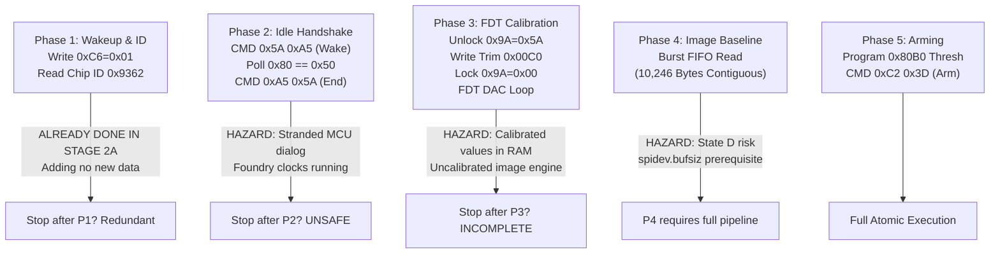

# Stage 2C.5C.1 — Initialization Stage Boundary and Safe Isolation Review

**Document ID:** `STAGE2C5C1_INITIALIZATION_STAGE_BOUNDARY_REVIEW`  
**Date:** 2026-11-02  
**Target Hardware:** FocalTech FT9362 / FW9369  
**Reference Document:** `FW9369_UNIFIED_INITIALIZATION_SPECIFICATION.md`  
**Execution Boundary:** Strictly static architecture and boundary review. Zero hardware operations authorized.

---

## 1. Executive Summary

A critical engineering question before executing any post-Stage-2A hardware operation is:
> *Can the complete FW9369 initialization sequence be safely decomposed and executed in isolated, progressive hardware stages, or does partial execution introduce unacceptable risks to silicon stability?*

This review analyzes the boundaries between the five initialization phases defined in the canonical specification:
1. **Phase 1:** Bus Wakeup & Identity Verification
2. **Phase 2:** MCU Idle Handshake & Foundry Setup
3. **Phase 3:** Capacitive AFE Tuning & FDT Calibration
4. **Phase 4:** Image Baseline Acquisition & DAC Tuning
5. **Phase 5:** Autonomous Finger Detection Arming

### Definitive Conclusion:
- **SAFE ISOLATION OF PARTIAL HARDWARE STAGES CANNOT BE ESTABLISHED.**
- The FW9369 initialization sequence is an **indivisible, atomic operational pipeline**.
- Executing partial stages (such as stopping after Phase 1, Phase 2, or Phase 3) strands the sensor silicon in undocumented, intermediate, and potentially unstable operational modes.
- Executing the complete pipeline in a single step is currently blocked by four critical hardware prerequisites and platform uncertainties:
  1. The unverified Linux kernel SPI timeout (risk of state `D` lockup).
  2. The unverified continuous CS# assertion during 10,246-byte FIFO transfers.
  3. The `spidev.bufsiz=65536` module reload prerequisite.
  4. The unknown internal silicon state resulting from the lack of an ACPI S5 cold reboot since Stage 2A.
- **Authoritative Recommendation:** **DEFER all physical hardware execution until explicit operator authorization and resolution of blocking limitations.**

---

## 2. Phase-by-Phase Boundary and Isolation Analysis



### 2.1 Boundary 1: Isolating Phase 1 (Bus Wakeup & Identity)
- **Proposed Scope:** Bind `spidev`, write `0xC6 = 0x01`, read `0xC6`, read Chip ID `0x1A8B`, clear interrupts `0x1A84 = 0xFFFF`, unbind and exit.
- **Feasibility Assessment:** **TECHNICALLY REDUNDANT.**
  - Phase 1 was already successfully executed on this physical platform in Stage 2A (2026-11-02T16:04:13).
  - Chip ID `0x9362` and CRC `0x1C53` are already proven physical facts.
  - Repeating Phase 1 in isolation generates zero new scientific knowledge, yet exposes the bus to potential transceiver glitches.

### 2.2 Boundary 2: Isolating Phase 1 + Phase 2 (The Deferred `0x5A` / `0xA5` Dialog)
- **Historical Context:** In Stage 2B.4, a minimal test ("Stage 2C.1B") was proposed to test `0x5A 0xA5`, poll status `0x80`, and issue `0xA5 0x5A`. In Stage 2B.5, this isolated test was formally **CANCELLED**.
- **Why Isolating Phase 2 is Unsafe:**
  1. **Stranded MCU Dialog Risk:**
     - Opcode `0x5A 0xA5` commands the sensor MCU to awaken and prepare for command processing.
     - If an error occurs between `0x5A` and `0xA5` (e.g. status `0x80` timeout), the MCU command parser is stranded in an open, listening state.
     - Any subsequent SPI activity on the shared bus or clock reflections can be misinterpreted by the MCU firmware.
  2. **Foundry Test Clock State:**
     - Phase 2 executes foundry test strobes: writing `0xF1 = 0x03/0x13`, `0xF4 = 0xC0`, and toggling `0x1A83`.
     - Stopping after Phase 2 leaves the internal silicon foundry test clocks enabled and internal charge pumps active, while the front-end analog sensing circuits remain uninitialized.
  3. **No Sensor Functionality:** Stopping after Phase 2 achieves no usable state. The sensor is neither in a clean low-power sleep state nor in an active sensing state.

### 2.3 Boundary 3: Isolating Phase 3 (AFE Tuning & FDT Calibration)
- **Proposed Scope:** Complete Phases 1 and 2, configure AFE timing registers (`0x1800..0x1808`), unlock `0x9A = 0x5A`, write trims `0x00C0..0x00C2`, lock `0x9A = 0x00`, execute FDT DAC search, and stop.
- **Why Isolating Phase 3 is Problematic:**
  1. **Protected Register Exposure:** Phase 3 opens the write-protection latch on sensitive analog trims. If the host crashes during Phase 3, the silicon remains unlocked.
  2. **Volatile Calibration Decay:** The FDT minima and DAC settings determined in Phase 3 reside in volatile sensor registers. If the host tears down the connection without proceeding to arming (Phase 5), the calibration data serves no purpose and will be lost or desynchronized on any subsequent power cycle.
  3. **Sensor Limbo:** The analog front-end is left biased with high-frequency sensing clocks, but without baseline reference frames or interrupt thresholds configured.

### 2.4 Boundary 4: Phase 4 & Phase 5 Dependencies
- **Phase 4 Dependencies:**
  - Image baseline capture requires reading 10,246 bytes from the FIFO buffer.
  - This requires the host kernel module parameter `spidev.bufsiz >= 65536`.
  - It requires continuous CS# assertion for 82 milliseconds.
  - If Phase 4 fails, Phase 5 cannot proceed because finger detection requires comparing live pixel data against the cold baseline acquired in Phase 4.
- **Phase 5 Dependencies:**
  - Programming the finger detection threshold vector `0x80B0..0x80B3` directly requires the calibrated `fdt_down[0..3]` values derived in Phase 3:
    $$\text{fdt\_down}[c] = \max(0, \text{minima}[c] - 30)$$
  - Phase 5 cannot be executed without Phase 3 calibration having occurred in the same continuous operational session.

---

## 3. The Atomicity Principle of FW9369 Silicon

The architectural research and source audits lead to a singular conclusion:

```text
       +-------------------------------------------------------------+
       |   THE ATOMICITY PRINCIPLE OF FW9369 INITIALIZATION          |
       |                                                             |
       |   The FW9369 sensor cannot be initialized in piecemeal      |
       |   stages. Each phase prepares hardware prerequisites        |
       |   strictly required by the subsequent phase:                |
       |     Wakeup (P1) -> MCU Idle (P2) -> AFE Cal (P3)            |
       |         -> Baseline (P4) -> Arm Detection (P5)              |
       |                                                             |
       |   Slicing this sequence creates unsupported, unverified,    |
       |   and potentially unstable intermediate silicon states.     |
       +-------------------------------------------------------------+
```

---

## 4. Blocking Platform Limitations

Because the initialization sequence must be executed atomically from start to finish, any physical execution is subject to all limitations of all five phases simultaneously. 

The review identifies **four blocking platform limitations** that prevent immediate hardware authorization:

| Blocking Limitation | Subsystem Affected | Nature of Hazard | Current Resolution Status |
| :--- | :--- | :--- | :--- |
| **1. Unverified Kernel Timeout** | `spi-pxa2xx-core` / `spidev` | `spidev_sync()` blocks in `wait_for_completion(&done)` in state `D` (TASK_UNINTERRUPTIBLE). Hardware hang locks userspace process permanently; cannot be killed. | **UNRESOLVED** (Inherent to upstream kernel architecture) |
| **2. Unverified Continuous CS#** | Intel LPSS SPI Controller | Burst read of 10,246 bytes requires uninterrupted CS# low for 82 ms. PCH DMA latency or FIFO stalls could pulse CS# high, corrupting sensor read pointer. | **UNRESOLVED** (Requires physical wire verification) |
| **3. `spidev.bufsiz` Prerequisite** | Linux kernel `spidev` module | Default `spidev.bufsiz` is 4,096 B. Phase 4 FIFO read (10,246 B) fails with `-EMSGSIZE` unless `spidev` is reloaded with `bufsiz=65536`. | **UNRESOLVED** (Host configuration change required) |
| **4. Unknown Silicon Starting State** | FT9362 Silicon Registers | Volatile register `0xC6` was written `0x01` in Stage 2A. No ACPI S5 cold power cut has occurred. Sensor internal state is physically unknown. | **UNRESOLVED** (Requires ACPI S5 Cold Reboot) |

---

## 5. Explicit Recommendation

1. **Do NOT attempt to execute a partial, sliced hardware test** (e.g. Phase 1 only, or Phase 1 + 2). Slicing the initialization sequence is architecturally unsafe and scientifically uninformative.
2. **Do NOT proceed to full physical pipeline execution** until the operator has explicitly reviewed and accepted the four blocking platform limitations.
3. **Hardware execution must remain BLOCKED.** The hardware gate in `bin/fw9369-hw-tool` must remain fail-closed.
