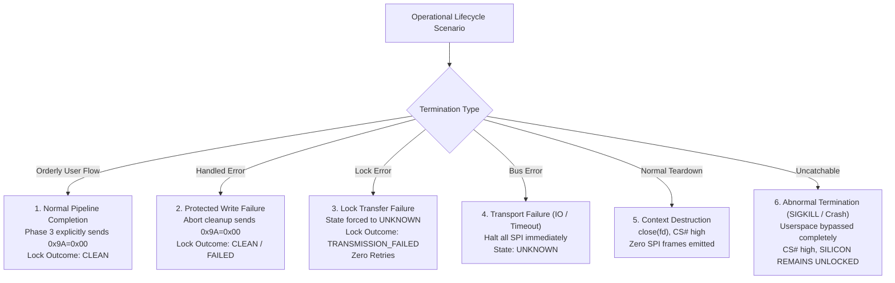

# Stage 2C.5C.2 — Cleanup Semantics, Abort Handlers, and Failure Review

**Document ID:** `STAGE2C5C2_CLEANUP_AND_FAILURE_REVIEW`  
**Date:** 2026-11-02  
**Target Hardware:** FocalTech FT9362 / FW9369  
**Source Under Audit:**
- [`src/fw9369_state.c`](file:///home/titan/fte3600-linux-driver/tools/fw9369-mock/src/fw9369_state.c#L62-L75)
- [`src/fw9369_transport_hw.c`](file:///home/titan/fte3600-linux-driver/tools/fw9369-mock/src/fw9369_transport_hw.c#L204-L211)
- [`include/fw9369_state.h`](file:///home/titan/fte3600-linux-driver/tools/fw9369-mock/include/fw9369_state.h)
**Execution Boundary:** Strictly static architecture and offline unit testing. Zero hardware operations authorized.

---

## 1. Executive Summary

A critical requirement of Stage 2C.5C.2 is to conduct a realistic, unvarnished audit of cleanup behavior under both planned and unplanned termination. 

Previous reviews frequently used terms like "RAII cleanup" or "guaranteed relock wrapper." While structured cleanup patterns exist in source code for orderly error paths, claiming that software "guarantees" a lock command across all termination modes is technically false.

This review classifies cleanup behavior across six specific operational scenarios and permanently establishes the boundary between orderly software teardown and uncatchable abnormal termination.

---

## 2. Comprehensive Cleanup Audit Across 6 Scenarios

### Scenario 1: Normal Completion
- **Code Path:** [`fw9369_state.c`](file:///home/titan/fte3600-linux-driver/tools/fw9369-mock/src/fw9369_state.c#L230-L236).
- **Behavior:**
  - After completing protected analog trim writes, `fw9369_pipeline_run()` issues `write_byte(t, FW9369_REG_PROTECT_9A, FW9369_KEY_LOCK)`.
  - The transport transitions from `FW9369_LOCK_STATE_ASSUMED_UNLOCKED` through `LOCK_COMMAND_SENT` to `FW9369_LOCK_STATE_ASSUMED_LOCKED`.
  - `ctx->lock_outcome` is recorded as `FW9369_LOCK_TRANSMITTED_CLEAN`.
  - The pipeline proceeds to subsequent phases with the sensor safely assumed locked.

### Scenario 2: Protected-Register Write Failure
- **Code Path:** [`fw9369_state.c`](file:///home/titan/fte3600-linux-driver/tools/fw9369-mock/src/fw9369_state.c#L223-L245).
- **Behavior:**
  - If writing to `0x00C0`, `0x00C1`, or `0x00C2` returns `-EIO` or `-EMSGSIZE`:
  - The error is captured in `trim_err`.
  - Execution immediately executes the structured lock write: `write_byte(t, FW9369_REG_PROTECT_9A, FW9369_KEY_LOCK)`.
  - If the lock write succeeds, `ctx->lock_outcome` is `FW9369_LOCK_TRANSMITTED_CLEAN`.
  - If the lock write fails, `ctx->lock_outcome` is `FW9369_LOCK_TRANSMISSION_FAILED`.
  - Function branches to `fail:`, invoking [`fw9369_pipeline_abort_cleanup()`](file:///home/titan/fte3600-linux-driver/tools/fw9369-mock/src/fw9369_state.c#L62-L75).

### Scenario 3: Lock Transfer Failure
- **Code Path:** [`src/fw9369_transport_hw.c`](file:///home/titan/fte3600-linux-driver/tools/fw9369-mock/src/fw9369_transport_hw.c#L380-L388).
- **Behavior:**
  - If `write_byte(0x9A, 0x00)` fails during `ioctl()` (e.g. `-EIO`, short transfer `-EMSGSIZE`, or unexpected count `-EPROTO`):
  - The transport **forces `ctx->lock_state = FW9369_LOCK_STATE_UNKNOWN`**.
  - It does **NOT** retry the lock write.
  - The pipeline records `ctx->lock_outcome = FW9369_LOCK_TRANSMISSION_FAILED`.
  - The unknown, unsafe state is exposed cleanly to the operator.

### Scenario 4: Transport Failure (Bus Glitch, Kernel Timeout)
- **Code Path:** [`src/fw9369_transport_hw.c`](file:///home/titan/fte3600-linux-driver/tools/fw9369-mock/src/fw9369_transport_hw.c#L350-L388).
- **Behavior:**
  - Any system call failure in `ioctl()` returns the negative error code immediately.
  - Transport halts further SPI submission.
  - State transitions to `FW9369_LOCK_STATE_UNKNOWN`.

### Scenario 5: Context Destruction (`fw9369_hw_transport_destroy`)
- **Code Path:** [`src/fw9369_transport_hw.c`](file:///home/titan/fte3600-linux-driver/tools/fw9369-mock/src/fw9369_transport_hw.c#L497-L507).
- **Behavior:**
  - `hw_close(ctx)` is invoked, calling `close(ctx->fd)`.
  - Kernel driver deasserts CS# high.
  - Memory allocated for `ctx` and `t` is freed via `free()`.
  - **Crucial Distinction:** Destroying the transport context **does not emit any SPI clock cycles or MOSI bytes**. If the hardware was in an unlocked or unknown state prior to destruction, destruction does **not** lock it.

### Scenario 6: Abnormal Termination (`SIGKILL`, Process Crash, Kernel Panic, Power Loss)
- **Mechanism:**
  - An uncatchable signal (`kill -9`), segmentation fault (`SIGSEGV`), kernel OOM killer invocation, or power loss abruptly terminates the userspace process.
  - **No userspace code executes. Signal handlers, RAII destructors, and cleanup functions are completely bypassed.**
  - The Linux kernel closes file descriptors. The Intel LPSS SPI hardware holds CS# high (inactive).
  - **NO LOCK COMMAND (`0x9A = 0x00`) IS EVER EMITTED.**
  - **Physical Silicon Consequence:** Because auxiliary standby power ($V_{DDIO}$) remains energized and Pad 14 (reset) remains locked high, **THE FT9362 SILICON REMAINS PERMANENTLY UNLOCKED IN HARDWARE**.

---

## 3. Debunking the "Guaranteed RAII Relock" Myth

To maintain absolute documentation and engineering integrity, this review strikes down misleading descriptions:

> [!WARNING]
> **Documentation Correction: RAII Scope Limitations**
> - Software constructs (such as structured cleanup functions or `goto fail` blocks) only execute during **handled, orderly userspace error returns**.
> - Software constructs **CANNOT** guarantee a lock command after `SIGKILL`, sudden process crash, kernel panic, or power interruption.
> - Anyone claiming that "RAII guarantees the sensor is relocked under all circumstances" is asserting a technical falsehood.
> - Under abnormal termination during the unlocked window, the **ONLY** physical recovery mechanism is an ACPI S5 cold reboot.

---

## 4. Invariant Rules for Cleanup Handlers

1. **Zero Blind Retries:**
   - If a lock write fails during cleanup, the cleanup handler must **NOT** loop or retry. Retrying on a faulted SPI bus can shift corrupted opcodes into adjacent sensor registers.
2. **Zero Concealment:**
   - A cleanup handler must never swallow an error or set a fake success state. If `write_byte(0x9A, 0x00)` fails, `ctx->lock_outcome` must be explicitly recorded as `FW9369_LOCK_TRANSMISSION_FAILED`.
3. **Fail-Closed State Retention:**
   - If a cleanup write fails, the transport context must remain in `FW9369_LOCK_STATE_UNKNOWN`.

---

## 5. Offline Test Verification

Test Suite 11 in `tests/test_runner.c` verifies cleanup and failure semantics:
- Context destruction while in `UNKNOWN` executes safely without crashing.
- Failed lock during cleanup forces `lock_outcome = FW9369_LOCK_TRANSMISSION_FAILED`.
- Ioctl failure in lock write calls `ioctl` exactly once with zero retries.
- Subsequent operations on recreated contexts remain blocked in `UNKNOWN`.

---

## 6. Audit Conclusion

Cleanup semantics are strictly characterized and decoupled from uncatchable termination realities. The transport enforces zero retries, zero state concealment, and clear acknowledgment that physical protection after abnormal termination requires an authentic ACPI S5 power cut.
