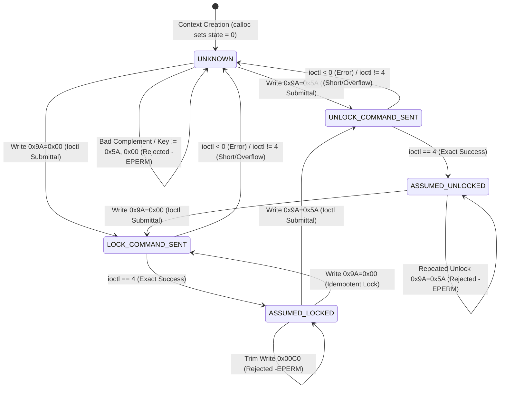

# Stage 2C.5C.2 — Register 0x9A Software Knowledge State Model

**Document ID:** `STAGE2C5C2_LOCK_STATE_MODEL`  
**Date:** 2026-11-02  
**Target Hardware:** FocalTech FT9362 / FW9369  
**Source Under Audit:**
- [`include/fw9369_transport_hw.h`](file:///home/titan/fte3600-linux-driver/tools/fw9369-mock/include/fw9369_transport_hw.h)
- [`src/fw9369_transport_hw.c`](file:///home/titan/fte3600-linux-driver/tools/fw9369-mock/src/fw9369_transport_hw.c)
- [`src/fw9369_state.c`](file:///home/titan/fte3600-linux-driver/tools/fw9369-mock/src/fw9369_state.c)
**Execution Boundary:** Strictly static architecture and offline unit testing. Zero hardware operations authorized.

---

## 1. Executive Summary

In Stage 2C.5B and Stage 2C.5C.1, userspace protection tracking for register `0x9A` relied on a simplistic binary boolean: `bool is_unlocked`. While this prevented illegal register allowlist fallthrough, the boolean representation was fundamentally inadequate for modeling the physical and protocol uncertainties of SPI hardware communication.

Specifically, a boolean model cannot distinguish between:
1. A sensor known to be locked;
2. An unlock command currently in flight;
3. A command whose SPI transfer failed midway after shifting partial bits;
4. A newly created context whose prior hardware history is completely unknown.

This document presents the hardened, 5-state software knowledge model designed and implemented in Stage 2C.5C.2.

---

## 2. Software Knowledge States vs. Physical Silicon Reality

A primary safety finding of this project is the **absence of in-band lock status telemetry**. The FocalTech FT9362 silicon provides no readable status register, flag, or interrupt indicating whether the analog trim write latch is physically open or closed. Register `0x9A` is strictly write-only.

Consequently, any userspace state representation must be understood as a **Software Knowledge Model**, not a verified physical state:

```text
       +-------------------------------------------------------------+
       |   EPISTEMIC BOUNDARY: KNOWLEDGE VS. SILICON REALITY         |
       |                                                             |
       |   Software States represent what the userspace transport    |
       |   knows based on validated commands transmitted and kernel  |
       |   ioctl return values.                                      |
       |                                                             |
       |   They DO NOT represent physical silicon confirmations.     |
       |   Physical silicon state remains unverified in-band.        |
       +-------------------------------------------------------------+
```

---

## 3. The Five Hardened Lock States

The state model is formally declared in [`include/fw9369_transport_hw.h`](file:///home/titan/fte3600-linux-driver/tools/fw9369-mock/include/fw9369_transport_hw.h#L16-L24):

```c
enum fw9369_lock_state {
    FW9369_LOCK_STATE_UNKNOWN = 0,         /* Initial state; physical silicon state is completely unknown */
    FW9369_LOCK_STATE_ASSUMED_LOCKED,      /* Lock command transmitted and verified shifted; assumed locked */
    FW9369_LOCK_STATE_UNLOCK_COMMAND_SENT, /* Unlock command currently in flight / transmission attempted */
    FW9369_LOCK_STATE_ASSUMED_UNLOCKED,    /* Unlock command transmitted and verified shifted; assumed unlocked */
    FW9369_LOCK_STATE_LOCK_COMMAND_SENT,   /* Lock command currently in flight / transmission attempted */
};
```

### State Semantics and Invariants:

| State | Numerical Value | Operational Meaning | Permitted Operations | Invariant Guarantees |
| :--- | :---: | :--- | :--- | :--- |
| `FW9369_LOCK_STATE_UNKNOWN` | `0` | Default initial state upon context creation, or after any transfer error, short transfer, or interruption. | Lock write (`0x9A=0x00`) permitted. Normal registers permitted. | **Protected trim writes (`0x00C0..0x00C2`) are STRICTLY REJECTED (`-EPERM`).** |
| `FW9369_LOCK_STATE_ASSUMED_LOCKED` | `1` | A lock command (`0x9A=0x00`) completed with exact byte count (`ret == 4`). | Unlock write (`0x9A=0x5A`) permitted. Idempotent lock permitted. Normal registers permitted. | Protected trim writes are **STRICTLY REJECTED (`-EPERM`)**. |
| `FW9369_LOCK_STATE_UNLOCK_COMMAND_SENT` | `2` | Unlock packet `[0x09, 0xF6, 0x9A, 0x5A]` was validated and handed to kernel `ioctl`. Transfer is in flight. | None (transient in-flight state). | If `ioctl` fails or returns non-4, transitions immediately to `UNKNOWN`. |
| `FW9369_LOCK_STATE_ASSUMED_UNLOCKED` | `3` | Unlock packet completed `ioctl` with exact return count (`ret == 4`). | **Protected trim writes (`0x00C0..0x00C2`) are PERMITTED.** Lock write (`0x9A=0x00`) permitted. | **Repeated unlock writes are REJECTED (`-EPERM`).** |
| `FW9369_LOCK_STATE_LOCK_COMMAND_SENT` | `4` | Lock packet `[0x09, 0xF6, 0x9A, 0x00]` was validated and handed to kernel `ioctl`. Transfer is in flight. | None (transient in-flight state). | If `ioctl` fails or returns non-4, transitions immediately to `UNKNOWN`. |

---

## 4. State Transition Diagram and Rules



---

## 5. Transition Decision Table

| Current State | Requested Transaction | Pre-Ioctl Validation | In-Flight State | Outcome on `ret == len` | Outcome on `ret < 0` or `ret != len` |
| :--- | :--- | :---: | :---: | :---: | :---: |
| `UNKNOWN` | Write Trim `0x00C0` | **REJECTED (`-EPERM`)** | — | — | — |
| `UNKNOWN` | Write Lock `0x9A = 0x00` | **ACCEPTED** | `LOCK_COMMAND_SENT` | `ASSUMED_LOCKED` | `UNKNOWN` |
| `UNKNOWN` | Write Unlock `0x9A = 0x5A` | **ACCEPTED** | `UNLOCK_COMMAND_SENT`| `ASSUMED_UNLOCKED` | `UNKNOWN` |
| `ASSUMED_LOCKED` | Write Trim `0x00C0` | **REJECTED (`-EPERM`)** | — | — | — |
| `ASSUMED_LOCKED` | Write Lock `0x9A = 0x00` | **ACCEPTED** | `LOCK_COMMAND_SENT` | `ASSUMED_LOCKED` | `UNKNOWN` |
| `ASSUMED_LOCKED` | Write Unlock `0x9A = 0x5A` | **ACCEPTED** | `UNLOCK_COMMAND_SENT`| `ASSUMED_UNLOCKED` | `UNKNOWN` |
| `ASSUMED_UNLOCKED` | Write Trim `0x00C0` | **ACCEPTED** | Unchanged | `ASSUMED_UNLOCKED` | `ASSUMED_UNLOCKED` (Triggers Abort Cleanup) |
| `ASSUMED_UNLOCKED` | Write Unlock `0x9A = 0x5A` | **REJECTED (`-EPERM`)** | — | — | — |
| `ASSUMED_UNLOCKED` | Write Lock `0x9A = 0x00` | **ACCEPTED** | `LOCK_COMMAND_SENT` | `ASSUMED_LOCKED` | `UNKNOWN` |

---

## 6. Implementation Code Inspection

### 6.1 Context Storage and Inspection
In [`src/fw9369_transport_hw.c`](file:///home/titan/fte3600-linux-driver/tools/fw9369-mock/src/fw9369_transport_hw.c#L29-L36):
```c
struct hw_context {
    struct fw9369_hw_config config;
    struct fw9369_hw_ops    ops;
    int                     fd;
    enum fw9369_lock_state  lock_state; /* Tracks 0x9A protected register software knowledge */
    struct hw_log_entry     log[HW_MAX_LOG_PACKETS];
    size_t                  log_count;
};
```
Because `fw9369_hw_transport_create_with_ops()` allocates `hw_context` via `calloc(1, sizeof(*ctx))`, `lock_state` is guaranteed to initialize to `0` (`FW9369_LOCK_STATE_UNKNOWN`).

### 6.2 Pre-Ioctl Allowlist Gate
In [`src/fw9369_transport_hw.c`](file:///home/titan/fte3600-linux-driver/tools/fw9369-mock/src/fw9369_transport_hw.c#L265-L278):
```c
if (reg == FW9369_REG_PROTECT_9A) {
    if (val == FW9369_KEY_UNLOCK) {
        /* Disallow repeated unlock while already assumed unlocked */
        if (ctx->lock_state != FW9369_LOCK_STATE_ASSUMED_UNLOCKED)
            packet_valid = true;
    } else if (val == FW9369_KEY_LOCK) {
        packet_valid = true;
    }
}
```
And for protected analog trim words (`0x00C0..0x00C2`) at lines 294–300 and 313–319:
```c
if (reg >= 0x00C0 && reg <= 0x00C2) {
    if (ctx->lock_state == FW9369_LOCK_STATE_ASSUMED_UNLOCKED)
        packet_valid = true;
}
```

### 6.3 In-Flight and Outcome Processing
In [`src/fw9369_transport_hw.c`](file:///home/titan/fte3600-linux-driver/tools/fw9369-mock/src/fw9369_transport_hw.c#L337-L388):
```c
/* Track in-flight state transitions */
bool is_unlock_cmd = (len == 4 && tx[0] == FW9369_OP_BYTE_WRITE &&
                      tx[2] == FW9369_REG_PROTECT_9A && tx[3] == FW9369_KEY_UNLOCK);
bool is_lock_cmd   = (len == 4 && tx[0] == FW9369_OP_BYTE_WRITE &&
                      tx[2] == FW9369_REG_PROTECT_9A && tx[3] == FW9369_KEY_LOCK);

if (is_unlock_cmd) {
    ctx->lock_state = FW9369_LOCK_STATE_UNLOCK_COMMAND_SENT;
} else if (is_lock_cmd) {
    ctx->lock_state = FW9369_LOCK_STATE_LOCK_COMMAND_SENT;
}

int ret = ctx->ops.ioctl_fn(ctx->fd, SPI_IOC_MESSAGE(1), &tr);
/* ... status calculation ... */

if (is_unlock_cmd) {
    ctx->lock_state = (status == 0) ? FW9369_LOCK_STATE_ASSUMED_UNLOCKED
                                    : FW9369_LOCK_STATE_UNKNOWN;
} else if (is_lock_cmd) {
    ctx->lock_state = (status == 0) ? FW9369_LOCK_STATE_ASSUMED_LOCKED
                                    : FW9369_LOCK_STATE_UNKNOWN;
}
```

---

## 7. Audit Conclusion

The 5-state model completely replaces the simplistic boolean. It eliminates false certainty, treats all transfer anomalies as UNKNOWN, prevents protected writes during unknown states, and documents the permanent boundary between userspace knowledge and physical silicon reality.
