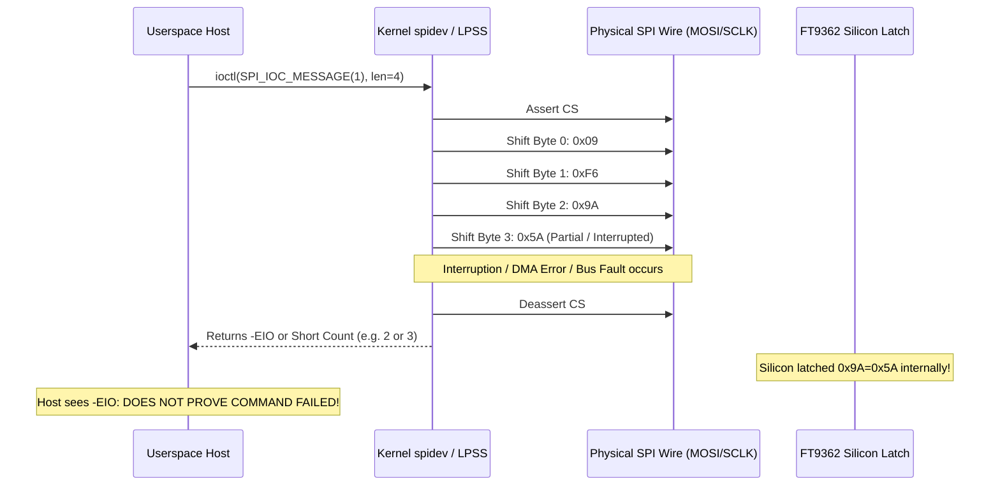

# Stage 2C.5C.2 — Uncertain Transfer Analysis and Hardware Outcome Handling

**Document ID:** `STAGE2C5C2_UNCERTAIN_TRANSFER_ANALYSIS`  
**Date:** 2026-11-02  
**Target Hardware:** FocalTech FT9362 / FW9369  
**Source Under Audit:**
- [`src/fw9369_transport_hw.c`](file:///home/titan/fte3600-linux-driver/tools/fw9369-mock/src/fw9369_transport_hw.c)
- [`include/fw9369_transport_hw.h`](file:///home/titan/fte3600-linux-driver/tools/fw9369-mock/include/fw9369_transport_hw.h)
**Execution Boundary:** Strictly static analysis and offline unit testing. Zero hardware operations authorized.

---

## 1. Executive Summary

In synchronous bus protocols like SPI, software typically receives a return value from a kernel system call (such as `ioctl(SPI_IOC_MESSAGE)`). A common programming fallacy is treating a negative kernel return value as proof that "the command was not transmitted" or that "the hardware remains in its prior state."

On a physical SPI bus, once the controller begins clocking data onto the MOSI line, electrical state changes occur inside the peripheral silicon. If the transfer is interrupted midway—due to a bus error, DMA underrun, signal delivery (`EINTR`), or controller timeout—**the peripheral may have already received and latched some or all of the command bytes**.

This document analyzes the physical wire dynamics of uncertain transfers and audits the hardened error handling implemented in `fw9369_transport_hw.c`.

---

## 2. Wire Dynamics of Failed Transfers

Consider a 4-byte SPI write to register `0x9A`:
$$\text{MOSI Frame: } [ \underbrace{0x09}_{\text{Byte Write}}, \underbrace{0xF6}_{\text{Complement}}, \underbrace{0x9A}_{\text{Address}}, \underbrace{0x5A}_{\text{Unlock Key}} ]$$
This transfer requires shifting 32 clock cycles on SCLK with CS# held low.



### Physical Realities:
1. **MOSI Shift Timing:** Byte 3 (`0x5A`) is the magic unlock key. If the host CPU receives an interrupt or DMA error during byte 3, the physical clock line may have already transitioned the required 8 bits into the FT9362 input shift register.
2. **Internal Latch Execution:** The FT9362 hardware latch activates upon the rising edge of CS#. When the kernel driver aborts a failed transfer, it deasserts CS# high. The rising edge of CS# can trigger the internal silicon write latch, **leaving the chip physically UNLOCKED**.
3. **Short Transfers (`ret < len`):** If the kernel shifts 2 or 3 bytes before terminating, the address `0x9A` was written with an incomplete byte. The internal state machine of the sensor may be stranded between nibbles.
4. **Unexpected Byte Counts (`ret > len`):** If the kernel reports shifting more bytes than requested (`-EPROTO`), the SPI core FIFO desynchronized, and trailing dummy bytes may have been clocked into the sensor.

---

## 3. Analysis of Specific Transfer Failure Modes

The implementation in [`src/fw9369_transport_hw.c`](file:///home/titan/fte3600-linux-driver/tools/fw9369-mock/src/fw9369_transport_hw.c#L350-L388) categorizes and handles every possible return value:

### 3.1 Negative Kernel Return (`ret < 0`, `status = -errno`)
- **Possible Errnos:**
  - `-EIO`: Hardware bus error, DMA contention, or PCH controller failure.
  - `-EINTR`: System call interrupted by an asynchronous process signal.
  - `-ETIMEDOUT`: Controller timeout.
  - `-EBUSY`: SPI master hardware busy with higher-priority transaction.
- **Flawed Assumption:** *"The command failed, so the sensor is still locked."*
- **Hardened Reality:**
  - Bits may have reached the sensor before the error occurred.
  - Software cannot know whether the silicon latch opened or remained closed.
  - **Hardened Action:** Transition unconditionally to `FW9369_LOCK_STATE_UNKNOWN`.

### 3.2 Short Transfer (`0 <= ret < len`, `status = -EMSGSIZE`)
- **Physical Manifestation:** The kernel shifted fewer than 4 bytes (e.g., `ret == 1, 2, 3`).
- **Hazard:** The sensor received a truncated SPI packet. A truncated opcode complement or missing data byte corrupts the sensor's internal shift register state.
- **Hardened Action:** Detected as an explicit protocol size violation (`-EMSGSIZE`). State transitions unconditionally to `FW9369_LOCK_STATE_UNKNOWN`.

### 3.3 Unexpected Positive Return (`ret > len`, `status = -EPROTO`)
- **Physical Manifestation:** The kernel SPI subsystem returned an integer greater than requested bytes (e.g., `ret == 6` on a 4-byte request).
- **Hazard:** Indicates kernel FIFO corruption or SPI subsystem desynchronization.
- **Hardened Action:** Detected as an anomalous protocol return (`-EPROTO`). State transitions unconditionally to `FW9369_LOCK_STATE_UNKNOWN`.

---

## 4. Symmetry Between Unlock and Lock Failures

A critical design principle of Stage 2C.5C.2 is applying symmetrical defensive reasoning to both unlock and lock commands:

```text
       +-------------------------------------------------------------+
       |   THE DUAL FAILURE PRINCIPLE                                |
       |                                                             |
       |   1. A failed UNLOCK command cannot be assumed unreceived.  |
       |      Silicon may be physically UNLOCKED.                    |
       |      Knowledge State: UNKNOWN                               |
       |                                                             |
       |   2. A failed LOCK command cannot be assumed received.      |
       |      Silicon may be physically UNLOCKED / UNSAFE.           |
       |      Knowledge State: UNKNOWN                               |
       +-------------------------------------------------------------+
```

### Why a Failed Lock Must NEVER Result in `ASSUMED_LOCKED`:
If `write_byte(0x9A, 0x00)` fails:
- If the software assumed the sensor locked, it would report clean completion to the caller.
- The caller might terminate the process, leaving the analog trim registers open to accidental corruption or ESD damage.
- The hardened transport forces `lock_state = FW9369_LOCK_STATE_UNKNOWN`, raises the error code immediately, and forbids masking the failure.

---

## 5. Absolute Prohibition of Automatic Retries

A naive instinct in driver development is to insert retry loops around failed SPI transfers (e.g., `while (retries++ < 3)`).

### Why Automatic Retries are Strictly Prohibited on FW9369 Silicon:
1. **Out-of-Sync Packet Desynchronization:** If a previous transfer was truncated (e.g. 2 bytes clocked), sending another 4-byte packet immediately shifts the first 2 bytes of the new packet into the remaining slots of the old command. This corrupts register addresses and can trigger unintended writes to adjacent registers.
2. **Missing In-Band Synchronization:** The FT9362 has no sync byte or parity bit to discard fragmented packets.
3. **State Machine Multiplication:** Retrying an unlock command while the sensor is already processing a fragmented command multiplies the uncertainty.
4. **Hardened Enforcement:** `fw9369_transport_hw.c` contains **ZERO automatic retries**. Every error is returned immediately to the caller.

---

## 6. Offline Test Verification

Test Suite 11 in `tests/test_runner.c` exercises every uncertain transfer outcome:

| Failure Test Scenario | Simulated Kernel Condition | Expected Status | Resulting Lock State | Test Assertion |
| :--- | :--- | :---: | :---: | :---: |
| **Unlock Negative Ioctl** | `fake_ioctl_force_eio = true` | `-EIO` | `FW9369_LOCK_STATE_UNKNOWN` | **PASS** |
| **Unlock Short Transfer** | `fake_ioctl_return_len = 2` | `-EMSGSIZE` | `FW9369_LOCK_STATE_UNKNOWN` | **PASS** |
| **Unlock Unexpected Count**| `fake_ioctl_return_len = 6` | `-EPROTO` | `FW9369_LOCK_STATE_UNKNOWN` | **PASS** |
| **Lock Negative Ioctl** | `fake_ioctl_force_eio = true` | `-EIO` | `FW9369_LOCK_STATE_UNKNOWN` | **PASS** |
| **Lock Short Transfer** | `fake_ioctl_return_len = 1` | `-EMSGSIZE` | `FW9369_LOCK_STATE_UNKNOWN` | **PASS** |
| **Lock Unexpected Count** | `fake_ioctl_return_len = 8` | `-EPROTO` | `FW9369_LOCK_STATE_UNKNOWN` | **PASS** |
| **Zero Automatic Retries** | Force error; check call count | `-EIO` | `fake_ioctl_call_count == 1` | **PASS** |

---

## 7. Audit Conclusion

The uncertain transfer handling in `fw9369_transport_hw.c` is verified as mathematically and physically sound. It eliminates false assumptions regarding negative ioctl results, enforces dual-failure transitions to `UNKNOWN`, and strictly rejects automatic retries.
