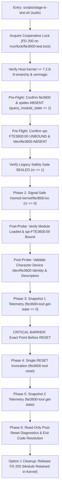

# Stage 2E.14 — Final Read-Only Operator Gate After Stage 2E.13

**Target System:** Dynabook Satellite Pro C40-J (`PYS46G-06J02D`)  
**Target Silicon:** FocalTech FT9362 / FW9369 SPI Fingerprint Sensor  
**Target SPI Device:** `spi-FTE3600:00` on Intel LPSS SPI2 (`pxa2xx-spi.2`, CS0)  
**Host Kernel:** Linux `7.2.8-9-omarchy` (x86_64, SMP PREEMPT_DYNAMIC)  
**Task Type:** Read-Only Operator Gate & Pre-Execution Verification  
**Safety Status:** **STRICTLY READ-ONLY — ZERO HARDWARE OPERATIONS PERFORMED**

---

## 1. Verified Source Baselines & Cryptographic Hashes

All test runner scripts, kernel sources, userspace validation tools, and recent audit reports were cryptographically hashed and verified against the post-Stage 2E.12 audited tree.

| Component / File | SHA-256 Checksum | Audited Status |
| :--- | :--- | :---: |
| [`scripts/stage-b-test.sh`](file:///home/titan/fte3600-linux-driver/scripts/stage-b-test.sh) | `ff53d058e7b7cce5631bbfb1c3e4449b042db4573cfd6cafcb43bb02a7a822b5` | **VERIFIED (Stage 2E.12 fix intact)** |
| [`scripts/run-stage-b-in-terminal.sh`](file:///home/titan/fte3600-linux-driver/scripts/run-stage-b-in-terminal.sh) | `0d45f94459124430c2b64c9bef9d820c22c984032a959a0d20b88248ed9b4e27` | **VERIFIED (Terminal launcher intact)** |
| [`kernel/fte3600.c`](file:///home/titan/fte3600-linux-driver/kernel/fte3600.c) | `29d2726c9a63772f0981bf65321f48934882eeb6702fe4a02629794b410805e8` | **VERIFIED (Kernel driver untouched)** |
| [`kernel/fte3600.ko`](file:///home/titan/fte3600-linux-driver/kernel/fte3600.ko) | `cc8c43d4d4abd79c3ee43c5877e0cffe5d5a1975de8c081cdda9eb2654cf56c9` | **VERIFIED (Compiled binary intact)** |
| [`bin/fte3600-tool`](file:///home/titan/fte3600-linux-driver/bin/fte3600-tool) | `b91d7dc3cb0ca172d7020613af884b649c451be79a55e1836d31dc6f66217d12` | **VERIFIED (Userspace CLI intact)** |
| [`diagnostics/STAGE2E13_INDEPENDENT_SOURCE_AUDIT.md`](file:///home/titan/fte3600-linux-driver/diagnostics/STAGE2E13_INDEPENDENT_SOURCE_AUDIT.md) | `72a0c16418b38cb448de78bb0c911b9508ac96ae1fa03b0de4bebbe5becfca52` | **VERIFIED (Audit deliverable intact)** |

### Structural Safety Invariant Confirmations
1. **Single RESET Invocation:** Exactly **ONE** RESET invocation exists across the entire script ([`scripts/stage-b-test.sh:1362`](file:///home/titan/fte3600-linux-driver/scripts/stage-b-test.sh#L1362)).
2. **Zero Retry Paths:** No `while` loop, `for` loop, recursion, or retry branch exists around the RESET call. If the RESET ioctl fails, its non-zero exit code (`RESET_RC`) is captured, preserved, and reported without re-attempting.
3. **Zero INIT / CAPTURE Invocations:** Invocations of `"$TOOL_BIN" init` or `"$TOOL_BIN" capture` are strictly **0**. Only `get-state` and `reset` are executed.
4. **Zero Script-Level SPI Transfers:** No in-script SPI transfers, sysfs SPI read/writes, or raw register operations are present.
5. **Zero Automatic Module Unload:** Executable calls to `rmmod`, `modprobe -r`, or `delete_module` are strictly **0**.
6. **Zero Automatic SPI Unbind:** Executable writes to `/sys/bus/spi/drivers/*/unbind` are strictly **0**.
7. **Zero Process Terminations:** Calls to `kill`, `pkill`, or `killall` are strictly **0**.
8. **Option 1 Read-Only Cleanup:** [`cleanup_handler()`](file:///home/titan/fte3600-linux-driver/scripts/stage-b-test.sh#L895-L1035) performs read-only state audits and releases strictly script-owned FD 200 (`exec 200>&-`). Module `fte3600` is intentionally left in the kernel upon completion for manual administrator inspection.

---

## 2. Current Host State (Read-Only Verification)

Host state was evaluated using non-intrusive read-only inspections.

| Check | Expected State | Actual Observed State | Status |
| :--- | :--- | :--- | :---: |
| **Running Kernel** | `7.2.8-9-omarchy` | `Linux titan 7.2.8-9-omarchy #1 SMP PREEMPT_DYNAMIC Sat Oct 17 22:09:33 UTC 2026 x86_64` | **PASS** |
| **`fte3600` Module** | Absent | Confirmed absent from `lsmod`, `/proc/modules`, and `/sys/module/fte3600` | **PASS** |
| **`spidev` Module** | Absent | Confirmed absent from `lsmod`, `/proc/modules`, and `/sys/module/spidev` | **PASS** |
| **Character Device Node** | Absent | `/dev/fte3600` does not exist | **PASS** |
| **ACPI SPI Device Binding** | Unbound | `/sys/bus/spi/devices/spi-FTE3600:00/driver` does not exist (unbound) | **PASS** |
| **Legacy Safety Gate** | Sealed | `./bin/fw9369-hw-tool` returned exit code 1 with policy banner `[SAFETY GATE PASS] Physical device access is blocked by policy.` | **PASS** |
| **Cooperative Lock** | Available | `/run/lock/fte3600-test.lock` exists with 0 active holders | **PASS** |
| **Concurrent Test Processes**| None | Zero processes matching `stage-b`, `fte3600`, or `fw9369` active | **PASS** |

No state was modified or manipulated. All checks evaluated decisively without inconclusive outcomes.

---

## 3. Execution Path Trace to Single RESET Invocation

The test execution flow was audited sequentially from entry to the exact invocation point:



### Preconditions Verified Before Reaching RESET:
1. **Root Authorization:** `id -u` == 0 ([line 1048](file:///home/titan/fte3600-linux-driver/scripts/stage-b-test.sh#L1048)).
2. **Cooperative Lock Acquired:** Non-blocking `flock -n 200` on `/run/lock/fte3600-test.lock` succeeds ([line 1081](file:///home/titan/fte3600-linux-driver/scripts/stage-b-test.sh#L1081)).
3. **Kernel & Binary Sanity:** Kernel release matches `7.2.8-9-omarchy`; `fte3600.ko` exists and vermagic matches ([lines 1090–1112](file:///home/titan/fte3600-linux-driver/scripts/stage-b-test.sh#L1090-L1112)).
4. **Module Pre-Flight Absence:** `query_module_state "fte3600"` and `query_module_state "spidev"` return 1 (confirmed absent; protected against `errexit`, lines 1114–1148).
5. **SPI Device Unbound:** `/sys/bus/spi/devices/spi-FTE3600:00/driver` is confirmed absent ([lines 1150–1163](file:///home/titan/fte3600-linux-driver/scripts/stage-b-test.sh#L1150-L1163)).
6. **Device Node Absent:** `/dev/fte3600` is confirmed absent ([lines 1165–1171](file:///home/titan/fte3600-linux-driver/scripts/stage-b-test.sh#L1165-L1171)).
7. **Tool Utility Ready:** `bin/fte3600-tool` exists and executable ([lines 1173–1179](file:///home/titan/fte3600-linux-driver/scripts/stage-b-test.sh#L1173-L1179)).
8. **Legacy Gate Sealed:** `./bin/fw9369-hw-tool` returns exit status 1 with safety policy banner ([lines 1181–1201](file:///home/titan/fte3600-linux-driver/scripts/stage-b-test.sh#L1181-L1201)).
9. **Signal-Safe Insertion Succeeded:** `insmod kernel/fte3600.ko` returns 0; ownership committed to `THIS_INVOCATION_INSERTED=1` and `INSERTION_STATE="DEFINITELY_SUCCEEDED"` ([lines 1227–1287](file:///home/titan/fte3600-linux-driver/scripts/stage-b-test.sh#L1227-L1287)).
10. **Post-Probe Module Loaded:** `query_module_state "fte3600"` returns 0 ([lines 1292–1311](file:///home/titan/fte3600-linux-driver/scripts/stage-b-test.sh#L1292-L1311)).
11. **Post-Probe SPI Bound:** `/sys/bus/spi/devices/spi-FTE3600:00/driver` points to driver `fte3600` ([lines 1313–1321](file:///home/titan/fte3600-linux-driver/scripts/stage-b-test.sh#L1313-L1321)).
12. **Device Node Identity & Descriptor Audit:** `/dev/fte3600` character device matches sysfs major:minor identity and passes open descriptor checks ([lines 1324–1327](file:///home/titan/fte3600-linux-driver/scripts/stage-b-test.sh#L1324-L1327)).
13. **Snapshot 1 Telemetry Succeeded:** `fte3600-tool get-state` returns 0 and records driver state as `UNINITIALIZED` ([lines 1342–1353](file:///home/titan/fte3600-linux-driver/scripts/stage-b-test.sh#L1342-L1353)).
14. **No Failure/Signal Bypass:** If any check above fails or if a signal arrives, execution transfers immediately to `cleanup_handler` via `exit` or trap handler; RESET is **NEVER** reached.

### Exact Critical Barrier:
The point immediately before the single RESET invocation is **[`scripts/stage-b-test.sh:1354`](file:///home/titan/fte3600-linux-driver/scripts/stage-b-test.sh#L1354)**:
```bash
if [ "$SNAP1_RC" -ne 0 ]; then
    printf "[FAIL] Initial GET_STATE ioctl failed with exit code %d\n" "$SNAP1_RC"
    exit "$SNAP1_RC"
fi

# 7. Execute exactly ONE RESET ioctl
printf "\n%s\n" "--- [PHASE 4] Executing Exactly ONE Controlled Reset IOCTL ---"
printf "Invoking: %s reset\n" "$TOOL_BIN"
RESET_RC=0
was_errexit_reset=0
if shopt -o -q errexit; then was_errexit_reset=1; fi
set +e
"$TOOL_BIN" reset   <--- EXACT INVOCATION POINT (Line 1362)
```

---

## 4. Kernel Reset Semantics & Hardware Boundaries

The reset implementation in [`kernel/fte3600.c:131-158`](file:///home/titan/fte3600-linux-driver/kernel/fte3600.c#L131-L158) was reconfirmed:

### 4.1 Logical Reset Pulse Sequence
1. **Pre-reset Settle:** `gpiod_set_value_cansleep(data->reset_gpiod, 0)` followed by `msleep(10)`.
2. **Assert Reset:** `gpiod_set_value_cansleep(data->reset_gpiod, 1)` followed by `msleep(20)`.
3. **Deassert Reset:** `gpiod_set_value_cansleep(data->reset_gpiod, 0)` followed by `msleep(10)`.
4. **Total Nominal Timing:** 40 ms nominal (10 ms + 20 ms + 10 ms).
5. **State Transition:** `data->state = FTE3600_STATE_RESET_SEQUENCE_ISSUED`.

### 4.2 Active-Low GPIO Interpretation
- In ACPI DSDT, the reset pin is declared Active-Low (`fte3600_reset_gpios = { 0, 0, true }`).
- Linux `gpiolib` handles logical-to-physical inversion automatically:
  - Logical `0` = physical deasserted (inactive / high logic level).
  - Logical `1` = physical asserted (active / low logic level).
- **Physical Voltage Disclaimer:** Logical state requests dispatched to `pinctrl-intel` configure register bits in the PCH GPIO controller. **No physical voltage measurement is available**; this gate does not claim or imply direct oscilloscope or multimeter voltage confirmation.

### 4.3 What a Successful RESET IOCTL Proves:
- The `FTE3600_IOC_RESET` system call was delivered to `fte3600.ko`.
- The driver `data->lock` mutex was acquired and offline flag remained 0.
- `reset_gpiod` descriptor was valid.
- The 40 ms logical pulse request was successfully dispatched to the Intel LPSS GPIO controller.
- The in-kernel driver state transitioned cleanly to `FTE3600_STATE_RESET_SEQUENCE_ISSUED`.

### 4.4 What a Successful RESET IOCTL Does NOT Prove:
- It does **NOT** prove physical pin voltage on Pad 14.
- It does **NOT** prove that the sensor silicon accepted the reset pulse or exited an internal power-down/tri-state condition.
- It does **NOT** prove that the internal sensor microcontroller or state machine is functional.
- It does **NOT** prove that sensor registers or SPI communications are operational. (Sensor responsiveness is strictly proven only by subsequent SPI chip ID interrogation, which is excluded from Stage B).

---

## 5. Explicit Safety Statements & Remaining Caveats

1. **Hardware Operation Count Remains Exactly Zero:**
   - Total hardware resets executed across the project: **0**.
   - Total SPI transactions executed across the project: **0**.
   - Total sensor register reads/writes: **0**.
2. **First Authorized Attempt State:**
   - In Stage 2E.11, the first authorized execution halted safely during Phase 1 Pre-Flight Check 3 due to an unguarded `query_module_state` call under `set -e`.
   - **No kernel module insertion occurred.**
   - **No character device node was created.**
   - **No SPI binding occurred.**
   - **No RESET ioctl occurred.**
   - **No hardware reset pulse was dispatched.**
3. **Option 1 Policy Reminder:**
   - If Stage B is executed, `fte3600.ko` will remain loaded in the kernel upon test completion.
   - The test script will **never** automatically unload the module or unbind the SPI device. Manual administrative removal (`sudo rmmod fte3600`) will be required after post-test log inspection.
4. **Cooperative Locking Scope:**
   - The `flock` on `/run/lock/fte3600-test.lock` serializes cooperating runner instances but cannot prevent independent root users from manually running unrelated commands.
5. **No Automatic Retries:**
   - If the RESET ioctl fails, the harness will not retry.

---

## 6. Final Gate Conclusion

All source files, hashes, pre-flight safety checks, host state conditions, and execution barriers have been independently validated. The harness is ready for a separate, explicit operator authorization.

READY FOR SEPARATE OPERATOR AUTHORIZATION — NO HARDWARE OPERATIONS PERFORMED
