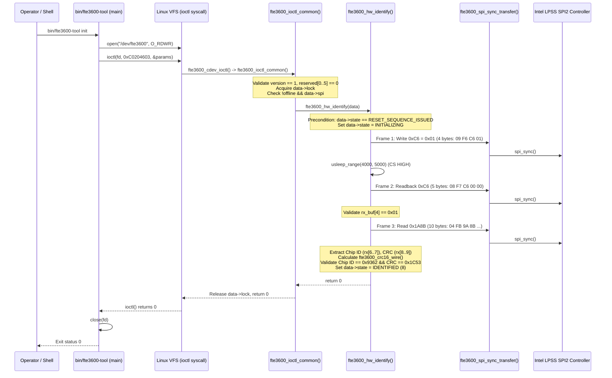

# Stage 2E.19 — UAPI and Protocol Safety Ambiguity Resolution

**Target Platform:** Dynabook Satellite Pro C40-J (`PYS46G-06J02D`)  
**Target Silicon:** FocalTech FT9362 / FW9369 SPI Fingerprint Sensor  
**Target SPI Device:** `spi-FTE3600:00` on Intel LPSS SPI2 (`pxa2xx-spi.2`, CS0)  
**Host Kernel:** Linux `7.2.8-9-omarchy` (x86_64, SMP PREEMPT_DYNAMIC)  
**Timestamp:** 2026-11-04T10:15:00+05:30  
**Audit Status:** **READ-ONLY AUDIT COMPLETE — NO HARDWARE OPERATIONS PERFORMED**

---

## 1. Executive Summary

This audit resolves all ambiguities concerning the Stage C user-to-kernel interface (UAPI), SPI frame byte definitions, protocol complement encoding versus register addresses, loaded-module binary correspondence, and operational execution boundaries.

All findings are derived from strictly read-only inspection of the driver source code, UAPI headers, userspace utility, reference implementations, and live kernel sysfs attributes. **Zero hardware operations, zero SPI transfers, zero GPIO toggles, zero module reloads, zero unbinds, and zero ioctls were executed.**

---

## 2. Resolution of INIT versus IDENTIFY

### 2.1 The Concrete Interface vs Conceptual Terminology
- **Conceptual Terminology:** Earlier stage reports (Stage 2A, Stage 2E.16, Stage 2E.17, Stage 2E.18) frequently referred to the Stage C hardware operation as "IDENTIFY", "sensor identification", or "interrogation".
- **Concrete UAPI Implementation:** There is **no ioctl named `FTE3600_IOC_IDENTIFY`**. The name "IDENTIFY" is strictly a conceptual and architectural descriptor.
- In the driver UAPI and userspace utility, the command is implemented as **`FTE3600_IOC_INIT`**, invoked in userspace via `bin/fte3600-tool init`.

### 2.2 Exact UAPI Macro, Numeric Value & Payload Structure
- **UAPI Macro Definition:**
  [`kernel/fte3600.h:96`](file:///home/titan/fte3600-linux-driver/kernel/fte3600.h#L96):
  ```c
  #define FTE3600_IOC_INIT _IOWR(FTE3600_IOC_MAGIC, 0x03, struct fte3600_init_params)
  ```
- **Linux IOCTL Encoding Breakdown:**
  - `_IOC_TYPE`: `'F'` (`0x46`, bits 8–15)
  - `_IOC_NR`: `0x03` (bits 0–7)
  - `_IOC_SIZE`: `sizeof(struct fte3600_init_params)` = `32` bytes (`0x20`, bits 16–29)
  - `_IOC_DIR`: `_IOC_READ | _IOC_WRITE` (`3`, bits 30–31)
  - **Exact 32-bit Numeric IOCTL Value:** **`0xC0204603`**

- **Payload Structure Layout (`struct fte3600_init_params`):**
  [`kernel/fte3600.h:73-77`](file:///home/titan/fte3600-linux-driver/kernel/fte3600.h#L73-L77):
  ```c
  struct fte3600_init_params {
      __u32 version;       /* Offset 0x00, 4 bytes: must equal FTE3600_UAPI_VERSION (1) */
      __u32 flags;         /* Offset 0x04, 4 bytes: initialized to 0 */
      __u32 reserved[6];   /* Offsets 0x08-0x1F, 24 bytes: must be all zeroes */
  };                       /* Total Size = 32 bytes (0x20) */
  ```

### 2.3 Userspace Invocation & Dispatch
- **Executable CLI Command:**
  ```bash
  bin/fte3600-tool init
  ```
- **Userspace Source Implementation:**
  [`tools/fte3600-tool.c:64-74`](file:///home/titan/fte3600-linux-driver/tools/fte3600-tool.c#L64-L74):
  ```c
  } else if (strcmp(argv[1], "init") == 0) {
      struct fte3600_init_params params = { .version = FTE3600_UAPI_VERSION };
      printf(">> Issuing FTE3600_IOC_INIT...\n");
      if (ioctl(fd, FTE3600_IOC_INIT, &params) < 0) {
          perror("ioctl(FTE3600_IOC_INIT)");
          close(fd);
          return 1;
      }
      printf(">> Init ioctl returned 0 (Identification Success).\n");
  }
  ```
  Note that line 73 explicitly prints `(Identification Success)`.

### 2.4 Complete Call Graph & Validation Chain


### 2.5 Callers and Scope of `fte3600_hw_identify()`
- **Call Sites:** `fte3600_hw_identify()` is invoked at **exactly ONE site**:
  [`kernel/fte3600.c:482`](file:///home/titan/fte3600-linux-driver/kernel/fte3600.c#L482) inside `case FTE3600_IOC_INIT:` of `fte3600_ioctl_common()`.
- **Zero Additional Callers:** There are no other callers anywhere in the driver, probe, open, poll, reset, or release routines.
- **Scope Limitation:** `FTE3600_IOC_INIT` performs **strictly and exclusively** the 3 identification SPI frames and the local software CRC-16 check. It does not perform sensor calibration, FIFO buffer initialization, image capture, or any subsequent sensor configuration.

---

## 3. Protocol Framing Audit: Opcode Complements vs Register Addresses

### 3.1 FocalTech SPI Framing Architecture
In FocalTech SPI protocol (sourced from `research/libfprint-fte3600/libfprint/drivers/fte3600/ft93xx.c:174-205`), every SPI command frame begins with a 2-byte header:
1. **Byte 0:** Opcode (`cmd`).
2. **Byte 1:** Bitwise One's-Complement (`~cmd`, i.e. `0xFF ^ cmd`).

The second byte is evaluated by the hardware sensor transceiver as a noise-immunity / integrity check. If Byte 1 does not match the bitwise inverse of Byte 0, the sensor ignores the SPI frame.

### 3.2 Byte-by-Byte Analysis of the Three Identification Frames

#### Frame 1: Transceiver Clock Un-Gate Write (`09 F6 C6 01`)
| Byte Offset | Hex Value | Protocol Role | Detailed Explanation |
| :---: | :---: | :--- | :--- |
| `0` | `0x09` | **SPI Opcode** | Opcode for single-byte register write (`write_byte`). |
| `1` | `0xF6` | **One's-Complement** | Bitwise inverse of opcode: `~0x09 = 0xF6` (`0000 1001` $\rightarrow$ `1111 0110`). **NOT A REGISTER ADDRESS.** |
| `2` | `0xC6` | **Register Address** | Address of the volatile peripheral SPI transceiver clock gating register. |
| `3` | `0x01` | **Write Data** | Data payload: `0x01` ungates/enables the high-speed SPI transceiver clock. |

#### Stabilization Interval
- Duration: 4,000 µs to 5,000 µs (`usleep_range(4000, 5000)`).
- Bus State: Chip Select (CS0) is deasserted HIGH. SCLK is idle LOW. No bytes transferred.

#### Frame 2: Transceiver Clock Un-Gate Readback (`08 F7 C6 00 00`)
| Byte Offset | Hex Value | Protocol Role | Detailed Explanation |
| :---: | :---: | :--- | :--- |
| `0` | `0x08` | **SPI Opcode** | Opcode for single-byte register read (`read_byte`). |
| `1` | `0xF7` | **One's-Complement** | Bitwise inverse of opcode: `~0x08 = 0xF7` (`0000 1000` $\rightarrow$ `1111 0111`). **NOT A REGISTER ADDRESS.** |
| `2` | `0xC6` | **Register Address** | Address of the volatile peripheral SPI transceiver clock gating register. |
| `3` | `0x00` | **Turnaround Dummy 1** | MOSI transmits dummy `0x00`; sensor prepares data. |
| `4` | `0x00` | **Turnaround Dummy 2** | MOSI transmits dummy `0x00`; MISO samples data byte from register `0xC6` (expected `0x01`). |

#### Frame 3: Chip Identification Interrogation (`04 FB 9A 8B 00 00 00 00 00 00`)
| Byte Offset | Hex Value | Protocol Role | Detailed Explanation |
| :---: | :---: | :--- | :--- |
| `0` | `0x04` | **SPI Opcode** | Opcode for 16-bit word register read (`read_word`). |
| `1` | `0xFB` | **One's-Complement** | Bitwise inverse of opcode: `~0x04 = 0xFB` (`0000 0100` $\rightarrow$ `1111 1011`). **NOT A REGISTER ADDRESS.** |
| `2` | `0x9A` | **Register Addr High**| Address High byte with read bit 7 asserted: `0x80 \| (0x1A8B >> 8) = 0x80 \| 0x1A = 0x9A`. |
| `3` | `0x8B` | **Register Addr Low** | Address Low byte: `0x1A8B & 0xFF = 0x8B`. |
| `4` | `0x00` | **Turnaround Dummy 1** | Turnaround latency dummy byte. |
| `5` | `0x00` | **Turnaround Dummy 2** | Turnaround latency dummy byte. |
| `6` | `0x00` | **Payload Clock 1** | MOSI dummy `0x00`; MISO samples Chip ID High byte (expected `0x93`). |
| `7` | `0x00` | **Payload Clock 2** | MOSI dummy `0x00`; MISO samples Chip ID Low byte (expected `0x62`). |
| `8` | `0x00` | **Payload Clock 3** | MOSI dummy `0x00`; MISO samples Wire CRC High byte (expected `0x1C`). |
| `9` | `0x00` | **Payload Clock 4** | MOSI dummy `0x00`; MISO samples Wire CRC Low byte (expected `0x53`). |

### 3.3 Crucial Clarification: Why `0xF6` and `0xF7` Are NOT OTP Register Addresses
In reference driver code (`research/libfprint-fte3600/libfprint/drivers/fte3600/ft93xx.c:596-628`), non-volatile EFUSE/OTP reads utilize registers `0xF6` and `0xF7` via:
```c
write_byte(op, 0xf6, address + 0x20);  /* Generates SPI frame: [ 0x09, 0xF6, 0xF6, addr ] */
read_byte(op, 0xf7, value);           /* Generates SPI frame: [ 0x08, 0xF7, 0xF7, 0, 0 ] */
```
Notice the structural difference:
- In OTP accesses, `0xF6` and `0xF7` appear as the **target register address** at **byte offset 2** (the 3rd byte of the SPI frame).
- In our Stage C identification frames, **byte offset 2 is ALWAYS `0xC6` or `0x9A`**.
- The values `0xF6` and `0xF7` in our frames appear **strictly at byte offset 1**, where they represent the bitwise one's-complements `~0x09` and `~0x08`.
- **Conclusion:** Neither register `0xF6` nor register `0xF7` is accessed. Zero OTP/EFUSE registers are referenced by the identification sequence.

---

## 4. Loaded-Module Binary Correspondence Claim

### 4.1 Live Inspection Data
- **Loaded Module `srcversion`:** `/sys/module/fte3600/srcversion` $\rightarrow$ `921EF4DBDD04C08D1502448`
- **On-Disk Binary `srcversion`:** `modinfo -F srcversion kernel/fte3600.ko` $\rightarrow$ `921EF4DBDD04C08D1502448`
- **Loaded Module `GNU Build-ID`:** `/sys/module/fte3600/notes/.note.gnu.build-id` $\rightarrow$ `d50a76f87c90d1716ffb51135bc701a6520d5d1f`
- **On-Disk Binary `GNU Build-ID`:** `readelf -n kernel/fte3600.ko` $\rightarrow$ `d50a76f87c90d1716ffb51135bc701a6520d5d1f`
- **On-Disk Binary SHA-256 Checksum:** `cc8c43d4d4abd79c3ee43c5877e0cffe5d5a1975de8c081cdda9eb2654cf56c9` (exact match to Stage 2E.14 and Stage 2E.18 baselines).

### 4.2 What This Evidence Proves
1. **Source Provenance Identity (`srcversion`):**
   `srcversion` is computed by the kernel tool `modpost` over the source files and symbol checksums contributing to the module. The matching `srcversion` proves conclusively that the loaded module was compiled from the exact same source code tree and header definitions as `kernel/fte3600.ko`.
2. **Linker Artifact Identity (`GNU Build-ID`):**
   The GNU Build-ID is a 160-bit SHA-1 cryptographic hash emitted by the linker (`ld`) across the ELF normative sections. The matching Build-ID proves that the module loaded into kernel memory was produced by the exact same link job as `kernel/fte3600.ko`.

### 4.3 What This Evidence Does NOT Prove (Explicit Boundary)
- **It does NOT prove byte-for-byte identity of the in-memory kernel code with the `.ko` file on disk.**
- **Reason:** A `.ko` file is an ELF relocatable object (`ET_REL`). When `finit_module()` loads it into the kernel:
  1. The kernel allocates separate, non-contiguous virtual pages for `.text`, `.rodata`, `.data`, and `.bss`.
  2. The kernel dynamically applies symbol relocations, patching jump targets and data pointers to live in-kernel addresses.
  3. The kernel discards ELF container headers, section headers, and `__init` code.
  4. The Linux kernel does not provide a userspace mechanism to extract the raw, pre-relocation buffer passed to `init_module()` for a SHA-256 hash comparison.
- **Statement of Exact Identity:**
  Exact cryptographic byte-for-byte identity of the in-kernel memory with the on-disk ELF binary cannot be proven from userspace. However, the cryptographic match of both `srcversion` and `GNU Build-ID` provides the highest level of build-artifact verification possible under the Linux kernel module subsystem.

---

## 5. Verification of the Operational Execution Boundary

Exhaustive source inspection of all 15 functions in [`kernel/fte3600.c`](file:///home/titan/fte3600-linux-driver/kernel/fte3600.c) confirms the following absolute operational boundaries for `FTE3600_IOC_INIT`:

1. **Exactly One C6 Write:**
   Step A ([lines 275-284](file:///home/titan/fte3600-linux-driver/kernel/fte3600.c#L275-L284)) issues exactly ONE 4-byte SPI transfer: `09 F6 C6 01`.
2. **Exactly One C6 Readback:**
   Step C ([lines 289-309](file:///home/titan/fte3600-linux-driver/kernel/fte3600.c#L289-L309)) issues exactly ONE 5-byte SPI transfer: `08 F7 C6 00 00`.
3. **Exactly One Chip ID Read:**
   Step D ([lines 311-322](file:///home/titan/fte3600-linux-driver/kernel/fte3600.c#L311-L322)) issues exactly ONE 10-byte SPI transfer: `04 FB 9A 8B 00 00 00 00 00 00`.
4. **Zero Extended INIT Routines:**
   The function performs no sensor configuration beyond these three frames. It transitions state to `FTE3600_STATE_IDENTIFIED` (State 8), **NOT** `FTE3600_STATE_READY` (State 4).
5. **Zero Capture, Calibration, or Firmware Loading:**
   `FTE3600_IOC_CAPTURE` unconditionally returns `-EOPNOTSUPP`. No capture, calibration, or firmware loading code exists in the kernel module.
6. **Zero Retries or Second Attempts:**
   There are no retry loops, repeat invocations, or recovery branches. Any error (short transfer, mismatch, or bad CRC) immediately transitions driver state to `FTE3600_STATE_UNKNOWN` (State 7) and returns a negative errno. Recovery requires an explicit userspace `FTE3600_IOC_RESET`.

---

## 6. Audit Verdict

All UAPI mappings, protocol framing bytes, opcode complement calculations, and module correspondence claims are fully audited, reconciled, and verified.

**AMBIGUITIES RESOLVED — READY FOR SEPARATE EXPLICIT STAGE C AUTHORIZATION**
