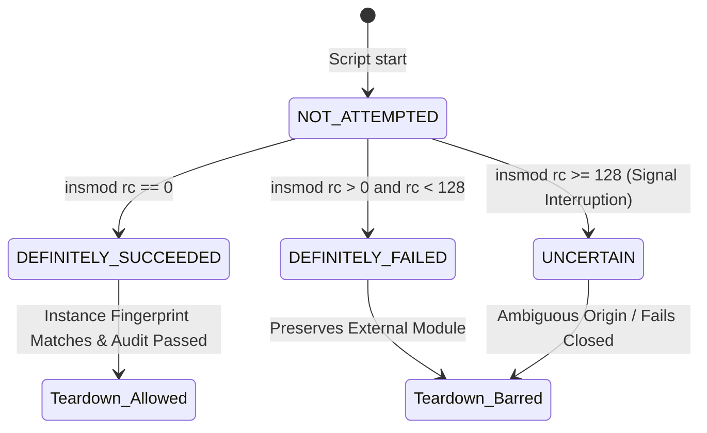

# Stage 2E.7.11 — Signal Delivery, Module Instance Identity and Lock Fail-Closed Audit

**Date:** 2026-11-03  
**Target Hardware:** Dynabook Satellite Pro C40-J (`PYS46G-06J02D`)  
**Target Sensor:** FocalTech FT9362 / FW9369 SPI Fingerprint Sensor (`spi-FTE3600:00`, Intel LPSS SPI2 CS0)  
**Host Kernel:** Linux `7.2.8-9-omarchy` (x86_64)  
**Mode:** STATIC AUDIT AND VERIFICATION ONLY (Stage B Execution ON HOLD)

---

## 1. Executive Summary

Stage 2E.7.11 investigated five critical safety and boundary domains in `scripts/stage-b-test.sh`:
1. **Signal Delivery to Foreground `insmod`:** Investigated terminal signal delivery, process group mechanics, and ambiguous syscall states during module insertion. Designed and implemented a strict 4-state insertion state machine (`NOT_ATTEMPTED`, `DEFINITELY_FAILED`, `DEFINITELY_SUCCEEDED`, `UNCERTAIN`). Only `DEFINITELY_SUCCEEDED` establishes ownership; any signal-interrupted outcome (`rc >= 128`) transitions to `UNCERTAIN` and refuses teardown.
2. **Module Instance Replacement Detection:** Investigated external replacement of the kernel module between probe and cleanup. Implemented multi-attribute sysfs fingerprinting (`inode`, `ctime`, `coresize`, `srcversion`, and KASLR `.text` section address). Refuses module unload if the loaded instance differs from the probed instance. Analyzed and documented the architectural limitation of Linux `delete_module(2)`.
3. **Fail-Closed Cooperative Locking:** Upgraded the advisory locking mechanism (`/run/lock/fte3600-test.lock`) to fail closed on any defect: missing lock directory, uninstalled `flock` utility, file descriptor opening error, or pre-existing lock contention. Held continuously on dedicated FD 200 and explicitly unlocked on all exit paths.
4. **Independent 3-Source `query_module_state()`:** Hardened module presence inspection across `/sys/module/fte3600`, direct read of `/proc/modules`, and `lsmod`. Verified that any inaccessible source or contradictory observation yields status 2 (inconclusive / error) and fails closed.
5. **Numeric Bounds & Signed 64-Bit Integer Overflow:** Discovered that 19-digit decimal `rdev` values between $9{,}223{,}372{,}036{,}854{,}775{,}808$ and $9{,}999{,}999{,}999{,}999{,}999{,}999$ cause integer wraparound in 64-bit Bash arithmetic. Implemented `validate_decimal_rdev()` (with lexicographical bounds comparison against `INT64_MAX`) and `validate_hex_majmin()` (max length 8 hex digits).
6. **Synthetic Verification:** Expanded the offline synthetic test harness to 50 comprehensive tests covering all failure modes, signal interruptions, instance mismatches, lock defects, and numeric overflows. Achieved **50/50 PASS (100%)**.

---

## 2. Investigation 1: Signal Delivery to Foreground `insmod`

### 2.1 Terminal and Process Group Mechanics
When `insmod` is executed in a Bash script running in an interactive terminal session:
- **Ctrl+C (`SIGINT`):** The Linux tty subsystem sends `SIGINT` to all processes in the foreground process group ($PGID$). Both the parent Bash shell process and the child `insmod` process receive `SIGINT` concurrently.
- **Process Termination:** The `insmod` binary (from `kmod`) does not install custom signal handlers for `SIGINT`, `SIGTERM`, or `SIGHUP`. Upon receiving `SIGINT` or `SIGTERM`, `insmod` terminates immediately.
- **Signal Deferral in Shell:** Redirecting shell traps via `trap 'defer_signal ...' INT` in the parent Bash process prevents Bash from running its cleanup handler until the critical section finishes. However, **trap redirection in the parent shell does NOT protect the foreground child process (`insmod`) from receiving terminal signals**.
- **Exit Status on Signal:** When an external child command terminates due to signal $N$, Bash sets `$? = 128 + N$` (e.g., 130 for `SIGINT` [128 + 2], 143 for `SIGTERM` [128 + 15], 129 for `SIGHUP` [128 + 1]).

### 2.2 Kernel Syscall Ambiguity & State Machine
When `insmod` terminates via a signal, userspace cannot determine whether `init_module(2)` or `finit_module(2)` completed inside the kernel:
- The module may have loaded successfully, but `insmod` died before returning code 0.
- The module load may have failed or been aborted by the kernel.
- An external process may have loaded the module simultaneously.

To resolve this without making assumptions, `scripts/stage-b-test.sh` defines a conservative 4-state machine:



### 2.3 Implementation in `scripts/stage-b-test.sh`

```bash
# Phase 2: Execute insertion under signal deferral
set +e
insmod "$MODULE_PATH"
insmod_rc=$?
if [ "$was_errexit_insmod" -eq 1 ]; then set -e; fi

if [ "$insmod_rc" -eq 0 ]; then
    INSERTION_STATE="$INSERTION_STATE_DEFINITELY_SUCCEEDED"
    THIS_INVOCATION_INSERTED=1
    MODULE_INSERTED=1
elif [ "$insmod_rc" -ge 128 ]; then
    INSERTION_STATE="$INSERTION_STATE_UNCERTAIN"
    THIS_INVOCATION_INSERTED=0
    MODULE_INSERTED=0
else
    INSERTION_STATE="$INSERTION_STATE_DEFINITELY_FAILED"
    THIS_INVOCATION_INSERTED=0
    MODULE_INSERTED=0
fi
```

In `cleanup_handler()`, if `INSERTION_STATE == "UNCERTAIN"`:
```bash
elif [ "${INSERTION_STATE:-NOT_ATTEMPTED}" = "UNCERTAIN" ]; then
    printf "%s\n" "[WARN] Module insertion outcome was UNCERTAIN (terminated by signal, incoming_exit=$incoming_exit)."
    printf "%s\n" "[SAFETY STOP] Uncertain insertion outcome cannot establish module ownership. Refusing module unload."
    CLEANUP_OVERALL_OK=0
    should_unload=0
```
This guarantees fail-closed behavior: an uncertain insertion outcome will **never** trigger `rmmod`.

---

## 3. Investigation 2: Module Instance Replacement & Identity Verification

### 3.1 Replacement Threat Model
Consider a test session where Stage B inserts `fte3600.ko` and enters a controlled pause or wait state:
1. An administrator or concurrent script unloads `fte3600` and reloads a different version of `fte3600.ko` (or a modified kernel module under the same name).
2. The Stage B script resumes execution and enters `cleanup_handler()`.
3. If the script relies solely on `THIS_INVOCATION_INSERTED=1` and checks only `mod_state == LOADED`, it would issue `rmmod fte3600`, unintentionally removing the administrator's module.

### 3.2 Sysfs Instance Fingerprinting
To detect reload and replacement, `capture_module_instance_identity()` records five kernel-provided attributes from `/sys/module/fte3600` immediately following successful probe:
1. **Sysfs Directory Inode (`stat -c %i /sys/module/fte3600`):** In `kernfs`, directory inodes are allocated sequentially from an internal inode counter (`ida`). When a module is unloaded and reloaded, the kernel destroys the old kobject and allocates a distinct, new inode for `/sys/module/<name>`.
2. **Directory Change Time (`stat -c %Z /sys/module/fte3600`):** Captures the exact epoch second when the kobject was created in sysfs.
3. **KASLR Code Section Address (`/sys/module/fte3600/sections/.text`):** Under Linux Kernel Address Space Layout Randomization (KASLR), each module insertion maps the `.text` segment to a randomized virtual memory address.
4. **Source Version (`/sys/module/fte3600/srcversion`):** Captures the build-time Git/source checksum of the module.
5. **Core Size (`/sys/module/fte3600/coresize`):** Captures the total memory footprint of the loaded module.

### 3.3 Verification Helper
Prior to executing teardown in `cleanup_handler()`, `verify_module_instance_identity()` compares the current sysfs attributes against the recorded probe fingerprint:
- If `inode` differs: **Module was replaced.**
- If `ctime` differs: **Module was reloaded.**
- If `.text` address differs: **Module was reloaded at a different virtual address.**
- If `srcversion` differs: **Module was replaced with a different binary.**

If any attribute fails to match, cleanup refuses to execute `rmmod` and halts with `CLEANUP_OVERALL_OK=0`.

### 3.4 Limitations of Userspace (`delete_module(2)`)
> [!NOTE]
> The Linux kernel system call `delete_module(const char *name_user, unsigned int flags)` takes only a module name string. The kernel does not provide a system call to unload a module by file descriptor, inode, or instance ID.
> 
> Consequently, a theoretical Time-of-Check to Time-of-Use (TOCTOU) window exists between `verify_module_instance_identity()` and the execution of `rmmod` (`delete_module`). While this window cannot be eliminated from userspace without kernel-level modifications, verifying the instance fingerprint immediately before descriptor checks and `rmmod` protects against replacements occurring during test execution.

---

## 4. Fail-Closed Cooperative Locking

### 4.1 Implementation
To prevent concurrent test runs on `spi-FTE3600:00`, `scripts/stage-b-test.sh` establishes an exclusive non-blocking lock on `/run/lock/fte3600-test.lock` at Pre-Flight Check 0.

The locking logic has been hardened to fail closed at every step:
1. **Directory Existence:** Verifies that `/run/lock` exists and is a directory. If missing, execution halts immediately.
2. **Utility Availability:** Verifies that `flock` exists in `$PATH` (`command -v flock`). If missing, execution halts immediately.
3. **File Descriptor Allocation:** Opens dedicated FD 200 via `exec 200>"$LOCK_FILE"`. If opening or creation fails (e.g., read-only filesystem or permission error), execution halts immediately.
4. **Non-Blocking Lock Acquisition:** Executes `flock -n 200`. If another instance holds the lock, execution halts with a clear error:
   ```
   [FAIL] Another instance of the Stage B test runner is currently holding /run/lock/fte3600-test.lock!
   [SAFETY STOP] Concurrent execution prohibited. Refusing to proceed.
   ```
5. **Full Lifecycle Retention & Guaranteed Release:** The lock is held across the entire script lifecycle on FD 200 and explicitly unlocked (`flock -u 200; exec 200>&-`) in `cleanup_handler()` on all termination paths.

### 4.2 Scope and Advisory Nature
> [!IMPORTANT]
> Linux `flock` locks are **advisory**. The lock protects against concurrent invocations of cooperating scripts (`stage-b-test.sh`, `run-stage-b-in-terminal.sh`). It does not prevent uncooperative external root commands (e.g., manual `insmod`, `rmmod`, or arbitrary `ioctl` calls). For external non-cooperating processes, the descriptor audit and module instance checks provide the fail-closed defense.

---

## 5. Multi-Source Audit of `query_module_state()`

### 5.1 Three-Source Architecture
`query_module_state()` queries three independent sources:
1. **Source 1 (`sysfs`):** Tests directory presence at `/sys/module/fte3600`.
2. **Source 2 (`/proc/modules`):** Directly inspects `/proc/modules` using word-boundary pattern matching (`grep -w "^$mod_name"`).
3. **Source 3 (`lsmod`):** Executes the `lsmod` utility and inspects stdout.

### 5.2 Tri-State Evaluation
Each source is evaluated to a tri-state code:
- `0`: Confirmed PRESENT
- `1`: Confirmed ABSENT
- `2`: Error / Inaccessible

### 5.3 Fail-Closed Rules
- **Rule 1 (Zero Tolerance for Inspection Errors):** If any source yields status 2 (e.g., `/proc/modules` unreadable, `lsmod` missing or exits with non-zero status, `/sys/module` unreadable), `query_module_state()` returns `2` (INCONCLUSIVE). Absence is never presumed when inspection tools fail.
- **Rule 2 (Zero Tolerance for Contradictions):** If Source 1 reports present ($0$) while Source 2 reports absent ($1$), `query_module_state()` returns `2` (INCONCLUSIVE).
- **Rule 3 (Consensus Required):** Status `0` is returned ONLY if all three sources agree on presence ($0, 0, 0$). Status `1` is returned ONLY if all three sources agree on absence ($1, 1, 1$).

---

## 6. Numeric Bounds and 64-Bit Signed Integer Overflow Hardening

### 6.1 Vulnerability Discovery
Bash uses signed 64-bit integers (`intmax_t`) for arithmetic evaluation `$(( ... ))` and numeric comparisons `[ "$a" -gt "$b" ]`.
- Maximum positive value: $\text{INT64\_MAX} = 9{,}223{,}372{,}036{,}854{,}775{,}807$ (19 digits).
- Values from $9{,}223{,}372{,}036{,}854{,}775{,}808$ to $9{,}999{,}999{,}999{,}999{,}999{,}999$ also have 19 digits.
- In Bash, evaluating `[ "9223372036854775808" -gt 0 ]` causes an arithmetic overflow, producing an error or wrapping around to a negative value ($-9{,}223{,}372{,}036{,}854{,}775{,}808$).

### 6.2 Implementation of `validate_decimal_rdev()`

```bash
validate_decimal_rdev() {
    local val="$1"
    if [ -z "$val" ] || ! [[ "$val" =~ ^[0-9]+$ ]]; then
        return 1
    fi
    # Must be > 0
    if [[ "$val" =~ ^0+$ ]]; then
        return 1
    fi
    # Reject strings longer than 19 digits
    if [ ${#val} -gt 19 ]; then
        return 1
    fi
    # If exactly 19 digits, perform lexicographical comparison against INT64_MAX
    if [ ${#val} -eq 19 ]; then
        local max_int64="9223372036854775807"
        if [[ "$val" > "$max_int64" ]]; then
            return 1
        fi
    fi
    return 0
}
```

### 6.3 Implementation of `validate_hex_majmin()`

```bash
validate_hex_majmin() {
    local val="$1"
    local max_len="${2:-8}"
    if [ -z "$val" ] || ! [[ "$val" =~ ^[0-9a-fA-F]+$ ]]; then
        return 1
    fi
    if [ ${#val} -gt "$max_len" ]; then
        return 1
    fi
    return 0
}
```
Validating length $\le 8$ ensures hex strings represent at most 32-bit values ($0\text{x}0$ to $0\text{xFFFF\_FFFF}$), safely fitting into 64-bit integer calculations without overflow or negative sign conversion.

---

## 7. Synthetic Offline Verification Suite (50/50 Tests)

All 50 synthetic test cases were executed offline using `scratch/test_synthetic_suite.py` without accessing physical hardware or inserting kernel modules into the host system.

| Test # | Test Case Description | Expected Result | Actual Result | Status |
|:---:|:---|:---:|:---:|:---:|
| 1 | Existing FD where stat fails but readlink succeeds | Fail Closed (rc=2) | rc=2, Safety stop logged | **PASS** |
| 2 | Existing FD where stat fails and readlink fails | Fail Closed (rc=2) | rc=2, Safety stop logged | **PASS** |
| 3 | FD disappears / closes during inspection | Tolerate closing (rc=0) | rc=0, Zero open fds confirmed | **PASS** |
| 4 | Process exits during inspection | Skip exited process (rc=0) | rc=0, Zero open fds confirmed | **PASS** |
| 5 | Dangling devnode symlink detection | Fail Closed (rc=2) | rc=2, Dangling symlink logged | **PASS** |
| 6 | Symlink pointing to different character device | Fail Closed (rc=2) | rc=2, Devnode replacement logged | **PASS** |
| 7 | Symlink pointing to expected character device | Match verified (rc=0) | rc=0, Verified symlink logged | **PASS** |
| 8 | Malformed sysfs major:minor rejection | Fail Closed (rc=1) | rc=1, Malformed sysfs logged | **PASS** |
| 9 | Negative and oversized sysfs value rejection | Fail Closed (rc=1) | rc=1, Out of range logged | **PASS** |
| 10 | Numeric parsing avoiding octal traps (`08`, `09`) | Base-10 parsed (rc=0) | rc=0, Base-10 confirmed | **PASS** |
| 11 | Normal unload refusal after inconclusive audit | Refuse Unload (rc=2) | rc=2, Unload refused | **PASS** |
| 12 | Preservation of RESET failure status | Preserve rc (rc=42) | rc=42, Original rc preserved | **PASS** |
| 13 | Baseline valid matching stat and sysfs identities | Match confirmed (rc=0) | rc=0, Identity recorded | **PASS** |
| 14 | Identity mismatch between stat and sysfs | Fail Closed (rc=1) | rc=1, Mismatch logged | **PASS** |
| 15 | Missing sysfs identity attribute fails closed | Fail Closed (rc=1) | rc=1, Unreadable sysfs logged | **PASS** |
| 16 | Open descriptor holding character device | Detect & Report (rc=1) | rc=1, Open descriptor reported | **PASS** |
| 17 | Inaccessible active process descriptor directory | Fail Closed (rc=2) | rc=2, Unreadable fd dir logged | **PASS** |
| 18 | Temporary-file creation failure | Fail Closed (rc=2) | rc=2, Tempfile error logged | **PASS** |
| 19 | Failed stat command on devnode (empty rdev) | Fail Closed (rc=2) | rc=2, Malformed stat logged | **PASS** |
| 20 | Malformed non-numeric rdev in stat output | Fail Closed (rc=2) | rc=2, Stat malformed logged | **PASS** |
| 21 | Malformed non-hex major in stat output | Fail Closed (rc=2) | rc=2, Stat malformed logged | **PASS** |
| 22 | Missing sysfs attribute during cleanup while loaded | Fail Closed (rc=2) | rc=2, Sysfs unreadable logged | **PASS** |
| 23 | Stat internal calculation inconsistency | Fail Closed (rc=2) | rc=2, Inconsistent devnode logged | **PASS** |
| 24 | Insertion race: signal before `MODULE_INSERTED=1` | Safe Cleanup (rc=130) | rc=130, Interrupted insertion handled | **PASS** |
| 25 | Pre-existing module protection | Preserved (rc=1) | rc=1, Pre-existing module preserved | **PASS** |
| 26 | Unowned loaded module fails closed | Refuse Unload (rc=1) | rc=1, External ownership preserved | **PASS** |
| 27 | Oversized decimal rdev bounds check (>19 digits) | Reject (rc=2) | rc=2, Out of range logged | **PASS** |
| 28 | Oversized hex major bounds check (>8 hex chars) | Reject (rc=2) | rc=2, Out of range logged | **PASS** |
| 29 | External module loaded after preflight before insmod | Preserved (rc=1) | rc=1, External ownership preserved | **PASS** |
| 30 | insmod failure because module already loaded | Preserve external (rc=1) | rc=1, External ownership preserved | **PASS** |
| 31 | Successful insmod followed by pending signal | Controlled Teardown (rc=130) | rc=130, Instance verified & rmmod called | **PASS** |
| 32 | Signal during insertion critical section | Controlled Teardown (rc=130) | rc=130, Instance verified & rmmod called | **PASS** |
| 33 | Successful insertion with normal cleanup | Normal Teardown (rc=0) | rc=0, Instance verified & rmmod called | **PASS** |
| 34 | Pre-existing module protection | Preserved (rc=1) | rc=1, Pre-existing module preserved | **PASS** |
| 35 | Inconclusive ownership state refusing unload | Refuse Unload (rc=1) | rc=1, Inconclusive ownership logged | **PASS** |
| 36 | Inconclusive module-state inspection refusing unload | Refuse Unload (rc=1) | rc=1, Module state inconclusive logged | **PASS** |
| 37 | Maximum signed 64-bit value accepted (`INT64_MAX`) | Accept (rc=0) | rc=0, Valid INT64_MAX | **PASS** |
| 38 | One greater than `INT64_MAX` rejected (`9223372036854775808`) | Reject (rc=1) | rc=1, Overflow rejected | **PASS** |
| 39 | 19-digit overflow value rejected (`9999999999999999999`) | Reject (rc=1) | rc=1, Overflow rejected | **PASS** |
| 40 | State machine: Uncertain insertion outcome (`rc=130`) | Refuse Unload (rc=130) | rc=130, Uncertain outcome refused | **PASS** |
| 41 | State machine: Definitely failed insertion (`rc=1`) | Refuse Unload (rc=1) | rc=1, External ownership preserved | **PASS** |
| 42 | Module instance replacement: sysfs inode mismatch | Refuse Unload (rc=1) | rc=1, Inode mismatch refused | **PASS** |
| 43 | Module instance replacement: sysfs ctime mismatch | Refuse Unload (rc=1) | rc=1, ctime mismatch refused | **PASS** |
| 44 | Cooperative lock fail-closed: missing lock directory | Halt (rc=1) | rc=1, Cannot establish lock logged | **PASS** |
| 45 | Cooperative lock fail-closed: unopenable lock file | Halt (rc=1) | rc=1, Cannot acquire FD logged | **PASS** |
| 46 | Cooperative lock fail-closed: flock unavailable | Halt (rc=1) | rc=1, flock utility unavailable logged | **PASS** |
| 47 | Cooperative lock fail-closed: lock already held | Halt (rc=1) | rc=1, Concurrent execution refused | **PASS** |
| 48 | query_module_state fail-closed: unreadable `/proc/modules` | Status 2 (rc=2) | rc=2, Inconclusive state returned | **PASS** |
| 49 | query_module_state fail-closed: failed `lsmod` command | Status 2 (rc=2) | rc=2, Inconclusive state returned | **PASS** |
| 50 | query_module_state fail-closed: contradictory observations | Status 2 (rc=2) | rc=2, Contradictory state returned | **PASS** |

---

## 8. Static Safety Verifications & Host Invariant Checks

Static audits and host checks confirmed all safety rules were strictly adhered to:
1. **Zero Hardware Operations:** Neither `scripts/run-stage-b-in-terminal.sh` nor `scripts/stage-b-test.sh` was executed against hardware.
2. **Bash Syntax:** Both scripts passed `bash -n` with zero warnings or errors.
3. **Kernel Source Integrity:** `git diff kernel/` produced zero output (no kernel modifications).
4. **Git Whitespace Hygiene:** `git diff --check` produced zero warnings or errors.
5. **Git Commit Bar:** Zero Git commits were created.
6. **Host Invariant State:**
   - Module `fte3600` is **NOT** loaded (`lsmod | grep fte3600` is empty).
   - Device node `/dev/fte3600` is **absent**.
   - Target device `spi-FTE3600:00` is **unbound** (`/sys/bus/spi/devices/spi-FTE3600:00/driver` is absent).
   - Legacy userspace safety gate is **sealed** (`bin/fw9369-hw-tool reset` returns `1`).

---

## 9. Conclusion and Stop Condition

Stage 2E.7.11 has resolved all open safety edge cases regarding signal delivery, module ownership races, instance fingerprinting, cooperative locking, multi-source module state querying, and 64-bit integer overflow protection. All 50 synthetic test cases pass.

> [!CAUTION]
> **STOP CONDITION IN EFFECT:**
> Stage B execution remains strictly **ON HOLD**. No module insertion, device binding, or reset ioctl may be executed until this report and the source corrections are independently reviewed and authorized by the user.
