# Stage 2E.8.1 Independent Implementation Audit: No-Auto-Unload Policy Verification

**Target System:** Dynabook Satellite Pro C40-J (`PYS46G-06J02D`)  
**Target Silicon:** FocalTech FT9362 / FW9369 SPI Fingerprint Sensor  
**Target SPI Device:** `spi-FTE3600:00` on Intel LPSS SPI2 (`pxa2xx-spi.2`, CS0)  
**Host Kernel:** Linux `7.2.8-9-omarchy` (x86_64)  
**Audit Stage:** Stage 2E.8.1 (Static Implementation Audit)  
**Status:** **STAGE B HARDWARE EXECUTION ON HOLD — STRICTLY READ-ONLY AUDIT**

---

## 1. Scope, Files, and Functions Inspected

This audit independently inspects the complete implementation of Stage 2E.8 Option 1 (Never Automatically Unload the Fingerprint Driver). All conclusions are derived from direct source code reading, executable call graph analysis, and offline verification.

### 1.1 Complete Files Inspected
1. `scripts/run-stage-b-in-terminal.sh` (39 lines, complete contents inspected)
2. `scripts/stage-b-test.sh` (1,394 lines, complete contents inspected)
3. `tools/fte3600-tool.c` (103 lines, complete contents inspected)
4. `tools/fw9369-mock/src/fw9369_main_hw.c` (80 lines, source of `bin/fw9369-hw-tool`, complete contents inspected)
5. `scratch/test_synthetic_suite.py` (1,044 lines, complete contents inspected)
6. `PROGRESS.md` (lines 2600–2770, Stage 2E.7.11 through Stage 2E.8 sections)
7. `kernel/fte3600.c` & `kernel/fte3600.h` (UAPI definitions and driver reset implementation)

### 1.2 Functions and Handlers Inspected
- `validate_decimal_rdev()` (`scripts/stage-b-test.sh:93-109`)
- `validate_hex_majmin()` (`scripts/stage-b-test.sh:119-129`)
- `convert_sysfs_dev_to_identity()` (`scripts/stage-b-test.sh:140-200`)
- `record_devnode_identity()` (`scripts/stage-b-test.sh:226-318`)
- `query_module_state()` (`scripts/stage-b-test.sh:341-409`)
- `defer_signal()` (`scripts/stage-b-test.sh:417-426`)
- `check_open_descriptors()` (`scripts/stage-b-test.sh:443-885`)
- `cleanup_handler()` (`scripts/stage-b-test.sh:895-1026`)
- Pre-flight Checks 0 through 8 (`scripts/stage-b-test.sh:1037-1196`)
- Critical Section & Insertion State Machine (`scripts/stage-b-test.sh:1205-1265`)
- Post-Probe Verification (`scripts/stage-b-test.sh:1268-1306`)
- Telemetry & Reset Execution (`scripts/stage-b-test.sh:1308-1360`)
- Test Exit Status Resolution (`scripts/stage-b-test.sh:1362-1394`)
- `main()` and `print_state()` (`tools/fte3600-tool.c:14-103`)
- `main()` and `print_usage()` (`tools/fw9369-mock/src/fw9369_main_hw.c:9-80`)

---

## 2. Complete Executable Call Graph & Proof of Zero Unload/Unbind

### 2.1 Complete Executable Call Graph
The full reachable execution flow starting from terminal launch is mapped below:

```mermaid
flowchart TD
    Launcher["run-stage-b-in-terminal.sh"] -->|"sudo exec"| StageB["stage-b-test.sh"]
    
    subgraph Preflight ["Phase 1: Pre-Flight Checks"]
        StageB -->|"Check 0"| Flock["flock -n /run/lock/fte3600-test.lock (FD 200)"]
        StageB -->|"Check 1-2"| ModInfo["uname -r & modinfo vermagic"]
        StageB -->|"Check 3"| QueryModPre["query_module_state(fte3600, spidev)"]
        StageB -->|"Check 4-5"| SysfsCheck["test -d SPI_PATH & test -e /dev/fte3600"]
        StageB -->|"Check 6"| ToolCheck["test -x bin/fte3600-tool"]
        StageB -->|"Check 7"| GateCheck["bin/fw9369-hw-tool (Legacy Safety Gate)"]
        StageB -->|"Check 8"| PadReadPre["grep pinctrl pins & debugfs gpio baseline"]
    end

    subgraph Insertion ["Phase 2: Insertion & Probe"]
        StageB -->|"Critical Section"| Insmod["insmod kernel/fte3600.ko"]
        Insmod -->|"rc committed"| StateMachine["INSERTION_STATE committed"]
        StateMachine -->|"Post-Probe 1"| QueryModPost["query_module_state(fte3600)"]
        StateMachine -->|"Post-Probe 2"| SpiBindVerify["readlink spi-FTE3600:00/driver"]
        StateMachine -->|"Post-Probe 3"| DevnodeRecord["record_devnode_identity()"]
    end

    subgraph TelemetryReset ["Phases 3-5: Telemetry & Reset"]
        StageB -->|"Phase 3"| Snap1["bin/fte3600-tool get-state (Snapshot 1)"]
        StageB -->|"Phase 4"| Reset["bin/fte3600-tool reset (Exactly ONE ioctl)"]
        StageB -->|"Phase 5"| Snap2["bin/fte3600-tool get-state (Snapshot 2)"]
        StageB -->|"Phase 5"| PostDiag["pinctrl & dmesg tail"]
        StageB -->|"Exit Status"| ExitResolve["TEST_EXIT_STATUS resolved -> exit"]
    end

    subgraph Cleanup ["Cleanup Trap: cleanup_handler()"]
        StageB -.->|"EXIT, INT, TERM, HUP"| CleanupHandler["cleanup_handler()"]
        CleanupHandler -->|"Guard"| ReentrancyCheck["CLEANUP_IN_PROGRESS == 1 ? return 0"]
        CleanupHandler -->|"Read-only"| ModAudit["query_module_state(fte3600)"]
        CleanupHandler -->|"Read-only"| DevAudit["test -e /dev/fte3600"]
        CleanupHandler -->|"Read-only"| SpiAudit["readlink SPI_PATH/driver"]
        CleanupHandler -->|"Read-only"| OpenFds["check_open_descriptors() (Informative)"]
        CleanupHandler -->|"Read-only"| PadAudit["grep pad 14, 229, debugfs gpio, dmesg"]
        CleanupHandler -->|"Policy"| Banner["Option 1 Policy Banners"]
        CleanupHandler -->|"Release"| UnlockFlock["flock -u 200 & exec 200>&-"]
        CleanupHandler -->|"Exit"| FinalExit["trap - ... & exit incoming_exit"]
    end
```



### 2.2 Proof of Zero Unload and Zero Unbind Operations
An exhaustive string and symbol audit of all reachable components was performed:
1. **`scripts/run-stage-b-in-terminal.sh`**:
   - Contains zero calls to `rmmod`, `modprobe`, or `delete_module`.
   - Lines 21 and 31 contain string literals in `printf` explaining to the user that `rmmod` is permanently disabled in the harness.
2. **`scripts/stage-b-test.sh`**:
   - Line 26: comment stating zero automatic `rmmod`, `modprobe -r`, or `unbind`.
   - Line 891: comment stating `cleanup_handler` never unloads `fte3600.ko` or unbinds SPI.
   - Line 941: comment stating SPI driver binding status check never unbinds.
   - Line 989: `printf` instruction informing the operator: `[POLICY] To manually unload after inspection: sudo rmmod fte3600`.
   - **Zero executable calls** to `rmmod`, `modprobe -r`, or `delete_module` exist.
   - **Zero unbind write commands** (e.g. `echo ... > unbind`) exist. Line 946 only executes `readlink "$SPI_PATH/driver"` to report binding status.
3. **`bin/fte3600-tool` & `tools/fte3600-tool.c`**:
   - Contains only standard POSIX system calls: `open()`, `close()`, `ioctl()`, `printf()`, `perror()`, `strerror()`.
   - `strings bin/fte3600-tool` contains zero references to `rmmod`, `modprobe`, `delete_module`, or `unbind`.
4. **`bin/fw9369-hw-tool` & `tools/fw9369-mock/src/fw9369_main_hw.c`**:
   - Contains zero device access. Prints the sealed safety banner and exits with code 1.
   - `strings bin/fw9369-hw-tool` contains zero references to `rmmod`, `modprobe`, `delete_module`, or `unbind`.

**Conclusion on Invariant:** No execution path initiated by `scripts/run-stage-b-in-terminal.sh` can unload `fte3600.ko` or unbind `spi-FTE3600:00`. The invariant is strictly proven.

---

## 3. Audit of All Cleanup and Signal Paths

### 3.1 Trap Registrations and Scope
The trap registrations in `scripts/stage-b-test.sh` are:
- `scripts/stage-b-test.sh:1029`: `trap 'cleanup_handler 130 "SIGINT"' INT`
- `scripts/stage-b-test.sh:1030`: `trap 'cleanup_handler 143 "SIGTERM"' TERM`
- `scripts/stage-b-test.sh:1031`: `trap 'cleanup_handler 129 "SIGHUP"' HUP`
- `scripts/stage-b-test.sh:1032`: `trap 'cleanup_handler $? "EXIT"' EXIT`

During the insertion critical section (`scripts/stage-b-test.sh:1215-1217`):
- INT, TERM, and HUP traps are temporarily redirected to `defer_signal` so signals cannot interrupt between `insmod` returning and committing `INSERTION_STATE`.
- At line 1244–1246, traps are restored to `cleanup_handler`.
- If a signal arrived during insertion, line 1254 explicitly calls `cleanup_handler "$DEFERRED_SIGNAL" "$DEFERRED_SIGNAL_NAME"`.

### 3.2 Evaluation of Cleanup Invariants
| Requirement | Audit Finding | Exact Source Reference |
|---|---|---|
| **Cleanup is idempotent** | **VERIFIED.** Guarded by `CLEANUP_IN_PROGRESS=1`. A second call returns 0 immediately without executing any logic. In addition, line 1024 executes `trap - EXIT INT TERM HUP` before `exit "$final_exit"`, preventing re-entry via the EXIT trap. | `scripts/stage-b-test.sh:900-904`, `1024` |
| **Original exit status is preserved** | **VERIFIED.** `local final_exit="$incoming_exit"`. Signal status codes (130, 143, 129), primary reset failure codes, or preflight failure codes are preserved without modification. Diagnostics do not mutate `final_exit`. | `scripts/stage-b-test.sh:1015-1025` |
| **No signal path invokes unload** | **VERIFIED.** `cleanup_handler()` contains zero calls to `rmmod`, `modprobe -r`, or helper unloader binaries. | `scripts/stage-b-test.sh:895-1026` |
| **No signal path unbinds SPI device** | **VERIFIED.** SPI driver binding is only read via `readlink` at line 946. Zero write operations to any `unbind` file. | `scripts/stage-b-test.sh:942-950` |
| **No cleanup branch issues an ioctl** | **VERIFIED.** Neither `ioctl` nor `bin/fte3600-tool` is called anywhere within `cleanup_handler()`. | `scripts/stage-b-test.sh:895-1026` |
| **No cleanup branch retries RESET** | **VERIFIED.** Reset is never re-invoked. | `scripts/stage-b-test.sh:895-1026` |
| **Lock FD 200 release timing** | **VERIFIED.** `flock -u 200` and `exec 200>&-` occur at lines 1003–1007, *strictly after* all diagnostics, descriptor checks, and policy banners have completed. | `scripts/stage-b-test.sh:1003-1007` |
| **Only script-owned descriptors closed** | **VERIFIED.** The script only closes FD 200 via `exec 200>&-`. No other descriptor is touched. | `scripts/stage-b-test.sh:1005` |
| **Other processes never terminated** | **VERIFIED.** Zero `kill`, `pkill`, or `killall` commands. Line 863 explicitly states `Automatic process termination is strictly disabled.` | `scripts/stage-b-test.sh:851-866` |
| **Cleanup errors do not conceal failure** | **VERIFIED.** `set +e` at line 908 allows diagnostic queries to fail without aborting cleanup. `final_exit` is initialized to `$incoming_exit` and is never overwritten by diagnostic command results. | `scripts/stage-b-test.sh:908`, `1015` |

---

## 4. Reset Interruption and Single-Execution Audit

### 4.1 Invocation Analysis of `bin/fte3600-tool reset`
The reset command is invoked at lines 1313–1326:
```bash
# 7. Execute exactly ONE RESET ioctl
printf "\n%s\n" "--- [PHASE 4] Executing Exactly ONE Controlled Reset IOCTL ---"
printf "Invoking: %s reset\n" "$TOOL_BIN"
RESET_RC=0
was_errexit_reset=0
if shopt -o -q errexit; then was_errexit_reset=1; fi
set +e
"$TOOL_BIN" reset
RESET_RC=$?
if [ "$was_errexit_reset" -eq 1 ]; then set -e; fi
printf "Reset ioctl process return code: %d\n" "$RESET_RC"
```

1. **Single Launch Guarantee:**
   - The command `"$TOOL_BIN" reset` appears at line 1319 only.
   - It is not embedded within a loop (`for`, `while`, `until`), function, or recursive block.
   - There are zero retry mechanisms. If `RESET_RC != 0`, the script logs a warning and proceeds to Snapshot 2.
2. **Signal Restart Prevention:**
   - Traps during Phase 4 point to `cleanup_handler`.
   - As audited in Section 3, `cleanup_handler` cannot restart or re-invoke Phase 4 or `bin/fte3600-tool`.
3. **Physical Reset Pulse vs Userspace Return Code:**
   - In `kernel/fte3600.c:425-455`, `FTE3600_IOC_RESET` calls `fte3600_reset_sequence()`:
     ```c
     gpiod_set_value_cansleep(data->reset_gpio, 1);
     msleep(40);
     gpiod_set_value_cansleep(data->reset_gpio, 0);
     msleep(10);
     ```
   - In Linux, `msleep()` is an **uninterruptible sleep** (`TASK_UNINTERRUPTIBLE`). If a signal arrives while the kernel thread is executing `msleep(40)`, the kernel completes the sleep and pulls Pad 14 back high *before* delivering the signal upon return to userspace.
   - Therefore, a userspace signal interruption (e.g. SIGINT $rc = 130$) does **not** prove that the hardware reset pulse did not occur. The pulse likely completed in hardware.
   - **Audit Finding:** The script does not claim that reset did not occur. It reports the exit code (`Reset ioctl process return code: %d`). However, lines 1371–1376 classify any non-zero `$RESET_RC` as a generic failure without distinguishing:
     - `RESET_RC == 0`: Reset ioctl succeeded.
     - `0 < RESET_RC < 128`: Reset ioctl returned failure from kernel.
     - `RESET_RC >= 128`: Userspace process was interrupted by signal (outcome uncertain as to whether the kernel completed the GPIO pulse).
   - **Recommendation:** Document this distinction so operators understand that an interrupted reset command does not imply the hardware pulse was withheld.

---

## 5. Device File Descriptor Lifecycle Audit

### 5.1 Device Opening in Userspace
In `tools/fte3600-tool.c`:
- Line 41:
  ```c
  int fd = open("/dev/fte3600", O_RDWR);
  if (fd < 0) {
      perror("open(/dev/fte3600)");
      return 1;
  }
  ```
- If `open()` fails, `fd < 0`. The tool prints `perror` and immediately returns 1. It does **not** call `close(fd)` on an invalid descriptor (-1), completely avoiding closing an unrelated descriptor (such as stdin/stdout).
- If `open()` succeeds, `fd` is valid ($\ge 3$).
- On every error branch (`ioctl` failure, invalid argument, unexpected capture return), lines 51, 60, 70, 87, 92, and 97 explicitly call `close(fd)`.
- On successful completion, line 101 calls `close(fd)`.
- If `fte3600-tool` is terminated prematurely by an asynchronous signal (e.g. SIGINT/SIGTERM/SIGKILL), the Linux kernel's process termination routine (`do_exit()` -> `exit_files()` -> `put_files_struct()`) closes all open file descriptors belonging to the process. This decrements `module_refcount` on `fte3600.ko`.

### 5.2 Device Descriptor Lifetime in `scripts/stage-b-test.sh`
- The shell script `scripts/stage-b-test.sh` **never directly opens `/dev/fte3600`**.
- All checks in `stage-b-test.sh` (lines 234, 248, 475, 528, 540, 934, 1145) use non-opening operations: `[ -e ]`, `[ -c ]`, `[ -L ]`, `stat -c`, `readlink`, `lsof -t`, and `fuser`.
- Neither `scripts/stage-b-test.sh` nor `cleanup_handler` attempts to close descriptors belonging to other processes.
- The informative descriptor audit in `check_open_descriptors()` (`scripts/stage-b-test.sh:443-885`) reads `/proc/[0-9]*/fd/*` via `stat -L` and `readlink`. It is strictly read-only.

---

## 6. Synthetic Test Suite Relevance and Classification

All 27 test cases in `scratch/test_synthetic_suite.py` were reviewed and classified.

### 6.1 Test Classification Table
| Test Name | Extracted Function / Logic Under Test | Classification | Active Coverage Description |
|---|---|---|---|
| **Test 1** | `check_open_descriptors()` | **Active Implementation Test** | Tests handling when `stat -L` fails on an active FD link while `readlink` succeeds. |
| **Test 2** | `check_open_descriptors()` | **Active Implementation Test** | Tests process exit race during `/proc` descriptor directory enumeration. |
| **Test 3** | `check_open_descriptors()` | **Active Implementation Test** | Tests detection and rejection of symlinks pointing to non-character or foreign files. |
| **Test 4** | `convert_sysfs_dev_to_identity()` | **Active Implementation Test** | Tests rejection of malformed sysfs `major:minor` strings. |
| **Test 5** | `convert_sysfs_dev_to_identity()` | **Active Implementation Test** | Tests rejection of negative or out-of-range device numbers. |
| **Test 6** | `convert_sysfs_dev_to_identity()` | **Active Implementation Test** | Tests that leading zeros (`08:09`) do not trigger octal parsing errors in Bash. |
| **Test 7** | Test exit status resolution logic | **Active Implementation Test** | Tests preservation of primary RESET failure code over secondary telemetry results. |
| **Test 8** | `record_devnode_identity()` | **Active Implementation Test** | Tests baseline validation when stat and sysfs identities match. |
| **Test 9** | `record_devnode_identity()` | **Active Implementation Test** | Tests fail-closed rejection when stat and sysfs major:minor disagree. |
| **Test 10**| `record_devnode_identity()` | **Active Implementation Test** | Tests fail-closed rejection when sysfs attributes are unreadable. |
| **Test 11**| `validate_decimal_rdev()` | **Active Implementation Test** | Tests lexicographical string bounds check preventing 64-bit Bash integer overflow. |
| **Test 12**| Check 0 lock acquisition logic | **Active Implementation Test** | Tests cooperative non-blocking `flock -n 200` fail-closed behavior when lock is held. |
| **Test 13**| `query_module_state()` | **Active Implementation Test** | Tests that an absent module returns status 1 (ABSENT). |
| **Path 1** | `cleanup_handler()` | **Active Implementation Test** | Tests that successful insertion + test success preserves module, prints policy banner, and exits 0. |
| **Path 2** | `cleanup_handler()` | **Active Implementation Test** | Tests that successful insertion + failed reset preserves module, prints banner, and preserves primary error code (rc=5). |
| **Path 3** | `cleanup_handler()` | **Active Implementation Test** | Tests that SIGINT preserves module and exits with signal status 130. |
| **Path 4** | `cleanup_handler()` | **Active Implementation Test** | Tests that `INSERTION_STATE=UNCERTAIN` preserves module and prints UNCERTAIN policy banner. |
| **Path 5** | `cleanup_handler()` | **Active Implementation Test** | Tests that `INSERTION_STATE=DEFINITELY_FAILED` preserves failure status (rc=1) without claiming ownership. |
| **Path 6** | `cleanup_handler()` | **Active Implementation Test** | Tests that devnode creation failure preserves failure status (rc=1) and preserves module. |
| **Path 7** | `cleanup_handler()` & `check_open_descriptors()` | **Active Implementation Test** | Tests that open descriptors trigger warnings without invoking process termination (`kill`). |
| **Path 8** | `cleanup_handler()` & `check_open_descriptors()` | **Active Implementation Test** | Tests that unreadable `/proc` entries log warnings without aborting or unloading. |
| **Path 9** | `cleanup_handler()` & `query_module_state()` | **Active Implementation Test** | Tests that inconclusive module state (status 2) logs warnings without unloading. |
| **Path 10**| `cleanup_handler()` | **Active Implementation Test** | Tests that multiple/re-entrant cleanup invocations return 0 cleanly without recursive loops. |
| **Path 11**| `cleanup_handler()` | **Active Implementation Test** | Tests that pre-existing module (`INITIAL_FTE3600_LOADED=1`) is preserved with policy banner. |
| **Path 12**| `cleanup_handler()` | **Active Implementation Test** | Tests that cleanup unlocks and closes only the script's own lock FD (FD 200). |
| **Path 13**| `cleanup_handler()` | **Active Implementation Test** | Tests that cleanup leaves SPI driver binding intact without unbinding. |
| **Path 14**| Static code inspection AST/Regex | **Active Implementation Test** | Tests that zero executable `rmmod`, `modprobe -r`, `delete_module`, or `unbind` calls exist in test scripts. |

### 6.2 Audit of Test Fidelity & Coverage Scope
1. **Purge of Obsolete Fingerprint Tests:** The 27 tests contain zero calls to `capture_module_instance_identity` or `verify_module_instance_identity`. All obsolete instance fingerprinting tests from Stage 2E.7.13 were cleanly retired.
2. **Real Logic Extraction:** In `scratch/test_synthetic_suite.py:95-135`, functions under test (`convert_sysfs_dev_to_identity`, `validate_decimal_rdev`, `validate_hex_majmin`, `query_module_state`, `defer_signal`, `cleanup_handler`) are extracted dynamically directly from `scripts/stage-b-test.sh` via `awk`. The tests exercise the exact production script logic.
3. **Static File Scope Limitation (Finding):** In Path 14 (`scratch/test_synthetic_suite.py:1016-1019`), the static scan target list is:
   ```python
   target_files = [
       "/home/titan/fte3600-linux-driver/scripts/stage-b-test.sh",
       "/home/titan/fte3600-linux-driver/scripts/run-stage-b-in-terminal.sh"
   ]
   ```
   While this audit independently confirmed that `tools/fte3600-tool.c` and `tools/fw9369-mock/src/fw9369_main_hw.c` contain zero unload commands, Path 14 does not include these C source files in its automated static scan.
   **Recommendation:** Expand Path 14 in `scratch/test_synthetic_suite.py` to include `tools/fte3600-tool.c` and `tools/fw9369-mock/src/fw9369_main_hw.c` for complete static coverage across all reachable components.

---

## 7. Unresolved Issues and Recommendations

### 7.1 Unresolved Issues
There are **zero safety-critical defects** that could cause an accidental module unload, SPI unbind, hardware damage, or process termination. The Option 1 policy is strictly fail-closed.

### 7.2 Non-Critical Source Code Recommendations
1. **Reset Interruption Telemetry Classification:**
   In `scripts/stage-b-test.sh:1320-1326`, refine the handling of `RESET_RC`:
   ```bash
   if [ "$RESET_RC" -ge 128 ]; then
       printf "[WARN] Reset ioctl was interrupted by signal (rc=%d); hardware pulse outcome UNCERTAIN.\n" "$RESET_RC"
   elif [ "$RESET_RC" -ne 0 ]; then
       printf "[WARN] Reset ioctl returned error (rc=%d).\n" "$RESET_RC"
   fi
   ```
   This prevents operators from assuming that a non-zero exit code due to SIGINT proves that no hardware pulse occurred on Pad 14.
2. **Static Check Scope in Synthetic Suite:**
   In `scratch/test_synthetic_suite.py:1016-1019`, add `tools/fte3600-tool.c` and `tools/fw9369-mock/src/fw9369_main_hw.c` to `target_files` in Path 14 so that C helper sources are continuously checked alongside shell scripts.

---

## 8. Verification Commands Executed During Audit

All checks executed during this audit were strictly read-only and static:

```bash
git diff --check          # PASSED (0 whitespace errors)
git diff -- kernel/       # PASSED (0 kernel modifications)
bash -n scripts/stage-b-test.sh            # PASSED (syntax valid)
bash -n scripts/run-stage-b-in-terminal.sh # PASSED (syntax valid)
python3 scratch/test_synthetic_suite.py    # PASSED (27/27 tests passed)
lsmod | grep fte3600      # PASSED (fte3600 confirmed absent on host)
ls -la /dev/fte3600       # PASSED (node confirmed absent on host)
ls -la /sys/bus/spi/devices/spi-FTE3600:00/driver # PASSED (unbound on host)
bin/fw9369-hw-tool        # PASSED (safety gate sealed, status 1 verified)
```

---

## 9. Final Conclusion

Based on exhaustive static inspection of the Stage B scripts, helper source code, and synthetic tests:

**Conclusion A: The no-auto-unload policy is correctly enforced across all reachable Stage B execution paths, with remaining limitations and recommendations documented.**

---

## 10. Mandatory Status Declarations

```
AUTOMATIC MODULE UNLOAD: DISABLED
STAGE B HARDWARE EXECUTION: NOT PERFORMED
STAGE B AUTHORIZATION: ON HOLD PENDING INDEPENDENT REVIEW
```
