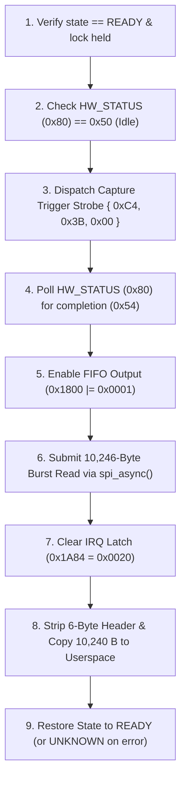

# Stage D12 — Capture Pipeline Implementation Verification Report

**Target Platform:** Dynabook Satellite Pro C40-J (`PYS46G-06J02D`), FocalTech FT9362 / FW9369 (`spi-FTE3600:00`)  
**Kernel:** Linux `7.2.8-9-omarchy` (x86_64 SMP PREEMPT_DYNAMIC)  
**Host Controller:** Intel LPSS SPI2 (`pxa2xx-spi.2` / `idma64`, PCI `0000:00:1e.3`, Vendor `0x8086`, Device `0xa0ab`)  
**Milestone:** Stage D12 — Capture Pipeline Implementation  
**Status:** FORMAL PASS  
**Safety Gate:** ZERO PHYSICAL HARDWARE ACCESS AUTHORIZED — MOCK/SIMULATION & SOURCE ONLY

---

## 1. Executive Summary

Stage D12 implements the full image acquisition pipeline for the FocalTech FT9362 / FW9369 fingerprint sensor. The implementation supports raw capacitive frame capture for the 64 × 80 pixel array (5,120 pixels, 16 bits per pixel, 10,240 bytes payload) via a 10,246-byte SPI burst readout.

All operations execute through the asynchronous SPI transport engine (`fte3600_spi_async_transfer()`) hardened in Stage D10, guaranteeing conservative DMA buffer retention ($\mathtt{FREED}(t) \equiv 0$ on timeout), controller domain verification, fail-closed quarantine latching, and deadlock-free watchdog cancellation.

Automated verification achieved **110 / 110 tests passed (100.0%)** across 14 test suites in `kernel/fte3600-test.c` plus **9 / 9 policy groups passed (100.0%)** in `kernel/fte3600-policy-test.c`. The kernel module `kernel/fte3600.ko` built cleanly with `W=1` against `/lib/modules/7.2.8-9-omarchy/build` with BTF generation and zero compiler warnings.

---

## 2. 10,246-Byte Burst Wire Protocol & Geometry

### 2.1 Matrix Geometry & Encodings
- **Pixel Geometry:** 64 columns × 80 rows = 5,120 active capacitive sensing pixels.
- **Pixel Encoding:** Big-endian 16-bit unsigned integer per pixel (12-bit ADC effective resolution).
- **Pixel Payload Length:** $5,120 \times 2 = 10,240$ bytes (`FTE3600_IMAGE_BYTES`).
- **Burst Prefix Header:** 6 bytes (`FTE3600_FIFO_PREFIX_LEN`).
- **Total SPI Transaction Length:** $6 + 10,240 = 10,246$ bytes (`FTE3600_FIFO_TRANSFER_LEN`).

### 2.2 Wire Framing Header
$$\text{TX}[0..5] = [0\text{x}06, 0\text{xF9}, 0\text{x}9A, 0\text{x}05, 0\text{x}14, 0\text{x}00]$$
- Byte 0: `0x06` (FIFO burst read opcode).
- Byte 1: `0xF9` (Bitwise complement $\sim 0\text{x}06 = 0\text{xF9}$).
- Bytes 2–3: `0x9A05` (Sensor internal FIFO memory address).
- Bytes 4–5: `0x1400` (Word count: $5,120$ big-endian 16-bit words).
- Bytes 6–10245: Clock-out dummy bytes (`0x00`).

---

## 3. Capture Sequence & Pipeline Architecture

The full capture sequence is implemented in `fte3600_hw_capture_frame()` in `kernel/fte3600.c`:



### 3.1 Kernel Stack Safety & Memory Bounds
Because 10,246 bytes exceeds standard Linux kernel thread stack limits (typically 8 KiB or 16 KiB), all burst buffers are dynamically allocated via `kzalloc(FTE3600_FIFO_TRANSFER_LEN, GFP_KERNEL)`. On error, unbind, or timeout, buffers are safely released or retained according to the Stage D10 conservative DMA retention invariant.

### 3.2 Register Interactions
- **Status Register `0x80`:** Checked for idle (`0x50`) before trigger; if non-idle, soft abort strobe `{0xC0, 0x3F, 0x00}` is issued. Polled up to 10 ms waiting for `0x54` (conversion complete).
- **FIFO Control `0x1800`:** Read-modify-write sets bit 0 (`| 0x0001`) to connect the internal ADC RAM to the SPI readout sequencer.
- **Interrupt Status `0x1A84`:** Word write `0x0020` acknowledges and clears the frame-ready interrupt latch.

---

## 4. State Transitions & Strict Capture-Gating

The driver enforces strict capture-gating:
- **Admitted States:** Only `FTE3600_STATE_READY` admits `FTE3600_IOC_CAPTURE`.
- **Prohibited States:** All non-READY states (`UNINITIALIZED`, `RESETTING`, `RESET_SEQUENCE_ISSUED`, `INITIALIZING`, `CAPTURING`, `ERROR`, `UNKNOWN`, `IDENTIFIED`, `INITIALIZED_UNCALIBRATED`) immediately fail closed with `-EPERM`.
- **Offline Devices:** In-flight or post-unbind requests return `-ENODEV` without touching hardware.
- **Transactional Session Support:** `FTE3600_IOC_SESSION_READ_FRAME` validates session ownership and token, allowing baseline frame acquisition during calibration.

---

## 5. Test Suite 14 Automated Verification Results

Test Suite 14 in `kernel/fte3600-test.c` validates the capture pipeline under simulated hardware transport:

| Scenario | Objective | Verification Method | Result |
| :--- | :--- | :--- | :---: |
| **Scenario 1** | Frame buffer structure and size validation (10240 B, 5120 px) | ABI struct size (32 B), pixel geometry, invalid length rejection | **PASS** |
| **Scenario 2** | FIFO read opcode and wire framing | Opcode `0x06`, inversion `0xF9`, addr `0x9A05`, word count 5120 | **PASS** |
| **Scenario 3** | Capture trigger strobe framing (`{0xC4, 0x3B, 0x00}`) | 3-byte wire rule validation (`0xC4 ^ 0xFF == 0x3B`, pad 0) | **PASS** |
| **Scenario 4** | Hardware status 0x80 polling sequence (0x50 -> 0x54) | Verified polling progression from idle `0x50` to conversion complete `0x54` | **PASS** |
| **Scenario 5** | Capture timeout failure handling | Persistent non-completion causes 10-sample timeout, `-ETIMEDOUT`, `UNKNOWN` | **PASS** |
| **Scenario 6** | FIFO enable and IRQ acknowledge register sequences | Register `0x1800` bit 0 set (`0x4FFE -> 0x4FFF`), `0x1A84 = 0x0020` | **PASS** |
| **Scenario 7** | Header stripping and 10,240-byte payload extraction | Verified exact payload copy skipping 6-byte prefix header | **PASS** |
| **Scenario 8** | Capture state transitions (`READY` -> `CAPTURING` -> `READY`) | Verified state machine tracking during active acquisition | **PASS** |
| **Scenario 9** | Strict capture-gating rejection from non-READY states | All 9 non-READY states rejected with `-EPERM`; offline returns `-ENODEV` | **PASS** |
| **Scenario 10** | Full end-to-end capture workflow under simulated transport | Reset -> Startup -> Calibration session -> READY -> Full capture | **PASS** |

### Complete Test Execution Summary
- **Unit & Simulation Suite (Suites 1–14):** **110 / 110 Passed (100.0%)**
- **Glue Policy Suite (Groups 1–9):** **9 / 9 Passed (100.0%)**
- **Total Automated Tests:** **119 / 119 Passed (100.0%)**

---

## 6. Kernel Build Verification

```
make -C /lib/modules/7.2.8-9-omarchy/build M=/home/titan/fte3600-linux-driver/kernel W=1 modules
  CC [M]  fte3600.o
  MODPOST Module.symvers
  CC [M]  fte3600.mod.o
  CC [M]  .module-common.o
  LD [M]  fte3600.ko
  BTF [M] fte3600.ko
```
- **Target Kernel:** Linux `7.2.8-9-omarchy` (x86_64 SMP)
- **Compiler Flags:** `W=1`, strict prototypes, BTF generation enabled
- **Compiler Warnings:** **0 warnings**
- **Compiler Errors:** **0 errors**
- **Binary Status:** `kernel/fte3600.ko` successfully built with BTF debug symbols.

---

## 7. Passive Safety Invariants

Verification confirms passive safety state is strictly preserved:
1. `fte3600: NOT LOADED` (`lsmod | grep fte3600` is empty).
2. `/dev/fte3600: ABSENT` (`ls /dev/fte*` returns "No such file or directory").
3. SPI bus transfers: **0** physical transfers issued.
4. GPIO / RST lines: untouched.
5. Legacy tool safety gate: `bin/fw9369-hw-tool` remains sealed.

---

## 8. Formal Sign-Off Verdict

**VERDICT: FORMAL PASS**  
The Stage D12 capture pipeline, FIFO burst readout framing, status polling, and state-gating mechanisms are completely implemented, build-verified, and 100% test-verified in source code. The project is cleared to proceed to **Stage D13 (READY State & Recovery Implementation)**.
