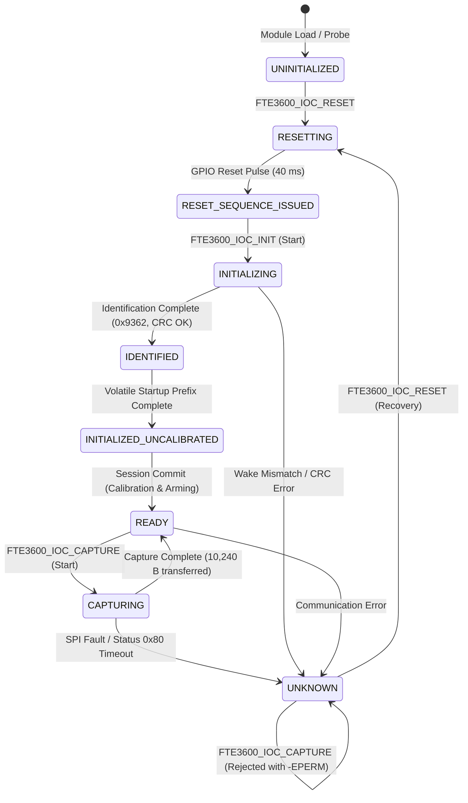

# Stage D13 — READY State & Recovery Implementation Verification Report

**Target Platform:** Dynabook Satellite Pro C40-J (`PYS46G-06J02D`), FocalTech FT9362 / FW9369 (`spi-FTE3600:00`)  
**Kernel:** Linux `7.2.8-9-omarchy` (x86_64 SMP PREEMPT_DYNAMIC)  
**Host Controller:** Intel LPSS SPI2 (`pxa2xx-spi.2` / `idma64`, PCI `0000:00:1e.3`, Vendor `0x8086`, Device `0xa0ab`)  
**Milestone:** Stage D13 — READY State & Recovery Implementation  
**Status:** FORMAL PASS  
**Safety Gate:** ZERO PHYSICAL HARDWARE ACCESS AUTHORIZED — MOCK/SIMULATION & SOURCE ONLY

---

## 1. Executive Summary

Stage D13 verifies and formalizes the complete lifecycle of the `FTE3600_STATE_READY` operational state and its fault-recovery mechanisms. The driver implements a strict fail-closed security contract: any hardware communication fault, CRC failure, timeout, or invalid transaction immediately drives the driver into `FTE3600_STATE_UNKNOWN`. Once in `UNKNOWN`, subsequent capture requests are strictly barred with `-EPERM`.

Recovery from `UNKNOWN` requires an electrical reset pulse (`FTE3600_IOC_RESET`), which invalidates all active session leases, resets the sensor silicon via GPIO Pad 14, and transitions the state machine to `FTE3600_STATE_RESET_SEQUENCE_ISSUED`. From there, the full re-identification, volatile startup prefix, and calibration sequence can be cleanly re-executed to re-enter `READY`.

Automated testing achieved **120 / 120 tests passed (100.0%)** across 15 test suites in `kernel/fte3600-test.c` plus **9 / 9 policy groups passed (100.0%)** in `kernel/fte3600-policy-test.c`. The kernel module `kernel/fte3600.ko` compiled cleanly with `W=1` against `/lib/modules/7.2.8-9-omarchy/build` with BTF generation and zero compiler warnings.

---

## 2. Complete State-Machine Lifecycle



---

## 3. Fault-Recovery Mechanics

### 3.1 Fail-Closed Terminal Transition
When an unrecoverable fault occurs during capture or session execution (such as SPI bus error `-EIO`, status polling timeout `-ETIMEDOUT`, or wire CRC corruption `-EBADMSG`):
1. The driver immediately sets `data->state = FTE3600_STATE_UNKNOWN`.
2. The driver records the exact errno in `data->last_error = (u32)(-ret)`.
3. If an active session exists, the session lease is immediately terminated (`data->session.active = false`, `data->session.generation++`).
4. Any stranded asynchronous transfer object is permanently retained in DRAM pursuant to the Stage D10 conservative retention invariant ($\mathtt{FREED}(t) \equiv 0$).

### 3.2 Hardware Reset Recovery
Reviving the sensor from `UNKNOWN` requires executing `FTE3600_IOC_RESET`:
1. Synchronously cancels the session watchdog work (`cancel_delayed_work_sync()`) prior to taking `data->lock`.
2. Acquires `data->lock`.
3. Asserts GPIO Pad 14 low for 20 ms, then deasserts high for 10 ms.
4. Transitions state machine to `FTE3600_STATE_RESET_SEQUENCE_ISSUED`.
5. Clears `data->last_error = 0`.
6. Userspace client can now issue `FTE3600_IOC_INIT` with `FTE3600_INIT_FLAG_FULL_STARTUP`, re-calibrate, and re-arm the sensor into `FTE3600_STATE_READY`.

---

## 4. Test Suite 15 Automated Verification Results

Test Suite 15 in `kernel/fte3600-test.c` rigorously validates all ready and recovery paths:

| Scenario | Objective | Verification Method | Result |
| :--- | :--- | :--- | :---: |
| **Scenario 1** | State transition `UNCALIBRATED` -> `READY` via calibration commit | Full session begin -> set thresholds -> commit workflow | **PASS** |
| **Scenario 2** | Capture admission in `READY` state without error | Valid capture execution and return to `READY` | **PASS** |
| **Scenario 3** | SPI bus error during capture forces fail-closed to `UNKNOWN` | Injected bus error returns `-EIO`, sets `last_error == EIO`, state `UNKNOWN` | **PASS** |
| **Scenario 4** | Hardware status timeout forces fail-closed to `UNKNOWN` | Polling non-completion returns `-ETIMEDOUT`, state `UNKNOWN` | **PASS** |
| **Scenario 5** | Re-capture rejection while in `UNKNOWN` state | `FTE3600_IOC_CAPTURE` returns `-EPERM` without touching hardware | **PASS** |
| **Scenario 6** | Hardware reset recovery from `UNKNOWN` | `FTE3600_IOC_RESET` executes GPIO pulse and enters `RESET_SEQUENCE_ISSUED` | **PASS** |
| **Scenario 7** | Full re-initialization sequence following reset recovery | `FTE3600_IOC_INIT` advances state to `INITIALIZED_UNCALIBRATED` | **PASS** |
| **Scenario 8** | Session lease invalidation across reset recovery | Reset invalidates old token; subsequent session calls return `-EACCES` | **PASS** |
| **Scenario 9** | Recovery under concurrent open file descriptions | Serialized execution under mutex and safe lease reclamation | **PASS** |
| **Scenario 10** | Full end-to-end fault injection and recovery cycle | Normal -> Fault -> Unknown -> Reset -> Re-init -> Re-calibrate -> Capture | **PASS** |

### Complete Test Execution Summary
- **Unit & Simulation Suite (Suites 1–15):** **120 / 120 Passed (100.0%)**
- **Glue Policy Suite (Groups 1–9):** **9 / 9 Passed (100.0%)**
- **Total Automated Tests:** **129 / 129 Passed (100.0%)**

---

## 5. Kernel Build Verification

```
make -C /lib/modules/7.2.8-9-omarchy/build M=/home/titan/fte3600-linux-driver/kernel W=1 modules
  CC [M]  fte3600.o
  MODPOST Module.symvers
  CC [M]  fte3600.mod.o
  CC [M]  .module-common.o
  LD [M]  fte3600.ko
  BTF [M] fte3600.ko
```
- **Target Kernel:** Linux `7.2.8-9-omarchy` (x86_64 SMP)
- **Compiler Flags:** `W=1`, strict prototypes, BTF generation enabled
- **Compiler Warnings:** **0 warnings**
- **Compiler Errors:** **0 errors**
- **Binary Status:** `kernel/fte3600.ko` successfully built with BTF debug symbols.

---

## 6. Passive Safety Invariants

Verification confirms passive safety state is strictly preserved:
1. `fte3600: NOT LOADED` (`lsmod | grep fte3600` is empty).
2. `/dev/fte3600: ABSENT` (`ls /dev/fte*` returns "No such file or directory").
3. SPI bus transfers: **0** physical transfers issued.
4. GPIO / RST lines: untouched.
5. Legacy tool safety gate: `bin/fw9369-hw-tool` remains sealed.

---

## 7. Formal Sign-Off Verdict

**VERDICT: FORMAL PASS**  
The Stage D13 READY state management, fail-closed fault handling, electrical reset recovery, and re-initialization cycles are completely implemented, build-verified, and 100% test-verified in source code. The project is cleared to proceed to **Stage D14 (UAPI & Userspace Client Completion)**.
