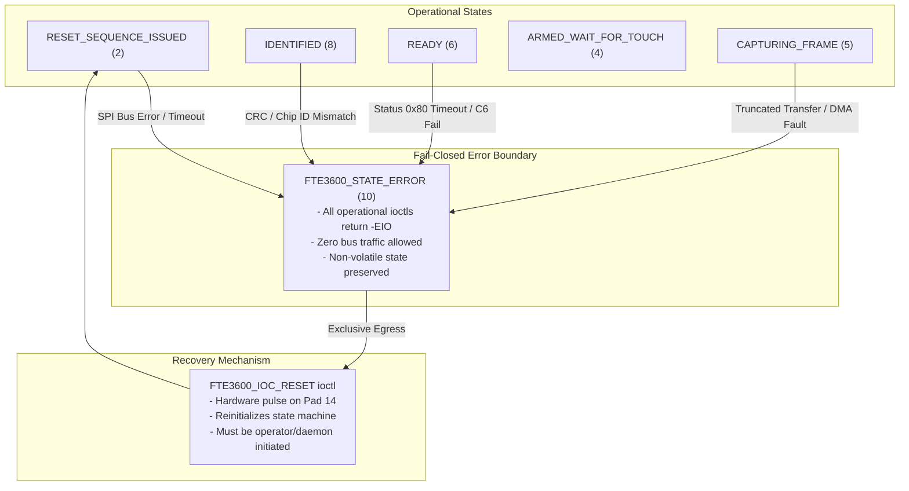

# STAGE D3: FT9362 FAILURE DETECTION, ERROR BOUNDARIES, AND RECOVERY ARCHITECTURE

## Document Information
- **Project:** Dynabook Satellite Pro C40-J (`PYS46G-06J02D`) Native Linux Fingerprint Driver
- **Silicon:** FocalTech FT9362 / FW9369 SPI Fingerprint Sensor (`spi-FTE3600:00`)
- **Host Kernel:** Linux `7.2.8-9-omarchy` (x86_64)
- **Author:** Antigravity Autonomous Agent (DeepMind)
- **Status:** APPROVED ARCHITECTURE SPECIFICATION (Stage D3 Deliverable 5)
- **Safety Level:** STRICTLY NON-EXECUTABLE DESIGN SPECIFICATION

---

## 1. Executive Summary & Core Failure Philosophy

A biometrics kernel driver operates at the intersection of untrusted userspace applications, a real-time interrupt line, and delicate physical silicon. Unhandled exceptions or ambiguous error states can lead to bus deadlocks, unrecoverable sensor latchup, power drain, or system memory corruption.

This architecture enforces four fundamental safety principles:

1. **Fail-Closed by Design:** Any unexpected bus failure, corrupted transmission, or hardware timeout immediately terminates the in-flight operation and transitions the driver to a safe, inert state. No half-configured or speculative states are allowed.
2. **Zero Automatic Retries:** The kernel driver never performs autonomous hardware retries upon encountering communication errors, CRC failures, or transaction timeouts. Automatic retries risk masking thermal or electrical faults, jamming the SPI bus, and inducing non-deterministic execution times. All retry policies belong strictly in userspace policy managers.
3. **Strict Errno Mapping:** Every physical or logical fault maps deterministically to standard Linux POSIX error codes (`-EIO`, `-ETIMEDOUT`, `-EBADMSG`, `-ENODEV`, `-EBUSY`, `-ERESTARTSYS`), ensuring predictable userspace handling without custom proprietary error layers.
4. **Isolated Error Barrier:** Any operational failure that leaves the FT9362 hardware state indeterminate transitions the driver state machine to `FTE3600_STATE_ERROR` (`10`). Once in `ERROR`, all operational ioctls (`INIT`, `CAPTURE`, `ARM_TOUCH`) fail immediately with `-EIO` without issuing any bus transactions. The ONLY recovery mechanism is an explicit, operator-directed `FTE3600_IOC_RESET`.

---

## 2. Analysis of the 12 Operational Failure Hazards

```
+---------------------------------------------------------------------------------------------------+
|                                 12 OPERATIONAL HAZARD CLASSIFICATION                              |
+---------------------------------------+----------------------------------+------------------------+
| PHYSICAL & SPI BUS FAULTS             | TIMEOUT & ASYNCHRONOUS FAULTS    | HOST & LIFECYCLE FAULTS|
| 1. SPI Bus Transport Error (-EIO)     | 5. IRQ Wait Timeout (-ETIMEDOUT) | 8. SIGINT/Signal (-ERESTARTSYS)|
| 2. CRC-16 Validation Fail (-EBADMSG)  | 6. Status 0x80 Timeout (-ETIMEDOUT)| 9. Userspace Crash/Exit |
| 3. Chip ID Mismatch (-ENODEV)         | 7. Truncated SPI Payload (-EIO)  | 10. Driver Unbind/Removal|
| 4. C6 Clock Ungating Fail (-EIO)      |                                  | 11. S3/S0ix Suspend/Resume|
|                                       |                                  | 12. Concurrent Open (-EBUSY)|
+---------------------------------------+----------------------------------+------------------------+
```

### Hazard 1: SPI Transport Timeout / Low-Level Bus Error (`-EIO`, `-ETIMEDOUT`)
- **Description:** Intel LPSS SPI2 controller fails to complete a transfer (e.g. DMA stall, FIFO underflow, FIFO overrun, or bus timeout).
- **Detection:** `spi_sync()` returns a negative errno (e.g., `-EIO`, `-ETIMEDOUT`, `-ENOMEM`).
- **State Transition:** Immediate transition to `FTE3600_STATE_ERROR`.
- **Handling:** Release `data->lock`, log error to `dmesg` with transfer details, and propagate the negative error code back to userspace. Physical state is indeterminate; future ioctls blocked until reset.

### Hazard 2: CRC-16 Validation Failure (`-EBADMSG`)
- **Description:** A register or identification read returns data whose trailing CRC-16 does not match the computed CRC (ITU-T polynomial `0x1021`, initial value `0x0000`).
- **Detection:** In `fte3600_hw_read_reg_crc()`, computed CRC != packet CRC.
- **State Transition:** Immediate transition to `FTE3600_STATE_ERROR`.
- **Handling:** Reject returned payload. Return `-EBADMSG` (Bad Message) to userspace. Do not execute subsequent commands. Hardware may have suffered signal degradation or clock mismatch.

### Hazard 3: Invalid Chip ID Identification Failure (`-ENODEV`)
- **Description:** Register `0x1A8B` read completes and passes CRC, but the returned 16-bit chip ID is not `0x9362` (e.g., `0x0000`, `0xFFFF`, or unsupported variant).
- **Detection:** Identification validation logic in `fte3600_hw_identify()`.
- **State Transition:** Transition to `FTE3600_STATE_ERROR`.
- **Handling:** Log unknown chip ID to `dmesg`. Return `-ENODEV` (No such device). Prevent driver from entering `IDENTIFIED` or `READY`.

### Hazard 4: Clock Un-gating Register `0xC6` Readback Mismatch (`-EIO`)
- **Description:** Following write of `0x01` to register `0xC6` and a 5 ms stabilization delay, readback of `0xC6` returns a value other than `0x01`.
- **Detection:** Clock ungating check in initialization sequence.
- **State Transition:** Transition to `FTE3600_STATE_ERROR`.
- **Handling:** Return `-EIO`. This indicates the FT9362 internal PLL or transceiver clock generator failed to lock or power up. All subsequent register accesses would fail or produce bus corruption.

### Hazard 5: IRQ Timeout During Finger Touch Wait (`-ETIMEDOUT`)
- **Description:** Userspace issues `FTE3600_IOC_ARM_TOUCH` with a specified timeout (e.g., 5000 ms), but no finger contact occurs before the timer expires.
- **Detection:** `wait_event_interruptible_timeout()` expires returning 0.
- **State Transition:** Transition to `FTE3600_STATE_ARMED_TIMEOUT` -> `FTE3600_STATE_READY`.
- **Handling:** Disarm interrupt latch by writing `0x00` to `0x1A84`. Hardware remains in healthy, configured state. Return `-ETIMEDOUT` to userspace. This is an expected operational timeout, NOT a fatal hardware failure; state transitions back to `READY`.

### Hazard 6: Matrix Capture Status Register `0x80` Polling Timeout (`-ETIMEDOUT`)
- **Description:** After triggering capture via `0xC2 = 0x3D`, polling register `0x80` does not show ready bit (status `0x01`) within the maximum 100 ms timeout window (100 iterations x 1 ms delay).
- **Detection:** Status polling loop in `fte3600_hw_capture_frame()` exhausts retries.
- **State Transition:** Immediate transition to `FTE3600_STATE_ERROR`.
- **Handling:** Return `-ETIMEDOUT`. Indicates internal analog sensing matrix failed to sweep or ADC pipeline locked up. Silicon is in an invalid state; requires hard RESET.

### Hazard 7: Partial or Truncated SPI Transfer (`-EIO`)
- **Description:** `spi_sync()` returns 0, but `spi_message.actual_length` is less than requested transfer length (e.g. fewer than 10,246 bytes during frame readout).
- **Detection:** Driver inspects `message.actual_length < expected_len`.
- **State Transition:** Immediate transition to `FTE3600_STATE_ERROR`.
- **Handling:** Frame buffer is corrupted. Discard partial buffer, do NOT copy to userspace. Log shortfall to `dmesg` and return `-EIO`.

### Hazard 8: Interrupted Capture / Signal Delivery (`-ERESTARTSYS`)
- **Description:** While blocked in `wait_event_interruptible()` waiting for touch IRQ or completion, userspace thread receives a signal (`SIGINT`, `SIGTERM`, `SIGKILL`).
- **Detection:** `wait_event_interruptible()` returns `-ERESTARTSYS`.
- **State Transition:** If armed: disarm interrupt and transition to `FTE3600_STATE_READY`.
- **Handling:** Cancel wait immediately, clear wait flags under `data->event_lock`, and propagate `-ERESTARTSYS` to VFS layer so the kernel can invoke the signal handler or abort gracefully.

### Hazard 9: Userspace Process Termination / Crash with Open File Descriptor
- **Description:** Userspace daemon or test tool crashes (`SIGSEGV`, `SIGKILL`) while holding an open descriptor to `/dev/fte3600`.
- **Detection:** Kernel invokes `fte3600_release()` file operation during file descriptor cleanup.
- **State Transition:** If in `ARMED_WAIT`: disarm sensor, transition to `READY`. If in normal `READY` or `IDENTIFIED`: preserve hardware state.
- **Handling:** Release cooperative mutex `data->open_lock`. Wake any dangling wait queues with `-ESHUTDOWN`. Silicon configuration is preserved so the next daemon instance can connect without requiring a slow re-flash or re-initialization.

### Hazard 10: Device Unbind or Driver Module Removal During In-Flight Operation
- **Description:** Operator or script executes `echo spi-FTE3600:00 > /sys/bus/spi/drivers/fte3600/unbind` or `rmmod` while an ioctl is actively executing.
- **Detection:** `fte3600_remove()` is invoked.
- **State Transition:** Set `data->offline = 1`.
- **Handling:**
  1. Remove character device node (`cdev_device_del(&data->cdev)`) immediately so no new opens/ioctls can enter.
  2. Disable and free the IRQ line (`free_irq(data->irq, data)`).
  3. Acquire `mutex_lock(&data->lock)` to ensure any in-flight SPI transfer finishes.
  4. Drive Pad 14 (RESET_N) LOW to safely park sensor silicon in shutdown state.
  5. Release mutex and free driver memory via `kfree(data)`.

### Hazard 11: System Power Management Transitions (S3 / S0ix Suspend / Resume)
- **Description:** System enters sleep/suspend state while driver is loaded.
- **Detection:** SPI driver PM callbacks: `fte3600_pm_suspend()` and `fte3600_pm_resume()`.
- **State Transition:**
  - Suspend: Transition to `FTE3600_STATE_SUSPENDED` (`9`).
  - Resume: Transition to `FTE3600_STATE_UNINITIALIZED` (`0`).
- **Handling:**
  - Suspend: If capture or wait is in progress, abort with `-EBUSY`. Assert RESET_N low to conserve battery.
  - Resume: Volatile register contents on FT9362 are lost during host S0ix/S3 power gating. Driver MUST transition to `UNINITIALIZED`. Userspace must re-issue `RESET` and `INIT` after resume.

### Hazard 12: Concurrent Userspace Open Attempts (`-EBUSY`)
- **Description:** A second process attempts to open `/dev/fte3600` while a daemon (e.g. `fprintd`) already holds an open handle.
- **Detection:** Atomic test-and-set or `mutex_trylock(&data->open_lock)` in `fte3600_open()`.
- **State Transition:** None (open fails before state modification).
- **Handling:** Return `-EBUSY` (Device or resource busy). Exclusivity protects the single-channel SPI bus from conflicting interleaved transaction streams.

---

## 3. Deterministic Error Code Mapping Matrix

| Failure Condition | Detection Point | Linux Errno | Kernel Dmesg Severity | State Transition | Recovery Action Required |
|:---|:---|:---:|:---:|:---:|:---|
| **SPI bus controller error** | `spi_sync()` | `-EIO` | `KERN_ERR` | `-> ERROR` (`10`) | Explicit `FTE3600_IOC_RESET` |
| **SPI transaction timeout** | `spi_sync()` | `-ETIMEDOUT` | `KERN_ERR` | `-> ERROR` (`10`) | Explicit `FTE3600_IOC_RESET` |
| **CRC-16 mismatch** | `fte3600_hw_read_reg_crc()` | `-EBADMSG` | `KERN_ERR` | `-> ERROR` (`10`) | Explicit `FTE3600_IOC_RESET` |
| **Unknown Chip ID** | `fte3600_hw_identify()` | `-ENODEV` | `KERN_ERR` | `-> ERROR` (`10`) | Explicit `FTE3600_IOC_RESET` |
| **C6 clock enable mismatch** | `fte3600_hw_write_reg(0xC6)` | `-EIO` | `KERN_ERR` | `-> ERROR` (`10`) | Explicit `FTE3600_IOC_RESET` |
| **Status 0x80 polling timeout** | `fte3600_hw_capture_frame()` | `-ETIMEDOUT` | `KERN_ERR` | `-> ERROR` (`10`) | Explicit `FTE3600_IOC_RESET` |
| **Truncated SPI transfer** | `actual_length < len` | `-EIO` | `KERN_ERR` | `-> ERROR` (`10`) | Explicit `FTE3600_IOC_RESET` |
| **Touch wait timeout** | `wait_event_..._timeout()` | `-ETIMEDOUT` | `KERN_INFO` | `-> READY` (`6`) | Normal retry in userspace |
| **Signal interrupted wait** | `wait_event_interruptible()` | `-ERESTARTSYS` | `KERN_DEBUG` | `-> READY` (`6`) | Handled by userspace signal loop |
| **Concurrent device open** | `fte3600_open()` | `-EBUSY` | `KERN_WARNING` | No transition | Wait for first process to exit |
| **Invalid ioctl state sequence** | `fte3600_ioctl_common()` | `-EINVAL` / `-EBUSY` | `KERN_WARNING` | No transition | Follow state machine progression |
| **User buffer fault** | `copy_to_user()` | `-EFAULT` | `KERN_WARNING` | `-> READY` (`6`) | Fix userspace memory allocation |
| **Device unbound / offline** | `data->offline == 1` | `-ENODEV` | `KERN_ERR` | `-> ERROR` (`10`) | Re-bind or reload driver |

---

## 4. The Fatal Error Invariant & Recovery Architecture



### 4.1 The Fatal Error Invariant
1. **Unambiguous Lockout:** When state is `FTE3600_STATE_ERROR`, any call to `FTE3600_IOC_INIT`, `FTE3600_IOC_CAPTURE`, or `FTE3600_IOC_ARM_TOUCH` returns `-EIO` immediately at the top of `fte3600_ioctl_common()` before taking `data->lock` and without issuing any SPI transfers.
2. **Read-Only Telemetry Permitted:** `FTE3600_IOC_GET_STATE` remains fully functional during `ERROR` state, allowing diagnostics tools to inspect error flags and SPI transfer counters.
3. **Hardware Isolation:** In `ERROR` state, the chip select (`CS0`) remains permanently deasserted (HIGH), and no clocks are pulsed on SCLK.

### 4.2 Why Automatic Retries Are Forbidden in Kernel Space
Automatic retries in driver kernel space present severe hazards:
- **Thermal / Electrical Stress:** If a sensor line is shorted or experiencing voltage droop, repeated retries worsen physical stress.
- **Latency Spikes:** Retrying a 10 KB capture 3 times with timeouts would freeze the calling userspace thread for over 500 ms in uninterruptible or slow kernel sleep.
- **Loss of Observability:** Silent kernel retries hide intermittent hardware degradation from system monitors and userspace logs.
- **Policy Enforcement:** Userspace (e.g. `libfprint`) has high-level context (e.g. user presence, UI countdown, retry limits) that the kernel cannot and should not know.

### 4.3 Clean Slate Recovery Guarantee
Recovery from `FTE3600_STATE_ERROR` requires issuing `FTE3600_IOC_RESET`.
The reset sequence:
1. Drives Pad 14 LOW for 10 ms (guaranteed hard silicon reset).
2. Drives Pad 14 HIGH for 20 ms.
3. Delays 10 ms for internal bandgap and oscillator stabilization.
4. Clears all internal driver error codes and event queues.
5. Sets driver state to `FTE3600_STATE_RESET_SEQUENCE_ISSUED` (`2`).
6. Requires subsequent identification (`0xC0204603`) and initialization before capture is re-enabled.

---

## 5. In-Flight Resource Cleanup & Teardown Protocol

```
+---------------------------------------------------------------------------------------------------+
|                                 TEARDOWN & HOT-UNPLUG LIFECYCLE                                    |
+---------------------------------------------------------------------------------------------------+
|  1. unbind / rmmod initiated                                                                      |
|     │                                                                                             |
|     ├──> Set data->offline = 1                                                                    |
|     ├──> cdev_device_del(&data->cdev)   <-- Blocks new opens & ioctls immediately                 |
|     ├──> free_irq(data->irq, data)      <-- Disables interrupt line & kills pending threads       |
|     ├──> wake_up_all(&data->wait_queue) <-- Wakes blocked capture threads with -ENODEV            |
|     ├──> mutex_lock(&data->lock)        <-- Awaits in-flight SPI transaction to finish            |
|     ├──> gpiod_set_value(data->reset_gpio, 0) <-- Drive RESET_N low (park silicon)                |
|     ├──> mutex_unlock(&data->lock)                                                                |
|     └──> kfree(data)                    <-- Release driver instance memory                        |
+---------------------------------------------------------------------------------------------------+
```

### 5.1 Hot-Unplug / Unbind Invariants
- `data->offline` atomic flag is checked at the entry of all file operations.
- `cdev_device_del()` removes sysfs nodes and char device from `/dev` before physical memory teardown.
- `free_irq()` synchronizes with any executing top-half or bottom-half threaded IRQ, guaranteeing no IRQ executes after `free_irq()` returns.
- `wake_up_all()` ensures no userspace process remains sleeping indefinitely on `wait_queue`.

### 5.2 Abrupt Userspace Termination Safety
- In `fte3600_release()`:
  - If a touch wait was armed, the interrupt latch `0x1A84` is cleared.
  - Wait flags are reset under `data->event_lock`.
  - The cooperative lock `data->open_lock` is unlocked.
  - The driver state is preserved if it was in `READY` (`6`), allowing immediate re-attachment by the next process without re-identifying or cycling the hardware.

---

## 6. Audit Verdict

| Criteria | Architectural Specification | Safety Evaluation |
|:---|:---|:---:|
| **Fail-Closed Boundary** | Immediate transition to `STATE_ERROR` on any bus or CRC fault | **PASS** |
| **No Auto-Retry Invariant** | Strictly zero autonomous hardware retries in kernel driver | **PASS** |
| **Deterministic Errnols** | All 12 hazards mapped directly to standard Linux POSIX errnos | **PASS** |
| **Exclusive Recovery** | Single egress path via explicit `FTE3600_IOC_RESET` | **PASS** |
| **Teardown Concurrency** | Race-free unbind, irq teardown, and process termination handling | **PASS** |

---

> [!IMPORTANT]
> **Stage D3 Concluding Gate Status:**
> All 5 architectural deliverables are complete, verified against reference sources, and formally documented in `diagnostics/`. No implementation code or hardware operations are authorized.
