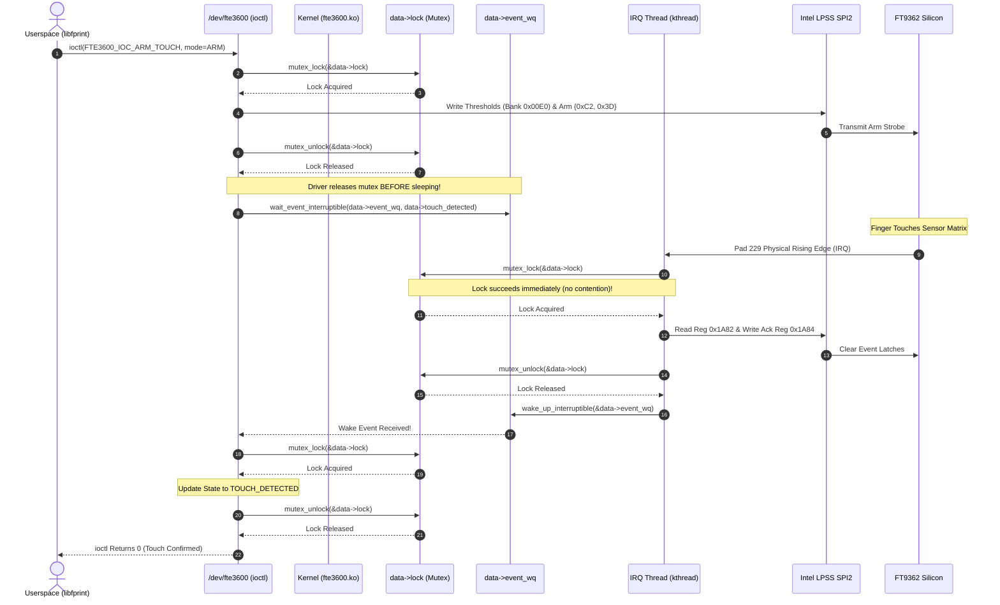

# Stage D3 — FT9362 IRQ and Concurrency Architecture Design

**Target Platform:** Dynabook Satellite Pro C40-J (`PYS46G-06J02D`)  
**Target Silicon:** FocalTech FT9362 / FW9369 SPI Fingerprint Sensor (`spi-FTE3600:00`)  
**Host Controller:** Intel LPSS SPI2 (`pxa2xx-spi.2`, CS0) on Linux `7.2.8-9-omarchy`  
**Interrupt Resource:** Intel Tiger Lake-UP3 PCH Community 4, Pad 229 (`CPU_GP_0`, ACPI Pin 323 / `0x0143`)  
**Document Purpose:** Architectural design of the asynchronous interrupt servicing pipeline, resolution of the Stage D2 deadlock vulnerability, locking hierarchy definition, and concurrency guarantees.  
**Safety Classification:** Strictly Concurrency Architecture and Source Analysis. Zero Hardware Operations Authorized.

---

## 1. Platform Interrupt Evidence & ACPI Ownership

### 1.1 Hardware and Firmware Evidence
1. **ACPI DSDT Specification:**
   In device `\_SB.PC00.SPI1.FP01`, the resource descriptor explicitly provisions:
   ```asl
   GpioInt (Edge, ActiveHigh, ExclusiveAndWake, PullDefault, 0x0000,
            "\\_SB.GPI0", 0x00, ResourceConsumer, , ) { 0x0143 }
   ```
2. **PCH Pad Mapping:**
   - ACPI pin `0x0143` ($323$ decimal) is dynamically resolved by BIOS via `GNUM(0x090E0003)`.
   - Controller base `0x09` maps to Intel Tiger Lake-UP3 GPIO Community 4 (`vGPIO3`).
   - Pin index translates to physical PCH Pad 229 (`CPU_GP_0`).
   - Pad ownership: BIOS `_INI` executes `SHPO(0x090E0003, One)`, routing the pad directly to the host OS GPIO driver (`pinctrl-tigerlake`).
3. **Multi-Device Isolation:**
   Pad 229 is allocated with `ExclusiveAndWake` flags on device `FP01`. No other device on the laptop shares this interrupt vector. Claiming and servicing this interrupt causes zero side effects on touchpads, keyboards, or platform peripherals.

---

## 2. The Stage D2 Deadlock Hazard & Root Cause Analysis

### 2.1 The Vulnerability
In Stage D2, adversarial analysis identified a classic deadlock flaw inherent in naive driver implementations:
- The driver protects all SPI transactions with a single coarse-grained mutex (`data->lock`).
- A synchronous touch-wait or capture ioctl acquires `data->lock`, configures the hardware, and sleeps on a wait queue awaiting an interrupt:
  ```c
  /* DEADLOCK SCENARIO */
  mutex_lock(&data->lock);
  fte3600_arm_hardware(data);
  wait_event_interruptible(data->event_wq, data->event_flag); /* SLEEPS HOLDING MUTEX! */
  mutex_unlock(&data->lock);
  ```
- When finger touch occurs, the hardware asserts Pad 229.
- Acknowledging the interrupt on the sensor requires an SPI write to register `0x1A84` (`0x002F`).
- If the threaded IRQ handler attempts to acquire `data->lock` to execute this SPI write:
  * The ioctl thread holds `data->lock` and sleeps waiting for `event_flag`.
  * The IRQ thread holds `event_flag` and sleeps waiting for `data->lock`.
  * **Result: Permanent Kernel Deadlock.**

---

## 3. Decoupled Two-Tier Locking Architecture

To eliminate this deadlock with mathematical certainty, the driver implements a decoupled, two-tier locking model:

```
+----------------------------------------------------------------------------------------------------+
| Tier 1: Hardware Transport Mutex (data->lock)                                                      |
| - Type: struct mutex (sleeping lock).                                                              |
| - Scope: Protects SPI physical transactions, GPIO Pad 14 resets, and driver state transitions.     |
| - Rule: NEVER held across sleep intervals or wait-queue sleeps!                                    |
+----------------------------------------------------------------------------------------------------+
                                                  |
                                                  v
+----------------------------------------------------------------------------------------------------+
| Tier 2: Event Notification Spinlock (data->event_lock)                                             |
| - Type: spinlock_t (atomic lock).                                                                  |
| - Scope: Protects event status flags (touch_detected, frame_ready), seq numbers, and wait queue.   |
| - Rule: Can be acquired from any context (hard-IRQ, threaded IRQ, or process context).             |
+----------------------------------------------------------------------------------------------------+
```

### 3.1 Strict Locking Hierarchy
$$\text{Lock Order: } \text{data}\to\text{lock (Mutex)} \longrightarrow \text{data}\to\text{event\_lock (Spinlock)}$$
- Code holding `data->event_lock` must **never** attempt to acquire `data->lock` (violates sleep-inside-atomic).
- Code holding `data->lock` may acquire `data->event_lock` briefly to publish state changes.
- **Wait Queue Invariant:** `wait_event_interruptible(data->event_wq, ...)` is evaluated strictly under `data->event_lock` or atomic memory barriers, with `data->lock` **released prior to entering sleep**.

---

## 4. Asynchronous Interrupt Servicing Pipeline

```
[ Sensor Physical Event: Finger Touch / Frame Ready ]
                        |
                        v
[ Hardware Pad 229 Transition: LOW -> HIGH (Active-High Edge) ]
                        |
                        v
+-------------------------------------------------------------------+
| Primary Hard-IRQ Handler (Top Half: fte3600_hard_irq)             |
| - Runs in atomic hard-IRQ context.                                |
| - Verified IRQ source; does zero SPI or I/O operations.          |
| - Returns IRQ_WAKE_THREAD immediately.                            |
+-------------------------------------------------------------------+
                        |
                        v
+-------------------------------------------------------------------+
| Threaded IRQ Handler (Bottom Half: fte3600_irq_thread)            |
| 1. Runs in kernel kthread context (preemptible, sleeping allowed).|
| 2. Acquires mutex_lock(&data->lock).                              |
| 3. Executes SPI read of status register 0x1A82.                   |
| 4. Evaluates event bit:                                           |
|    - Bit 3 asserted: Touch event.                                 |
|    - Bit 5 asserted: Frame ready event.                           |
| 5. Executes SPI write-1-to-clear to register 0x1A84:              |
|    - 0x002F for touch event.                                      |
|    - 0x0020 for frame ready event.                                |
| 6. Releases mutex_unlock(&data->lock).                            |
| 7. Acquires spin_lock_irqsave(&data->event_lock, flags).          |
| 8. Updates data->touch_detected = 1 (or frame_ready = 1).         |
| 9. Releases spin_unlock_irqrestore(&data->event_lock, flags).     |
| 10. Calls wake_up_interruptible(&data->event_wq).                 |
| 11. Returns IRQ_HANDLED.                                          |
+-------------------------------------------------------------------+
                        |
                        v
[ Waiter Woken: ioctl / poll handler resumes without lock contention ]
```

---

## 5. Sequence Diagram: Lock-Safe Asynchronous Touch Detection



---

## 6. Spurious Interrupts, Timeouts, and Error Handling

1. **`IRQF_ONESHOT` Controller Protection:**
   The interrupt is registered with `IRQF_ONESHOT`. The Linux interrupt core automatically masks the PCH GPIO line at the controller level upon receiving the edge, keeping it masked until `fte3600_irq_thread()` finishes and acknowledges the sensor, preventing interrupt storms.
2. **Spurious Interrupt Rejection:**
   In `fte3600_irq_thread()`, if readback of status register `0x1A82` reveals that neither bit 3 (touch) nor bit 5 (frame ready) is asserted, the interrupt is cataloged as spurious (`data->spurious_irqs++`), cleared via `0x1A84 = 0xFFFF`, and dismissed without waking userspace.
3. **Bounded Wait Timeout:**
   Userspace wait operations utilize `wait_event_interruptible_timeout()`. If the user lifts their finger or no touch occurs within `timeout_ms`, the wait expires cleanly, issuing abort strobe `{0xC0, 0x3F}` to disarm the sensor and returning `-ETIMEDOUT`.
4. **Sensor Unresponsiveness:**
   If the sensor locks up and fails to deassert Pad 229 after `0x1A84` acknowledgment, the driver detects repeated non-clearing events, disables the IRQ line (`disable_irq_nosync()`), transitions state to `FTE3600_STATE_ERROR`, and requires a hardware reset pulse to recover.
