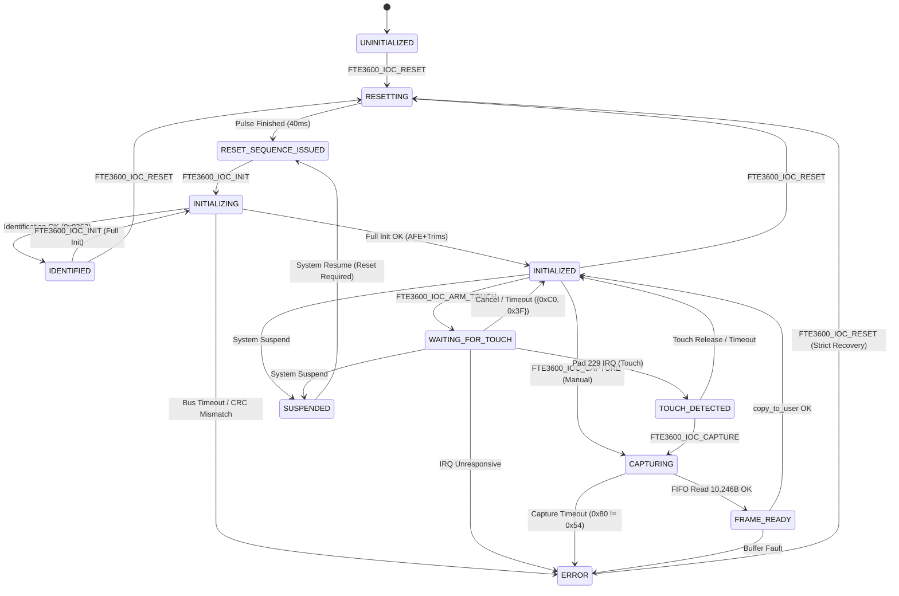

# Stage D3 — FT9362 Kernel State Machine Design

**Target Platform:** Dynabook Satellite Pro C40-J (`PYS46G-06J02D`)  
**Target Silicon:** FocalTech FT9362 / FW9369 SPI Fingerprint Sensor (`spi-FTE3600:00`)  
**Host Controller:** Intel LPSS SPI2 (`pxa2xx-spi.2`, CS0) on Linux `7.2.8-9-omarchy`  
**Current Baseline State:** `fte3600.ko` loaded (`20480 0`), state `8 (IDENTIFIED)`  
**Document Purpose:** Architectural design and formal specification of the 11-state kernel driver state machine, transition invariants, error boundaries, and lifecycle management.  
**Safety Classification:** Strictly Architecture Design and Source Analysis. Zero Hardware Operations Authorized.

---

## 1. Existing Architecture Evaluation

### 1.1 Four-Tier Architecture Breakdown

```
+----------------------------------------------------------------------------------------------------+
| Tier 1: Already Implemented in Kernel Driver (kernel/fte3600.c)                                    |
| - Passive ACPI enumeration, Intel PCH GPIO mapping (Pad 14 reset, Pad 229 IRQ mapping).           |
| - Driver-owned single-client exclusive lease (atomic_cmpxchg on data->is_open).                    |
| - Hardware reset pulse sequence (10 ms settle, 20 ms active-low assert, 10 ms recover).           |
| - Minimal hardware identification (write C6=0x01, wait 4ms, readback C6==0x01, read 0x1A8B, CRC). |
| - Fail-closed error handling (state transitions to UNKNOWN on bus error or CRC mismatch).          |
| - Character device (/dev/fte3600) with GET_STATE, RESET, and INIT (ID-only) ioctl handlers.        |
+----------------------------------------------------------------------------------------------------+
                                                  |
                                                  v
+----------------------------------------------------------------------------------------------------+
| Tier 2: Reference-Library Functionality (research/libfprint-fte3600/)                              |
| - Post-ID wake handshake: Command {0x5A, 0xA5}, poll status 0x80 == 0x50, Command {0xA5, 0x5A}.    |
| - Foundry interrogation: Sense-amp strobes on 0xF1 (idx 3 and 0x13), strobe 0xF4, read 0x9B.       |
| - Volatile AFE baseline tuning: Register 0x1801 (0xFC80 | dac).                                    |
| - Parameter bank protection unlock: Write 0x9A = 0x5A.                                             |
| - Channel trims (bank address 0x00C0) and FDT threshold vector (bank address 0x00E0).             |
| - Touch arm strobe: Command {0xC2, 0x3D}.                                                          |
| - Capture sequence: Mode 0x1800=0x4FFE, trigger {0xC4, 0x3B}, poll 0x80==0x54, FIFO burst {0x06}. |
| - Userspace image processing: Floating-point baseline subtraction, border filter, grayscale norm.  |
+----------------------------------------------------------------------------------------------------+
                                                  |
                                                  v
+----------------------------------------------------------------------------------------------------+
| Tier 3: Proposed Kernel Architecture (Stage D3 Design Scope)                                       |
| - Formal 11-state explicit state machine separating IDENTIFIED from INITIALIZED and CAPTURING.     |
| - Threaded IRQ servicing on Pad 229 (spi->irq) with decoupled spinlock wait queues.                |
| - Transactional UAPI v2 (RESET, INIT, ARM_TOUCH, CAPTURE, GET_STATE, GET_FRAME_INFO).              |
| - DMA-safe 10,246-byte kernel transfer engine with guaranteed CS0 assertion continuity.             |
| - Strict kernel/userspace boundary: kernel delivers raw frames; userspace handles FPU/biometrics. |
+----------------------------------------------------------------------------------------------------+
                                                  |
                                                  v
+----------------------------------------------------------------------------------------------------+
| Tier 4: Uncertain / Unverified Behaviors (Explicitly Identified)                                   |
| - SPI bus operation above 1 MHz (LPSS SPI2 signal integrity at 4 MHz remains unverified).         |
| - Deep low-power hardware autosuspend (wake latency across system S0ix sleep states).             |
| - Die temperature sensitivity on AFE baseline drift during prolonged finger touch.                 |
+----------------------------------------------------------------------------------------------------+
```

---

## 2. Formal 11-State Kernel State Machine

The driver implements an explicit 11-state state machine governing device lifecycle, bus operations, and user interactions.

### 2.1 State Definitions

| State ID | Enumeration Symbol | Physical Hardware Reality | Permitted UAPI Operations |
| :---: | :--- | :--- | :--- |
| **0** | `FTE3600_STATE_UNINITIALIZED` | Device freshly bound or un-reset. Pad 14 HIGH (inactive). Transceiver clock gated (`0xC6 == 0x00`). Silicon unconfigured. | `FTE3600_IOC_GET_STATE`<br>`FTE3600_IOC_RESET` |
| **1** | `FTE3600_STATE_RESETTING` | Transient state: Kernel actively driving Pad 14 LOW ($20\,\text{ms}$ active-low electrical pulse). | `FTE3600_IOC_GET_STATE` |
| **2** | `FTE3600_STATE_RESET_SEQUENCE_ISSUED` | Electrical reset timing pulse completed on PCH GPIO. Sensor power cycled. SPI transceiver clock gated (`0xC6 == 0x00`). Responsiveness unproven. | `FTE3600_IOC_GET_STATE`<br>`FTE3600_IOC_RESET`<br>`FTE3600_IOC_INIT` |
| **3** | `FTE3600_STATE_INITIALIZING` | Transient state: Actively executing SPI identification frames or post-ID AFE parameter programming. | `FTE3600_IOC_GET_STATE` |
| **4** | `FTE3600_STATE_INITIALIZED` | Sensor identified, wake handshake verified, foundry fab decoded, volatile AFE registers and channel trims programmed. In clean idle/standby. | `FTE3600_IOC_GET_STATE`<br>`FTE3600_IOC_RESET`<br>`FTE3600_IOC_ARM_TOUCH`<br>`FTE3600_IOC_CAPTURE` |
| **5** | `FTE3600_STATE_CAPTURING` | Trigger strobe `{0xC4, 0x3B}` issued. Sensor matrix scanning charges. Polling register `0x80 == 0x54` or awaiting frame IRQ. | `FTE3600_IOC_GET_STATE` |
| **6** | `FTE3600_STATE_ERROR` | Fatal error latch: Bus timeout, CRC failure, chip mismatch, or protocol abort. All operations rejected except RESET. | `FTE3600_IOC_GET_STATE`<br>`FTE3600_IOC_RESET` |
| **7** | `FTE3600_STATE_UNKNOWN` | Compatibility alias for unrecoverable hardware state. Exits strictly via `FTE3600_IOC_RESET`. | `FTE3600_IOC_GET_STATE`<br>`FTE3600_IOC_RESET` |
| **8** | `FTE3600_STATE_IDENTIFIED` | SPI transceiver clock un-gated (`0xC6 == 0x01`). Chip ID `0x9362` and CRC `0x1C53` validated. Post-ID AFE and trims unconfigured. | `FTE3600_IOC_GET_STATE`<br>`FTE3600_IOC_RESET`<br>`FTE3600_IOC_INIT` |
| **9** | `FTE3600_STATE_WAITING_FOR_TOUCH` | Threshold vector programmed in bank `0x00E0`. Strobe `{0xC2, 0x3D}` active. Low-power background FDT scan running. Awaiting Pad 229 IRQ. | `FTE3600_IOC_GET_STATE`<br>`FTE3600_IOC_RESET`<br>`poll()` / `select()` |
| **10**| `FTE3600_STATE_TOUCH_DETECTED` | Pad 229 edge detected, threaded IRQ verified bit 3 in `0x1A82`, latch acknowledged via `0x1A84 = 0x002F`. Finger contact confirmed. | `FTE3600_IOC_GET_STATE`<br>`FTE3600_IOC_RESET`<br>`FTE3600_IOC_CAPTURE` |
| **11**| `FTE3600_STATE_FRAME_READY` | 10,246-byte burst FIFO transfer completed without error. 10,240-byte raw pixel payload buffered in kernel DMA memory. Ready for copy. | `FTE3600_IOC_GET_STATE`<br>`FTE3600_IOC_CAPTURE`<br>`FTE3600_IOC_GET_FRAME_INFO` |
| **12**| `FTE3600_STATE_SUSPENDED` | Platform entering S3/S0ix sleep. Background touch scan aborted, IRQ disabled, sensor clock gated. | `FTE3600_IOC_GET_STATE` |

---

## 3. State Transition Matrix

```
+---------------------------------------------------------------------------------------------------------------------------------------------------------------+
| Current State         | Event / Action                | Target State                  | SPI? | GPIO/IRQ? | Prerequisite Condition                             |
+-----------------------+-------------------------------+-------------------------------+------+-----------+----------------------------------------------------+
| UNINITIALIZED         | FTE3600_IOC_RESET             | RESETTING                     | NO   | GPIO OUT  | data->lock held, online == 1                       |
| RESETTING             | Pulse timing finishes         | RESET_SEQUENCE_ISSUED         | NO   | GPIO OUT  | 10ms + 20ms + 10ms completed                       |
| RESET_SEQUENCE_ISSUED | FTE3600_IOC_INIT (ID only)    | INITIALIZING -> IDENTIFIED    | YES  | NO        | C6 write/readback OK, ID 0x9362, CRC 0x1C53        |
| RESET_SEQUENCE_ISSUED | FTE3600_IOC_INIT (Full Init)  | INITIALIZING -> INITIALIZED   | YES  | NO        | Full 32-step sequence successfully completed       |
| IDENTIFIED            | FTE3600_IOC_INIT (Post-ID)    | INITIALIZING -> INITIALIZED   | YES  | NO        | C6 is 1, wake handshake & AFE config OK            |
| INITIALIZED           | FTE3600_IOC_ARM_TOUCH         | WAITING_FOR_TOUCH             | YES  | IRQ EN    | Thresholds written to 0x00E0, Arm strobe 0xC2 0x3D |
| INITIALIZED           | FTE3600_IOC_CAPTURE (Direct)  | CAPTURING                     | YES  | NO        | Mode 0x1800=0x4FFE, Trigger strobe 0xC4 0x3B       |
| WAITING_FOR_TOUCH     | Pad 229 IRQ fires             | TOUCH_DETECTED                | YES  | IRQ IN    | Threaded handler acks 0x1A84 = 0x002F              |
| WAITING_FOR_TOUCH     | Cancel / Close / Timeout      | INITIALIZED                   | YES  | IRQ DIS   | Abort strobe 0xC0 0x3F restores idle               |
| TOUCH_DETECTED        | FTE3600_IOC_CAPTURE           | CAPTURING                     | YES  | NO        | Trigger strobe 0xC4 0x3B                           |
| CAPTURING             | Reg 0x80 == 0x54 + FIFO read  | FRAME_READY                   | YES  | NO        | 10,246 bytes read, length verified, acked          |
| FRAME_READY           | copy_to_user() completes      | INITIALIZED                   | NO   | NO        | Image payload successfully delivered               |
| Any State except RESET| Bus Error / Timeout / CRC Err | ERROR                         | NO   | NO        | Fail-closed invariant                              |
| ERROR / UNKNOWN       | FTE3600_IOC_RESET             | RESETTING                     | NO   | GPIO OUT  | Explicit operator recovery                         |
| Any Operational State | Platform PM Suspend           | SUSPENDED                     | YES  | IRQ DIS   | Abort strobe issued, IRQ disabled                  |
| SUSPENDED             | Platform PM Resume            | RESET_SEQUENCE_ISSUED         | NO   | GPIO OUT  | Reset required on wake                             |
+---------------------------------------------------------------------------------------------------------------------------------------------------------------+
```

---

## 4. Mermaid State Diagram



---

## 5. Architectural Invariants and Safety Boundaries

1. **IDENTIFIED vs INITIALIZED Separation:**
   - `IDENTIFIED` proves solely that the SPI transceiver clock is un-gated (`0xC6 == 0x01`), the bus is responsive, and chip ID `0x9362` was read with matching CRC `0x1C53`.
   - `INITIALIZED` proves that the post-ID wake handshake was verified, foundry fab was decoded (`0xAA`), volatile AFE registers (`0x1801`, `0x1800`, `0x1804`, `0x1807`, `0x1887`, `0x1805`) were programmed, and internal analog trims were written to bank `0x00C0`.
   - A sensor in `IDENTIFIED` cannot capture images or detect touches until transitioned to `INITIALIZED`.

2. **INITIALIZED Does Not Mean Frame Captured:**
   - Reaching `INITIALIZED` configures the baseline analog front end. No physical capacitive charge has been sampled into the FIFO.

3. **FRAME_READY Strict Validation:**
   - `FRAME_READY` is reached **only** after:
     * Status register `0x80 == 0x54` confirmed frame readiness.
     * FIFO readout bit in `0x1800` was enabled.
     * Exactly 10,246 bytes were received via SPI DMA.
     * Completion latch `0x1A84 = 0x0020` was acknowledged.

4. **Fail-Closed ERROR Invariant:**
   - On any bus fault, timeout, or protocol failure, the state machine transitions immediately to `ERROR`.
   - `ERROR` rejects all read, write, arm, and capture ioctl calls with `-EIO` or `-EPERM`.
   - The **only** permitted transition out of `ERROR` is via `FTE3600_IOC_RESET`. Zero automatic retries or recovery loops are permitted in the kernel.
