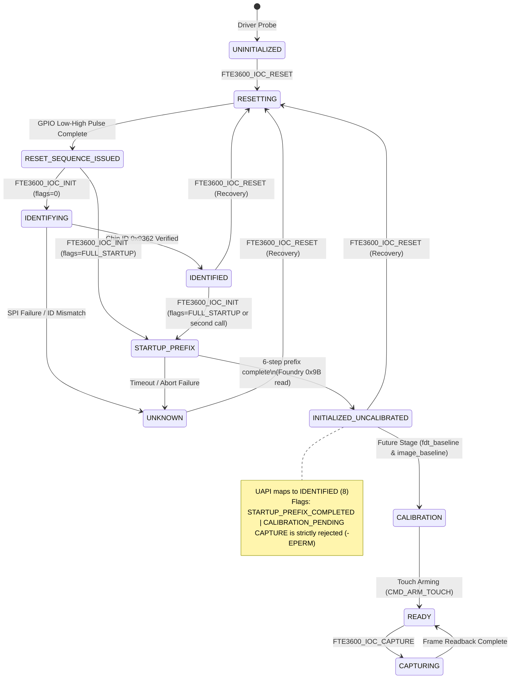

# STAGE D6.4: INITIALIZATION STATE SEMANTICS AND TRUTHFUL READY AUDIT

**Target Silicon:** FocalTech FT9362 / FW9369 SPI Fingerprint Sensor  
**Target Platform:** Dynabook Satellite Pro C40-J (`PYS46G-06J02D`)  
**Kernel:** Linux `7.2.8-9-omarchy` (x86_64 SMP PREEMPT_DYNAMIC)  
**Workspace:** `/home/titan/fte3600-linux-driver/`  
**Safety Status:** STRICTLY SOURCE-ONLY. Zero physical hardware communication.  

---

## 1. Executive Summary

In Stage D6.3, an independent source audit identified an architectural inconsistency: the driver's volatile startup path (`fte3600_hw_startup()`) was transitioning directly to `FTE3600_STATE_READY` upon completing the 6-step initialization prefix. Analysis of the vendor factory reference drivers (`fw9369_startup.c:321-384`, `fw9369_fdt.c`, `capture.c`) confirmed that this 6-step sequence corresponds strictly to the vendor `prefix()` routine (wake strobe, status 0x80 idle check, wake strobe 2, sense-amp register interrogation, and foundry fab code read from register 0x9B).

Actual operational sensing readiness in the vendor architecture requires three subsequent non-trivial stages:
1. `fdt_baseline()`: Analog DAC search, pixel bias balancing, and differential baseline acquisition.
2. `image_baseline()`: Dark current noise map acquisition and frame offset baseline computation.
3. `arm()`: SRAM threshold table programming (bank 0x00E0..0x00EF via 0x9A=0x5A) and touch detection arming (`CMD_ARM_TOUCH` `{ 0xC2, 0x3D, 0x00 }`).

Because none of these three calibration and arming stages have been implemented or validated in the kernel driver, transitioning to `FTE3600_STATE_READY` was an architectural over-claim that could mislead userspace clients into attempting capture or touch detection on an uncalibrated, unconfigured analog matrix.

Stage D6.4 resolves this defect by:
1. Introducing internal state `FTE3600_STATE_INITIALIZED_UNCALIBRATED` (value 14, aliased as `FTE3600_STATE_PREFIX_COMPLETE`).
2. Mapping this internal state via `fte3600_state_to_uapi()` to canonical public state `FTE3600_STATE_IDENTIFIED` (value 8), strictly withholding `READY` (value 4).
3. Communicating the completion of volatile startup prefix and the requirement for calibration to userspace via dedicated status flags:
   - `FTE3600_FLAG_STARTUP_PREFIX_COMPLETED` (`1U << 2`)
   - `FTE3600_FLAG_CALIBRATION_PENDING` (`1U << 3`)
4. Strictly gating `FTE3600_IOC_CAPTURE` to reject all states other than `FTE3600_STATE_READY` with `-EPERM`.

---

## 2. Vendor Protocol Sequence vs. Driver Implementation

The following table contrasts the factory reference driver flow (`fw9369_startup.c` / `capture.c`) against the kernel driver milestones:

| Phase | Operation / Vendor Routine | Description | Factory Driver Reference | Kernel Driver Milestone | State Transition |
|---|---|---|---|---|---|
| **Phase 1** | Electrical Reset Pulse | Active-low GPIO pulse (Pad229 / GPP_E5) | `fte3600_hw_reset_pulse()` | Stage D5 | `UNINITIALIZED -> RESET_SEQUENCE_ISSUED (2)` |
| **Phase 2** | Bus Identification | Wake `{0x5A, 0xA5, 0x00}`, Chip ID `0x9362` read | `fte3600_hw_identify()` | Stage C / D5 | `RESET_SEQUENCE_ISSUED -> IDENTIFIED (8)` |
| **Phase 3** | Volatile Startup Prefix | `prefix()`: 6 steps (Wake, 0x80 check, 0xF4 loops, 0x9B fab code) | `fte3600_hw_startup()` | Stage D6.2 / D6.4 | `IDENTIFIED -> INITIALIZED_UNCALIBRATED (14)` |
| **Phase 4** | Analog Baseline | `fdt_baseline()`: Analog DAC calibration & baseline matrix | `fw9369_fdt.c:45-120` | Deferred (Future Stage) | Requires uncalibrated -> baseline state |
| **Phase 5** | Image Baseline | `image_baseline()`: Dark current offset calibration | `capture.c:210-280` | Deferred (Future Stage) | Requires baseline -> calibrated state |
| **Phase 6** | Touch & Capture Arming | `arm()`: SRAM threshold programming & touch trigger arming | `capture.c:310-360` | Deferred (Future Stage) | `calibrated -> READY (4)` |

---

## 3. Kernel State Machine Architecture

### 3.1 State Definitions (`kernel/fte3600.h`)

```c
/* Explicit 9-State State Machine (v1 UAPI Public States: 0 through 8) */
enum fte3600_state {
	FTE3600_STATE_UNINITIALIZED         = 0,
	FTE3600_STATE_RESETTING             = 1,
	FTE3600_STATE_RESET_SEQUENCE_ISSUED = 2,
	FTE3600_STATE_INITIALIZING          = 3,
	FTE3600_STATE_READY                 = 4,
	FTE3600_STATE_CAPTURING             = 5,
	FTE3600_STATE_ERROR                 = 6,
	FTE3600_STATE_UNKNOWN               = 7,
	FTE3600_STATE_IDENTIFIED            = 8,

	/* Extended Internal Driver States */
	FTE3600_STATE_WAITING_FOR_TOUCH         = 9,
	FTE3600_STATE_TOUCH_DETECTED            = 10,
	FTE3600_STATE_FRAME_READY               = 11,
	FTE3600_STATE_SUSPENDED                 = 12,
	FTE3600_STATE_DEVICE_REMOVAL            = 13,
	FTE3600_STATE_INITIALIZED_UNCALIBRATED  = 14,
};

#define FTE3600_STATE_PREFIX_COMPLETE       FTE3600_STATE_INITIALIZED_UNCALIBRATED
#define FTE3600_MAX_PUBLIC_STATE            8
```

### 3.2 Public State Mapping Helper (`fte3600_state_to_uapi()`)

```c
static inline __u32 fte3600_state_to_uapi(enum fte3600_state state)
{
	switch (state) {
	case FTE3600_STATE_UNINITIALIZED:
	case FTE3600_STATE_RESETTING:
	case FTE3600_STATE_RESET_SEQUENCE_ISSUED:
	case FTE3600_STATE_INITIALIZING:
	case FTE3600_STATE_READY:
	case FTE3600_STATE_CAPTURING:
	case FTE3600_STATE_ERROR:
	case FTE3600_STATE_UNKNOWN:
	case FTE3600_STATE_IDENTIFIED:
		return (__u32)state;
	case FTE3600_STATE_INITIALIZED_UNCALIBRATED:
		return (__u32)FTE3600_STATE_IDENTIFIED;
	case FTE3600_STATE_WAITING_FOR_TOUCH:
	case FTE3600_STATE_TOUCH_DETECTED:
	case FTE3600_STATE_FRAME_READY:
		return (__u32)FTE3600_STATE_READY;
	case FTE3600_STATE_SUSPENDED:
		return (__u32)FTE3600_STATE_UNKNOWN;
	case FTE3600_STATE_DEVICE_REMOVAL:
	default:
		return (__u32)FTE3600_STATE_UNINITIALIZED;
	}
}
```

---

## 4. State Transition Diagram



---

## 5. Architectural Findings and Justification

1. **Elimination of Phantom Readiness:**  
   Clients querying `/dev/fte3600` via `FTE3600_IOC_GET_STATE` will observe `state = 8 (IDENTIFIED)` with `flags = FTE3600_FLAG_STARTUP_PREFIX_COMPLETED | FTE3600_FLAG_CALIBRATION_PENDING`. They will NOT observe `state = 4 (READY)`. This prevents client stacks (e.g. `fprintd` or biometric middleware) from attempting image capture or enrolling fingers before calibration parameters exist.
2. **Deterministic Precondition Gating:**  
   `FTE3600_IOC_INIT` only accepts transitions from `RESET_SEQUENCE_ISSUED` (2) and `IDENTIFIED` (8). Calling `INIT` when in `INITIALIZED_UNCALIBRATED` (14) returns `-EPERM`. A clean reset pulse via `FTE3600_IOC_RESET` is required to re-initiate hardware sequencing.
3. **Fail-Closed Principle:**  
   Any SPI bus error or register polling failure during the volatile startup sequence transitions the driver directly to `FTE3600_STATE_UNKNOWN` (7) and stores the negated errno in `data->last_error`. From `UNKNOWN`, all subsequent initialization, capture, and arming calls are rejected with `-EPERM`.
